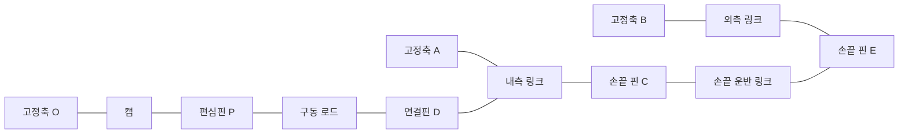

# FreeCAD 집게의 명목 연동

원본의 `Pinc_Cam`은 원판의 두 편심핀으로 구동 로드를 당기고 미는 형상이다.
저장된 BREP에서 편심핀, 로드 양 끝, 고정판과 손끝 링크의 공통 원통축을
찾아 두 개의 폐쇄 링크를 구성했다. 캠 외곽면과 가상의 접촉 법칙을 맞추지 않고
핀 중심 간 거리를 사용한다. 실물 구속이나 조립 공차를 측정한 결과는 아니다.

## 확인한 연결

손가락마다 아래 점을 사용한다. 좌표와 근거 면 번호는
[`freecad_kinematics.json`](../config/geometry/freecad_kinematics.json)의
`gripper_linkages`에 보존한다. 부품 구분은
[`freecad_gripper_structure.json`](../config/geometry/freecad_gripper_structure.json)에 둔다.

| 점 | 공통 축을 갖는 부품 | 역할 |
|---|---|---|
| O | Cam, CamHorn, servo | 캠 회전축 |
| P | Cam, Driving_Rod | 캠 편심핀 |
| D | Driving_Rod, Internal_Rod | 구동 로드와 내측 링크 연결 |
| A | Internal_Rod, Top_Plate, Bottom_Plate | 내측 링크의 고정축 |
| B | External_Rod, Top_Plate, Bottom_Plate | 외측 링크의 고정축 |
| C | Internal_Rod, Distal_Rod | 내측 링크와 손끝 운반 링크 연결 |
| E | External_Rod, Distal_Rod | 외측 링크와 손끝 운반 링크 연결 |



캠과 혼은 중앙 축 외에 네 체결 구멍의 축도 일치한다. 이를 명목 강체 회전으로
묶었다. 좌우 집게 각각의 두 손가락에서 추출한 주요 거리는 다음과 같다.

| 거리 | CAD 값 |
|---|---|
| 편심 반경 OP | 11 mm |
| 구동 로드 PD | 약 32.64768 mm |
| 내측 링크의 구동점 AD | 약 21.26447 mm |
| 내측 AC, 외측 BE | 각각 40 mm |
| 고정축 간격 AB, 손끝 핀 간격 CE | 각각 11.5 mm |

AC와 BE의 벡터, AB와 CE의 벡터가 각각 일치하여 저장된 자세에서 평행사변형을
이룬다. 두 편심핀의 벌어진 각도는 180°가 아니라 178.68°다. 대칭 오차인지
의도한 위상인지 확정하지 않고 원본 좌표를 그대로 사용한다. 따라서 두 손가락의
움직임을 강제로 같은 각도로 만들지 않는다.

## 계산과 모델 반영

입력은 각 손의 `cad_delta_right_gripper_cam`, `cad_delta_left_gripper_cam`이다.
저장된 자세에서 캠이 회전한 변화량이며 물리 영점이나 servo encoder 값이 아니다.

1. O를 중심으로 P를 회전한다.
2. A 중심의 반경 AD 원과 P 중심의 반경 PD 원의 교점으로 D를 구한다.
3. 내측 링크를 강체 회전하여 C를 구한다.
4. C 중심의 반경 CE 원과 B 중심의 반경 BE 원의 교점으로 E를 구한다.
5. 내측, 외측, 구동 로드와 손끝 운반 링크의 상대 회전을 계산한다.

교점 두 개 중 저장된 조립 자세와 같은 방향의 해를 유지한다. 원이 만나지
않거나 접선 상태로 해가 합쳐지면 오류로 처리한다. 해를 바꾸거나 링크 길이를
수정해서 계속 움직이지 않는다. 이 오류 조건은 기하학적 계산 영역이며 실제
사용 가능 각도나 안전 한계가 아니다.

한 손에 캠 1개와 종속 회전 8개를 추가했다. 전체 미리보기는 34개 회전 좌표이며
독립 입력은 기존 16개와 캠 2개를 합한 18개다. 종속 좌표 16개는
`resolved_deltas()`가 계산한다. URDF에는 비선형 폐쇄 링크를 선형 `mimic`으로
대체하지 않았다. ROS에 상태를 공급할 때도 해석된 좌표들을 함께 제공해야 하며,
종속 관절을 독립적으로 움직이면 링크 폐쇄가 깨진다.

MuJoCo는 이 FK 결과로 34개 mocap body를 배치한다. 실제 접촉·구동·관성으로
링크를 강제하는 동역학 모델은 아니며 actuator와 추정 질량은 추가하지 않았다.

## 아직 확정하지 않은 것

| 항목 | 상태 |
|---|---|
| 캠 물리 영점, encoder 부호, 모터 ID와 가동 범위 | null 유지 |
| 실물 각도와 개구 폭의 보정 곡선 | null 유지; 명목 링크 위치 계산과 구분 |
| 캠 편심핀의 178.68° 배치 의도 | 추가 확인 필요; 180°로 수정하지 않음 |
| 핀 유격, 마찰, 체결 상태, 탄성, 접촉 힘 | 모델링하지 않음 |
| 팁의 실제 체결력·탄성·유격 | CAD 맞물림은 명목 고정 결합으로 반영. 나사·재질 조건은 실물 확인 필요 |
| 물체 접촉 뒤 정지, 패드 변형과 유지력 | 실물 시험 필요 |

구동 로드와 내·외측 링크의 핀 연동은 모델에 반영했지만,
`gripper_actuation=false`는 유지한다. 기존 실물 집게의 닫힘 tick과 접촉 판정
기준을 새 집게로 복사하지 않는다.

[팁 체결과 회전 간섭 분석](freecad-tip-mounts.md)에서 네 팁의 공통 체결축과
양방향 강체 회전 간섭을 확인했다. 팁은 운반 링크 아래의 네 고정 자식 링크로
분리했으며 회전 좌표나 독립 입력은 추가하지 않았다.

덮개를 숨긴 연동 GIF는 다음 명령으로 만든다. `-25`는 표시용 변화량 예시다.
출력 JSON은 독립 입력과 계산된 전체 관절 변화량을 함께 기록한다.

```bash
python3 tools/validation/preview_freecad_kinematics.py \
  --delta cad_delta_right_gripper_cam=-25 --focus-gripper right \
  --output /tmp/cleany-gripper.gif
```
