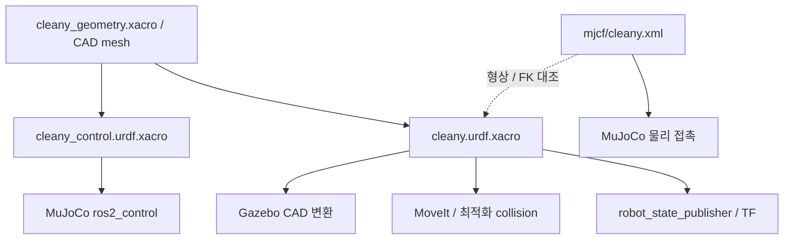

# 로봇 모델과 실행 backend

URDF와 MJCF는 TF, MoveIt, simulator가 공유하는 로봇 형상을 정의한다. CAD 치수와 관성 추정은 실물 보정값과 구분한다.



## Use

빌드한 overlay를 source한 뒤 전체 description을 발행한다.

```bash
ros2 launch cleany_description description.launch.py use_sim_time:=true
```

패키지 디렉터리에서는 control description을 확장할 수 있다.

```bash
xacro urdf/cleany_control.urdf.xacro   mujoco_model:=/absolute/path/to/control_scene.xml headless:=true
```

| 구성 | 옵션 / 제어 범위 |
|---|---|
| 전체 이동 로봇 | head와 continuous wheel joint 기본 포함 |
| 고정 팔 MoveIt | `include_head_camera:=false include_wheel_joints:=false`; wheel 형상은 fixed link로 유지 |
| arm control | 양팔 각 5관절 position command + position/velocity state |
| gripper | 양쪽 state는 항상 제공; command는 `enable_gripper_command:=true`로 선택 |
| base / head / passive roller | 이 arm control 계약 밖 |

## Files

| 진입점 | 고유 역할 |
|---|---|
| `urdf/cleany_geometry.xacro` | backend 중립 canonical geometry |
| `urdf/cleany.urdf.xacro` | plugin 없는 TF/MoveIt 모델 |
| `urdf/cleany_control.urdf.xacro`, `cleany_mujoco_ros2_control.xacro` | MuJoCo hardware 확장 |
| `urdf/head_camera.xacro` | 물리 장착과 선택적 measured RGB optical transform |
| `mjcf/cleany.xml` | simulator scene이 include하는 물리 모델 |
| `test/test_model_parity.py` | joint, motor geometry와 randomized FK 대조 |

## Model contract

| 항목 | 계약 |
|---|---|
| 축 | REP-103: base +X 전방, +Y 좌측, +Z 위; wheel 축 +Y. Optical +X 오른쪽, +Y 아래, +Z 전방 |
| 베이스 | wheelbase 0.35 m, track 0.6038 m, radius 0.0635 m |
| 바퀴 | URDF는 500 g rigid assembly; 48개 passive roller joint는 MJCF만 |
| TCP | `${side}_gripper_frame`의 `(0, −0.100, 0)` m |
| wrist roll | local −Y와 TCP offset 공선; analytical roll 보정이 이 전제에 의존 |
| head / wrist 보정 | nominal 기본. `jetson_20261009`는 provisional measured RGB/손목 optical; depth는 nominal 유지 |
| 질량 | 총 15.933871 kg 추정; 배터리 5.20 kg, 195×165×175 mm와 PG42 각 0.8 kg 포함 |

보정 프로필은 [모델 계약](model.md)과 [캘리브레이션](../../../../docs/CALIBRATION.md)을 따른다. Simulation GT wrist edge는 실측 프로필과 별개다.

## CAD 장착과 모델 대조

| 검사할 위치 | 현재 기준 / 허용 |
|---|---|
| 왼팔 shoulder origin | `(0.116200343, 0.196231727, 0.447797)` m, base_link |
| 오른팔 shoulder origin | `(0.116200838, −0.196177072, 0.447797)` m, base_link |
| arm base 체결 | CAD 원형 마운트 4개 구멍축의 XY 오차 ≤0.01 mm |
| motor 배치 | 상완 `(0, 0.05, 0)`, 하완 `(0, 0, 0.05)` m, 나머지 3개 zero; CAD rounding 허용 2e-6 m |
| moving jaw | joint RPY `(pi, 0, 3.33)`와 CAD 약 21.59° mesh 보상 함께 적용 |
| randomized FK | 양팔, fixed/moving jaw, TCP, head; rounded MJCF 각도의 parity 허용 1e-5 |
| 고정 조립체 관성 | MJCF chassis/Base/Base_2의 원본 fullinertia를 평행축 합성; 절대 오차 1e-9 |

URDF와 MJCF가 같은 잘못된 위치를 공유하는 경우를 막기 위해 체결축 검사는 CAD 원본을 직접 대조한다. 높이·회전과 수치는 CAD 정렬이며 실물 측정이 아니다.

양팔 motor CAD 5개씩은 visual과 URDF collision에 포함한다. RGB-D self-filter가 collision 형상을 쓰므로 누락하면 자기 표면이 OctoMap에 남는다. Fixed-jaw motor는 MJCF에서 visual-only지만 URDF에는 collision이 있다.

V8 손목 mount는 각 6 visual과 15 collision primitive이며 optical TF와 독립된 rigid geometry다. 렌즈 중심/CV축은 MJCF camera/site/body와 nominal sorting 설정이 공유한다. Renderer의 −Z 보기 규약에는 optical Y/Z를 반전한다. 실측 Jetson 프로필은 별도로 관리한다.

### Head와 제어 예외

| 옵션 / 경계 | 동작 |
|---|---|
| `include_head_camera:=false` | 고정 기둥 `top_base_link/top_base_joint`는 유지; 움직이는 head 전체 충돌에는 별도 joint feedback 필요 |
| MJCF head 내부 접촉 | `top_base_link`–`head_tilt_link` 한 쌍만 제외; 외부 환경 충돌 유지 |
| `scheduled_cameras`, `efficient_viewer` | 기본 false; observer scheduler와 같은 worker GUI. Efficient GUI 선택 시 vendor headless=true |
| `mujoco_hardware_plugin` | 기본 `MujocoSystemInterface`; sorting은 `ObservedMujocoSystem`으로 잠금 평가 snapshot 추가 |
| actuator | 기존 servo 14개와 PG42 전압 4개. MuJoCo 3.4 backend는 임시 scene의 wheel actuator만 제거 |

카메라 scheduling은 mount geometry를 바꾸지 않으며 parser에는 소문자 true/false를 전달한다. Head 내부 접촉 제외는 CAD 근사 예외로 실물 간섭 부재의 보장은 아니다.

## Gazebo navigation adapter

Gazebo는 Xacro/sdformat으로 CAD 모델을 가져오고 설정된 park angle에서 팔과 head를 고정한다. 구동 wheel 4개와 Gazebo sensor/메카넘 접촉 근사를 추가하며 원본 movable joint 계약은 유지한다. [Gazebo 실행](../../../../docs/how-to/simulation.md)을 따른다.

## 선택적 충돌 메시 평면화

| 모델 선택 | 적용 |
|---|---|
| optimized_arm_collision_meshes=true 기본 | 팔 / motor / head / mast 경량 collision mesh |
| head_collision_meshes=true 기본 | Head 충돌 형상 포함 |
| Gazebo CAD / MoveIt | 공통 URDF 최적화 collision 사용 |
| MuJoCo 물리 접촉 | mjcf/cleany.xml 기존 형상 유지 |
| 원본 URDF↔MJCF 대조 | 위 두 옵션 false 명시 |
| 기본 계획 모델 검사 | 원본과 visual / inertia / joints 동일 확인 |
| 유지 자산 | 시각 모델, 관성, 관절, 원본 CAD |

| 대상 | `true`일 때의 형상 |
|---|---|
| 양팔의 상완, 하완, 연결부와 모터 11종 | `meshes/collision/`의 평면 메시, 좌우 합계 22개 인스턴스 |
| 머리와 마스트 CAD 6종 | `head_collision_meshes=true`이고 해당 링크가 포함될 때 경량 메시 적용 |
| 집게의 기존 볼록 메시 5종 | 이미 12–24개 삼각형으로 구성되어 원본 유지 |
| box, cylinder, sphere primitive | 기존 해석적 형상 유지 |

외접 메시의 각 조각은 담당하는 원본 표면 조각을 포함한다. 하완 포크, 어깨와 손목 연결부,
하완 모터, 마스트와 머리 브래킷은 먼저 평면으로 나누고 떨어진 표면 조각을
분리한다. 이후 각 조각을 지지 평면으로 감싸 불필요한 둥근 모서리와 작은
구멍을 단순화한다.
분할 축과 위치는 `configs/robot/arm_collision_meshes.json`의
`partition_components`에서 원본 메시 좌표계의 미터 단위로 지정한다.
밀리미터 CAD의 단위 변환은 `mesh_scales`가 관리한다.

`enclosure_variants`는 각 조각의 축 선택과 불필요한 지지 평면 제거 방식을
기록한다. STL의 float32 좌표로 반올림한 뒤 볼록 면을 다시 구성하고 원본
포함 및 팽창 상한을 검사한다. 최종 STL의 각 면도 같은 볼록 경계를 이루는지
검사해, 정점의 볼록 외피만 맞고 실제 삼각형은 안으로 접히는 경우를 막는다.

팽창 상한 1mm는 **분할 조각의 볼록 외피**를 기준으로 한다. 오목한 CAD
표면과의 거리 상한이 아니며, 조각 내부의 작은 빈 공간은 메워질 수 있다.
MoveIt은 `cleany/SolidFCL`로 닫힌 볼록 조각을 내부가 채워진 형상으로 읽는다.
삼각형 표면을 가로지르지 않고 조각 안에 완전히 들어간 작은 장애물도 검출한다.
외접 포함 조건뿐 아니라 실제 서비스의 내부 장애물 검출과 원본 CAD 대조를
검사한다. Gazebo와 MuJoCo의 물리 엔진에 이 MoveIt 플러그인을 적용하는 것은 아니다.

`make test-description-models`는 원본 모델의 MuJoCo 동등성, 기본 계획 모델의
공통 정보 보존과 최적화 자산을 검사한다. `test_collision_meshes.py`는 모든 출력 메시의 실제 STL 좌표에서 포함과 팽창
상한, 폐곡면, 분할된 포크의 틈, 단위와 Xacro 적용 범위를 검사한다.
재생성은 `python3 tools/optimize_arm_collision_meshes.py --write`를 명시적으로
실행하며, `--write`가 없으면 생성 결과와 저장된 자산의 일치를 확인한다.

## Integration regression scope

| 검사 | 확인 / 제외 |
|---|---|
| `make test-description-models` | geometry, color, mass, joint, randomized FK, optical transform, 최적화 자산 |
| 원본 parity | 두 URDF 모두 `include_wheel_joints:=false`; collision 최적화 false를 명시 |
| 전체 연결 | 동작 가능한 X display에서 `make test`; controller/planning/hand-eye 포함 |
| 별도 검증 | 실제 보정, Jetson 성능, navigation, 접촉 유지와 전체 수거 |

모델 일치가 모든 motion fixture나 물리 실행 성공을 보장하지 않는다. 검사 범위는 [테스트 참조](../../../../docs/reference/testing.md)를 따른다.
