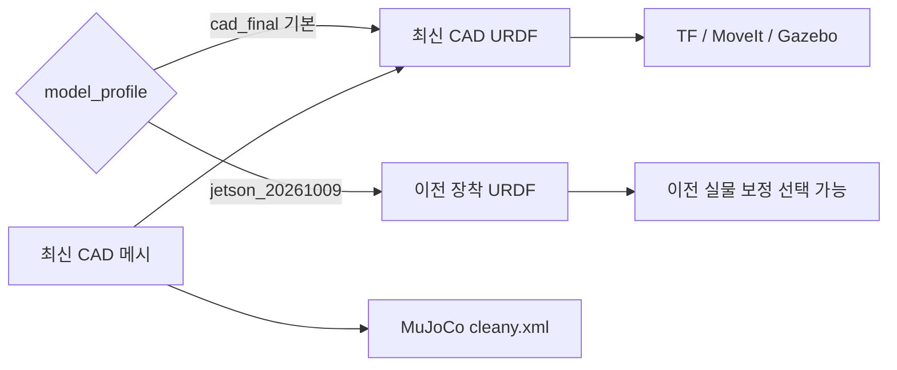
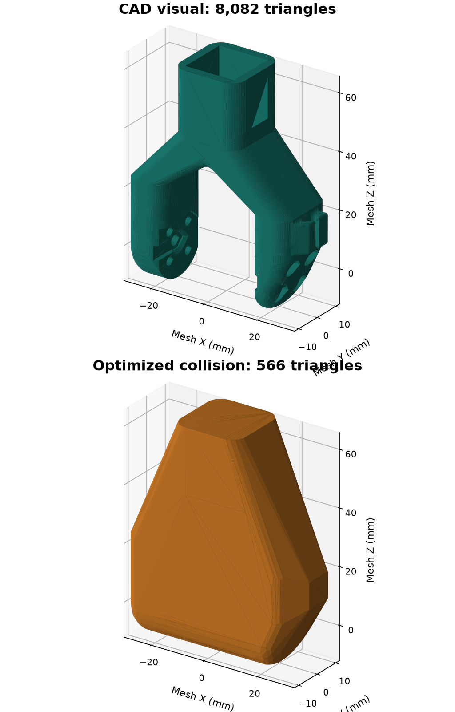

# 모델 실행과 검증

기본 `cad_final`과 이전 실물 장착 `jetson_20261009`를 명시적으로 구분합니다. [모델 계약](model.md)은 형상과 좌표를, 이 문서는 실행과 재생성을 관리합니다.



이전 실물 장착의 관절, 관성 및 센서 계약은 [이전 모델 reference](legacy-model-runtime.md)를 따릅니다.
`model_variant`는 `freecad_final` 정적 미리보기, `freecad_kinematic` 상대 관절 미리보기,
`legacy_runtime` xacro 실행 경로를 선택합니다. 기본 xacro 경로에서는 `model_profile`이
`cad_final` 또는 `jetson_20261009` 형상을 선택합니다.

## 실행

```bash
ros2 launch cleany_description description.launch.py model_profile:=cad_final
```

이전 실물 보정과 형상을 함께 선택합니다.

```bash
ros2 launch cleany_description description.launch.py \
  use_sim_time:=false model_profile:=jetson_20261009 \
  calibration_profile:=jetson_20261009
```

| 진입점 | 역할 |
|---|---|
| `urdf/cleany.urdf.xacro` | 기본 최신 모델; head와 wheel joint 포함 |
| `urdf/cleany_control.urdf.xacro` | 최신 팔 제어 모델; 그리퍼는 읽기 전용 |
| `mjcf/cleany.xml` | 기본 MuJoCo scene 원본 |
| `mjcf/cleany_jetson_20261009.xml` | 이전 모델의 독립 실행과 회귀 검사 |
| MoveIt `move_group.launch.py` | 최신 모델 기본; 이전 프로필은 해당 이전 joint limits와 함께 선택 |

`include_head_camera:=false`여도 고정 마스트는 남습니다. `include_wheel_joints:=false`는 wheel 형상과 고정 연결을 유지합니다. 최신 링크형 그리퍼에 `enable_gripper_command:=true`를 전달하면 실행을 거부합니다. 링크 기구 검증 전에는 집기 성공을 평가할 수 없습니다.

## 충돌 형상

<figure class="contract-figure" data-visual-id="collision-shape">

<figcaption>같은 최신 CAD 부품의 visual과 부품별 convex collision입니다. 구멍과 오목한 빈 공간은 충돌 외피에서 메워질 수 있습니다. <a href="../../../../docs/assets/visuals/generated.json">입력과 출처</a></figcaption>
</figure>

| 형상 | 사용과 한계 |
|---|---|
| `meshes/cad_final/` | CAD visual; 저장된 BREP를 0.15 mm deflection으로 삼각화 |
| `meshes/cad_final/collision/` | 부품별 볼록 외피를 포함하는 단순화 메시; 원본 볼록 외피 대비 최대 확장 0.25 mm, 서로 다른 링크를 합치지 않음 |
| LiDAR | 원본 23개 solid로 분리; STL별 200,000 triangle 제한 준수 |
| MoveIt | `cleany/SolidFCL`의 내부 장애물 검사 |
| MuJoCo wheel | 기존 48개 passive roller 접촉 근사와 500 g 질량 유지 |
| 이전 프로필 | `optimized_arm_collision_meshes`, `head_mast_rear_gap_m` 옵션과 v8 형상 유지; 최신 CAD의 마스트 위치는 고정 |

## 재생성과 검증

별도 Python 환경에 `cadquery-ocp`, `numpy`, `scipy`를 준비하고 ROS overlay를 source합니다. 입력 CAD는 팀이 공유하는 원본을 지정합니다. Exporter는 URDF, MJCF, 부품별 메시, 등록 JSON과 MuJoCo 손목 TF 설정을 함께 갱신합니다.

```bash
xacro ros2_ws/src/cleany_description/urdf/cleany.urdf.xacro \
  model_profile:=jetson_20261009 > /tmp/cleany-legacy.urdf
python3 tools/models/export_cad_model.py /path/to/Cleany-final.FCStd \
  --legacy-urdf /tmp/cleany-legacy.urdf
make test-description-models
```

| 검사 | 확인 범위 |
|---|---|
| 최신 CAD 등록 | 308개 원본 부품, 입력/출력 해시, 조립 자세에서 CAD 경계 복원 |
| 최신 URDF ↔ MJCF | 여러 관절 자세의 축과 원점, 렌즈 배치, 물리 step의 유한성 |
| 프로필 분리 | 새 형상에 이전 보정 적용 거부, 미구현 그리퍼 구동 거부 |
| Gazebo 실행 | 이전/최신 모델의 주행, LiDAR, IMU, TF와 영상 수신; 최신 navigation 모델은 head RGB-D만 포함 |
| 이전 모델 회귀 | 기존 FK, 광학축, 질량과 최적화 충돌 메시 검사 유지 |

Gazebo 실행 검사는 EGL headless 렌더링을 사용하며 명시적으로 실행합니다.

```bash
python3 -m pytest -q -s \
  ros2_ws/src/cleany_gazebo_sim/test/test_runtime_simulation.py \
  ros2_ws/src/cleany_gazebo_sim/test/test_runtime_rendering_sensors.py \
  --run-sim-runtime -k cad_frame
```

실물 보정, 새 질량·관성, 링크형 그리퍼 운동학과 전체 수거 성공은 이 검사 범위 밖입니다.
