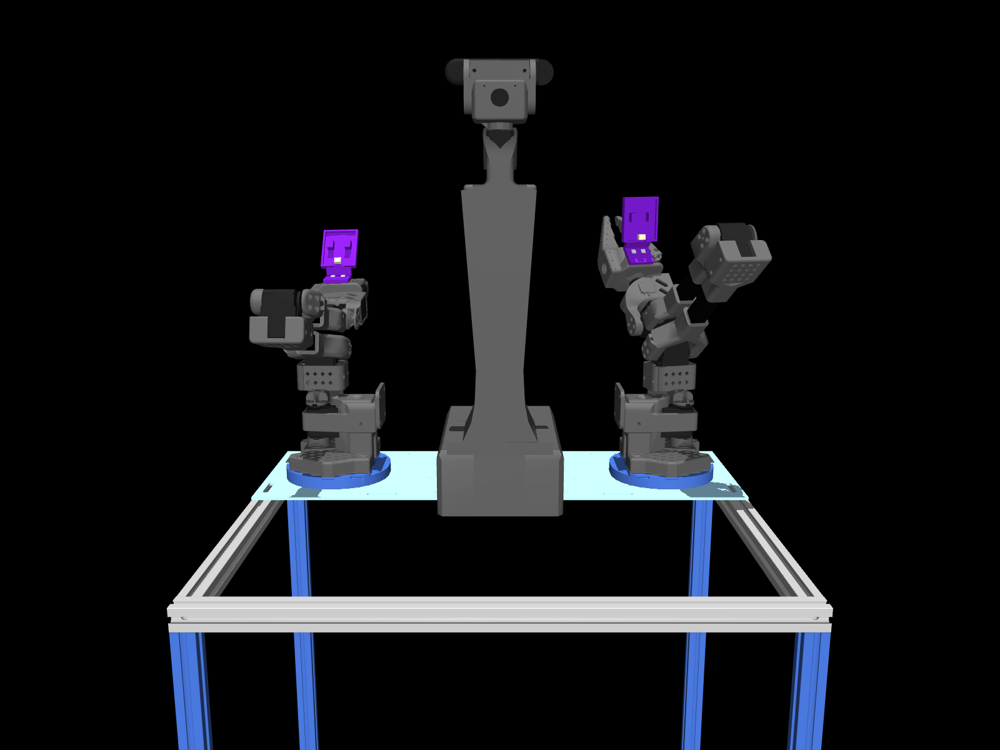

# Robot model 계약

CAD 모델은 ROS 좌표, 팔 chain, 시뮬레이션 형상을 공유한다. Geometry, 질량, 센서 TF에는 명목값과 추정값이 포함되므로 실물 검증값으로 취급하지 않는다.

## 좌표와 형상

| 항목 | 계약 |
|---|---|
| base_link, REP-103 | +X 전방 / +Y 좌측 / +Z 상방; wheel 축 +Y |
| Optical frame | +X 우측 / +Y 하방 / +Z 전방 |
| CAD wheelbase / track / radius | 0.35 / 0.6038 / 0.0635 m |
| Wheel 모델 | URDF: 500 g rigid assembly; MJCF만 passive roller joint 48개 |
| Grasp TCP | gripper_frame 기준 (0, -0.100, 0) m 고정; hinged gripper 유지 |
| Head RGB-D TF | 기본은 명목값; `jetson_20261009` 프로파일은 RGB optical TF에만 잠정 실물 보정 적용 |
| Wrist camera TF | 기본은 제외; 같은 프로파일 선택 시 각 gripper 기준 보정 optical TF와 RGB alias 추가 |

## 실물 헤드 마운트와 관절 기준

Jetson에 저장된 2026-10-09 모델에 맞춰 마스트의 매끄러운 면을 뒤쪽(-X)으로 돌리고,
CAD 상판 뒤쪽 모서리보다 50 mm 뒤에 배치한다. `head_mast_rear_gap_m`은
URDF와 MJCF가 같은 조립 형상을 유지하도록 `0.05`만 허용한다.
하부 마운트 높이 65 mm와 기둥 238 mm를 반영하며 상부 pan/tilt
부품은 이 합계에서 제외한다. 하부 마운트의 전후 길이는 172 mm이고 앞쪽 모서리는
상판 앞쪽보다 41 mm 뒤에 있다. 상부 헤드는 전방을 향하도록 유지한다.

`topbase1.stl`은 Jetson의 기존 수정 mesh를 그대로 사용한다. URDF visual과 collision,
MJCF의 마스트와 상부 장착 높이를 함께 맞춘다. 메시 치수와 조립 방향을 확인하는
검사는 URDF/MJCF의 단순 상호 일치와 별개로 수행한다.

왼쪽 wrist-roll의 2026-10-05 측정 범위
`[-1.5247769031583274, 2.9513790358919736]` rad는 관절 보정 프로파일의
`observed_position_limits_rad`와 원본 자세 기록에 보존한다. 이 범위를 실행 제한으로
채택하려면 URDF, MJCF, MoveIt과 grasp 실행기의 좌우별 설정을 함께 연결해야 한다.
현재 기본 관절 제한과 TCP는 유지한다. 마운트 변경은 기본 형상에 적용하며,
카메라 외부 보정은 프로파일 선택으로 구분한다.



이미지는 사용자가 제공한 `mount.png` 원본이며 기존 PR 이미지를 교체했다.
마운트 형상을 보여주는 렌더로, 실물 사진이나 보정 정확도 검증 자료는 아니다.

프로파일 적용 방법, 좌표계와 검증 한계는 [캘리브레이션 가이드](../../../../docs/CALIBRATION.md)를 따른다.
팔과 헤드 encoder 매핑은 근거 데이터로 보존하며 이 패키지가 직접 장치를 설정하지 않는다.

## 손목 카메라 마운트 v8

Jetson에 적용된 v8 마운트를 양쪽 `*_gripper_frame`에 붙인다. 기존
`XLeRobot_camera1/2.stl` 형상을 교체하며 URDF와 canonical MJCF에 같은 배치를
사용한다. 손목별 visual 6개는 보라색 마운트, 커넥터, 카메라 모듈, 렌즈와 나사를
표현한다. 충돌 형상은 상자 14개와 렌즈 원통 1개이며 MuJoCo 접촉과 URDF 충돌
검사에 사용한다. 통합 STL은 여러 구성품을 이어 담은 visual이므로 충돌 mesh로
사용하지 않는다. 전선과 케이블은 독립 미리보기에만 포함된다.

[형상 설정](../config/geometry/wrist_mount_v8.json)은 출처, SHA-256, 좌표 변환과
측정 조건을 보존한다. 판 크기 42.1 × 50.7 mm 등 사용자 실측 기준을 반영한
프록시이며 기울기, 두께, 발판 위치와 질량은 추정값이다. 제작용 CAD는 아니다.
메시는 Jetson 원본 바이트를 유지하며 관절, TCP와 canonical 질량/관성은 유지한다.

형상의 추정 광학 좌표와 `jetson_20261009` 실측 외부 보정은 별도다. Jetson의
보정 파일은 이전 수집본과 동일하며 이번 형상 반영으로 보정 정확도를 새로 검증한
것은 아니다. Canonical MuJoCo 카메라와 optical site는 기존 명목값을 유지한다.
실제 장착 위치가 보정 당시와 달라졌다면 기존 보정값의 유효성을 재확인해야 한다.

독립 형상 미리보기는 다음 명령으로 연다. 독립 모델의 추정 관성과 카메라 설정은
canonical 로봇에 적용하지 않는다.

```bash
python3 -m mujoco.viewer --mjcf=ros2_ws/src/cleany_description/mjcf/wrist_mount_v8.xml
```

## 제어 범위

Control entrypoint는 팔 10관절을 명령하고 gripper 2관절을 관측한다. Gripper 명령은 enable_gripper_command=true일 때만 허용하며 base, head, roller는 이 계약 밖이다.

Arm-only MoveIt은 include_head_camera=false, include_wheel_joints=false를 사용한다. Full description에서는 둘 다 기본 true이며, wheel false여도 fixed geometry는 유지한다.

기존 actuator는 servo position 14개와 PG42 voltage 4개다. 신규 servo DC-motor 기본값은 별도 upgrade 전까지 비활성이다. MuJoCo 3.4 backend는 임시 scene의 wheel actuator만 제거한다.

## 추정 질량과 Gazebo

| 항목 | 추정값 |
|---|---|
| 총 질량 | 15.933871 kg; PLA 추정 포함 |
| 배터리 | 5.20 kg, 195×165×175 mm |
| PG42 motor | 각 0.8 kg |

Gazebo navigation은 park 팔, head를 고정하고 wheel joint, 센서를 부착한다. 이 설정은 실물 관성, 센서 보정을 증명하지 않는다.

관련 안내: [MuJoCo backend](../../cleany_mujoco_sim/docs/backends.md).
