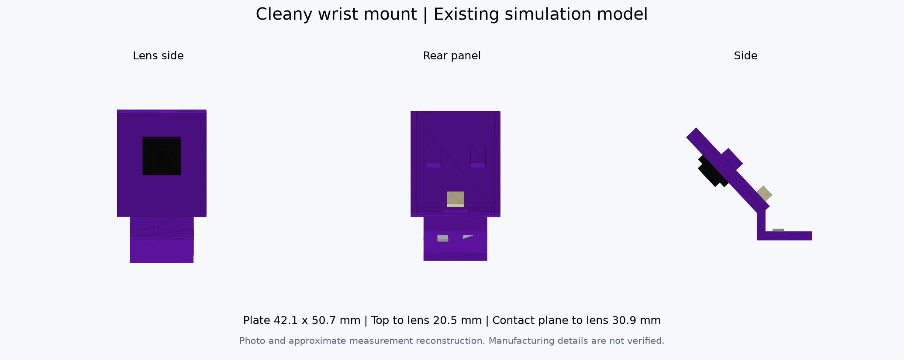

# 손목 카메라 마운트 v8 전달 및 적용

사진과 실측으로 복원한 보라색 마운트를 기존 Isaac 환경에서 추출했다.
이 자료는 형상 검토와 후속 통합에 사용한다. 기본 URDF, canonical MJCF와
`jetson_20261009` 카메라 보정 프로파일은 이 자료를 자동으로 사용하지 않는다.



이미지는 추출한 삼각형과 렌즈 primitive를 CPU로 그린 형상 미리보기다.
Isaac 센서 영상이나 실물 보정 정확도의 검증 자료는 아니다.

## 가져오기와 확인

저장소 루트에서 별도 브랜치로 가져온다.

```bash
git fetch origin codex/wrist-camera-mount-handoff
git switch --track origin/codex/wrist-camera-mount-handoff
```

STL은 [메시 폴더](../meshes/wrist_mount_v8/)에 있다. CAD 뷰어에는
`mount_legacy_jaw_mm.stl`을 mm로 읽고, ROS 또는 시뮬레이터 통합에는
`mount_legacy_jaw_m.stl`을 m로 읽는다. STL 자체에는 단위 정보가 없다.

MuJoCo Python 패키지가 있는 환경에서는 외부 로봇 파일 없이 조립을 확인할 수 있다.

```bash
python -m mujoco.viewer \
  --mjcf=ros2_ws/src/cleany_description/mjcf/wrist_mount_v8.xml
```

이 조립 예시는 기존 카메라 형상 body를 Fixed_Jaw 메시 좌표로 변환한 것이다.
카메라, 렌즈, 나사와 케이블 프록시를 포함한다. 접촉 상자와 관성은 기존 v8의
추정값이다. 카메라 FOV는 형상 확인용 명목값이며 내부 보정과 왜곡을 구현하지 않는다.

## 그리퍼에 부착

기준은 `feat/physical-mount-camera-calibration`의 `412f1c2`다.
이 모델의 Fixed_Jaw STL은 기존 Isaac에서 사용한 원본과 SHA-256이 같고,
canonical MJCF의 `Fixed_Jaw` 및 `Fixed_Jaw_2` body 안에서 메시 origin이 항등이다.
통합용 STL은 이 Fixed_Jaw 메시 좌표로 작성했다. 두 그리퍼에 다음 origin으로
배치할 수 있다.

| 항목 | 값 |
|---|---|
| Parent | `left_gripper_frame` 또는 `right_gripper_frame` |
| Visual translation, m | `0 0 0` |
| Visual RPY, rad | `0 0 0` |
| Mesh scale | `1 1 1` |

URDF에서는 `urdf/physical_properties.xacro`의 각 `*_gripper_frame` 조건 블록에
아래 visual을 추가하는 방식으로 결합한다. 이 문서의 예시는 아직 기본 모델에
적용하지 않았다. URDF의 기존 Fixed_Jaw visual에는 변환 반올림으로 최대 약
1.2 μm, 2.7 μrad의 origin이 남아 있다. 같은 메시 기준으로 정확히 맞추려면
그 visual의 origin을 복사한다. 좌우 값은 형상 설정의
`target_urdf_fixed_jaw_visual_origins`에 기록했다. 아래 0 origin은 그 미소 차이를
무시한 배치 예시다.

```xml
<visual name="photo_wrist_mount_v8_visual">
  <origin xyz="0 0 0" rpy="0 0 0"/>
  <geometry>
    <mesh filename="package://cleany_description/meshes/wrist_mount_v8/mount_legacy_jaw_m.stl"
          scale="1 1 1"/>
  </geometry>
  <material name="photo_wrist_mount_v8_purple">
    <color rgba="0.38 0.08 0.66 1"/>
  </material>
</visual>
```

기존 `XLeRobot_camera1.stl`과 `XLeRobot_camera2.stl`의 visual과 collision은
현재 그리퍼에 이미 들어 있다. 새 형상을 채택할 때 해당 카메라 형상과 충돌을
함께 교체해야 중복 표시와 중복 충돌을 피할 수 있다. 기본 광학 TF와 gripper joint를
삭제하는 방식으로 교체하지 않는다. 합친 STL은 visual용이며, 충돌 형상은
독립 MJCF의 구성품별 box를 참고해 적용 대상 simulator에서 별도로 확인한다.

MJCF에 직접 통합할 때도 `Fixed_Jaw`와 `Fixed_Jaw_2` body에 같은 원점으로
합친 메시를 부착할 수 있다. 그 body 안의 기존 카메라 형상을 처리하고, sensor pose와
camera intrinsic 설정은 별도로 연결한다. 이 자료를 추가하는 것만으로 Isaac의
로봇 또는 센서가 교체되지는 않는다.

기존 로컬 Isaac의 이름은 실제 왼팔을 `right_gripper_frame`으로 연결했다.
새 기준 모델에서는 실제 왼팔이 `left_gripper_frame`이다. 공통 형상에는 같은 STL을
사용하되, 기존 모터와 카메라 이름 매핑을 그대로 가져오지 않는다.

## 카메라 좌표와 보정값

[형상 설정](../config/geometry/wrist_mount_v8.json)의 `parent_T_child` 행렬은
child 좌표를 parent 좌표로 옮긴다. 평행이동은 m다.

| 설정 | 의미 |
|---|---|
| `legacy_jaw_from_camera_geometry_body` | 구성품 원본 body에서 Fixed_Jaw 메시 좌표로 변환 |
| `camera_geometry_body_from_camera_cv` | CV 광학 좌표에서 구성품 body로 변환 |
| `legacy_jaw_from_camera_cv_approximate` | 형상에서 계산한 렌즈 중심과 방향 |

CV 광학 좌표는 +X 영상 오른쪽, +Y 영상 아래쪽, +Z 광학 전방이다.
형상 기반 렌즈 중심은 그리퍼 좌표에서 약 `(1.231, -56.685, 54.900)` mm다.
독립 MJCF의 camera와 optical site는 이 방향을 표현한다.

이 좌표는 사진과 치수로 만든 모델의 예측이다. 팀원이 보드를 촬영해 구한
`config/calibration/jetson_20261009/*_wrist_camera_extrinsics.yaml`의
hand-eye 변환은 별도로 유지한다. 동일한 parent 좌표에서 두 결과를 비교하고,
형상과 보정이 어긋날 때 원인을 확인한 뒤 채택한다. 메시 추가를 이유로
측정 외부 보정값을 이 추정 좌표로 덮어쓰지 않는다.

## 실측과 추정 범위

| 항목 | 값 또는 근거 |
|---|---|
| 판 가로 × 세로 | 사용자 대략 실측 42.1 × 50.7 mm |
| 판 위쪽 모서리 → 렌즈 중심 | 사용자 대략 실측 20.5 mm |
| 바닥 접촉면 → 렌즈 중심 수직 높이 | 사용자 대략 실측 30.9 mm |
| 판 기울기 | 사진 및 기존 fitting 기반 약 43.04° |
| 발판 위치, 두께, 렌즈 깊이, 질량 | 추정 |
| 좌우 형상 차이 | 측정하지 않아 같은 형상 사용 |

구성품 STL 원본, m/mm 변환, 좌표 변환과 독립 조립의 파일 참조를 검사하려면
MuJoCo와 NumPy가 있는 Python 환경에서 실행한다.

```bash
python tools/validation/verify_wrist_mount_v8.py
```

원본 설계 CAD와 제조 공차는 없다. 합친 STL은 여러 상자 메시를 이어 담은 프록시이며
제작용 단일 solid나 가공 홀을 제공하지 않는다. 실제 로봇의 간섭, 변형과
절대 센서 정확도는 이 형상 검사만으로 검증되지 않는다.
