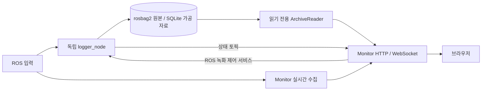

# Monitor 관측 데이터 계약

Monitor는 ROS 상태를 웹에 표시하고 독립 logger의 기록을 조회한다. 관측 전용이며 Runtime의 안전과 완료 판정을 대체하지 않는다.

## 수집과 한도

Metadata는 전체 discovery를 수행하되 메시지는 기본, action, 사용자 선택 토픽만 구독한다. 마지막 선택자가 해제하면 해당 구독을 정리한다. 수신 주기는 발행 주기를 보장하지 않는다.

| 항목 | 한도 |
|---|---|
| ROS discovery / UI 갱신 | 1 Hz / 최대 10 Hz |
| Action / 선택 토픽 / 브라우저 | 32 / 16 / 8 |
| 미리보기 전체 / 배열 / 깊이 / 문자열 | 2048 / 256 / 10 / 4096자 |
| 지도 기본 / 설정 상한 | 524288 / 1048576셀 |
| 경로 / 이벤트 ring / 브라우저 로그 | 4096점 / 2048건 / 500건 |
| 느린 브라우저 전송 timeout | 2초 |

QoS는 publisher endpoint 기준으로 선택하며, 혼합 publisher는 호환 가능한 약한 설정을 사용한다. Type import, QoS 오류, publisher 없음, 수신 없음, stale을 구분한다.

## 공간 데이터와 재접속

2D 레이어는 메시지 시각의 TF로 map_frame에 변환하고 회전 origin을 반영한다. Robot pose는 최신 TF를 사용하며 ±2초 밖 stamp는 stale로 처리한다. 정적 지도와 마지막 경로는 유지한다.

Telemetry는 종류/토픽별 최신값으로 합친다. Runtime/Monitor boot ID는 별개이며 재접속 시 초기 snapshot을 제공한다.

| 조건 | 표시 / 처리 |
|---|---|
| 미구독 토픽 | unmeasured |
| 미리보기 한도 초과 | truncated; 전체 cloud/rosbag 대체 아님 |
| 지도 / 경로 한도 초과 | 지도는 사유와 함께 거절 / 경로는 잘림 표시 |
| Layer TF 없음 | 해당 레이어 숨김 |
| 이벤트 ring에서 밀려남 | Gap 표시 |
| 단절, 재시작, sequence gap | 명시적으로 표시; IDLE/성공/안전으로 추정 금지 |

## 기록과 시간

Logger가 ROS 수집, 가공, 정책, 설정 파일, 세션과 단일 writer를 소유한다.
Monitor는 ROS 상태와 카메라의 실시간 표시, HTTP와 녹화 제어 client를 소유하며
`ArchiveReader`로 공유 디렉터리의 과거 자료만 읽는다. 생성자는 저장 경로나 파일을
만들지 않는다. Monitor 종료는 logger에 정지 요청을 보내지 않는다. 두 프로세스의
메모리 Hub와 구독 수명은 독립적이며 `MissionJournal`은 Mission Runtime에 남는다.

Logger 상태가 기본 3초 동안 갱신되지 않으면 `UNAVAILABLE`로 표시한다. 제어 서비스
불가와 응답 timeout은 HTTP 503, 상태나 revision 충돌은 409다. 실패 시 로컬 writer를
만들거나 정지 완료로 추정하지 않는다. 과거 기록은 logger가 없어도 조회할 수 있다.

저장 형식, 시간 단위, 큐와 종료 계약은 [Logger 데이터 계약](../../cleany_logger/docs/data.md)을
따른다. 기존 `state_directory`와 schema 1/2/3/4 읽기를 유지하며 HTTP 경로도 같다.

| HTTP 경로 | 의미 |
|---|---|
| `/api/recordings/{session}/export` | 가공 데이터 SQLite |
| `/api/recordings/{session}/bag` | 완료된 원본 bag ZIP; 녹화 중 409, 완료 bag 없음 404 |
| `/api/recordings/{session}/raw?category=point_cloud&at=<wall-seconds>` | 지정 시각 직전 원본 CDR 1건 |
| `/api/recordings/{session}/replay?at=<wall-seconds>` | SQLite의 가공 자료로 과거 재생 |

## 기록 설정과 화면

저사양, 기본, 정밀 프로필은 주기만 바꾸며 항목 선택, 토픽 이름, 녹화 정지 상태를 유지한다. 센서 원본 5종은 기본 OFF다. 항목별 Hz는 시간 표본화이며 점과 픽셀 수를 줄이지 않는다. 안전 판단 변경 이벤트는 해당 토픽을 끈 경우를 제외하고 Hz와 무관하게 보존한다. 정확한 항목과 주기는 `cleany_logger.recording`의 `SEMANTIC_RATES`, `cleany_logger.sources`의 출처 정의를 따른다.

녹화 토픽 변경은 logger의 관측 출처만 바꾼다. 대시보드 실시간 관측은 Monitor parameter를 따른다. 설정 변경은 정지 상태에서만 허용하며 녹화 중 시작 요청은 기존 세션을 반환한다. logger 출처 세대가 바뀌면 가공 최신 상태와 주행 이력을 초기화하고 설정을 기록한다. 시간 막대는 SQLite 세션의 실제 기록 구간을 연결하고, 일시정지와 기록 없는 시각을 구분한다. 재생에는 라이브 표본을 섞지 않는다.

실시간 호스트 리소스는 Monitor, 기록된 호스트 리소스는 logger의 `psutil` 관측이며 다른 DDS 호스트의 지표를 추정하지 않는다. 별도 worker가 기본 1초마다 수집하고 CPU/RSS 상위 프로세스는 각각 20개, 요약 이력은 300개가 기본값이다. 권한과 장치 오류, 첫 표본은 미측정으로 표시한다. 프로세스 CPU는 논리 코어 하나가 100%이며 RSS 합계는 호스트 메모리 사용량이 아니다.

## Cartographer와 RViz

기존 Cartographer 수집과 SQLite 재생은 호환을 위해 유지한다. `/submap_list`, `/trajectory_node_list`, `/constraint_list`, `/scan_matched_points2`를 읽고 allowlist된 SubmapQuery만 호출한다. 기본 한도는 서브맵 64개, 텍스처 262144 pixel, 이미지 캐시 16 MiB다. Epoch와 버전을 구분하고 불일치하거나 오래된 텍스처를 새 관측으로 표시하지 않는다.

전용 웹 SLAM renderer는 제거됐다. 서브맵, 정합점, LiDAR, 점군과 costmap의 상세 공간 관측은 RViz를 사용한다. 원본 bag 재생 절차는 [실행 가이드](../../../../docs/RUNNING.md#개발-monitor)를 따른다. Nav2 BT 화면은 수신 XML과 상태를 기록하며 BT 실행이나 주행 명령을 보내지 않는다.

관련 안내: [실행](../../../../docs/RUNNING.md), [환경](../../../../docs/DEVELOPMENT_SETUP.md).

노드별 통신 목록: [인터페이스 표](interfaces.md).
