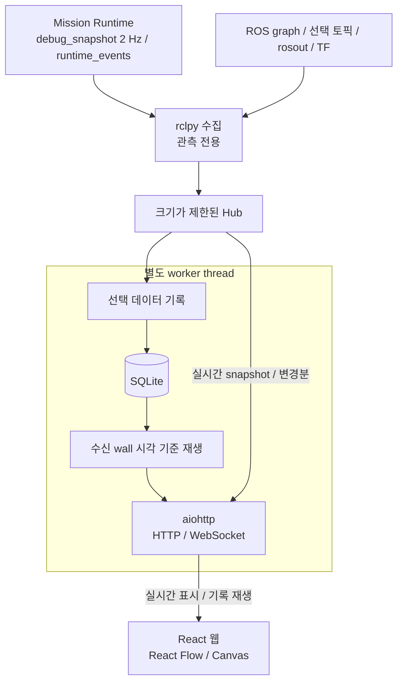

# Monitor 관측 데이터 계약

Monitor는 ROS 상태를 수집해 웹에 표시하고 기록하고 재생한다. 관측 전용이며 Runtime의 안전과 완료 판정을 대체하지 않는다.

## 수집과 한도

Metadata는 전체 discovery를 수행하되 메시지는 기본, action, 사용자 선택 토픽만 구독한다. 마지막 선택자가 해제하면 해당 구독을 정리한다. 수신 주기는 발행 주기를 보장하지 않는다.

| 항목 | 한도 |
|---|---|
| ROS discovery / UI 갱신 | 1 Hz / 최대 10 Hz |
| Action / 선택 토픽 / 브라우저 | 32 / 16 / 8 |
| 미리보기 전체 / 배열 / 깊이 / 문자열 | 2048 / 256 / 10 / 4096자 |
| 지도 기본 / 설정 상한 | 524288 / 1048576셀 |
| 경로 / 이벤트 ring / 브라우저 로그 | 4096점 / 2048건 / 500건 |
| 느린 브라우저 전송 timeout | 2초 |

QoS는 publisher endpoint 기준으로 선택하며, 혼합 publisher는 호환 가능한 약한 설정을 사용한다. Type import, QoS 오류, publisher 없음, 수신 없음, stale을 구분한다.

## 공간 데이터와 재접속

2D 레이어는 메시지 시각의 TF로 map_frame에 변환하고 회전 origin을 반영한다. Robot pose는 최신 TF를 사용하며 ±2초 밖 stamp는 stale로 처리한다. 정적 지도와 마지막 경로는 유지한다.

Telemetry는 종류/토픽별 최신값으로 합친다. Runtime/Monitor boot ID는 별개이며 재접속 시 초기 snapshot을 제공한다.

| 조건 | 표시 / 처리 |
|---|---|
| 미구독 토픽 | unmeasured |
| 미리보기 한도 초과 | truncated; 전체 cloud/rosbag 대체 아님 |
| 지도 / 경로 한도 초과 | 지도는 사유와 함께 거절 / 경로는 잘림 표시 |
| Layer TF 없음 | 해당 레이어 숨김 |
| 이벤트 ring에서 밀려남 | Gap 표시 |
| 단절, 재시작, sequence gap | 명시적으로 표시; IDLE/성공/안전으로 추정 금지 |

## 기록과 시간

ROS stamp와 수신 wall/monotonic 시각을 함께 저장하며 재생 축은 수신 wall이다. ROS clock 역행은 이벤트로 남기고 clock 정체와 수신 지연을 표시한다. Host wall 역행 환경의 정밀 재생은 지원하지 않는다.

선택 기록은 전체 rosbag을 대체하지 않으며 camera는 별도 경로다. HTTP 경로, 허용 항목은 server 구현과 monitor.yaml을 따른다. 기록은 외부 cleany-data에 두고 web/dist, ROS install은 생성물로 취급한다.

관련 안내: [실행](../../../../docs/RUNNING.md), [환경](../../../../docs/DEVELOPMENT_SETUP.md).
