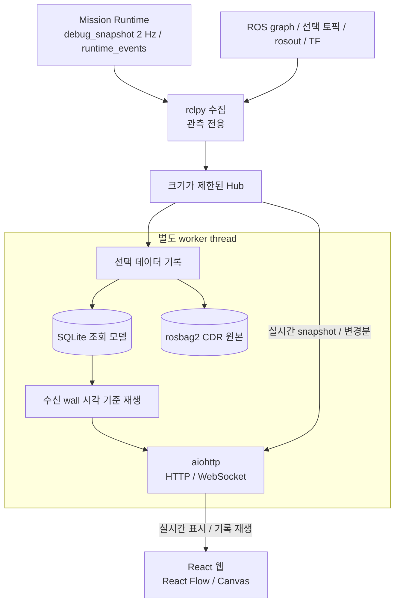

# Monitor 관측 데이터 계약

Monitor는 ROS 상태를 수집해 웹에 표시하고 기록하고 재생한다. 관측 전용이며 Runtime의 안전과 완료 판정을 대체하지 않는다.

## 수집과 한도

Metadata는 전체 discovery를 수행하되 메시지는 기본, action, 사용자 선택 토픽만 구독한다. 마지막 선택자가 해제하면 해당 구독을 정리한다. 수신 주기는 발행 주기를 보장하지 않는다.

| 항목 | 한도 |
|---|---|
| ROS discovery / UI 갱신 | 1 Hz / 최대 10 Hz |
| Action / 선택 토픽 / 브라우저 | 32 / 16 / 8 |
| 미리보기 전체 / 배열 / 깊이 / 문자열 | 2048 / 256 / 10 / 4096자 |
| 지도 기본 / 설정 상한 | 524288 / 1048576셀 |
| 경로 / 이벤트 ring / 브라우저 로그 | 4096점 / 2048건 / 500건 |
| 느린 브라우저 전송 timeout | 2초 |

QoS는 publisher endpoint 기준으로 선택하며, 혼합 publisher는 호환 가능한 약한 설정을 사용한다. Type import, QoS 오류, publisher 없음, 수신 없음, stale을 구분한다.

## 공간 데이터와 재접속

2D 레이어는 메시지 시각의 TF로 map_frame에 변환하고 회전 origin을 반영한다. Robot pose는 최신 TF를 사용하며 ±2초 밖 stamp는 stale로 처리한다. 정적 지도와 마지막 경로는 유지한다.

Telemetry는 종류/토픽별 최신값으로 합친다. Runtime/Monitor boot ID는 별개이며 재접속 시 초기 snapshot을 제공한다.

| 조건 | 표시 / 처리 |
|---|---|
| 미구독 토픽 | unmeasured |
| 미리보기 한도 초과 | truncated; 전체 cloud/rosbag 대체 아님 |
| 지도 / 경로 한도 초과 | 지도는 사유와 함께 거절 / 경로는 잘림 표시 |
| Layer TF 없음 | 해당 레이어 숨김 |
| 이벤트 ring에서 밀려남 | Gap 표시 |
| 단절, 재시작, sequence gap | 명시적으로 표시; IDLE/성공/안전으로 추정 금지 |

## 기록과 시간

ROS stamp와 수신 wall/monotonic 시각을 함께 저장하며 재생 축은 수신 wall이다. ROS clock 역행은 이벤트로 남기고 clock 정체와 수신 지연을 표시한다. Host wall 역행 환경의 정밀 재생은 지원하지 않는다.

저장 경계는 ROS 메시지의 CDR 원문은 rosbag2, 대시보드가 만든 조회와 재생 모델은 SQLite다. 선택하고 표본화한 기록이므로 전체 ROS 그래프의 무손실 녹화를 뜻하지 않는다.

| 데이터 | 저장소 |
|---|---|
| 선택한 LiDAR, 점군, voxel, 카메라, 지도, 경로와 위치 원문 | rosbag2의 표준 `sqlite3` storage |
| TF, 시계, 카메라 CameraInfo와 선택한 로봇 모델 문맥 | 같은 bag에 수신마다 기록 |
| 화면 레이어, 미션, BT, 안전 상태, 로그와 호스트 리소스 | 대시보드 SQLite의 가공 자료 |
| 원본의 토픽, 타입, 수신 시각과 bag timestamp | SQLite `raw_index`; payload 없음 |

`state_directory` 아래 `<session>.sqlite3`, `bags/<session>/`, `recording-settings.json`을 둔다. 기본 위치는 `~/.local/state/cleany/dev-monitor`이며 실행 시 `-p state_directory:=/absolute/path`로 바꾼다. 기록은 자동 삭제하지 않는다. `web/dist`와 ROS install은 생성물이다.

ROS callback은 최대 8 MiB 메시지를 32 MiB/128건의 큐로 넘기고 HTTP worker가 bag 쓰기와 종료를 소유한다. 초과, 쓰기 실패와 용량 중단은 유실 건수와 `raw_gap` metadata로 남긴다. rosbag2 runtime이 없거나 쓰기에 실패하면 원본 기록을 중단하며 SQLite payload로 대체하지 않는다. 세션 제한과 `total_limit_bytes`는 SQLite와 bag을 합산한다.

녹화 시작마다 새 UUID를 만들고 정지하면 SQLite와 bag writer를 닫는다. `bag_state`는 `not_started`, `recording`, `finalized`, `incomplete`를 구분하며 완료된 bag만 ZIP으로 내보낸다. 원본 timestamp는 수신 ROS clock의 nanosecond, SQLite 시간축은 수신 wall 초다. 동일 ROS timestamp의 원본도 수신 순서로 구분한다. 이전 schema 1/2/3 SQLite는 수정하거나 자동 변환하지 않고 계속 읽는다.

| HTTP 경로 | 의미 |
|---|---|
| `/api/recordings/{session}/export` | 가공 데이터 SQLite |
| `/api/recordings/{session}/bag` | 완료된 원본 bag ZIP; 녹화 중 409, 완료 bag 없음 404 |
| `/api/recordings/{session}/raw?category=point_cloud&at=<wall-seconds>` | 지정 시각 직전 원본 CDR 1건 |
| `/api/recordings/{session}/replay?at=<wall-seconds>` | SQLite의 가공 자료로 과거 재생 |

원본 구독은 화면과 카메라 preview lease에 독립적이다. CameraInfo는 이미지 토픽의 형제 `camera_info`에서 요청한다. TF와 시계, CameraInfo는 Hz로 누락시키지 않는다. 설정 변경과 새 세션은 transient-local 원본 구독을 다시 생성해 retained 자료를 요청한다.

## 기록 설정과 화면

저사양, 기본, 정밀 프로필은 주기만 바꾸며 항목 선택, 토픽 이름, 녹화 정지 상태를 유지한다. 센서 원본 5종은 기본 OFF다. 항목별 Hz는 시간 표본화이며 점과 픽셀 수를 줄이지 않는다. 안전 판단 변경 이벤트는 해당 토픽을 끈 경우를 제외하고 Hz와 무관하게 보존한다. 정확한 항목과 주기는 `recording.py`의 `SEMANTIC_RATES`, `sources.py`의 출처 정의를 따른다.

기본 관측 토픽 변경은 녹화만이 아니라 대시보드 수집 대상도 바꾼다. 설정 세대가 바뀌면 이전 최신 상태와 주행 이력을 초기화하고 설정을 기록한다. 시간 막대는 SQLite 세션의 실제 기록 구간을 연결하고, 일시정지와 기록 없는 시각을 구분한다. 재생에는 라이브 표본을 섞지 않는다.

호스트 리소스는 Monitor 서버 호스트의 `psutil` 관측이며 다른 DDS 호스트의 지표를 추정하지 않는다. 별도 worker가 기본 1초마다 수집하고 CPU/RSS 상위 프로세스는 각각 20개, 요약 이력은 300개가 기본값이다. 권한과 장치 오류, 첫 표본은 미측정으로 표시한다. 프로세스 CPU는 논리 코어 하나가 100%이며 RSS 합계는 호스트 메모리 사용량이 아니다.

## Cartographer와 RViz

기존 Cartographer 수집과 SQLite 재생은 호환을 위해 유지한다. `/submap_list`, `/trajectory_node_list`, `/constraint_list`, `/scan_matched_points2`를 읽고 allowlist된 SubmapQuery만 호출한다. 기본 한도는 서브맵 64개, 텍스처 262144 pixel, 이미지 캐시 16 MiB다. Epoch와 버전을 구분하고 불일치하거나 오래된 텍스처를 새 관측으로 표시하지 않는다.

전용 웹 SLAM renderer는 제거됐다. 서브맵, 정합점, LiDAR, 점군과 costmap의 상세 공간 관측은 RViz를 사용한다. 원본 bag 재생 절차는 [실행 가이드](../../../../docs/RUNNING.md#개발-monitor)를 따른다. Nav2 BT 화면은 수신 XML과 상태를 기록하며 BT 실행이나 주행 명령을 보내지 않는다.

관련 안내: [실행](../../../../docs/RUNNING.md), [환경](../../../../docs/DEVELOPMENT_SETUP.md).

노드별 통신 목록: [인터페이스 표](interfaces.md).

## 청소 BT와 조작 관측

실행 → BT는 Mission의 실제 노드와 상태를 보여준다. 관측은 Perception port, 다음 행동 제안은 Planner port가 수행하고 Mission은 제안 검증과 실행 허가를 소유한다. 노드는 이 책임을 호출하는 작업 흐름이며 별도 인식 알고리즘을 뜻하지 않는다.

ExecuteOne을 선택하면 Action 준비, 접근, 집기, 운반, 놓기와 팔 복귀를 펼쳐 볼 수 있다. 이 상세는 서버 단계의 관측이며 청소 BT topology나 실행 순서를 변경하지 않는다. 별도 매니퓰레이션 화면에는 전체 단계, 실행 시간, 취소 상태와 실행 비교가 있다.

실행 기록은 현재 mission ID와 정확한 execution ID로 연결한다. 다음 Goal의 기록이 아직 없으면 이전 물체의 진행률을 대신 표시하지 않는다. 과거 실행을 선택해도 현재 Runtime의 주행 판단은 별도로 표시한다. 관측 토픽을 바꾸면 이전 조작 이력과 revision도 초기화한다.

| 표시 | 의미 |
|---|---|
| 청소 BT SUCCESS | 마지막으로 관측한 작업 결과; 현재 Nav2 준비나 주행 가능 여부와 다름 |
| 주행 확인 불가 | Runtime 상태가 없거나 오래돼 현재 gate를 확인할 수 없음 |
| 조작 완료 | 서버 최종 record의 결과; Mission의 검증과 정지 확인은 별도 |
| 진행 상태 미확인 | 수신 정체나 이전 실행을 현재 진행으로 추정하지 않음 |

`execution_events`는 revision과 서버 wall timestamp로 단계 구간을 만든다. 중간부터 구독한 기록, 누락과 시각 역행을 구분하며 역행한 기록의 경과 시간은 표시하지 않는다. Timeout과 취소는 서버 steady clock을 사용한다. 기본 최근 실행 20개, 실행당 구간 64개를 보존하며 topic QoS depth는 100이다. SQLite 가공 기록과 시간 막대 재생에서도 같은 의미를 사용한다. 재생은 로봇 명령을 보내지 않는다.
