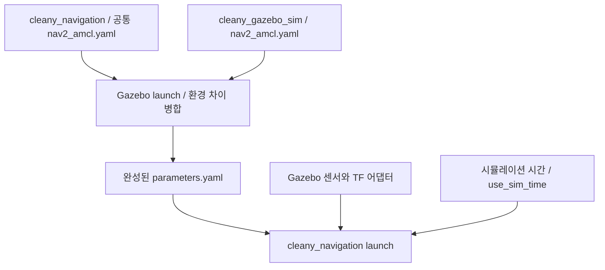

# Gazebo 주행 연동

이 패키지는 시뮬레이터의 센서와 TF, 시뮬레이션 시간을 공통 Navigation 입력에 연결합니다. 위치 추정과 경로 계획, 주행 제어는 `cleany_navigation`이 수행합니다. 실행 순서는 [시뮬레이터 가이드](../../../../docs/implementation/how-to/simulation.md)를 따릅니다.

## 실행 구성과 설정 병합

| 이 패키지의 진입점 | 연결하는 공통 진입점 | 이 패키지의 처리 |
|---|---|---|
| [amcl_nav2.launch.py](../launch/amcl_nav2.launch.py) | `cleany_navigation/amcl_nav2.launch.py` | AMCL/Nav2 설정 병합, 지도와 시뮬레이션 시간 전달 |
| [amcl_nav2_safety.launch.py](../launch/amcl_nav2_safety.launch.py) | `cleany_navigation/navigation.launch.py` | 설정 병합, 센서와 몸체 설정 구성, 카메라 TF 어댑터 연결 |

두 진입점의 `params_file`은 [이 패키지의 환경 overlay](../config/nav2_amcl.yaml)를 기본으로 사용합니다. 공통 파일과 합쳐 임시 `parameters.yaml`을 만든 뒤 Navigation에 전달하므로, 이 overlay를 Nav2 노드에 단독으로 전달하지 않습니다. Plugin 교체 시의 병합 규칙은 [Navigation 설정 계약](../../cleany_navigation/docs/planning.md#외부-설정의-전달-계약)을 따릅니다.

## 안전 주행 어댑터의 책임

| 입력 또는 구성 | 처리 |
|---|---|
| `use_sim_time` | 기본 `true`; 공통 launch에 전달 |
| `safety_params_file` | [Gazebo 안전 설정](../config/nav2_safety.yaml)에서 카메라 장착 정보와 로봇 설정 분리 |
| `body_profile` | CAD 변환 프로필과 시뮬레이션 주차 한계를 로봇 설정에 반영 |
| 카메라 TF | 동적 pan 구성은 명령 bridge와 feedback TF 어댑터 연결; 고정 구성은 장착 TF 발행 |
| Optical TF | 카메라 프레임에서 optical 프레임으로 변환 발행 |
| `robot_params_file` | 위 정보를 합친 임시 `robot.yaml`을 공통 Navigation에 전달 |
| `omni_params_file` | 기본 Omni 저속 튜닝을 공통 Navigation에 전달 |

Gazebo 메타데이터가 포함된 안전 설정은 공통 ROS 파라미터 파일과 구분합니다. 래퍼는 공통 `safety_params_file`과 환경별 `robot_params_file`을 각각 전달합니다. 어댑터의 정확한 토픽과 TF는 [인터페이스](interfaces.md)를 따릅니다.

`odom → base_link`와 센서 장착 TF는 활성 시뮬레이션 구성이 제공합니다. 같은 변환을 실물 드라이버나 다른 시뮬레이터가 중복 발행하지 않도록 실행 구성을 분리합니다. `map → odom`은 선택한 위치 추정 또는 SLAM 중 하나가 소유합니다.
