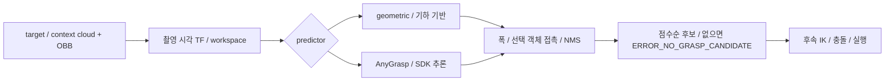
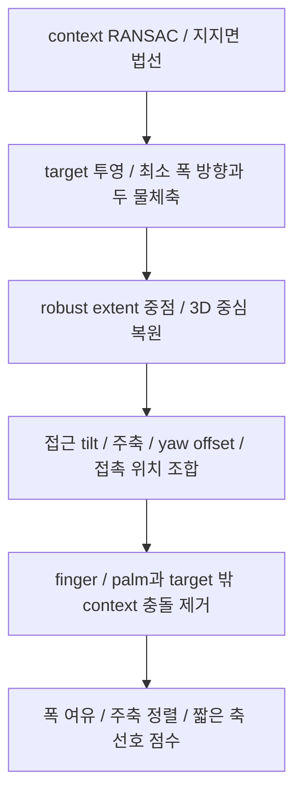
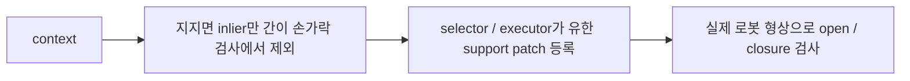
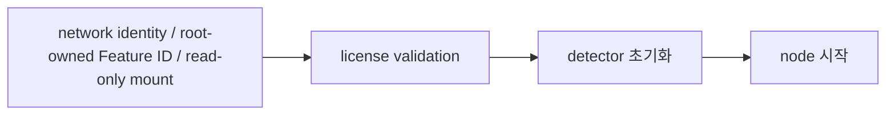

# 파지 후보 생성과 선택

`GraspNode`는 선택 물체의 점군에서 후보를 만들고 필터링한 `GraspCandidate[]`를 점수 내림차순으로 반환한다. 팔 선택, IK, MoveIt 충돌 검사와 실제 실행은 [조작 경로](../../../../docs/how-to/manipulation.md)가 담당한다.



## 처리 경계

| 입력 / 출력 | 계약 |
|---|---|
| 서비스 | `grasp/plan` (`cleany_interfaces/srv/PlanGrasp`) |
| 입력 | Perception 2단계의 RGB `target_cloud` / `context_cloud`와 원본 OBB |
| Workspace | target bounds + margin; context로 충돌 후보 제거 |
| 출력 없음 | `ERROR_NO_GRASP_CANDIDATE`; pose 합성 안 함 |
| Predictor 확장 | `GraspPredictor` port 구현 |
| Geometric | 모델 / checkpoint / SDK license 불필요; 단순 강체의 top-down MVP |
| AnyGrasp | Adapter import는 첫 요청까지 지연; 2026 aarch64 dev SDK의 `create_detector()` / region steering 사용 |

### Geometric 후보가 만들어지는 순서



복잡한 형상, 변형 물체와 측면 접근에는 별도 predictor 또는 MoveIt 단계가 필요하다. 후보 생성 성공은 파지 유지 성공이 아니다.

## 물체별 접근각 탐색

| 옵션 | 일반 기본 / Sorting | 동작 |
|---|---|---|
| `search_approach_tilts` | 기존 단일 `approach_tilt_degrees` / true | `approach_tilt_options` 기본 0, 8, 16, 24° 평가 |
| `include_reverse_closing_axis` | 선택 / sorting 활성 | 비대칭 jaw의 반대 closing 방향 추가 |
| `nms_rotation_threshold_degrees` | 20° / 5° | 접근각 후보가 NMS에서 합쳐지는 범위 조정 |
| `approach_reference_positions` | `[0.0]` 비활성 / 양 어깨 xyz | Planning frame 기준점을 평탄화한 배열; 어깨에서 물체로 향하는 수평 접근 생성 |
| `reject_robot_opposite_approach` | 선택 | `robot_reference_position`에서 물체로 향하는 방향과 반대인 후보 제거 |
| `prefer_upward_closing_axis` | false | 같은 점수에서 fixed-jaw 쪽 +closing이 위인 후보 우선; 진단용 |
| 생성 예산 | 일반 demo 24 / sorting 96 | 실행 selector의 IK 예산은 24 유지 |

접근 tilt와 어깨 기준점은 교차 배분한다. 반대 closing 방향에도 같은 short-axis 점수를 주어 후보 제한에서 사라지지 않게 한다. 재관측은 기존 방향과 중심 연속성으로 먼저 선별한다.

요청마다 지지면, 물체축·중심과 장애물 점은 한 번 계산한다. 각 조합은 이 결과를 공유하고 점수순으로 충돌을 지연 평가한다. 후보 상한 뒤 계산을 생략해도 전체 평가 후 자른 결과와 순서·다양성은 같아야 한다.

### 길이 방향 접촉 위치

| 검사 / 옵션 | 조건 |
|---|---|
| 활성 | `search_longitudinal_contacts`: 일반 false, sorting true |
| 대상 | 지지면 높이/길이 ≤ `longitudinal_max_height_ratio=0.4`, 길이 > finger length |
| 위치 | `longitudinal_offset_fractions=[0,-0.25,0.25]`; finger 전체가 robust 관측 범위 안에 남도록 제한 |
| 높이 보정 | 일반은 유지; sorting의 `longitudinal_contact_height_offset_m=0.003`은 위 대상만 법선 방향 3 mm 보정 |
| 제외 | 짧은 레고나 두꺼운 컵에는 위 높이 보정 미적용 |
| 순위 | 생성 시 동점이면 robot reference에 가까운 지점; 최종 같은 품질의 길이 방향 후보는 관측 체적 중심에 가까운 후보 우선 |
| 유지 검사 | 폭 / 점수 기준, context 충돌, NMS, 후속 IK / MoveIt |

끝부분 후보도 남아 중앙 후보의 IK나 충돌 검사 실패 시 평가한다. 라벨과 시뮬레이터 정답 위치는 사용하지 않는다. 3 mm는 시뮬레이션 시험값이며 실물 보정값이 아니다.

### 지지면 검사 위임



`geometric.defer_support_plane_collision=true`는 위 계약을 함께 적용하는 sorting 전용이다. 기본 false는 간이 지지면 충돌 검사다. 평면 위 장애물은 계속 검사하며 지지면 무시나 정답 책상 주입으로 사용하지 않는다. 상세 조건은 [sorting 실행 계약](../../cleany_skill_executor/docs/study_cafe_sorting_contract.md#지지면과-jaw-충돌)을 따른다.

## 관측 충돌 형상

| 항목 | 계약 |
|---|---|
| 발행 설정 | `publish_collision_geometry`: node false, sorting true |
| 토픽 / QoS | `/grasp/collision_geometry`, Reliable / Transient Local, depth 16 |
| 형상 | OBB local XY의 관측 볼록 외곽 + 관측 Z와 OBB 바닥/상단을 포함하는 프리즘 |
| 거부 | 512 vertices 초과 또는 퇴화; 임의 축소 안 함 |
| 동일성 | 후보와 동일 snapshot / object / capture / frame / OBB pose를 별도 메시지로 전달 |
| 한계 | 숨은 뒷면과 구멍을 복원한 mesh 아님; 컵 내부가 비었다고 가정하지 않음 |
| 영향 범위 | 기존 후보 포맷 유지; simulator mesh / 질량 / 마찰은 변경하지 않음 |

## 후보 이미지 확인

```bash
ros2 run rqt_image_view rqt_image_view /grasp/debug_image
```

800 × 800 RGB **추정 지지면 top view**다. 요청에 원본 RGB와 intrinsics가 없으므로 카메라 영상 overlay가 아니다. Transient Local 토픽이라 요청 뒤 viewer를 열어도 마지막 결과를 받는다.

| 표시 | 의미 |
|---|---|
| 주황 | Target |
| 회색 | Context |
| 파란 선 | 후보 jaw |
| 초록 | 최고 점수 후보 |
| 숫자 뒤 값 | 후보 점수 |

## 설정

[anygrasp.yaml](../config/anygrasp.yaml)이 배포 설정을 관리한다.

| 설정 | 의미 |
|---|---|
| `predictor_type` | 기본 `geometric`, SDK 사용 시 `anygrasp` |
| `debug_image_topic` | 후보 top-view 출력 |
| `geometric.*` | Gripper 형상, 충돌 여유, RANSAC, outlier trim, yaw / tilt |
| `checkpoint_path` / `license_path` | Jetson-local SDK 파일; 네 license 파일의 디렉터리명은 `license` |
| `gripper_height_m` | SDK finger height |
| `planning_frame` | 기본 `base_link` |
| `maximum_gripper_width_m` | 실물 gripper 보정 뒤 확정할 값 |
| `canonical_to_tcp_rotation` | Canonical → TCP, 3×3 row-major rotation |
| `tcp_approach_axis` | TCP 접근 축, Cleany local −Y |

| Canonical 축 | Cleany TCP 대응 |
|---|---|
| GraspNet +X approach | −Y approach |
| GraspNet +Y closing | +X closing |

## Jetson 첫 관문

SDK와 license는 저장소에 포함하지 않는다. 배포 절차와 고정 MAC은 [GPU runtime](../../../../containers/vision/README.md)을 따른다. 이 adapter 구현만으로 Jetson 호환성을 검증한 것으로 보지 않는다.

| 순서 | 배포 환경에서 확인할 것 |
|---|---|
| 1 | JetPack 6.2 / CUDA 12.6 호환 PyTorch와 수정 MinkowskiEngine |
| 2 | 공식 example data의 import, checkpoint / license load, collision-enabled inference |
| 3 | MuJoCo box/can RGB point cloud의 후보 생성 |
| 4 | `/grasp/plan`의 planning-frame candidate와 RViz marker |



Host-native와 container Feature ID는 다르다. 실제 배포 container에서 검증하고 저장된 identity와 다르면 시작을 거부한다. ROS 비의존 core와 fake 검사는 SDK 없이 실행할 수 있다.

## 빌드와 테스트

```bash
source /opt/ros/humble/setup.bash
cd ros2_ws
colcon build --symlink-install --packages-up-to cleany_grasping
source install/setup.bash
colcon test --packages-select cleany_grasping
colcon test-result --verbose
ros2 run cleany_grasping grasp_server --ros-args \
  --params-file src/cleany_grasping/config/anygrasp.yaml
```

## 큰 물체의 접촉 높이

| 설정 | 동작 / 한계 |
|---|---|
| `geometric.maximum_top_contact_depth_m` | 일반 / sorting 기본 0: 기존 체적 중심 사용 |
| `grasp_maximum_top_contact_depth_m` | Demo launch에서 같은 값 전달, 기본 0 |
| 양수 설정 | Support-normal 상단 percentile에서 지정 깊이 이내 접촉점; 기존 중심이 더 높으면 유지 |
| 적용 한계 | 높게 잡는 것만으로 파지가 개선되지 않음; TCP 보정, 충돌, 관절 / 파지 허용값 유지 |

이 옵션은 점군 기하를 사용하며 label이나 GT 좌표를 쓰지 않는다. 별도 컵 진단값을 기본 운용값으로 간주하지 않는다.

## 요청 검증과 설정 불변성

| 검증 대상 | 요구 조건 |
|---|---|
| Target / context | 같은 optical frame, 같은 0이 아닌 촬영 timestamp |
| OBB pose | 점군과 같은 frame |
| TF | 촬영 시각에 한 번 조회; pose / 접근 방향 / OBB를 함께 planning frame으로 변환 |
| XYZRGB | Field datatype / offset / point step / row step / 전체 길이 검사; 정상 행 padding과 packed RGB 허용 |
| TCP 설정 | 입력 배열을 복사해 읽기 전용 보관; 반사 행렬은 quaternion 변환 전에 거부 |
