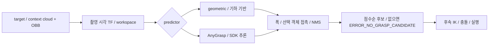
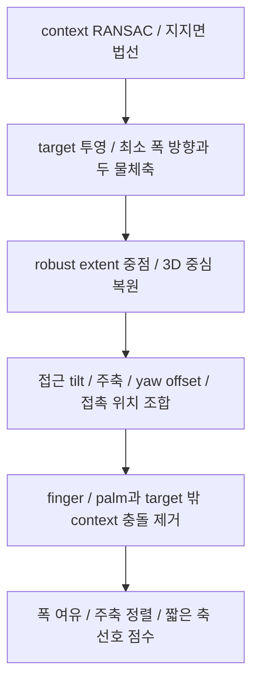
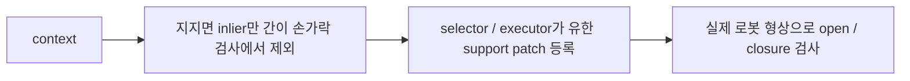
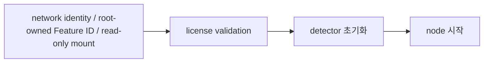

# 파지 후보 생성과 선택

`GraspNode`는 선택 물체의 점군에서 후보를 만들고 필터링한 `GraspCandidate[]`를 점수 내림차순으로 반환합니다. 팔 선택, IK, MoveIt 충돌 검사와 실제 실행은 [조작 경로](../../../../docs/implementation/how-to/manipulation.md)가 담당합니다.



## 처리 경계

| 입력 / 출력 | 계약 |
|---|---|
| 서비스 | `grasp/plan` (`cleany_interfaces/srv/PlanGrasp`) |
| 입력 | Perception 2단계의 RGB `target_cloud` / `context_cloud`와 원본 OBB |
| Workspace | target bounds + margin; context로 충돌 후보 제거 |
| 출력 없음 | `ERROR_NO_GRASP_CANDIDATE`; pose 합성 안 함 |
| Predictor 확장 | `GraspPredictor` port 구현 |
| Geometric | 모델 / checkpoint / SDK license 불필요; 단순 강체의 top-down MVP |
| AnyGrasp | Adapter import는 첫 요청까지 지연; 2026 aarch64 dev SDK의 `create_detector()` / region steering 사용 |

### Geometric 후보가 만들어지는 순서



복잡한 형상, 변형 물체와 측면 접근에는 별도 predictor 또는 MoveIt 단계가 필요합니다. 후보 생성 성공은 파지 유지 성공이 아닙니다.

## 물체별 접근각 탐색

| 옵션 | 일반 기본 / Sorting | 동작 |
|---|---|---|
| `search_approach_tilts` | 기존 단일 `approach_tilt_degrees` / true | `approach_tilt_options` 기본 0, 8, 16, 24° 평가 |
| `include_reverse_closing_axis` | 선택 / sorting 비활성 | 비대칭 jaw의 반대 closing 방향 추가 |
| `nms_rotation_threshold_degrees` | 20° / 5° | 접근각 후보가 NMS에서 합쳐지는 범위 조정 |
| `approach_reference_positions` | `[0.0]` 비활성 / 양 어깨 xyz | Planning 좌표계 기준점을 평탄화한 배열; 어깨에서 물체로 향하는 수평 접근 생성 |
| `reject_robot_opposite_approach` | 선택 | `robot_reference_position`에서 물체로 향하는 방향과 반대인 후보 제거 |
| `prefer_upward_closing_axis` | false | 같은 점수에서 fixed-jaw 쪽 +closing이 위인 후보 우선; 진단용 |
| 생성 예산 | 일반 demo 24 / sorting 96 | 실행 selector의 IK 예산은 24 유지 |

실물 준비 자세 프로파일과 sorting launch는 반대 closing 방향을 끄고 yaw를 0°, ±20°, ±40°로 제한합니다.

접근 tilt와 어깨 기준점은 교차 배분합니다. 반대 closing 방향에도 같은 short-axis 점수를 주어 후보 제한에서 사라지지 않게 합니다. 재관측은 기존 방향과 중심 연속성으로 먼저 선별합니다.

요청마다 지지면, 물체축·중심과 장애물 점은 한 번 계산합니다. 각 조합은 이 결과를 공유하고 점수순으로 충돌을 지연 평가합니다. 후보 상한 뒤 계산을 생략해도 전체 평가 후 자른 결과와 순서·다양성은 같아야 합니다.

### 길이 방향 접촉 위치

| 검사 / 옵션 | 조건 |
|---|---|
| 활성 | `search_longitudinal_contacts`: 일반 false, sorting true |
| 대상 | 지지면 높이/길이 ≤ `longitudinal_max_height_ratio=0.4`, 길이 > finger length |
| 위치 | `longitudinal_offset_fractions=[0,-0.25,0.25]`; finger 전체가 robust 관측 범위 안에 남도록 제한 |
| 높이 보정 | 일반은 유지; sorting의 `longitudinal_contact_height_offset_m=0.003`은 위 대상만 법선 방향 3 mm 보정 |
| 제외 | 짧은 레고나 두꺼운 컵에는 위 높이 보정 미적용 |
| 순위 | 생성 시 동점이면 robot reference에 가까운 지점; 최종 같은 품질의 길이 방향 후보는 관측 체적 중심에 가까운 후보 우선 |
| 유지 검사 | 폭 / 점수 기준, context 충돌, NMS, 후속 IK / MoveIt |

끝부분 후보도 남아 중앙 후보의 IK나 충돌 검사 실패 시 평가합니다. 라벨과 시뮬레이터 정답 위치는 사용하지 않습니다. 3 mm는 시뮬레이션 시험값이며 실물 보정값이 아닙니다.

### 지지면 검사 위임



`geometric.defer_support_plane_collision=true`는 위 계약을 함께 적용하는 sorting 전용입니다. 기본 false는 간이 지지면 충돌 검사입니다. 평면 위 장애물은 계속 검사하며 지지면 무시나 정답 책상 주입으로 사용하지 않습니다. 상세 조건은 [sorting 실행 계약](../../cleany_skill_executor/docs/study-cafe-sorting-contract.md#지지면과-jaw-충돌)을 따릅니다.

## 관측 충돌 형상

| 항목 | 계약 |
|---|---|
| 발행 설정 | `publish_collision_geometry`: 노드 false, sorting true |
| 토픽 / QoS | `/grasp/collision_geometry`, Reliable / Transient Local, depth 16 |
| 형상 | OBB local XY의 관측 볼록 외곽 + 관측 Z와 OBB 바닥/상단을 포함하는 프리즘 |
| 거부 | 512 vertices 초과 또는 퇴화; 임의 축소 안 함 |
| 동일성 | 후보와 동일 snapshot / object / capture / 좌표계 / OBB pose를 별도 메시지로 전달 |
| 한계 | 숨은 뒷면과 구멍을 복원한 mesh 아님; 컵 내부가 비었다고 가정하지 않음 |
| 영향 범위 | 기존 후보 포맷 유지; 시뮬레이터 mesh / 질량 / 마찰은 변경하지 않음 |

## 후보 이미지 확인

<figure class="visual-slot" data-visual-id="grasp-debug">
<p><strong>시각자료 자리 · 비워 둠</strong></p>
<figcaption><strong>필요한 자료:</strong> 현재 /grasp/debug_image에서 같은 snapshot의 물체, 후보 축과 접촉 위치가 보이는 화면.<br><strong>빈 이유:</strong> 기존 실물 파지 사진에는 predictor의 입력과 후보 대응 정보가 없습니다.</figcaption>
</figure>

```bash
ros2 run rqt_image_view rqt_image_view /grasp/debug_image
```

800 × 800 RGB **추정 지지면 top view**다. 요청에 원본 RGB와 intrinsics가 없으므로 카메라 영상 overlay가 아닙니다. Transient Local 토픽이라 요청 뒤 viewer를 열어도 마지막 결과를 받습니다.

| 표시 | 의미 |
|---|---|
| 주황 | Target |
| 회색 | Context |
| 파란 선 | 후보 jaw |
| 초록 | 최고 점수 후보 |
| 숫자 뒤 값 | 후보 점수 |

## 설정

[anygrasp.yaml](../config/anygrasp.yaml)이 배포 설정을 관리합니다.

| 설정 | 의미 |
|---|---|
| `predictor_type` | 기본 `geometric`, SDK 사용 시 `anygrasp` |
| `debug_image_topic` | 후보 top-view 출력 |
| `geometric.*` | Gripper 형상, 충돌 여유, RANSAC, outlier trim, yaw / tilt |
| `checkpoint_path` / `license_path` | Jetson-local SDK 파일; 네 license 파일의 디렉터리명은 `license` |
| `gripper_height_m` | SDK finger height |
| `planning_frame` | 기본 `base_link` |
| `maximum_gripper_width_m` | 실물 gripper 보정 뒤 확정할 값 |
| `canonical_to_tcp_rotation` | Canonical → TCP, 3×3 row-major rotation |
| `tcp_approach_axis` | TCP 접근 축, Cleany local −Y |

| Canonical 축 | Cleany TCP 대응 |
|---|---|
| GraspNet +X approach | −Y approach |
| GraspNet +Y closing | +X closing |

## Jetson 첫 관문

SDK와 license는 저장소에 포함하지 않습니다. 배포 절차와 고정 MAC은 [GPU runtime](../../../../containers/vision/README.md)을 따릅니다. 이 adapter 구현만으로 Jetson 호환성을 검증한 것으로 보지 않습니다.

| 순서 | 배포 환경에서 확인할 것 |
|---|---|
| 1 | JetPack 6.2 / CUDA 12.6 호환 PyTorch와 수정 MinkowskiEngine |
| 2 | 공식 example data의 import, checkpoint / license load, collision-enabled inference |
| 3 | MuJoCo box/can RGB point cloud의 후보 생성 |
| 4 | `/grasp/plan`의 planning-좌표계 candidate와 RViz marker |



Host-native와 container Feature ID는 다릅니다. 실제 배포 container에서 검증하고 저장된 identity와 다르면 시작을 거부합니다. ROS 비의존 core와 fake 검사는 SDK 없이 실행할 수 있습니다.

## 빌드와 테스트

```bash
source /opt/ros/humble/setup.bash
cd ros2_ws
colcon build --symlink-install --packages-up-to cleany_grasping
source install/setup.bash
colcon test --packages-select cleany_grasping
colcon test-result --verbose
ros2 run cleany_grasping grasp_server --ros-args \
  --params-file src/cleany_grasping/config/anygrasp.yaml
```

## 큰 물체의 접촉 높이

| 설정 | 동작 / 한계 |
|---|---|
| `geometric.maximum_top_contact_depth_m` | 일반 / sorting 기본 0: 기존 체적 중심 사용 |
| `grasp_maximum_top_contact_depth_m` | Demo launch에서 같은 값 전달, 기본 0 |
| 양수 설정 | Support-normal 상단 percentile에서 지정 깊이 이내 접촉점; 기존 중심이 더 높으면 유지 |
| 적용 한계 | 높게 잡는 것만으로 파지가 개선되지 않음; TCP 보정, 충돌, 관절 / 파지 허용값 유지 |

이 옵션은 점군 기하를 사용하며 label이나 GT 좌표를 쓰지 않습니다. 별도 컵 진단값을 기본 운용값으로 간주하지 않습니다.

## 요청 검증과 설정 불변성

TCP 회전과 접근 축은 입력 배열에서 복사한 읽기 전용 값으로 보관한다.
설정 검증 뒤 외부 배열 변경이 계획 결과를 바꾸지 않게 하며, 반사 행렬은
quaternion 변환 전에 거부한다. 기존 Cleany local -Y 접근 축 계약은 유지한다.

Target/context cloud의 촬영 timestamp는 같고 0이 아니어야 한다. 미지정 시각으로
최신 TF를 사용해 과거 cloud를 계획하지 않도록 요청을 거부한다.
XYZRGB cloud는 지원되는 field datatype, offset, point/row step 및 전체 data
길이를 검사한다. 정상적인 organized cloud의 행 padding과 packed RGB는 유지한다.

## AnyGrasp 워커 생명주기 및 자원 관리

AnyGrasp 딥러닝 추론기는 GPU 메모리 효율을 위해 상태 기반 Lease 메커니즘과 독립 Worker 프로세스를 사용합니다.

### 1. 워커 유지 및 메모리 반환 (Lease 정책)
- **VLM 준비 창 (`/grasp/prepare_window`)**:
  - 호출자가 준비 창을 열면 AnyGrasp 모델을 사전 로드합니다. 이 서비스 자체는 IK 계산이나 모터 명령을 실행하지 않습니다.
  - 호출 성공 시 기본 **180초 유한 유지 Lease**가 생성되며, `false` 호출 시 즉시 해제됩니다.
- **액션 실행 유지 (`anygrasp_task_status_topic`)**:
  - 조작 액션이 활성화되면 기본 **600초 작업 유지 Lease**가 갱신됩니다.
  - 액션 종료 통지 시 1회 해제되며, 두 Lease가 모두 만료된 후 기본 **120초 유휴(Idle)** 시간이 지나면 워커 프로세스가 종료되어 GPU 메모리를 반환합니다.
- **메모리 보호 임계치**: `anygrasp_minimum_available_memory_mb` 설정 시, 시스템 가용 메모리(`MemAvailable`)가 부족하면 작업 Lease보다 메모리 즉시 반환을 우선시합니다.

### 2. GPU 파일 락 기반 자원 조율 (`gpu_lock_path`)
같은 경로를 사용하는 프로세스 간 GPU 작업을 파일 잠금으로 조정합니다:
- **잠금 파일**: `configs/robot/gpu-work.lock` 및 `.demand`
- **동작 원칙**:
  - 실제 사용자 파지 요청(Foreground Demand)이 항상 최우선권을 가집니다.
  - 대기 중인 실제 요청이 있으면 비차단 준비 요청은 GPU 사용을 보류합니다.
  - 이미 실행 중인 CUDA 커널 연산은 안전하게 완료될 때까지 대기합니다.

### 3. 후보 조건 및 적응형 점군 샘플링 (Adaptive Sampling)

| 설정 파라미터 | 기본값 | 설명 |
|---|---|---|
| `anygrasp_approach_direction` | `[0, 0, 0]` | 파지 접근 방향 제한 벡터 (영벡터 시 무제한) |
| `anygrasp_approach_threshold_degrees` | 180 | 허용 접근 각도 오차 (도 단위) |
| `anygrasp_region_steering_mode` | `workspace` | SDK 관심 영역 지정 (`target_voxels` 지정 시 대상 복셀 주변으로 제한) |
| `anygrasp_target_region_voxel_m` | 0.01 | 대상 복셀 크기 (1cm) |
| `anygrasp_adaptive_point_policy` | `fixed` | 점군 샘플링 정책 (`target_geometry` 사용 시 대상 형상에 따라 4,000/8,000점 동적 적용) |
| `anygrasp_adaptive_low_maximum_points` | 4000 | 경량 타깃용 샘플링 포인트 상한 |
| `anygrasp_adaptive_minimum_object_points` | 400 | 경량 상한 적용을 위한 최소 포인트 수 하한 |
| `anygrasp_adaptive_minimum_object_extent_m` | 0.015 | 대상 PCA 3축 최소 크기 하한 (15mm) |
| `anygrasp_adaptive_maximum_context_ratio` | 40 | 컨텍스트 대비 타깃 포인트 비율 상한 |

- **동적 샘플링 동작**:
  - Jetson 실물 설정(`config/anygrasp.yaml`)은 `target_geometry`를 적용하여 형태가 뚜렷하고 충분한 점군이 확보된 일반 물체는 4,000점만 샘플링하여 추론 시간을 단축합니다.
  - 작거나 얇거나 점군이 성긴 물체는 8,000점을 유지합니다. 후보가 거절되면 전체 해상도로 재시도하며 실제 생성률은 입력과 모델에 따라 달라집니다.
- **CUDA 캐시 및 가비지 컬렉션 (GC)**:
  - `cuda_gc_interval_calls`: 추론 N회(기본 16회)마다 명시적 Python 전체 GC를 실행합니다.
  - 미사용 CUDA 캐시가 `cuda_cache_release_threshold_mb`(기본 512MB)를 초과하면 주기적으로 PyTorch 캐시를 시스템에 반환합니다.

## CPU 연산 스레드 제어 (`CLEANY_GRASP_BLAS_THREADS`)

`grasp_server`는 프로세스 기동 시 `OPENBLAS_NUM_THREADS=1`을 설정하여 기하 연산으로 인한 CPU 코어 독점을 방지합니다.
- **환경 변수 오버라이드**: `CLEANY_GRASP_BLAS_THREADS=2`와 같이 지정하면 상위 `OPENBLAS_NUM_THREADS`보다 우선하여 적용됩니다.
- ROS 2 콜백 실행기나 PyTorch 내부 스레드는 이 제한의 영향을 받지 않습니다.


### 파지 대상 본체와 접촉점

모든 물체에 같은 3차원 점군 검사를 적용한다. 5 mm 복셀의 기본 연결 반경
(`target_body.connectivity_radius_m`)은 9 mm다. 가장 큰 연결 성분이 전체 점의 90% 이상
(`target_body.minimum_fraction`)이고 다른 점에서 연결 반경 두 배 이상 떨어져 있으면 그 성분을
본체로 사용한다. 연결이 끊긴 두 부분의 크기가 비슷하거나 간격이 좁으면 원래 관측을 보존한다.
연결 반경을 0으로 설정하면 분리를 끈다.

기하 예측기는 본체에서 중심, 방향, 벌림을 계산한다. AnyGrasp의 탐색 범위와 전체 해상도 재시도,
두 예측기의 최종 접촉점 검사에도 같은 본체를 사용한다. 분리된 점은 장애물로 보존하며
그 점의 연결 반경 안에 놓인 접촉 후보는 제외한다. 충돌 장면에는 원래 관측 형상을 전달한다.

### 낮은 물체의 CAD 패드 접촉 후보

대칭 CAD 그리퍼는 지지면 위 관측 높이가 패드 한 개의 길이(30.75 mm) 이내이면 기존
중앙 후보와 함께 패드 중앙에서 접근축을 따라 9 mm 앞쪽을 사용하는 후보를 검사한다.
관측 상단에서 3 mm 안쪽의 접촉 위치 주변에 점군이 둘러싸여 있어야 한다. TCP는 패드
중앙에 고정되며 접촉 위치를 맞추기 위해 접근 반대 방향으로 이동한다. 후보별로 점군
충돌을 검사하고, 팔 선택 시 실제 CAD 형상으로 준비 경로, 접근 경로, 손가락 닫힘을 검사한다.
다른 그리퍼의 기본 `geometric.distal_pad_offset_m`은 0이다.
