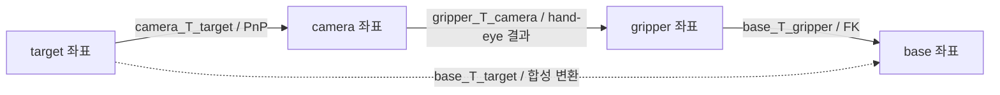
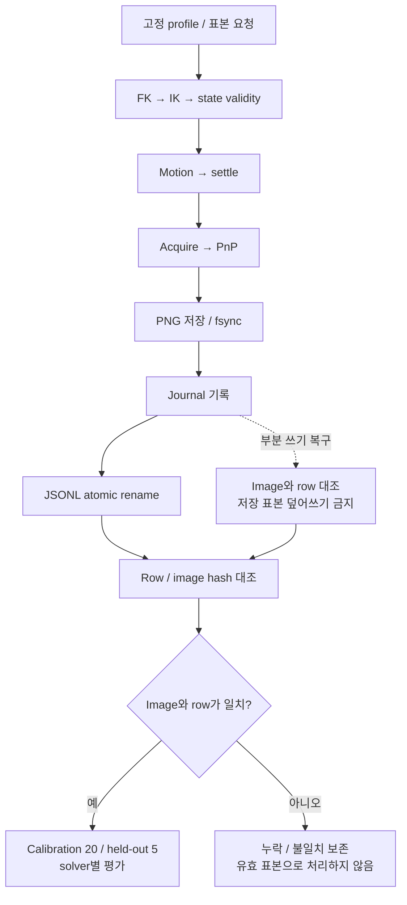

# Hand-eye 좌표와 데이터 계약

Hand-eye 계산과 재현에 필요한 좌표, 동기화, 저장 조건을 정의한다. 모델, 상수, 허용 한계는 config와 core 코드가 원본이며, 작업 절차는 [CALIBRATION](../../../../docs/CALIBRATION.md)을 따른다.

## 좌표와 동기화

parent_T_child는 child 좌표를 parent로 변환한다. Transform은 다음 식을 만족한다.

`base_T_gripper @ gripper_T_camera @ camera_T_target = base_T_target`

| 항목 | 계약 |
|---|---|
| 단위 / quaternion | m, rad, ns / xyzw |
| 회전 행렬 | Orthogonal, det +1, 오차 1e-6 이내 |
| Image/CameraInfo | 같은 nonzero stamp, optical frame |
| FK / position IK | Canonical 12관절 feedback / 팔 5관절 검사 |
| Capture / timeout | Settle 이후 stamp / monotonic 대기 시간 |

Position-only IK는 orientation 도달을 보장하지 않는다. 다른 입력의 camera calibration을 아래 fixture 값으로 덮어쓰지 않는다.

| Fixture camera | 값 |
|---|---|
| Frame / image | left_wrist_rgb_optical_frame / RGB8 640×480, step 1920 |
| Distortion / rectification | plumb_bob D=0 / R=I |
| Intrinsics | fx=fy=227.751496, cx=319.5, cy=239.5 |

## Board와 PnP

| Fixture board | 값 |
|---|---|
| ChArUco | 7×5, square 30 mm, marker 15 mm |
| Dictionary / legacy | DICT_5X5_100 / false |
| Corner gate | 24개 중 최소 16개 + 4 quadrant coverage |

평면 PnP는 IPPE를 사용하고 IPPE_SQUARE는 사용하지 않는다. Positive-depth 후보를 VVS refine한 뒤 ambiguity를 검사한다. 상위 두 오차 비가 1.05 미만이면 ambiguous이며, 영 오차 특수 기준은 코드의 1e-12를 따른다. 유효하지 않은 관측은 성공 표본으로 기록하지 않는다.

## Dataset과 저장

Materialized profile은 pose/runtime/URDF, camera K/D/R/P, source hash를 고정한다. 구성은 calibration 20개와 held-out 5개이며 실패 표본을 교체하지 않는다. Random seed, 탐색 제한, 선정 근거, row/image hash, capture provenance를 보존한다.

수집은 요청 → FK → IK → state validity → motion → settle → acquire → PnP → record 순서다. 저장은 PNG fsync → journal → JSONL atomic rename 순서로 수행한다. 부분 쓰기 복구 시 image 없는 row를 유효 처리하지 않으며, 기존 dataset 일부 재사용을 fresh run으로 표시하지 않는다.

## 평가와 적용

Tsai, Park, Horaud, Andreff, Daniilidis solver를 평가하고 method별 예외를 분리한다. GT 평가는 simulation 한정이며 held-out, solver 실패도 결과에 남긴다.

Offset, 품질 gate는 명시한 실행 정책을 사용한다. 결과 생성은 자동 TF 게시나 실물 calibration 완료를 의미하지 않는다.
