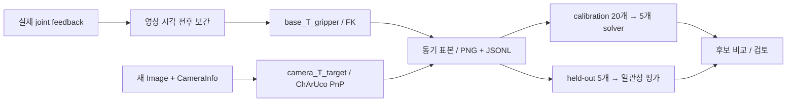
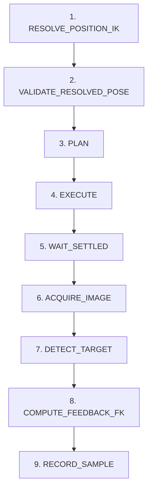

# Hand-eye 수집과 오프라인 평가

왼손목 eye-in-hand 보정의 수집 adapter, 데이터 검증과 solver를 제공한다. 결과는 검토용 후보이며 TF를 발행하거나 보정 프로필에 자동 적용하지 않는다. 이 패키지는 simulator launch를 제공하지 않으므로 카메라와 motion backend는 별도로 구성한다.

| 하려는 일 | 먼저 읽을 곳 |
|---|---|
| 좌표와 단위 확인 | [좌표·데이터 계약](frames-and-data.md), 아래 Transform convention |
| 새 데이터 수집 | [수집 순서](#single-pose-orchestration), [입력 조건](#position-ik-state-validity-motion-and-settle) |
| 기존 데이터 검증 | [데이터 검증](#pose-sets-and-dataset-validation) |
| Solver 비교 | [오프라인 평가](#offline-solver-and-timestamp-evaluation) |
| 구현 수정 | 아래 adapter 표와 [검증](#verification) |



## Transform convention

`RigidTransform(parent_frame, child_frame, ...)`는 child 좌표를 parent 좌표로 옮기는 `parent_T_child`다. 합성 전에 frame 이름을 검사한다.

`base_T_gripper @ gripper_T_camera @ camera_T_target = base_T_target`

| 변환 | 출처 / OpenCV 인자 |
|---|---|
| `base_T_gripper` | feedback FK → `R_gripper2base`, `t_gripper2base` |
| `camera_T_target` | PnP → `R_target2cam`, `t_target2cam` |
| `gripper_T_camera` | 미지 보정값 ← `R_cam2gripper`, `t_cam2gripper` |
| `base_T_target` | 고정 표적 관계, held-out 비교 |

단위는 m, rad, 정수 ns이고 quaternion은 ROS xyzw 순서다. 회전 행렬은 모든 값이 유한하고 `||R^T R − I||_F ≤ 1e-6`, `|det(R) − 1| ≤ 1e-6`이어야 한다.

## Single-pose orchestration

`SinglePoseOrchestrator`는 다음 9단계를 재시도 없이 수행한다.



1. `config/single_pose_request.template.json`을 복사하고 실행 입력을 채운다. `null`인 미결정 값은 실행 가능한 기본값이 아니다.
2. 절대 artifact 경로, pose, hash/version, soft limit, clearance 근거, right-park 허용치와 각 단계 timeout을 지정한다.
3. 별도로 준비한 카메라와 motion backend에서 수집한다. 성공한 PLAN/EXECUTE만으로 촬영을 허가하지 않는다.
4. `orchestration.jsonl`에서 시작·성공·실패 단계와 이유를 확인한다. 실패 이후 단계의 부작용은 실행하지 않는다.

| 사전 조건 | 의미 |
|---|---|
| 단계별 timeout | 각각 양의 monotonic 시간; 공유 암묵값 없음 |
| pose 검증 | canonical left-arm soft limit, collision margin, 해당 joint vector에 묶인 clearance 근거, MoveIt validity |
| 안전 수치 | 승인되지 않은 production 기본값을 제공하지 않음 |
| simulation fixture | clearance 0.146088 m, 요구 margin 0.10 m, pose 일치 1e-4 rad; 현재 모델과 회귀 검사 |

위 fixture 수치는 실물 허용값이 아니다. 수집 root는 소스 트리 밖의 실행별 디렉터리를 사용한다.

## Camera acquisition and dataset artifacts

`RosExactCameraPairAdapter`는 ROS 메시지를 독립된 bounded buffer로 복사하고 **settle 완료보다 늦은** 가장 이른 호환 영상을 선택한다.

| fixture 입력 | 조건 |
|---|---|
| Image / CameraInfo | 같은 nonzero stamp, `left_wrist_rgb_optical_frame` |
| 영상 | RGB8, 640×480, step 1920; endian/행 간격/payload 길이 검사 |
| 보정 | `plumb_bob`, D의 5계수 0, R=I |
| K | fx=fy=227.751496, cx=319.5, cy=239.5 |
| P | K와 같은 focal/principal point, translation 0 |
| 촬영 대기 | 명시 buffer 크기, monotonic wall deadline; ROS clock 정지에도 만료 |

Focal length는 vertical FOV 93°의 `fy = height / (2 tan(FOV/2))`다. 다른 카메라 입력을 이 fixture 값으로 덮어쓰지 않는다.

```text
<run_id>/
├── manifest.yaml           # 환경, 설정, 버전과 hash
├── samples.jsonl           # 동기 표본
├── orchestration.jsonl     # 단계별 수집 결과
└── images/<sample_id>.png  # 손실 없는 원본 영상
```

| 저장 항목 | 보존할 내용 |
|---|---|
| manifest | commit/dirty, URDF/MJCF/pose hash, ROS/MoveIt/OpenCV/MuJoCo/vendor 버전 |
| 재현 조건 | camera/target 계약, board SVG/PDF hash와 크기 출처, 제어·영상·joint 주기, parameter, seed |
| 표본 | canonical 12관절, 왼팔 seed/해 5관절, 정확한 image/info stamp, 보간 전후 stamp와 비율 |
| 추정 입력 | FK/PnP 변환, 순서 있는 ChArUco 대응점, K/D/R/P 원본과 SHA256 |

`DatasetWriter`는 PNG fsync/rename → journal fsync → 전체 JSONL fsync/rename 순서로 쓴다. 재개 시 유효 journal을 replay하고 journal 이전의 미참조 이미지를 정리하며 row/image/camera/manifest hash를 검사한다. 이미지 없는 row를 완료 표본으로 만들지 않는다. ID의 경로 이탈과 dataset/image symlink는 거부하고 URDF/Xacro나 보정 프로필을 수정하지 않는다.

## Pose sets and dataset validation

`pose_generation.py`는 호출자가 제공한 후보 근거로 결정적으로 선택한다. `pose_manifest.py`와 `pose_run.py`는 새 실행의 20 calibration + 5 held-out 구성을 관리한다. Single/multi-pose ROS node는 별도 backend에 연결하며 multi-pose 취소는 `std_srvs/Trigger`를 사용한다.

```bash
ros2 run cleany_handeye_calibration validate_handeye_dataset --help
```

검증에는 sample, pose manifest, runtime config, URDF, 평가 전용 ground truth, translation bound와 출력 인자가 필요하다. 검증 통과가 보정 적용을 뜻하지 않는다.

## Offline solver and timestamp evaluation

### 입력과 실행

| 입력 | 용도 |
|---|---|
| `samples.jsonl` + 같은 폴더 `manifest.yaml` | 20 calibration / 5 held-out; manifest 자체 hash 검사 |
| materialized URDF | manifest hash와 일치해야 FK 재계산 |
| evaluation-only GT | 오프라인 오차 평가 전용; solver/PnP/TF/수집에는 전달하지 않음 |
| continuous observation JSONL | 실제 연속 joint/image 관측. 정지 표본 전후 stamp로 합성하지 않음 |
| `evaluation.yaml` | 검토한 translation validity bound와 timing 설정 |

`config/evaluation.template.yaml`의 미결정 값을 검토하여 채운 뒤 실행한다.

```bash
source /opt/ros/humble/setup.bash
source "$(make -s print-install-base)/setup.bash"
ros2 run cleany_handeye_calibration evaluate_handeye \
  --samples /absolute/run/samples.jsonl \
  --continuous-log /absolute/run/continuous_trajectory.jsonl \
  --urdf /absolute/run/cleany.urdf \
  --ground-truth /absolute/run/evaluation-only-ground-truth.yaml \
  --config /absolute/run/evaluation.yaml \
  --output-directory /absolute/run/evaluation
```

### 비교 행렬과 결과 읽기

| 평가 조건 | pixel noise | 왼팔 joint noise |
|---|---:|---:|
| ideal | 0 px | 0° |
| nominal | 0.5 px | 0.05° |
| stress | 1.0 px | 0.10° |

5 solver × 3 조건 × 기록된 seed 10개 = 150회다. 같은 조건/seed의 solver들은 동일한 hash의 PCG64 noise를 받는다. Pixel noise는 원본 ChArUco 점에 적용한 뒤 PnP를, joint noise는 왼팔 5관절에 적용한 뒤 FK를 다시 계산한다. 최종 변환이나 GT를 직접 흔들지 않는다.

| 출력 | 읽는 방법 |
|---|---|
| `pnp_candidates.jsonl` | raw/refined 후보, depth, RMSE와 모든 실패 |
| `solver_results.csv` | 150개 결과 전체; 실패를 빼고 성공률을 계산하지 않음 |
| `metrics.yaml` | 유효율, 위치/회전 median·linear P95, held-out 일관성, runtime |
| `candidate_transform.yaml` | `candidate_not_applied`; 자동 적용하지 않음 |
| `timestamp_sensitivity.csv` | 선택한 한 solver의 연속 관측 timestamp offset 민감도 |

유효율 0.95 미만 method는 제외한다. 네 정확도 지표의 Pareto 비교 후 held-out 일관성을 사용하고 우열이 교차하면 `review_required`다. 선택 변환은 첫 기록 seed의 clean ideal 결과다. 후보 적용은 사람이 검토한다.

Continuous JSONL의 `joint_state`에는 stamp, canonical 12개 이름/위치와 선택적 속도를, `image_observation`에는 별도 sample/pose ID, image stamp와 PnP 변환을 기록한다. `image_stamp_ns + offset_ns`에서 보간하고 URDF FK를 다시 계산한다.

## Planar ChArUco and PnP contract

| 항목 | 조건 |
|---|---|
| board | 7×5 squares, square 30 mm, marker 15 mm, `DICT_5X5_100`, `legacy_pattern=false` |
| 유효 검출 | 내부 24 corner 중 유일하고 범위 안인 16개 이상, object-space 4분면 모두 포함 |
| 검출 API | Ubuntu OpenCV 4.5.4의 `CharucoBoard_create`, `DetectorParameters_create`, `detectMarkers`, `interpolateCornersCharuco`, `chessboardCorners` |
| 영상 처리 | 2배 cubic grayscale 확대 + subpixel refinement 후 좌표를 원본 픽셀로 환산 |
| PnP | `solvePnPGeneric(SOLVEPNP_IPPE)`; `IPPE_SQUARE` 미사용 |
| 후보 검사 | finite, 모든 표적의 camera Z 양수 → 후보별 VVS refine → cheirality와 전체점 RMSE 재검사 |
| 모호성 | 두 RMSE 모두 ≤1e-12 px 또는 best가 그보다 크고 second/best <1.05이면 `ambiguous_pnp` |

확대 검출은 corner gate를 완화하지 않는다. Raw/refined 변환, 최소 depth와 실패 이유를 보존한다. 정답 정보는 검출과 후보 선택에 사용하지 않는다.

## Hand-eye solver and metrics

Tsai, Park, Horaud, Andreff, Daniilidis는 동일한 검증 표본의 복사본을 받는다. 한 method의 예외/무효 변환은 다른 method를 중단시키지 않는다.

| 검증 | 조건 |
|---|---|
| registry | 예상 OpenCV constant 누락 또는 미등록 `CALIB_HAND_EYE_*` 추가 시 preflight 실패 |
| translation envelope | `HandEyeTransformValidityPolicy.max_translation_norm_m`는 양의 유한한 명시 입력; 범위 밖 해 무효 |
| 입력 split / frame | calibration만 solver로 전달; base/gripper/camera/target 이름 검사 |
| held-out | 표본별 `base_T_target` 복원 후 모든 쌍의 병진·회전 차이 median/P95 |
| 오차 단위 | 병진 m, 회전 rad |

## Joint feedback synchronization and FK

| adapter | 보존 / 거부 조건 |
|---|---|
| `JointStateRingBuffer` | 12관절 완전성, increasing stamp, bounded capacity; 추가 관절은 MoveIt에 보내지 않음 |
| 시간 역행 | 중복/작은 역행은 buffer 변경 없이 거부; reset threshold 이상이면 새 epoch와 기존 buffer 폐기 |
| 보간 | 영상 양쪽의 서로 다른 sample, 각각 `max_sample_distance_ns` 이내; joint 이름으로 선형 보간 |
| 속도 | 양쪽 sample에 있으면 보간·기록; FK 필수 입력은 아님 |
| `timed_joint_sample_from_message` | 수신 시간이 아닌 `JointState.header.stamp` |
| `MoveItForwardKinematicsAdapter` | canonical 12관절, `is_diff=false`, `/compute_fk`의 `base_link → left_gripper_frame` |
| FK 결과 | MoveIt code, link, frame, pose 수와 rigid transform 검사; monotonic 준비/응답 timeout |

누락, stale, 불완전, 순서 오류와 clock reset은 각각 명시 상태다. 테스트는 client/executor poll hook을 주입해 ROS graph 없이 실행할 수 있다.

## Position IK, state validity, motion, and settle

| 단계 | endpoint / gate |
|---|---|
| 시작/각 이동 전 | fresh ROS-stamped 12관절 위치·속도; 오른팔 5관절이 승인된 all-zero park에서 정지 |
| IK | `/compute_ik`; `left_arm`, `left_gripper_frame`, `base_link`만 허용; collision avoidance |
| IK state | full non-diff 12관절, 왼팔 seed만 대체; 오른팔과 gripper feedback 유지 |
| IK 방향 | identity quaternion은 placeholder; position-only이며 orientation 보장 없음 |
| validity | `/check_state_validity`; 왼팔 해를 같은 full state에 적용해 검사한 `ValidatedJointGoal`만 다음 단계로 전달 |
| plan / execute | `/move_action`의 plan_only, scaling 0.10/0.10 → 반환 trajectory만 `/execute_trajectory`로 실행 |
| 취소 | 별도 monotonic timeout; `ERROR_NONE`과 정확한 goal UUID가 `goals_canceling`에 있어야 확인 |

Freshness, park 허용치와 모든 IK/validity/plan/execute/cancel/settle timeout은 `MujocoMotionConfig`의 필수 입력이다. Raw JointPose, stale/partial state, 오른팔 park 이탈은 실행하지 않는다. Action status와 정확한 MoveIt error code를 보존한다.

| simulation settle 기준 | 값 |
|---|---:|
| controller path / goal tolerance | 0.05 / 0.01 rad |
| settle position / velocity | 0.015 rad / 0.01 rad/s |
| 연속 유지 | ROS stamp 기준 1.0초 |

왼팔 모든 joint가 동시에 만족해야 한다. 조건 위반이나 시간 역행은 구간을 초기화한다. 별도 monotonic settle deadline은 clock 정지에도 만료하며 timeout 뒤 촬영을 허가하지 않는다. 이 수치는 실물 승인 허용치가 아니다.

## Core models

| 모델 | 역할 |
|---|---|
| `PositionTarget`, `JointPose`, `IkResult` | frame을 가진 위치 목표, 완전한 joint vector, 배타적인 성공/실패 |
| `TimedJointSample` | 촬영 시각과 대응할 feedback |
| `CalibrationSample`, `CalibrationSampleRecord` | 변환 쌍/split과 version-1 동기 데이터 row |

Mutable 입력은 immutable tuple로 복사한다. 중복 joint 이름, 길이 불일치, 무효 timestamp와 비유한 값을 거부한다.

## Dependencies

System NumPy/OpenCV/PyYAML은 rosdep의 `python3-numpy`, `python3-opencv`, `python3-yaml`을 사용한다. 수학·동기화·설정·settle core는 rclpy를 import하지 않는다. ROS adapter는 manifest의 rclpy/action_msgs/moveit_msgs/sensor_msgs에 의존한다.

## Verification

저장소 루트의 Humble 환경에서 실행한다. 개별 수정은 해당 pytest부터, 연결 변경은 `make test-handeye`로 확인한다.

```bash
python3 -m pytest -q ros2_ws/src/cleany_handeye_calibration/test
make test-handeye
```

| 수정 범위 | 집중 검사 파일 |
|---|---|
| 동기화 / FK | `test_joint_state_sync.py`, `test_moveit_fk.py` |
| motion / settle | `test_motion_config.py`, `test_ik_adapter.py`, `test_motion_adapter.py`, `test_settle_detector.py` |
| camera / 저장 | `test_camera_acquisition.py`, `test_ros_camera_adapter.py`, `test_schema.py`, `test_dataset_writer.py` |
| single pose | `test_single_pose_orchestrator.py`, `test_single_pose_runtime_config.py` |
| pose set | `test_pose_diversity.py`, `test_pose_manifest.py`, `test_pose_generation.py`, `test_pose_run.py`, `test_multi_pose_runtime.py` |
| 평가 | `test_offline_fk.py`, `test_experiment_evaluation.py`, `test_timestamp_sensitivity.py`, `test_evaluation_artifacts.py` |
