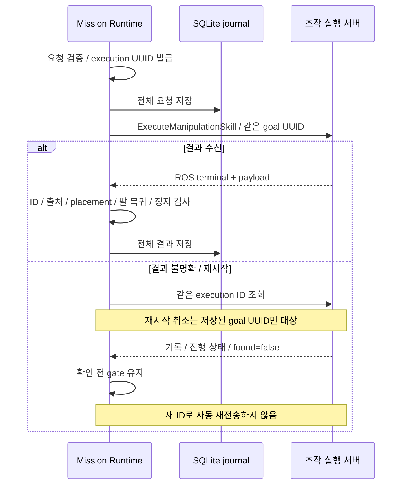

# 단일 객체 Manipulation 계약

Mission은 승인한 객체를 실행 서버에 전달하고, 서버 내부 BT는 executor가 소유한다. 이 실행 계약은 reachable-grasp plan-only action과 별개다.

## 인터페이스

| 항목 | 원본 / 기본 이름 |
|---|---|
| 실행 action | ExecuteManipulationSkill.action / mock/manipulation/execute_skill |
| 진행, 결과 record | ManipulationExecutionRecord.msg |
| 조회 service | GetManipulationExecution.srv / mock/manipulation/get_execution |
| 요청 | mission/task/execution ID, skill_name, snapshot ID, uint32 object ID, destination ID |

## 요청과 재전송

Runtime은 wire object ID를 Planner 제안과 대조하며 표시 ID에서 숫자를 추정하지 않는다. Destination은 RuntimePolicy allowlist로 검사한다.

행동마다 execution UUID를 발급하고 **전체 요청을 SQLite에 저장한 뒤 전송**한다. ROS goal UUID도 같은 값을 사용하므로 지연 수락, 재시작 취소는 정확한 goal만 대상으로 한다. 결과가 불명확하면 같은 execution ID로 조회하며 새 ID로 자동 재전송하지 않는다.

## 성공 판정

현재 peer는 BLOCKED도 ROS SUCCEEDED로 반환할 수 있다. 따라서 Runtime은 ROS terminal뿐 아니라 다음 payload 조건을 함께 검사한다.

- SUCCESS, 일치하는 execution ID와 mock 출처
- LEFT_GRIPPER, CONFIRMED, placement 검증 완료
- 팔 복귀와 정지 확인

Feedback stage는 완료 증거가 아니다. 전체 결과와 task/execution/destination ID는 journal, report_json.actions에 보존하며, peer CANCELED는 Runtime CANCELLED로 변환한다.

## 주행과 복구

| 상태 | 처리 |
|---|---|
| HELD/UNKNOWN, 팔 미복귀, 사람 확인 필요 | Home, 다음 미션 이동 차단; 취소 결과가 CANCELLED여도 FSM ERROR 유지 가능 |
| reset_error | 주행 가능 조건 우회 금지 |
| found=false | 저장 오류/기록 없음 미구분; 미실행, 정지 증거로 사용 금지 |
| 진행 중, INTERRUPTED, 불일치 결과 | Gate 유지 |
| 재시작 | 저장 UUID의 취소, 조회만 수행; 미션 자동 재개 금지 |

현재 peer에는 수동 팔 복구, 해제 계약이 없으므로 Runtime은 임의 복구를 수행하지 않는다. 진단은 journal의 manipulation_boundary metadata에 남긴다.

관련 안내: [Mission](mission.md), [검증](../../../../docs/TESTING.md).
