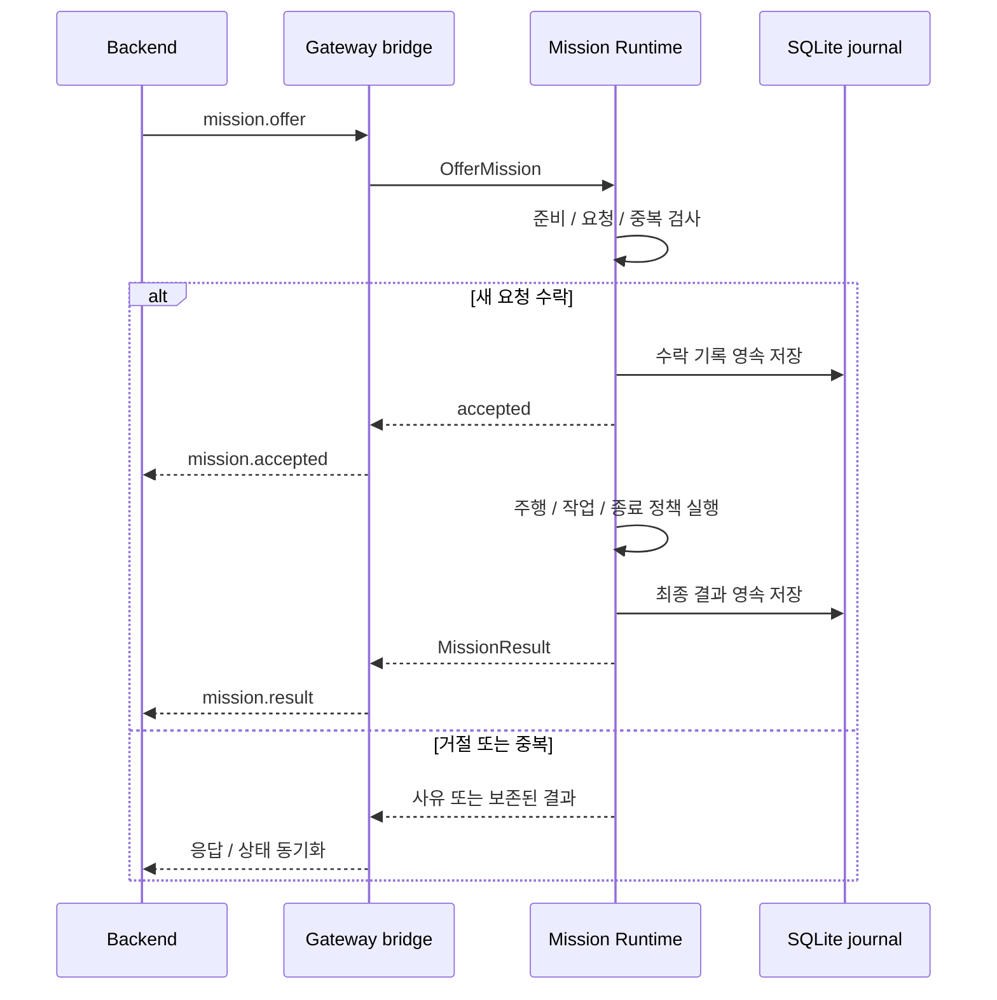
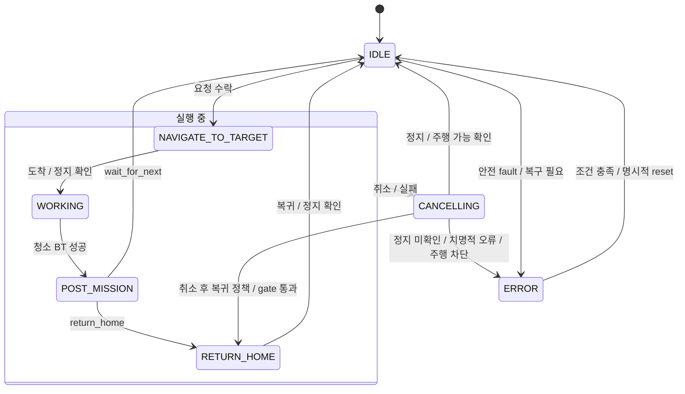
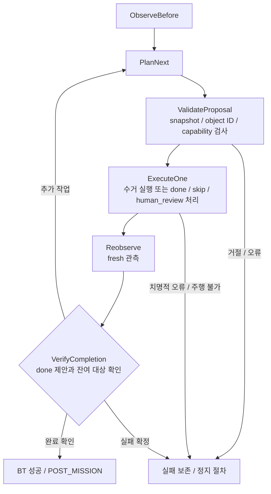

# Mission과 Gateway 계약

Backend는 queue와 배차를, Mission Runtime은 수락 이후 실행과 영속 결과를 소유한다. Runtime에는 별도 queue가 없으며 한 번에 미션 하나만 수락한다. 필드는 패키지 msg/srv, 설정은 cleany_mission_manager/config/runtime.yaml이 원본이다.

## 인터페이스

| 상대 이름 | 의미 |
|---|---|
| `mission/offer` | clean_desk, SEAT, canonical seat ID 요청 수락 |
| `mission/cancel` | 비동기 취소 수락 |
| `mission/snapshot` | 현재 상태와 보존된 최종 보고 |
| `mission/reset_error` | 정지, 팔 주행 가능, Nav2 준비 확인 후 명시적 오류 해제 |
| `mission/status`, `mission/result` | transient-local 상태와 최신 최종 보고 |
| `robot/safety_fault`, `robot/safety_released` | 안전 소유자의 fault/release 알림 |

Offer/Cancel의 accepted는 수락 응답이며 완료 증거가 아니다. 같은 ID로 같은 요청을 보내면 재실행하지 않고, 같은 ID에 다른 내용을 보내면 거절한다. Runtime 진단 sequence와 Backend 미션별 sequence는 별개다.

## 수락과 완료

수신 ACK, 실행 수락, 최종 결과는 서로 다른 시점이다.

## 정상 실행

정상 실행은 대상 이동, 작업, 완료 후 정책 순서다. 종료 전 최종 보고를 저장한다. 취소 후 복귀에는 정지, 팔의 주행 가능 상태, 복귀 정책, Nav2 준비가 모두 필요하다. ERROR 해제 조건은 아래 표를 따른다.

### 청소 BT

청소 BT는 처음 장면을 관측한 뒤 계획, 제안 검증, 객체 하나의 실행, 재관측, 완료 검증을 반복한다. Snapshot/object ID와 capability를 검사하며, done 제안도 fresh 관측에서 잔여 대상을 확인한 뒤 완료한다. Skip과 human_review는 조작 명령 없이 기록하며 done도 조작 명령을 보내지 않는다.

보고에는 skip, 사람 확인, 실패, 취소를 보존한다. Mock 관측 ID는 실제 사진이 아니다.

## 취소, 안전, 재시작

Nav2는 설정된 lifecycle node 모두 active이고 lifecycle_timeout 이내 응답해야 준비 상태다. 기본 목록은 map_server, amcl, planner_server, controller_server, bt_navigator, collision_monitor다. Deadline은 steady clock과 runtime.yaml 값을 사용한다.

| 조건 | 처리 |
|---|---|
| Nav2 action server만 준비 | NAV2_NOT_READY, goal 미전송 |
| 취소 요청 | Nav2 terminal + fresh odom 정지 확인; ACK만으로 IDLE 전이 금지 |
| 정지 확인 기한 초과 | ERROR 유지 |
| Safety fault | Producer가 실제 정지 먼저 수행; Runtime은 물리 E-stop 아님 |
| Fault 해제 | 일치하는 release + 정지 확인 + 명시적 reset |
| 재시작 당시 미완료 미션 | INTERRUPTED, 사람 확인 필요; 자동 재개 금지 |
| Backend 단절 | 수락한 미션 계속 실행; 재연결 후 상태와 결과 동기화 |

SQLite journal은 수락, 출처, goal UUID, 최종 결과, 오류를 저장한다. 재시작 시 저장된 UUID의 orphan goal만 취소하고 정지, 준비를 확인한다.

## Gateway schema v1

control_bridge는 `ws(s)://<backend>/api/robots/cleany-01/gateway/ws`를 ROS에 연결한다. mission.offer의 clean_seat를 ROS clean_desk/SEAT로 변환하고 canonical seat ID를 보존한다.

연결, 재연결, sync마다 fresh snapshot을 보내고 **snapshot ACK 이후** 해당 연결의 feedback, 명령을 허용한다. RPC timeout은 수락 여부가 불명확하므로 거절을 합성하지 않고 재동기화한다.

| 항목 | 의미 |
|---|---|
| ACK / mission.accepted / mission.result | 수신 / 수락 / 최종 결과 |
| SQLite outbox | Event ID, 미션별 sequence, payload를 ACK까지 보존하고 재전송 |
| Snapshot | 최근 100개 최종 보고; IDLE이어도 port 미준비면 가용 ERROR |
| Mock before/after_observation | null; outcome과 사람 확인은 보존 |
| Schema, 인증, media 정책 | control-plane 저장소 소유 |
| Parameter 기본값 | control_bridge node 기준 |

## 개발 관측

| 토픽 | 계약 |
|---|---|
| debug_snapshot | reliable/transient-local depth 1, schema v1 |
| runtime_events | reliable/transient-local depth 2048, boot ID, 연속 sequence |

관측 토픽은 명령 경로가 아니다. 소비자는 재시작과 sequence gap을 구분해야 한다.

관련 안내: [실행](../../../../docs/RUNNING.md), [Manipulation](manipulation.md).
