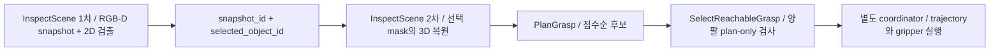
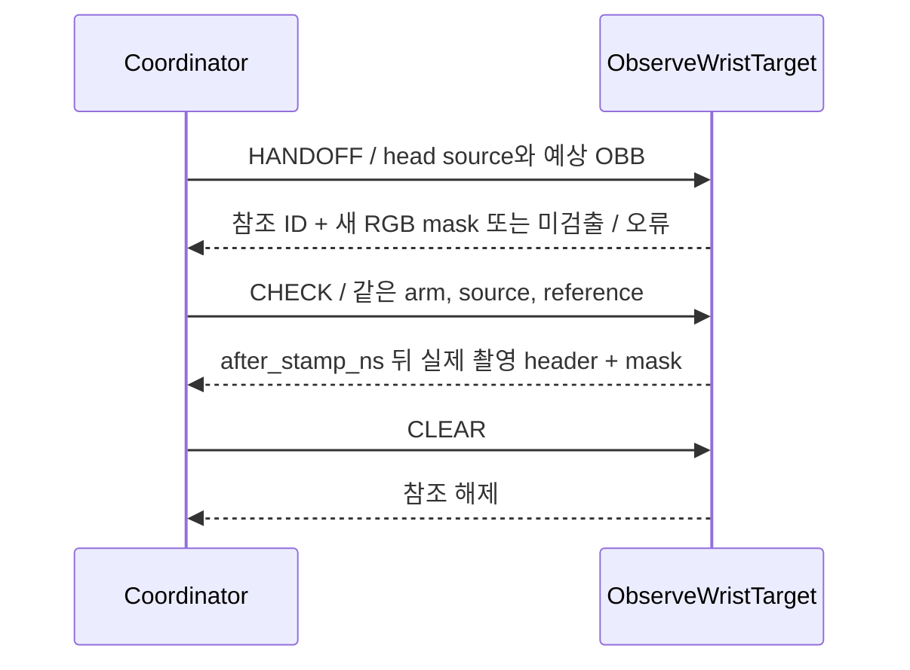
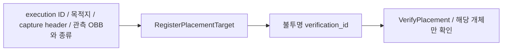

# 관측과 조작 인터페이스

Perception snapshot, grasp 후보, 도달성 검사와 조작 결과가 공유하는 ROS wire 계약이다. Provider 내부 model은 노출하지 않는다.



## 객체 메시지

| 타입 / 필드 | 의미 |
|---|---|
| `DetectedObject2D`, `DetectedObject2DArray` | RGB pixel bbox, snapshot-local 번호, 후속 선택용 `snapshot_id` |
| `distance_m`, `distance_valid` | 촬영 depth와 TF로 구한 configured target-frame 원점 거리; 불충분한 depth는 자동 조작 제외 |
| 후보 순서 | 거리 → confidence → detector 원본 순서 |
| `DetectedObject3D`, `DetectedObject3DArray` | 선택 OBB와 같은 snapshot 문맥 |
| `sorting_category`, `sorting_reason` | 모델 분류와 사유; category는 trash / lost_item / review / 미제공 빈 값 |

빈 category는 이름 기반 폐기 허가가 아니다. 메시지 변경 시 consumer를 함께 재빌드한다.

### 관측 충돌 형상

| `ObservedObjectGeometry` | 계약 |
|---|---|
| 연결 | `/grasp/collision_geometry`; capture header, snapshot_id, object_id로 후보와 연관 |
| 좌표 | `mesh_pose`는 header frame, vertices는 mesh_pose local 좌표 |
| 형상 | Convex footprint를 인식 지지면까지 돌출; 숨은 실제 형상이나 simulator GT 아님 |
| 배포 | 별도 mesh 메시지, `shape_msgs` 의존; 다른 메시지 호환성은 각 계약 참조 |

## Scene inspection action

| 단계 | 요청 | 결과 |
|---|---|---|
| 1차 | 동기화된 새 RGB-D snapshot | 2D detection |
| 2차 | 기존 snapshot_id + selected_object_id | 선택 YOLOE mask의 target/context cloud와 OBB |

2차 출력은 같은 configured target frame과 capture timestamp를 사용한다.

## Grasp planning과 선택

| API | 결과 / 제약 |
|---|---|
| `PlanGrasp` | Score 내림차순 `GraspCandidate[] candidates` |
| `SelectReachableGrasp` | 동일 snapshot / object / frame / OBB 후보를 IK, state validity, 두 구간 plan-only 검사 |
| 선택 결과 | Index, arm, endpoint joint state; 현재 RobotState에 종속되는 trajectory는 반환하지 않음 |
| `required_arm=left/right` | 재인식에서 해당 팔만 평가 |
| `required_arm=''` | 가까운 팔부터 양팔 fallback |
| 다른 required_arm | `ERROR_INVALID_INPUT` |

Nearest coordinator는 유효한 distance를 가진 가까운 물체부터 시도한다. 선택 Action은 gripper나 trajectory를 실행하지 않는다.

## 손목 RGB 인계와 확인



| 요청 / 시각 | 계약 |
|---|---|
| HANDOFF | Head source ID, 원래 label/confidence, 예상 base-frame OBB → segmentation reference; 별도 손목 detection은 선택 |
| `expected_pose` | 입력 추정치; header stamp는 원본 head 관측 시각 |
| 신선도 | `after_stamp_ns`보다 새로운 image/CameraInfo 쌍만 처리 |
| 측정 범위 | RGB-only header와 mask; depth / 3D 높이 측정값 아님 |

| 응답 status | 의미 | 후속 처리 |
|---|---|---|
| `OK=1` | 유효한 검출, `success=true` | 참조 / mask 사용 |
| `NOT_DETECTED=2` | 새 RGB / CameraInfo / TF로 투영했으나 대응 물체 없음 | CHECK는 기존 ID와 실제 촬영 header, 빈 mask 반환; 다음 새 프레임 재시도 가능 |
| `ERROR=0` | 센서 / TF / 추론 / 참조 / 중복 후보 / mask 오류 | 단순 미검출로 취급 금지 |

HANDOFF 미검출은 파지 진행용 참조를 만들지 않는다. Status 필드가 다른 wire/CDR 버전은 제공자와 호출자를 함께 재빌드·재시작하고, 이전 기록은 이전 인터페이스로 읽는다.

## VerifyPlacement

| 요청 / 응답 | 계약 |
|---|---|
| 요청 | Label, destination_id, 방출 이후 `after_stamp_ns` |
| 결과 | 실제 놓기 확인의 success/message; 열기 명령 성공과 구분 |
| 현재 제공자 | Simulation oracle; 물체 정답 pose를 조작 코드에 반환하지 않음 |
| 실물 | 독립 센서 기반 검증 제공자 필요 |

## Contracts

- [Mobile base](../docs/mobile_base.md): `/cmd_vel` 차체 속도 명령

## Mission Runtime 계약

| 인터페이스 | 의미 |
|---|---|
| `OfferMission` | mission_id, clean_desk, SEAT, canonical target_id, requested_by; accepted / duplicate / reason / 선택 report_json은 수락 응답 |
| `CancelMission` | 취소 수락; 실제 종료는 최종 결과로 확인 |
| `GetRuntimeSnapshot` | 현재 상태와 보존 결과를 snapshot_json으로 반환 |
| `MissionStatus` | FSM / 외부 phase / BT 단계 / ready / 진단 sequence; Backend의 미션별 sequence와 구분 |
| `MissionResult` | Outcome, 실패, 완료·skip 작업, 사람 확인, 관측 참조, 주행·복귀 결과, report_json |

Mock 관측 ID는 실제 사진이 아니다. 이름과 취소·복구 규칙은 [Mission 계약](mission.md)을 따른다.

## 개발 관측 메시지

| 메시지 | 내용 |
|---|---|
| `DebugBTNode` | ID / parent / kind / status / visited / operation_id |
| `RuntimeDebugSnapshot` | Header, boot/event sequence, mission/state/ready/reason, BT 노드, versioned snapshot_json |
| `RuntimeEvent` | Boot/sequence, mission/task/execution ID, kind, data_json |

명령 의미가 없고 인터페이스 빌드만으로 producer가 실행되지 않는다. [QoS와 상세 필드](#개발-관측-인터페이스)를 참고한다.

## 설정 및 검증

인터페이스를 추가하거나 변경할 때는 해당 의존 패키지, `package.xml`, 빌드 및 메시지
호환성 검증을 함께 갱신한다.

```bash
source /opt/ros/humble/setup.bash
cd ros2_ws
colcon build --symlink-install --packages-select cleany_interfaces
source install/setup.bash
colcon test --packages-select cleany_interfaces
colcon test-result --verbose
```

설치된 계약은 `ros2 interface show`로 `InspectScene`, `PlanGrasp`,
`SelectReachableGrasp`와 관련 message를 확인한다.

## 관련 KB

- [Technical Overview](../../../../docs/cleany-docs/20_TECHNICAL/00%20-%20Technical%20Overview.md)
- [System Context](../../../../docs/cleany-docs/20_TECHNICAL/01%20-%20System%20Context.md)
- [ROS 2 Software Architecture](../../../../docs/cleany-docs/20_TECHNICAL/11%20-%20ROS%202%20Software%20Architecture.md)

## 단일 물체 Manipulation action

실행·취소·조회 명령은 [Skill Executor 실행 안내](../../cleany_skill_executor/docs/manipulation_mock_usage.md)를
따른다. 이 절은 ROS 필드와 종료·기록 상태의 의미를 정리한다.

### 공개 인터페이스

| 타입 | 기본 ROS 이름 | 역할 |
|---|---|---|
| `ExecuteManipulationSkill.action` | `/mock/manipulation/execute_skill` | 승인된 `collect_trash` 또는 `collect_lost_item` 물체 하나의 요청·Feedback·Result·취소 |
| `GetManipulationExecution.srv` | `/mock/manipulation/get_execution` | execution_id를 받아 found와 최신 record 반환 |
| `CancelManipulation.srv` | `/mock/manipulation/cancel` | 활성 execution_id와 취소 mode를 받아 accepted와 message 반환 |
| `ManipulationExecutionRecord.msg` | `/mock/manipulation/execution_events` | 진행·종료·재시작 중단 이벤트 |

[MuJoCo BT 서버](../../cleany_manipulation_bt/README.md)는 같은 계약을 `/sim/manipulation`에서 제공한다.

이벤트 QoS는 Reliable·Transient Local, depth 100이다.
상태·단계·오류의 전체 목록은 [Action 명세](../../cleany_skill_executor/docs/02_execute_manipulation_skill_action_spec.md)를 따른다.

### Goal·Feedback·Result

| 구분 | 확인할 내용 |
|---|---|
| Goal | 호출자가 execution_id 발급. snapshot_id/object_id 조합으로 대상 지정 |
| Feedback | 큰 단계 `stage`, 세부 동작 `substage`, 선택 팔과 진행 설명 |
| `substage` | Feedback·기록의 현재 세부 동작. 큰 단계 `stage`의 취소·timeout 계약은 유지 |
| `completed_substages` | 기록에 저장된 완료 세부 동작 목록. 명령 완료와 물체 상태 확인을 구분 |
| `failed_substage` | Result·기록의 실패 세부 동작. 기존 기록에는 빈 값일 수 있음 |
| `cancel_mode` | Result·기록의 취소 정책. `IMMEDIATE`, `CHECKPOINT`, `RETURN_ARM`; 취소 요청이 없으면 빈 값 |
| Result | 종료 status, 오류, 물체·놓은 결과·팔 복귀·정지 근거 |
| `execution_profile` | 근거를 생성한 실행 환경. 모의 서버는 `mock`, BT MuJoCo 서버는 `mujoco` |

세부 진행 필드 추가 후 서버·클라이언트·모니터를 함께 재빌드하고 재시작한다.
이전 SQLite JSON 기록은 세부 진행 필드가 없어도 읽으며 빈 값으로 취급한다.

`CancelManipulation`은 기본 Action 취소를 내부에서 전달해 ROS 상태도 `CANCELING`으로
전환한다. 일반 Action cancel의 기본 정책은 `CHECKPOINT`다. 활성 실행 중 모드 선택은
멱등이며, 이미 요청한 모드를 변경하려면 `IMMEDIATE`로 선점한다. 즉시 정지는 이후
요청으로 완화되지 않는다. 잘못된 ID와 mode, 종료된 실행은 거절한다.

### 실행 기록 읽기

`ManipulationExecutionRecord`는 Goal, 최신 진행과 Result 필드를 함께 제공한다.

| 필드 | 의미 |
|---|---|
| `record_state` | 아래 표의 기록 상태 |
| `has_result` | 최종 Action Result 존재 여부 |
| `human_confirmation_required` | 물리 상태에 대한 사람 확인 필요 여부 |
| `revision` | 기록 갱신 버전 |
| `accepted_at_ns`, `updated_at_ns`, `evidence_at_ns` | 수락·갱신·관측 근거 시각. Unix nanoseconds |

| `record_state` | 해석 |
|---|---|
| `ACTIVE` | 진행 중 |
| `FINISHED` | 실행 종료와 최종 Result 확정. 디스크 저장 완료를 보장하지 않음 |
| `INTERRUPTED` | 재시작 시 발견한 미완료 실행. 가짜 Result를 만들지 않음 |
| `RECORDING_FAILED` | 이전 구현의 저장 실패 진단. 현재 서버는 새 기록에 사용하지 않음 |

`has_result=false`이면 status/error_code/failed_stage/retryable을 Result로 해석하지 않는다.
중단 기록도 마지막 물리 상태와 완료 단계를 보존하며 사람 확인 필요를 표시한다.
현재 서버의 조회는 메모리의 최신 기록을 반환한다. 실행 기록 저장 실패는 경고로 남기고
실제 실행의 status와 error_code를 유지하며, 조회 성공이 디스크 저장 완료를 보장하지 않는다.
단계 deadline은 기록 시각과 별개로 프로세스 단조 시계를 사용한다.

### 개발 관측 인터페이스

| 토픽 | QoS | 상세 내용 |
|---|---|---|
| `mission/debug_snapshot` | Reliable / Transient Local, depth 1 | RuntimeDebugSnapshot, schema 1 JSON: FSM 정의, 모듈별 ready/stopped/reason, profile, proposal, 조작 결과, navigation 진단 |
| `mission/runtime_events` | Reliable / Transient Local, depth 2048 | RuntimeEvent, boot ID와 연속 sequence, 실행 식별자 |

Event kind는 transition, bt_tick, action_start, action_result, action_cancel_requested, cancel_requested, mission_result다. 기존 MissionStatus / MissionResult와 미션 service 계약은 별도로 유지한다.

## 읽기 전용 snapshot 조회

`GetSceneSnapshot.srv`는 `/perception/get_scene_snapshot`에서 `snapshot_id`를 받아
`found`, `DetectedObject2DArray detections`, `message`를 반환한다. 기존 cache만 조회하고
TTL, 촬영 시각과 객체 번호를 갱신하지 않는다. 누락/만료는 `found=false`다.


## 관찰 간 추적

| 식별자 / 필드 | 범위 |
|---|---|
| `tracking_session_id` | 같은 고정 베이스 책상 작업; 빈 값이면 추적 비활성 |
| `track_id`, `tracking_state` | 관찰 사이 연결; snapshot-local 객체 번호와 구분 |
| `position_valid`, `representative_position` | 대표 3D 위치, 배열의 `representative_frame` 기준; RGB header frame과 구분 |
| 배열의 session / epoch | 추적 문맥; 선택 3D 결과에도 전달 |
| `missing_objects` | 마지막 참조 보존; 처음부터 불확실한 대상은 빈 track ID일 수 있음 |
| Snapshot 조회 / 선택 복원 | 저장된 ID 유지 |

## 개체별 배치 확인



| 경로 | 계약 |
|---|---|
| 등록 서비스 | `/sorting/register_placement_target` |
| ID 지정 | 미등록 / 만료 ID는 실패; label fallback 금지 |
| 빈 ID | 종류당 하나인 기존 장면의 label-only 경로 |
| 종류 중복 | 등록 경로 필수 |
| 배포 | 인터페이스 변경 뒤 consumer 전체 재빌드 |
