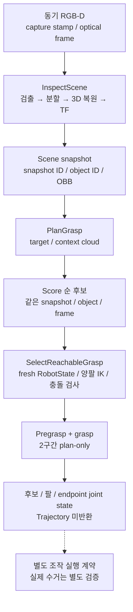

# Scene와 Grasp 계약

Scene inspection은 동기 RGB-D snapshot에서 객체를 찾고, Grasp planning은 선택 객체의 후보를 만든다. 도달성 선택은 MoveIt plan-only 검사이며 실제 수거 실행과 구분한다. 필드 원본은 패키지 msg/action/srv다.

## Snapshot과 객체

| 항목 | 의미 |
|---|---|
| 좌표 | m, 오른손 좌표계 |
| Array header | 전체 객체의 capture stamp, frame |
| object_id | Snapshot 내 1부터 시작하는 선택 번호 |
| snapshot_id | Opaque identifier |
| OBB pose / size | 중심, 방향 / local X/Y/Z 전체 길이 |
| Confidence | [0,1] |

InspectScene은 detector → segmenter → 3D reconstruction → TF를 한 번 수행하며 취소할 수 있다. 빈 query는 기본 prompt를 사용한다. 정상 빈 장면은 success=true, ERROR_NONE, objects=[]로 반환한다. 오류는 timeout, API, JSON, mask, depth, plane, TF, cancel, internal로 구분한다.

## 후보 생성

PlanGrasp는 snapshot/object ID, target/context cloud, OBB를 직접 받아 숨은 cache에 의존하지 않는다. Cloud는 같은 nonzero capture stamp, frame을 가져야 하며, TF는 capture 시각을 사용한다. Latest TF로 대체하지 않는다.

PointCloud2는 XYZ float32와 packed RGB float32/uint32를 지원한다. Step, payload를 검사하고 padded row를 처리한다. Provider, approach 설정은 cleany_grasping/config가 관리한다.

| 조건 | 처리 |
|---|---|
| 후보 존재 | Score 내림차순 반환 |
| 후보 없음 | 실패; 가짜 pose 생성 금지 |
| TCP 회전 | Rigid rotation, det +1 필수; reflection 거절 |

## 도달성 선택

SelectReachableGrasp는 같은 snapshot/object/frame/OBB 후보에 대해 양팔 IK, state validity, pregrasp/grasp 2구간을 검사한다. 완전하고 fresh한 12관절 RobotState를 사용하고 goal 하나씩 처리한다. 임시 ACM은 terminal 전에 복원해야 하며 복원 실패는 성공이 아니다.

성공 결과는 candidate index, arm, candidate, endpoint joint state다. Trajectory는 현재 RobotState에 종속되어 반환하지 않는다.

Position-only IK는 목표 orientation 도달을 검증하지 않는다. MuJoCo 접근 데모도 gripper close, attach, lift 성공을 증명하지 않는다.

관련 안내: [Planning](../../cleany_moveit_config/docs/planning.md), [실행](../../../../docs/RUNNING.md).
