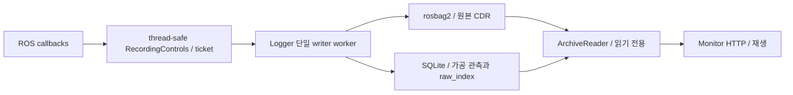
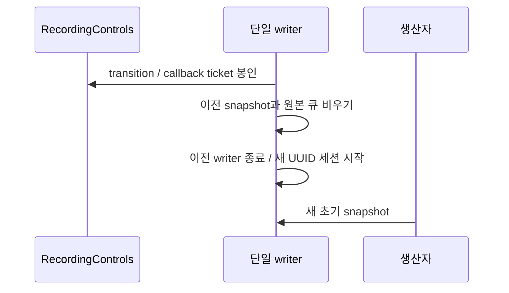
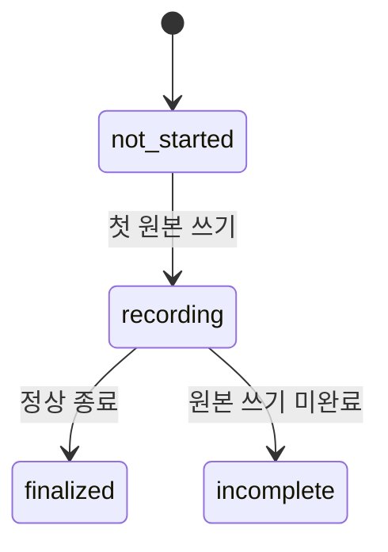

# Logger 기록 데이터 계약

Logger가 ROS 구독, 가공과 저장을 소유합니다. Monitor는 실시간 표시 / 제어 client와 과거 자료를 읽는 HTTP adapter입니다. 실행은 [런타임](runtime.md), endpoint는 [인터페이스](interfaces.md)를 따릅니다.

Logger는 Monitor, aiohttp, preview 디코더와 Mission Runtime을 import하지 않습니다. Rosbag2는 첫 원본 쓰기에 로드하며 저장 API와 과거 조회는 ROS 없이 사용 가능합니다. 작업 성공 판정과 MissionJournal 복구 소유권은 생산자 / Mission Runtime에 남습니다.

## 생산자와 저장 소유권

| API | 입력과 계약 |
|---|---|
| `ObservationBuffer.put` | 가공 관측의 수신 wall 시각을 초 단위 `received_at`으로 전달할 수 있습니다. 생략하면 현재 wall 시각을 사용합니다. |
| `RecordingControls` | 항목, 주기, 출처와 원본 큐를 관리합니다. `reserve`로 얻은 ticket을 `offer`에 전달합니다. |
| `RawMessage` | 토픽, 메시지 타입, 변경하지 않은 CDR bytes, 수신 wall 초, 선택적 ROS stamp 초와 정수 수신 ROS 측정 시각 ns를 전달합니다. |
| `Recorder.append(snapshot)` | `sequence`, `rows`, 선택적 `gap`이 있는 snapshot을 기록합니다. 각 row는 `seq`, `kind`, `key`, `data`, `received_at`을 포함합니다. |
| `Recorder.append_raw()` | 제어 큐를 비우고 rosbag2에 쓰며 SQLite에는 원본 위치만 남깁니다. |
| `Recorder.restore_settings(config)` | 저장된 정책을 현재 출처와 함께 검증해 복원합니다. 없거나 읽을 수 없는 설정은 기본값을 유지합니다. |
| `Recorder.persist_settings(settings)` | 검증한 정책을 임시 파일, fsync와 rename으로 원자적으로 저장합니다. |
| `Recorder.start_session()` | 이전 writer를 종료하고 현재 한도와 같은 controls, bag factory로 새 UUID 세션을 엽니다. |
| `Recorder.close()` | bag을 종료하고 SQLite를 commit한 뒤 닫습니다. |
| `export_sqlite`, `export_bag` | 가공 DB의 일관된 backup과 종료된 native bag ZIP을 만듭니다. HTTP 응답과 임시 파일 수명은 adapter가 소유합니다. |
| `ArchiveReader(directory)` | 경로만 보관하며 디렉터리, 설정 파일과 세션을 생성하지 않습니다. |
| `ArchiveReader.sessions`, `replay`, `raw_message`, `navigation_runs` | 세션 metadata, 시각별 가공 관측, CDR 한 건과 제한된 주행 요약을 읽습니다. |

| 생산자 row 필드 | 계약 |
|---|---|
| data | 가공 완료한 JSON 호환 값 |
| received_at | 수신 wall 초 |
| received_monotonic | 선택적 표본화 시계 |
| ros_time / source_id / category / topic_revision | 원본 시각, 개별 기록 선택, 출처 세대 |
| seq | 같은 생산자에서 증가; 출처 변경 시 topic_revision 증가 |

Recorder와 SQLite 연결의 쓰기·종료는 같은 worker thread에서 수행합니다. ROS 콜백은 RecordingControls만 사용합니다. [Monitor 계약](../../cleany_dev_monitor/docs/data.md)은 별도입니다.

## 저장 형식과 시간

| 데이터 | 저장소 |
|---|---|
| 선택한 센서 / TF / 시계 / CameraInfo / 로봇 모델 문맥 | `bags/<session>/` 표준 sqlite3 storage |
| Marker / Cartographer / OccupancyGrid / SLAM matched-point | `bags/<session>/diagnostics/` 별도 bag |
| 화면 레이어 / Mission / BT / 안전 상태 / 로그 / 리소스 | `<session>.sqlite3` |
| 원본 토픽 / 타입 / 수신 시각 / bag 측정 시각 | SQLite raw_index; payload 없음 |
| 기록 정책 | recording-settings.json |

기본 state_directory는 `~/.local/state/cleany/recordings`입니다. `-p state_directory:=/absolute/path`로 바꿉니다. 기존 기록은 자동 삭제하지 않습니다.

| 시간 / 호환성 | 계약 |
|---|---|
| 재생 축 | 수신 wall 초; 원본 ROS stamp와 monotonic도 보존 |
| Bag 측정 시각 | 수신 ROS clock ns; 같은 시각 메시지도 수신 순서로 구분 |
| ROS clock 역행 / 정체 | 이벤트와 수신 지연으로 표시 |
| Host wall 역행 | 정밀 재생 미지원 |
| 과거 SQLite schema 1/2/3 | 수정 / 자동 변환 없이 읽기 유지 |

### 큐, 세션과 실패

| 조건 | 처리 |
|---|---|
| Callback 메시지 | 최대 8 MiB |
| 원본 큐 | 최대 32 MiB / 128건 |
| 큐 초과 / 쓰기 실패 / 용량 중단 | 유실 수와 raw_gap metadata |
| Rosbag2 없음 / 쓰기 실패 | 원본 중단; SQLite payload로 대체 안 함 |
| 용량 계산 | SQLite + 상위/diagnostics bag + WAL 합산 |
| SQLite bag | resilient preset; 읽기 transaction이 writer를 잠그지 않게 구성 |
| 정지 후 시작 | 새 UUID |
| 녹화 중 시작 | 같은 세션 반환 |
| 정지 | SQLite와 bag writer 닫기 |

완료된 bag만 ZIP으로 내보내며 상위 bag과 diagnostics를 함께 포함합니다. 상위 bag만 재생하면 진단 토픽은 없습니다. 과거 단일 bag도 같은 원본 조회 API로 읽습니다.

### 구독 독립성

| 입력 | 기록 규칙 |
|---|---|
| 원본 구독 | 화면과 카메라 preview lease에 독립 |
| CameraInfo | 이미지의 형제 camera_info 요청 |
| TF / 시계 / CameraInfo | Hz 표본화로 누락시키지 않고 수신마다 기록 |
| 설정 변경 / 새 세션 | Transient-local 구독 재생성으로 retained 자료 요청 |

선택·표본화한 기록이며 전체 ROS 그래프의 무손실 녹화는 아닙니다. 연속 센서 bag은 [매핑 원본 수집](../../../../docs/implementation/how-to/mapping.md#오프라인-slam-비교용-원본-bag)을 따릅니다.

## 조작 이력

| 항목 | 계약 |
|---|---|
| 집계 키 / 시간 | Execution record revision과 서버 wall 측정 시각 |
| 소유 | Logger / Monitor 각각 독립 집계 |
| 기본 보존 | 최근 20개 실행, 실행당 64구간 |
| 누락 표현 | 늦은 구독, revision 누락, 시각 역행 구분 |
| 재생 | 미래에 수신한 결과를 과거 시각에 섞지 않음 |
| 출처 변경 | 조작 이력과 revision 초기화 |
| 저장 선택 | 해당 조작 출처의 녹화 선택 적용; Monitor / HTTP 모듈 불필요 |

## 기록 정책

| 정책 | 기준 |
|---|---|
| Source schema / 주기 | cleany_logger.sources |
| 선택 / 프로필 | cleany_logger.recording |
| 실제 구독 | logger_node의 DDS discovery와 subscription |
| 큰 원본 | 기본 OFF; 카메라 / 점군 / voxel은 필요한 토픽과 Hz 선택 |
| 진단 표본화 | source_hz / source_enabled 적용; 0.1 Hz는 10초당 최대 한 건 |
| SLAM 대상 | slam_trajectory_topic, slam_constraints_topic, slam_submaps_topic, slam_matched_points_topic |
| 센서와 진단 | Sensor full-rate와 diagnostics 표본화는 독립 |
| joint_state_topic OFF | 기본 /joint_states로 우회 기록하지 않음 |
| 세션 한도 | limit_mib 10–10240 MiB |
| 총량 한도 | total_limit_bytes는 이전 세션까지 포함; 자동 삭제 없음 |
| 기록 근거 | 세션에 정책, metadata에 큐 폐기 수 보존 |

| Motion 출처 | 토픽 / 주기 |
|---|---|
| localization_status_topic | /localization/status String; 기본 2 Hz, 저사양 1 Hz / 정밀 5 Hz |
| slip_topic | /navigation/slip String, 5 Hz |
| traction_recovery_topic | /navigation/traction_recovery String, 수신 이벤트 |

정합 점수·이유·속도 제한·복구 진행은 원본으로 저장하며 복구 지도 / 후보 파일은 실행의 runtime/localization/에 둡니다. Slip 출처도 개별 변경·제외와 동일 용량 정책을 적용합니다. [슬립 분석 문맥](../../cleany_navigation/docs/interfaces.md#슬립-관측의-분석-문맥)을 참고합니다.
