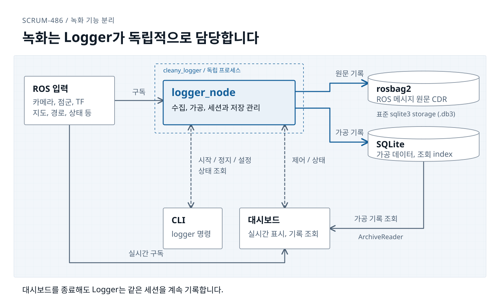

# Logger 실행과 책임

`logger_node`는 대시보드 없이 ROS 입력을 구독하고 녹화하는 독립 프로세스다.
원본 CDR은 rosbag2, 가공 관측과 조회 index는 SQLite에 저장한다. 수집 정책,
주행 요약과 조작 이력 집계, 호스트 리소스, 원본 큐, 단일 writer와 세션 종료를 소유한다.
대시보드를 종료하거나 다시 열어도 활성 세션은 유지한다.

Logger와 Monitor 서버는 같은 호스트에서 같은 `state_directory`를 사용한다.
브라우저는 원격 접속할 수 있다. 독립 CLI 실행 파일 `logger`는 ROS 서비스로
시작, 정지, 상태 조회와 토픽 설정을 제공하며 대시보드를 요구하지 않는다. 화면의 토픽 선택과 카메라 preview는 녹화 정책을
바꾸지 않는다. Monitor에는 writer와 logger 연결 실패 시 대체 녹화 기능이 없다.

독립 launch는 `logger.launch.py`, 설정은 `config/logger.yaml`이다.
`record_on_start`가 true면 저장된 선택과 주기를 복원해 새 세션을 시작한다.
false면 대기하며 시작 요청 전에는 세션 DB를 만들지 않는다. 저장된 active 값은
재시작 시 자동 적용하지 않는다. 실행별 새 UUID를 쓰고 기존 세션에 이어 쓰지 않는다.

저장 디렉터리의 `.logger.lock`은 프로세스 수명 동안 독점하며 중복 logger를 거절한다.
비정상 종료된 `recording` bag은 다음 시작 시 `incomplete`로 표시한다. 자동 삭제나
손상 bag 복구는 수행하지 않는다. 정상 정지는 큐, SQLite와 bag 종료가 끝난 뒤 응답한다.

logger는 상태 전이와 작업 성공을 판정하지 않으며 Mission Runtime의
`MissionJournal`을 열거나 갱신하지 않는다. 실패 코드는 생산자가 보낸 의미를 보존한다.

ROS 계약은 [인터페이스](interfaces.md), 저장 계약은 [데이터](data.md),
실행 절차는 [RUNNING](../../../../docs/RUNNING.md#독립-logger),
검증 절차는 [TESTING](../../../../docs/TESTING.md)을 따른다.
