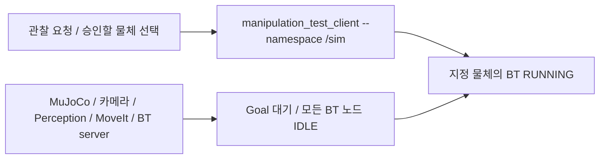
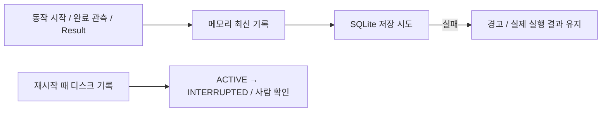

# cleany_manipulation_bt

승인된 `snapshot_id/object_id`의 쓰레기 또는 분실물 하나를 MuJoCo에서 수거하는 ROS Action 서버입니다.
실제 BehaviorTree.CPP 4 실행기가 동작 순서를 소유하고, Python은 기존 인식, MoveIt,
그리퍼 동작과 SQLite 기록을 연결합니다. Planner와 Mission Manager는 포함하지 않습니다.
기존 mock 실행에는 이 패키지의 C++ 모듈을 import하지 않습니다.

| 하려는 일 | 안내 |
|---|---|
| 빌드·자동 검사 | [빌드와 검증](#빌드와-검증) |
| 장면 실행·관찰·Goal 요청 | [실행](#실행) |
| 터미널 출력 조정 | [로그 설정](#터미널-로그) |
| 실행 검증·취소 | [계약과 증거](#계약과-증거), [취소 방식](#취소) |
| 결과 조회·모니터 이해 | [기록과 모니터](#기록과-모니터) |

## 빌드와 검증

아래 Make 명령은 레포 루트에서 실행합니다.

Ubuntu 22.04 / ROS 2 Humble의 `behaviortree_cpp` 4.x, `pybind11_vendor`, Python 개발
header가 필요합니다. 설치는 [개발환경 안내](../../../docs/implementation/development-setup.md)를 따릅니다.

```bash
make build-manipulation-bt
make test-manipulation-bt
make test-manipulation
```

첫 검사는 실제 C++ 트리와 가짜 backend, DDS Action/취소/조회, snapshot TTL,
수거 코드 추출 회귀를 검증합니다. 두 번째 mock 검사는 기존 성공/실패/취소/재시작을
보존하는지 확인합니다. 가짜 backend의 성공은 물리 수거 성공 근거가 아닙니다.

## 실행

기존 스터디카페의 YOLOE head/손목 모델, text encoder, PyTorch/Ultralytics와
`GEMINI_API_KEY`가 필요합니다. 모델 경로와 인식 준비 조건은
[기존 수거 실행 안내](../cleany_skill_executor/docs/study-cafe-sorting-usage.md)를 따릅니다.
키는 코드/ROS parameter에 넣지 않고 실행 환경에서 제공합니다.

```bash
# 키를 로컬 파일에 설정한 경우에만 사용. 키 자체를 로그에 출력하지 않는다.
source ~/.config/cleany/gemini.env
make sim-mujoco-manipulation
# GUI가 필요한 환경: SORTING_ARGS='headless:=false use_rviz:=true'
```

headless에서도 기존 GLFW 카메라 renderer에는 유효한 `DISPLAY`가 필요합니다.
GUI 로그인 터미널에서 실행하거나 Xvfb가 설치된 CI에서
`xvfb-run --auto-servernum make sim-mujoco-manipulation`을 사용합니다.

| BT 수거함 / 접근 | 계약 |
|---|---|
| [manipulation_bins.yaml](config/manipulation_bins.yaml) | 기존 tray 좌표, trash bin Y 외측 180 mm; 자동 sorting의 170 mm 설정과 별도 |
| 선택 이유 | 관측 OBB의 회전 독립 bounding sphere + 5 mm 여유 검사 |
| 공유 | Simulator / MoveIt / verifier가 동일 설정 사용 |
| 적합성 검사 | 팔 이동 전, 접근 전 재관측 때 반복 |
| Pregrasp | 첫 재관찰 임시 객체 정리, target 접촉 금지, 팔 / gripper 함께 이동 |
| 접근 | 다시 재관찰 후 target 접촉 허용 |
| 한계 | 실물 수거함 / 장착 사양 확정 아님 |



| 실행 경계 | 동작 |
|---|---|
| 시작 구성 | Grasp/selection, 지도, 결과 평가기도 시작; 자동 SortingCoordinator.run 미실행 |
| 대기 중 | 카메라 / depth 지도 갱신, 정상 좌표계 진단 기본 숨김 |
| 재사용 | 알려진 형상 updater, jaw clearance, 좌표 보정 |
| PTP 상한 | 속도 / 가속도 scaling 각각 0.08, launch 인자로 조정 |
| 실패 / GT | Controller 실패 뒤 자동 재실행 없음; 평가 정답을 grasp / 연관 / 계획에 사용하지 않음 |

시뮬레이션 편의 설정이며 실물 안전 검증이 아닙니다.

다른 터미널에서 detector-only 관찰을 요청합니다.

```bash
source /opt/ros/humble/setup.bash
source "$(make -s print-install-base)/setup.bash"
ros2 action send_goal /perception/inspect_scene cleany_interfaces/action/InspectScene \
  "{query: 'Detect objects on the table.', tracking_session_id: 'desk-validation-1', snapshot_id: '', selected_object_id: 0}"
```

반환된 실제 snapshot과 쓰레기 object ID를 지정합니다. snapshot cache의 기본 TTL은
120초이고 최근 두 장만 남습니다. 만료됐으면 새 관찰을 요청해야 합니다.

같은 고정 베이스 책상 작업에는 같은 `tracking_session_id`를 사용합니다. BT는 승인된
snapshot의 session/epoch/track ID를 재관측에서도 확인합니다. 베이스 이동 후에는 새 세션을
시작합니다. 자세한 조건은 [인식 패키지의 물체 추적](../cleany_perception/docs/runtime.md#고정-베이스-책상-물체-추적)을 따릅니다.
빈 세션은 추적을 끄는 호환 경로이며, 재관측에서 같은 종류가 여러 개면 수거를 중단합니다.

```bash
ros2 run cleany_skill_executor manipulation_test_client \
  --namespace /sim --snapshot-id '<실제 snapshot_id>' --object-id 1 \
  --destination-id trash_right --timeout 1200
# 출력된 execution_id로 조회
ros2 run cleany_skill_executor manipulation_test_client \
  --namespace /sim --execution-id '<execution_id>' --query
# 취소 재현: 위 실행 명령에 --cancel-stage GRASPING 추가
```

## 터미널 로그

| launch 인자 | 기본값 | 상세 출력 |
|---|---|---|
| `log_level` | `info` | `debug`: 후보 평가, 좌표·오차·타이밍, 깊이 지도 프레임 진단 |
| `backend_log_level` | `warn` | `info`: MuJoCo·MoveIt·TF 초기화와 계획 상세 |

기본 출력에는 준비 완료, 주요 작업 진행, 경고·오류와 컨트롤러 spawner의
준비 완료가 남습니다.

```bash
make sim-mujoco-manipulation SORTING_ARGS="headless:=false log_level:=debug"
# 외부 backend의 초기화·계획 상세까지 확인
make sim-mujoco-manipulation SORTING_ARGS="headless:=false log_level:=debug backend_log_level:=info"
```

`log_level`은 끌리니 로거와 `move_group.scene_mapping`에 적용합니다.
`debug`에서도 ROS 내부 대기 루프의 로그는 함께 켜지지 않습니다. 두 옵션은
`debug`, `info`, `warn`, `error`, `fatal` 중에서 선택합니다.

MoveIt 2.5.9의 종료 시 controller plugin unload 문제를 피하기 위해
`keep_controller_plugin_loaded:=true`를 기본으로 전달합니다. 적용 범위와 종료
회귀 검사는 [MoveIt README](../cleany_moveit_config/docs/planning.md#humble-controller-plugin-teardown)를 따릅니다.

## 계약과 증거

| ROS 경로 | 용도 |
|---|---|
| `/sim/manipulation/execute_skill` | 기존 `ExecuteManipulationSkill` 계약, `execution_profile=mujoco` |
| `/sim/manipulation/get_execution` | 기존 `GetManipulationExecution` 조회 계약 |
| `/sim/manipulation/cancel` | `CancelManipulation`: execution_id와 취소 mode 요청 |
| `/sim/manipulation/execution_events` | Reliable/Transient Local 기록 이벤트 |
| `/sim/manipulation/bt_transitions` | 실제 UID, 노드 ID, 이전/현재 상태 JSON |
| `/perception/get_scene_snapshot` | 읽기 전용 `GetSceneSnapshot`; TTL/촬영 시각 유지 |

Action 이름을 remap하면 내부 취소 client도 같은 이름의 `/_action/cancel_goal`을
사용합니다. 서버 종료는 진행 중인 tick의 기록 쓰기를 기다린 뒤 DB를 닫으며,
종료 자체를 정지 확인이나 수거 완료 근거로 기록하지 않습니다.

| 실행 결과 | 근거 |
|---|---|
| SUCCESS | 물체 이탈 / 안착 + 팔 복귀 + 최종 정지 |
| 반복 feedback | 시각과 내용이 같으면 새 표본 아님; 수신 시각 유지, 멈춘 스트림 만료 |
| 같은 시각 다른 내용 / 시각 역행 | 무효 표본 |
| Backend 주기 | read/update/write에 같은 시각, 새 simulation 시각에서만 다음 주기 |
| 진단 | invalid_reasons: repeated_stamp / backward_stamp / missing_velocity / stale_receipt / clock_skew; clock_stopped는 시계 정지 |
| 실패 / 취소 | 이미 확인한 물체 / 놓기 상태 보존 |
| FATAL | 정지 미확인, 장치 / 비상정지 / 내부 오류; 후속 Goal 차단 |

[상세 실행 계약](docs/execution-contract.md)이 검사 기준, timeout과 늦은 응답 처리를 관리합니다.

### 취소

일반 Action cancel은 `CHECKPOINT`입니다. `manipulation/cancel` 서비스는
`IMMEDIATE`, `CHECKPOINT`, `RETURN_ARM`을 제공합니다.
취소 수락 후에도 이전 동작의 종료와 정지 확인을 기다립니다.
`RETURN_ARM`은 정지 확인 뒤 필요하면 현재 위치에서 그리퍼를 열고, 실행 시작 때 저장한 팔 자세로 복귀합니다.
모드별 절차와 제한은 [상세 취소 계약](docs/execution-contract.md#취소)을 따릅니다.

### 정상 수거의 놓기·정지 확인

독립 안착 평가와 새 관절 샘플로 확인하며, 명령 성공이나 취소 응답만으로 정지를 인정하지 않습니다.
평가기의 `false`는 제한 시간 안의 확인 대기이며, 확인 기한을 넘기면 `UNKNOWN / VERIFICATION_TIMEOUT`입니다.
`arm_recovered=true`는 실행 시작 자세로의 복귀 근거입니다. 모바일 베이스의 주행 허가는 별도 readiness 계약이 필요합니다.
판정 조건과 설정은 [놓기·정지 확인](docs/execution-contract.md#정상-수거의-놓기정지-확인)을 따릅니다.

### 예상하지 못한 실행 예외

프로그램 오류는 `INTERNAL_ERROR`로 기록하고 별도 종료 경로에서 정지를 확인합니다.
정지 처리와 최종 결과는 [실행 예외 계약](docs/execution-contract.md#예상하지-못한-실행-예외)을 따릅니다.

## 기록과 모니터

### 실행 기록



| 기록 경계 | 계약 |
|---|---|
| 기본 DB | $XDG_STATE_HOME/cleany/manipulation_mujoco/executions.sqlite3; 미지정 시 ~/.local/state |
| 별도 설정 | bt_database_path; mock DB와 분리 |
| BT 전환 | bt_transitions에 실제 C++ UID / 상태 저장 |
| 저장 실패 | 동작 중단 / status·error_code 변경 / 후속 차단 원인으로 사용 안 함 |
| 조회 | 프로세스 메모리 최신값; 디스크 저장 완료를 보장하지 않음 |
| 재시작 | 미완료를 INTERRUPTED / 사람 확인 필요로 전환, 자동 재개 없음 |
| 차단 | HELD / UNKNOWN / FATAL이 남으면 후속 Goal 차단 |
| 복구 / 중복 | 디스크에 저장된 기록만 사용; 미저장 메모리는 유실 |
| 기동 | DB 초기화 / 읽기 실패 시 서버 시작 안 함 |
| 새 실행 | 이전 worker와 ROS 요청 종료 필요; 늦은 응답은 기존 context에만 반영 |

### Live 모니터

VS Code BehaviorTree Viewer 0.1.2의 **Monitor**를 사용합니다.

| 서버 | 기본 주소 | 표시 근거 |
|---|---|---|
| MuJoCo BT | `127.0.0.1:1667` | 실제 C++ 트리의 UID와 노드 상태 |
| Mock | `127.0.0.1:1666` | 모의 실행 이벤트를 설계 XML에 투영 |

1. VS Code workspace 설정에 `behaviortreeViewer.monitorHost=127.0.0.1`,
   `behaviortreeViewer.monitorPort=1667`을 지정합니다.
2. 기존 Monitor 연결을 끈 뒤 다시 켭니다. 파일명에 `(live)`와 `Monitoring active`가 표시되면 연결된 상태입니다.
3. [실행](#실행)의 관찰 요청과 Goal 전송을 수행합니다. Goal 전송 전에는 모든 노드가 IDLE입니다.

MuJoCo 포트는 `bt_monitor_port`로 변경합니다. 뷰어의 기본 포트는 1666이므로 MuJoCo 주소를 지정해야 합니다.
모니터는 FULLTREE/STATUS를 제공합니다. 트리 구조 XML은 실행기 생성 시 한 번 보관하고,
모니터 조회마다 실제 노드 상태를 읽습니다. 로봇 명령이나 blackboard 변경 기능은 제공하지 않습니다.

실행 종료 후 native BT가 노드를 IDLE로 reset하면 진행 색도 정리됩니다.
뷰어 0.1.2는 전체 IDLE 상태가 1.5초 이어지면 표시를 흐리게 합니다.
종료 결과는 조회 서비스에, 상태 전환 이력은 ROS/SQLite에 남습니다.

### 실행 설정

[config/manipulation_mujoco.yaml](config/manipulation_mujoco.yaml)의 ROS parameter로
동작 상한(180초), 단계별 안착 확인(10초), 정지 평가(10초), 피드백/시계 신선도(2초)와
지원 label을 조정한다. 이 수치는 첫 시뮬레이션 구현의 조정 가능한 기본값이다.
전체 물체 수거 성공률이나 실제 하드웨어에 대한 보장을 뜻하지 않는다.

## 검증 기록 (2026-10-14)

### 제어 주기 수정 후

로컬 제어 실행기에 한 주기의 시각을 고정하고 새 시뮬레이션 시각에서만 다음 실행을
허용한 뒤, 같은 환경의 실제 MuJoCo/MoveIt 컵 수거를 다시 검증했다.

| 실제 시험 | 결과 |
|---|---|
| 개별 추적 ID를 사용하는 컵 한 개 수거 | `SUCCESS / NONE`, `LEFT_GRIPPER / CONFIRMED`, `arm_recovered=true`, `stop_confirmed=true` |
| 첫 MoveIt 이동 요청 직후 physics 일시 정지 | 수신 만료와 시계 정지 감지. `FATAL / STOP_UNCONFIRMED`, `stop_confirmed=false`; 조회 후 physics를 재개해 피드백 복구 확인 |

성공 실행 ID는 `7076b0e7-88d8-4991-96de-155c6e15e8aa`이다. DB에 BT 전환 72개가
남았고, 독립 안착 평가·관절 속도 관찰·원래 팔 자세 복귀와 Action/조회 결과 일치를
확인했다. 마지막 관찰 구간은 약 0.50초이며 팔 관절 복귀 오차는 최대 약 0.00042 rad였다.
worker가 받은 관절 메시지 8,162개에서 timestamp 중복·역행은 0개였고 최소 간격은
설정 주기인 10 ms였다. 일시 정지 실행 ID는 `94b25e6c-c1f6-43ac-bc62-62e13eb6c633`이다.

관련 10개 패키지 빌드, `make test-manipulation-bt` 528개 검사와 제어 주기 회귀 검사
5개가 통과했다. 보고서는 로컬 `artifacts/manipulation-validation-20261014-201912/`와
`artifacts/manipulation-validation-20261014-202326/`에 보존했다. 이 결과는 고정 베이스의
단일 컵과 시계 정지 시험이며 전체 물체 수거 성공률·실물·Mission Manager·모바일 베이스
통합을 검증한 것은 아니다.

### 수정 전 기록

최신 main을 기반으로 정리한 브랜치에서 실제 MuJoCo/MoveIt, CPU YOLOE와 Gemini API로
컵 한 개 수거를 6회 실행했다. 실행마다 새 장면과 별도 SQLite DB를 사용했다.
당시에는 정상 수거 완료를 확인하지 못했다. 다음 표와 실행 ID는 수정 전 실패 이력이다.

| 관찰 결과 | 상태와 조치 |
|---|---|
| 첫 팔 이동에서 충돌 장면을 이중 등록 | `MOTION_FAILED`. 재관찰 장면을 정리한 뒤 pregrasp 장면을 등록하도록 수정하고 회귀 검사 추가 |
| 관절 피드백 시각 중복 | 내용까지 같은 메시지는 새 관측으로 세지 않도록 수정했으나, 같은 시각에 값이 달라지는 수신은 `HARDWARE_ERROR`로 중단됨. 이후 위 제어 주기 수정 적용 |
| 추적 없는 경로의 컵 재관측 | 대상 종류가 없거나 두 개 검출되면 수거 중단. 마지막 두 개 검출 사례는 `FAILED / MOTION_FAILED`, `NOT_TOUCHED` |
| 개별 추적 ID를 사용하는 컵 수거 | 접근 전까지 같은 track ID 유지. 관절 피드백 문제로 `FATAL / HARDWARE_ERROR`, `NOT_TOUCHED`, `arm_recovered=false` |

마지막 실행 ID는 `743a9d90-7acf-43b2-8dc0-607149664648`이다. 모든 실행에서
`stop_confirmed=true`였고, 별도 관절 속도 관찰과 Action/조회 결과 일치도 확인했다.
마지막 실패 시 피드백 수신 지연은 약 0.9 ms였으며, 같은 timestamp의 메시지 두 개에서
position/velocity가 달랐다. 스트림 지연과 시각 중복에 따른 무효 판정을 구분할 필요가 있다.
보고서와 전환 이력은 로컬 `artifacts/manipulation-validation-20261014-*`에 보존했다.

수정 전에도 관련 10개 패키지 빌드와 `make test-manipulation-bt` 523개 검사는
통과했지만 실제 수거는 중단됐다. 자동 검사와 실제 수거 시나리오를 별도로 검증한다.

## 검증 기록 (2026-10-01)

이 절은 당시의 물리 연동 기록이다. 현재 코드의 자동 검사 명령은 [빌드와 검증](#빌드와-검증)을 따른다.

Ubuntu 22.04 arm64 / ROS Humble, BehaviorTree.CPP 4.10.0, 기존 head/손목 YOLOE 모델의
CPU 추론과 실제 Gemini API를 사용했다. 독립 시뮬레이션 실행별로 별도 `/tmp` DB를 지정했다.
실패/취소 기록을 지우거나 보유 중인 물체의 자동 재개를 허용하지 않았다.

| 실제 MuJoCo 시험 | 결과 |
|---|---|
| 승인된 컵 한 개 수거 | `SUCCESS / NONE`, `LEFT_GRIPPER / CONFIRMED`, `arm_recovered=true`, `stop_confirmed=true` |
| `GRASPING/GraspObject`에서 취소 | 닫기·파지 확인 후 정지, 들기 시작 없음. `CANCELED / HELD`, `stop_confirmed=true` |
| 취소 후 후속 Goal | 사람 확인 필요 기록을 유지하며 Goal 거절 |
| controller 추종 실패 | 정상 경로 중단, 자동 재실행 없음, `FAILED / MOTION_FAILED`, 실제 정지 확인 후 조회 |
| 이동 시작 시 시뮬레이터/controller 프로세스 일시 정지 | 시계·관절 수신 중단 감지, `FATAL / STOP_UNCONFIRMED`, `stop_confirmed=false`. Result 조회 후 프로세스를 복원하여 시험 종료 |

성공 Goal의 snapshot은 `rgbd-0000000001042000000-000003`, `object_id=2`, 관측 label은
`cup`, 목적지는 `trash_right`였다. 실행 ID `7c1918eb5b4a48a587997a05860d5152`의
DB(`/tmp/cleany-bt-physical-clean.sqlite3`)에는 checkpoint 39개와 실제 BT 전환 72개가 남았다.
방출 뒤와 팔 복귀 뒤 평가가 각각 성공했고, Action Result와 조회 서비스 결과가 일치했다.
실제 ROS 이동 중 모니터의 UID 10(`MoveToPregrasp`)이 `RUNNING`인 것도 확인했다.
취소 실행 ID는 `d123a39d4c5643d19f8d8188adedf8ec`이며 별도 취소 DB에 기록했다.
일시 정지 실행 ID는 `8c9b82db607848d5b019ec6c61c63e33`이며
`/tmp/cleany-bt-physical-paused.sqlite3`에 FATAL 기록을 보존했다.

`make test-manipulation-bt`의 272개 검사와 `make test-manipulation`의 기존 mock 102개 검사가
통과했다. 당시의 `make test-grasp-pregrasp`로 관련 C++ 지도/관측과 기존 인식·파지·수거·MoveIt·MuJoCo
회귀 검사도 통과했다. native BT 실패 경로, 원자적 취소, stale/잘못된 대상 차단, false 평가 응답의
확인 대기, 늦은 응답 격리, stop 근거 누락과 기록 실패, 재시작 자동 재개 금지를 포함한다.
이 기록은 첫 컵 한 개의 연동 검증이며 다른 대상의 수거 성공률 측정은 아니다.

## Jetson 실물 실행

`manipulation_jetson_server`는 실물 수거와 팔 복귀를 실행하고 별도의 SQLite 기록을 유지한다.
로봇별 수거 JSON과 모션 감시 YAML을 명시적으로 입력한다. 기존 MuJoCo 서버와
같은 namespace에서 동시에 실행하지 않는다.

실행은 [실물 수거 안내](../cleany_skill_executor/docs/physical-collection.md),
통신과 복구 요청은 [실물 BT 인터페이스](docs/interfaces.md)를 따른다.
