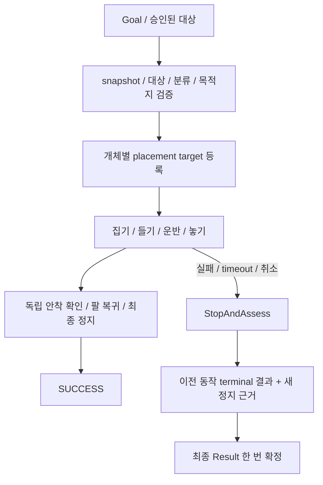
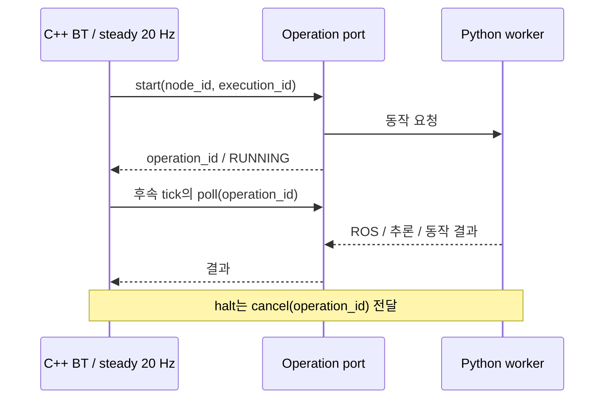
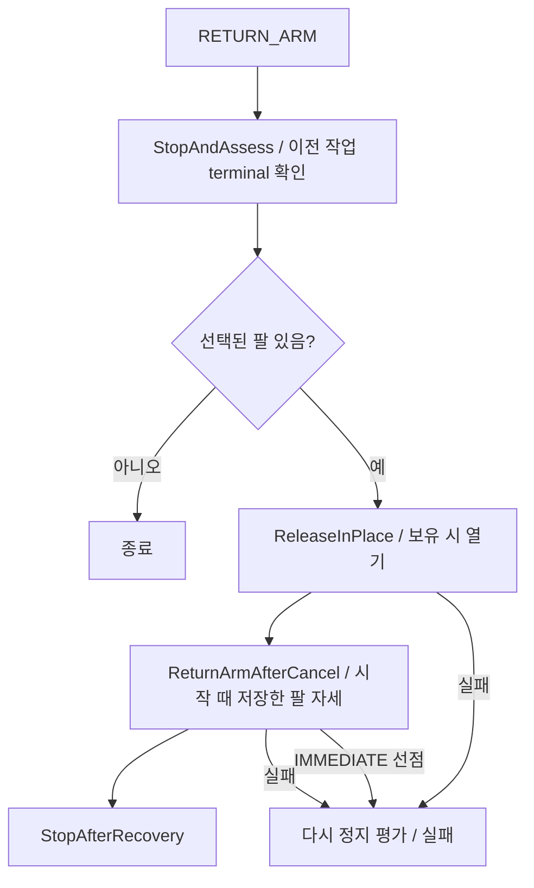
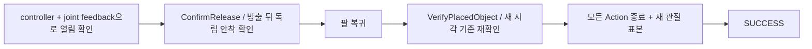
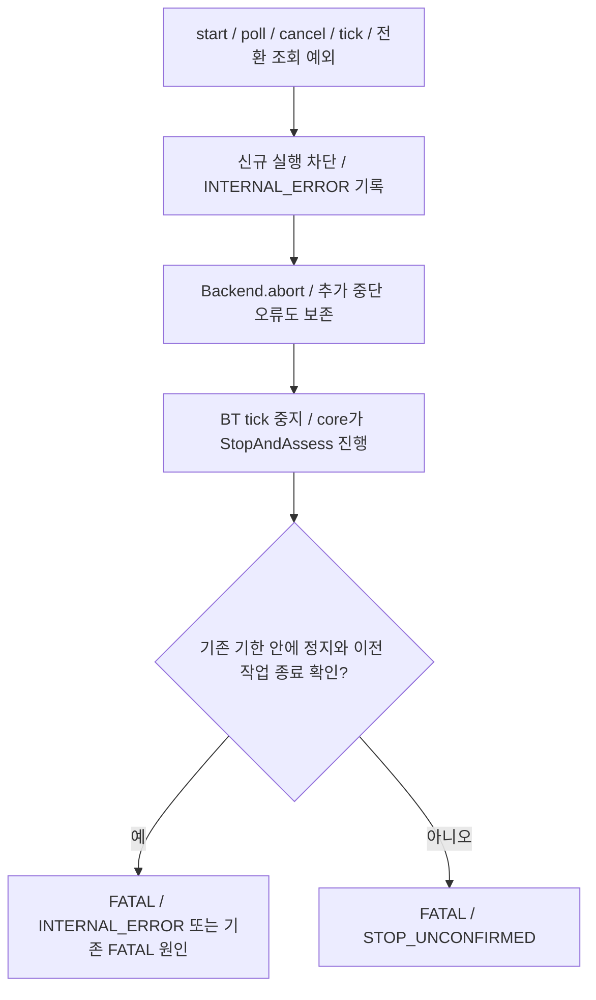

# MuJoCo Manipulation 실행 계약

승인된 물체 하나를 실행하는 `execution_profile=mujoco` 서버의 계약이다. [실행 명령](../README.md)과 [Goal·Feedback·Result 명세](../../cleany_skill_executor/docs/02_execute_manipulation_skill_action_spec.md)를 함께 확인한다.



## 실행 순서와 결과

[collect_trash_mujoco.xml](../trees/collect_trash_mujoco.xml)이 단계를 관리한다. BT `FAILURE`와 Action의 BLOCKED/FAILED/CANCELED/FATAL은 서로 다른 의미다.



Worker 하나가 동작을 수행해 ROS 응답이나 추론 대기가 tick을 막지 않는다. 큰 영상·점군과 계획 결과는 실행별 Python context, Blackboard에는 execution ID만 둔다. [비동기 노드 계약](https://www.behaviortree.dev/docs/tutorial-basics/tutorial_04_sequence/)을 따른다.

### 대상 검증

| Skill | 지원 label | 분류 / 목적지 |
|---|---|---|
| `collect_trash` | `cup`, `crumpled tissue`; `paper cup`, `disposable paper cup`은 컵 alias | 쓰레기 분류·사유와 정책 목적지 일치 |
| `collect_lost_item` | `mouse`, `computer mouse`, `wireless mouse`, `lego brick` | `lost_item` 분류·사유 + `lost_items_left` |

두 skill은 같은 집기·이동·놓기·확인 트리를 공유한다. 원래 label과 분류는 보존하며 정책과 `bt_supported_trash_labels`, `bt_supported_lost_item_labels`에서 허용값을 읽는다.

| 시점 | 통과 조건 |
|---|---|
| 동작 전 | 지정 snapshot, 대상 depth, 분류, 정책과 목적지 유효 |
| 같은 종류 여러 개 | 유효한 session / epoch / track 필요; 빈 세션의 단일 대상 경로는 종류가 유일해야 함 |
| 복원 뒤 이동 전 | OBB로 `/sorting/register_placement_target` 등록, verification ID 고정; 불확실하면 차단 |
| 첫 팔 이동 전 / 접근 전 | 승인 track, 기하 연속성, 분류–skill–목적지 재확인; 다른 개체로 대체 금지 |
| 거부 | 미지원 대상, review, 분류와 다른 skill, 다른 목적지 |

### 실패와 timeout

| 상황 | 처리 |
|---|---|
| 파지 확인 실패 | Lift 시작 안 함 |
| 보유 상실 / controller 실패 / timeout / feedback·시계 중단 | `StopAndAssess → FinalizeFailure` |
| 제한 시간 전 결과 없음 | TIMEOUT 기록, 중단 요청; 움직임 전이라도 정지 확인 요구 |
| Timeout 취소 시작 전에 성공 결과 준비됨 | 경과 시간과 관계없이 기존 성공 처리 |
| 취소 시작 뒤 늦은 성공 / 취소 완료 | TIMEOUT 유지; 물체 상태·놓기·복귀 근거만 보존 |
| 늦은 장치 / 비상정지 / 내부 오류 | FATAL, 후속 Goal 차단 |
| 기한 내 동작 terminal 또는 정지 미확인 | `FATAL / STOP_UNCONFIRMED` |
| 최종 Result 뒤 관측 | 확정 결과 변경 안 함 |

정지 평가가 먼저 끝나도 이전 동작의 terminal 결과 전에는 Result를 확정하지 않는다. 이 수집은 기존 정지 기한 안에서만 수행하며, timeout 후 다음 정상 동작이나 취소 후 복귀를 새로 시작하지 않는다.

## 취소

| Mode | 중단 시점 | 이후 동작 |
|---|---|---|
| `IMMEDIATE` | 현재 노드 / 원자 구간 완료를 기다리지 않음 | 정지 확인 후 종료 |
| `CHECKPOINT` | 현재 checkpoint까지 제한 시간 내 완료 | 잡기+확인, 들기+보유 확인, 놓기+위치/열기/이탈 확인 뒤 다음 단계 차단 |
| `RETURN_ARM` | 현재 작업에 즉시 중단 요청 | 정지 → 보유 시 현재 위치 놓기 → 팔 복귀 → 최종 정지 |

일반 Action cancel은 CHECKPOINT다. 적용 mode를 Result와 실행 기록의 `cancel_mode`에 남긴다.



| RETURN_ARM 경계 | 계약 |
|---|---|
| 복귀 계획 | 현재 관절 상태 → 실행 시작 때 저장한 자세; 기존 controller / feedback / timeout 검사 |
| 현재 위치 놓기 | 열기 완료에 근거한 초기 정책; 놓기 위치 선택과 별도 이탈 관찰은 미확정 |
| 수거 성공과 구분 | 목적지 이동·안착 검증 없음; 기존 `placement_state`만 보존 |
| 선점 | 복귀 중 IMMEDIATE가 우선, 뒤의 약한 요청으로 완화 안 함 |

IMMEDIATE/RETURN_ARM도 이전 동작 terminal과 정지를 모두 확인해야 놓기·복귀 또는 최종 확정을 진행한다. 늦은 실제 실패는 취소보다 우선하며 늦은 성공은 확인 근거만 보존한다. 기한 내 종료나 정지를 확인하지 못하면 STOP_UNCONFIRMED다.

```bash
ros2 service call /sim/manipulation/cancel cleany_interfaces/srv/CancelManipulation \
  "{execution_id: '실행-UUID', mode: 'RETURN_ARM'}"
```

테스트 클라이언트는 `--cancel-stage TRANSPORTING --cancel-mode RETURN_ARM`으로 재현한다.

## 정상 수거의 놓기·정지 확인



평가기의 false는 확인 대기다. 제한 시간 안에 안착 근거를 얻지 못하면 `placement_state=UNKNOWN / VERIFICATION_TIMEOUT`이다. SUCCESS에는 독립 방출·안착, 팔 복귀와 최종 정지가 모두 필요하다.

### 정지 근거

| 대상 | 요구 조건 / 무효 처리 |
|---|---|
| ROS Action | 모두 terminal; cancel 응답만으로 정지 인정 안 함 |
| 관절 기록 | 양팔과 양 gripper의 sensor stamp + 단조 시계 수신 시각을 관절별 보관 |
| 부분 메시지 | 포함 관절만 갱신; 양팔이 별도 메시지여도 새 표본으로 합산 가능 |
| 무효 표본 | 속도 누락, 비정상 값, 중복 이름, 반복 / 역행 stamp |
| 새 확인 표본 | 모든 필수 관절이 이전 확인 이후 새 정보를 제공해야 함 |
| 연속 유지 | 전 관절 속도 이내 + Action 종료가 연속 횟수와 유지 시간을 모두 충족 |
| 구간 재시작 | 오래된 정보, 움직임 또는 미종료 Action |

[manipulation_mujoco.yaml](../config/manipulation_mujoco.yaml)의 초기값이다. 실물 안전 기준으로 사용하지 않는다.

| ROS parameter | 기본값 | 의미 |
|---|---|---|
| `bt_stop_timeout_sec` | 10 s | 정지 확인 기한 |
| `bt_stop_feedback_max_age_sec` | 0.5 s | 관절별 수신 경과 / stamp 허용 오차 |
| `bt_stationary_duration_sec` | 0.25 s | 단조 시계 최소 유지 |
| `arm_stationary_samples` | 5 | 모든 관절의 새 표본 연속 횟수 |
| `arm_stationary_velocity_rad_s` | 0.02 rad/s | 팔 / gripper 정지 속도 |

| 오류 우선순위 | 결과 |
|---|---|
| HARDWARE_ERROR / E_STOP / INTERNAL_ERROR / STOP_UNCONFIRMED 관측 | 즉시 후속 실행 차단, 사람 확인 필요 |
| 위 오류 뒤 정지 확인 성공 | FATAL과 원래 오류 유지 |
| 움직임 뒤 정지 확인 실패 | 최종 STOP_UNCONFIRMED 우선, 원래 원인은 message에 보존 |

## 예상하지 못한 실행 예외

| 예외 | 분류 |
|---|---|
| 명시적 `OperationError` | 원래 오류 코드 유지 |
| 하위 동작의 정확한 `RuntimeError`, `ValueError` 및 `InfrastructureError`, `CartesianPlanningError`, `LiftRedetectionError` | 기존 준비 / 대상 / 이동 / 파지 실패 분류 |
| 그 밖의 예외 | 발생 노드·종류·내용을 INTERNAL_ERROR로 기록 |
| AttributeError / TypeError / KeyError / NotImplementedError / RecursionError | 일반 동작 실패로 바꾸지 않음 |
| 보유 접촉 검사 | 정확한 RuntimeError만 보유 상실; 다른 내부 예외는 전달 |



| 오류 종료 경계 | 계약 |
|---|---|
| 작업 번호 전 start 실패 | `Backend.abort()`가 현재 context에 중단 신호 전달 |
| 중단 / native halt 추가 오류 | 원인 보존; 정지 평가 계속, native node reset 뒤 core 처리 |
| 이미 정지 평가 중 | 같은 평가와 원래 기한 유지 |
| 허용 동작 | 이전 최종 관측 수집만 수행; 놓기 / 팔 복귀 시작 안 함 |
| 확정 | 확인된 물체·놓기·복귀 근거 보존; Result와 종료 이벤트 한 번만 확정 |
| BT snapshot 조회 실패 | 모니터 갱신만 중단; 정지 처리와 결과 전달 계속 |
| 준비 / XML 구성 실패 | Goal 거절 |
| 실행 ID 예약 뒤 context 초기화 실패 | Goal 수락 후 위 오류 종료 경로로 결과 반환 |

프로세스가 살아 있는 동안의 예외 계약이다. 프로세스 종료 후 처리는 [재시작 복구 계약](../README.md#기록과-모니터)을 따른다.
