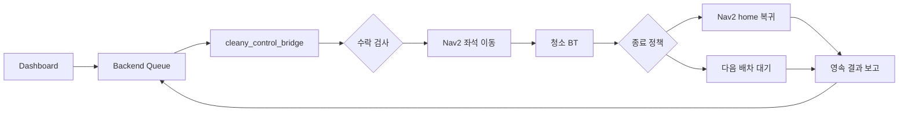

# cleany_mission_manager

SCRUM-420의 단일 로봇 Mission Runtime입니다. 상위 FSM이 수락·이동·작업·복귀·보고를
소유하고, `py_trees` Behavior Tree가 책상 작업의 반복과 완료 확인을 소유합니다.
순수 core는 ROS 및 네트워크를 호출하지 않고 `start/poll/cancel/ready/stopped` port를 사용합니다.

- [실행 범위](#현재-실행-범위) · [FSM·청소 BT](#실행-흐름과-소유권) · [ROS 계약](#ros-계약)
- [Runtime 실행](#설정과-실행) · [조작 연결·결과 판정](#단일-물체-manipulation-연결)
- [Mock 시간표](#mock-조작의-관찰-시간) · [개발 관측](#개발용-fsmbt-관측)
- [시설 지도](#full-facility-simulation-approach-map) · [도착 검사](#independent-navigation-arrival-check)

## 현재 실행 범위

| 구성 | 주행 | 조작 | 설정·실행 |
|---|---|---|---|
| 기본 | Nav2 | 로컬 Mock | [runtime.yaml](config/runtime.yaml) |
| ROS 통신 확인 | Mock | 외부 Mock Action | [runtime_manipulation_mock.yaml](config/runtime_manipulation_mock.yaml) |
| Gazebo 통합 | Gazebo/Nav2 | 외부 Mock Action | [Bringup 빠른 시작](../cleany_bringup/README.md#빠른-시작) |

Perception·Planner는 모든 구성에서 Mock이며 카메라·LLM·실물 팔을 호출하지 않는다.
두 쓰레기 객체를 처리하고 새 관측으로 완료를 확인한다. 실행 출처는 미션 수락 시
저장하고 최종 보고에 보존한다.

| 역할 | 구현 |
|---|---|
| 수락 및 상태 전이 | `core/runtime.py`, `runtime_models.py` |
| 청소 BT | `core/cleaning.py` |
| SQLite 중복 실행 방지 및 결과 보존 | `core/journal.py` |
| 비동기 Nav2·TF·odom adapter | `adapters/nav2.py` |
| 단일 물체 조작 계약 및 ROS action adapter | `core/manipulation.py`, `adapters/manipulation.py` |
| 교체 가능한 책상 Mock | `mocks/desk.py` |
| ROS service 및 steady-clock tick | `node.py` |

ROS 실행 경로는 `MissionRuntime`을 사용합니다.

## 실행 흐름과 소유권



Backend가 Queue와 배차를 소유한다. Runtime은 Queue 없이 한 미션만 수락한다.

| 수락·작업 진입 검사 | 조건 |
|---|---|
| 미션 수락 | IDLE, 지원 좌석·요청 유형, 모든 port의 준비·정지 조건 충족 |
| Nav2 준비 | `required_navigation_lifecycle_nodes` 전체 ACTIVE, `lifecycle_timeout` 이내 응답 |
| 기본 필수 노드 | map_server, amcl, planner_server, controller_server, bt_navigator, collision_monitor |
| 작업 진입 | Nav2 terminal 결과, fresh odom 정지와 원래 목표 pose에 대한 도착 검사 통과 |

Nav2 Action만 준비된 상태는 충분하지 않다. 필수 lifecycle이 미준비이면
`NAV2_NOT_READY`로 거절하고 주행 Goal을 보내지 않는다. 다른 profile의 필수 목록은
ROS parameter로 명시하며 준비된 안전 체인을 확인해야 한다.
동일 mission ID·동일 요청은 재실행하지 않습니다. 다른 내용으로 ID를 재사용하면 거절합니다.

FSM은 `IDLE → NAVIGATE_TO_TARGET → WORKING → POST_MISSION → RETURN_HOME/IDLE`이며
중단 시 `CANCELLING`, 치명적 오류 또는 정지 확인 실패 시 `ERROR`로 전이합니다.
외부 phase는 `NAVIGATING`, `WORKING`, `RETURNING`으로 노출합니다.

BT는 `ObserveBefore → [PlanNext → ValidateProposal → ExecuteOne → Reobserve → VerifyCompletion]`
반복입니다. 한 번에 한 객체만 실행하고 이후 반드시 다시 관측합니다. snapshot ID와
object ID, 허용 capability를 검사하며 오래된 제안과 임의 skill은 실행하지 않습니다.
`done` 제안만으로 완료하지 않고 추가 fresh 관측에서 처리 대상이 남았는지 확인합니다.
skip·사람 확인·실패·취소는 보고에 보존하며 무조건 SUCCESS로 바꾸지 않습니다.

## ROS 계약

| 이름 | 타입 | 의미 |
|---|---|---|
| `mission/offer` | `cleany_interfaces/srv/OfferMission` | `clean_desk`, `SEAT`, canonical `seat-*` 요청 |
| `mission/cancel` | `cleany_interfaces/srv/CancelMission` | 비동기 취소 수락; 완료는 결과로 확인 |
| `mission/snapshot` | `cleany_interfaces/srv/GetRuntimeSnapshot` | 현재 상태 및 보존된 최종 보고 JSON |
| `mission/reset_error` | `std_srvs/srv/Trigger` | 정지·팔의 주행 가능 상태·Nav2 준비 확인 후 명시적 오류 해제 |
| `mission/status` | `cleany_interfaces/msg/MissionStatus` | transient-local 상태 및 BT 단계 |
| `mission/result` | `cleany_interfaces/msg/MissionResult` | transient-local 최신 최종 보고 |
| `robot/safety_fault` | `std_msgs/msg/String` | `E_STOP` 또는 `HARDWARE_ERROR` 알림 |
| `robot/safety_released` | `std_msgs/msg/String` | 해당 안전 소유자의 해제 알림 |

안전 알림 producer가 실제 정지를 먼저 수행해야 합니다. 이 Runtime은 물리 e-stop 구현이
아닙니다. 안전 오류는 일치하는 release 알림과 정지 확인 후에도 별도 reset이 필요합니다.
주행 취소는 Nav2 terminal 상태와 fresh odom의 정지를 함께 확인합니다. 취소 ACK만으로
IDLE을 만들지 않으며 확인 시간 초과 시 ERROR를 유지합니다.

SQLite journal은 수락, 실행 출처, Nav2 goal UUID, 최종 결과와 오류 상태를 저장합니다.
재시작 당시 미완료 미션은 `INTERRUPTED`와 사람 확인 필요로 보고하고 자동 재개하지 않습니다.
저장된 정확한 UUID에 대해 orphan goal 취소를 요청하고 정지·준비 상태를 확인합니다.
Backend 연결 단절은 이미 수락한 미션의 실행을 중단하지 않습니다.

## 설정과 실행

[runtime.yaml](config/runtime.yaml)과 [좌석 pose](config/study_cafe_targets.yaml)를 설치합니다.
기본 deadline은 주행·청소 각 180초, 단일 작업 30초, 취소 확인 5초이며 steady clock을
사용합니다. `max_actions=30`, `max_skill_retries=2`로 반복을 제한합니다.
설정은 시작할 때 읽습니다. 변경 후 node를 재시작해야 합니다.

`post_mission:=return_home|wait_for_next`로 미결정 복귀 정책을 선택합니다. 기본은
`return_home`이라는 **실행 옵션**이며 제품 정책 확정을 뜻하지 않습니다. `wait_for_next`는
현재 위치에서 다음 Backend 배차를 기다립니다. 미션 간 연결 이동도 새 배차로 시작합니다.
주행 실패는 전체 미션을 자동 재시도하지 않습니다. 일반 취소의 home 복귀 여부도 같은
정책을 따르며, 안전 오류는 복귀하지 않습니다.

좌석 YAML은 `map_id`, `frame_id`, `home`, `seats`를 명시합니다. 현재 seat-12·13 pose와
home은 study-cafe **시뮬레이션 접근 후보**입니다. 충전 dock·팔 도달 가능성·실환경 좌표는
아직 검증하지 않았습니다. 구성·시점별 home 복귀 결과는
[통합 검증 이력](docs/manipulation_mock_integration.md#과거-검증-이력)을 확인합니다.

기존 AMCL/Nav2 실행 옆에서 시작합니다. SLAM은 동시에 시작하지 않습니다.

```bash
make build-mission-runtime
source "$(make -s print-install-base)/setup.bash"
ros2 launch cleany_mission_manager mission_runtime.launch.py \
  gateway_url:=ws://127.0.0.1:8080/api/robots/cleany-01/gateway/ws \
  post_mission:=wait_for_next
```

Nav2 없이 구조를 확인할 때는 위 명령에 `navigation_backend:=mock`를 추가합니다.
실험별 `journal_path`, `bridge_journal_path`를 사용하되 동일 미션을 복구할 때는 동일 DB를
유지합니다. Gazebo부터 함께 시작하려면 [cleany_bringup](../cleany_bringup/README.md)을 봅니다.

검사 명령과 ROS 선택 검사는 [workspace 공통 검증](../../README.md#missionmock-조작-검증),
실행 결과와 제한은 [통합 검증 결과](docs/manipulation_mock_integration.md#최신-검증-결과)를 따른다.
기획 근거는 KB [Mission Lifecycle](../../../docs/cleany-docs/20_TECHNICAL/09%20-%20Mission%20Lifecycle.md),
[Robot ROS Contract](../../../docs/cleany-docs/20_TECHNICAL/10%20-%20Robot%20ROS%20Contract.md),
[안전](../../../docs/cleany-docs/20_TECHNICAL/08%20-%20Safety%20and%20Risk.md)을 따릅니다.
KB는 이 구현 변경에서 수정하지 않습니다.

## 단일 물체 Manipulation 연결

청소 BT가 관측·Planner 제안을 검증한 뒤 `ManipulationPort`로 한 물체를 실행한다.
서버의 접근·집기·운반 단계는 Action 내부 진행이며 Mission의 FSM·BT 노드를 추가하지 않는다.
선별 포함 범위는 [통합 문서](docs/manipulation_mock_integration.md#책임과-구현-범위),
wire 필드는 [공통 인터페이스](../cleany_interfaces/README.md#단일-물체-manipulation-action)를 따른다.

| Runtime의 상대 이름 기본값 | 용도 |
|---|---|
| `mock/manipulation/execute_skill` | 승인된 단일 물체 실행 |
| `mock/manipulation/get_execution` | 같은 execution ID의 영속 기록 조회 |

### 요청과 결과 판정

- Mission allowlist는 `collect_trash`다. `SceneObject.wire_object_id`를 Planner 제안과
  대조하며 `trash-1` 표시 문자열에서 숫자를 추정하지 않는다.
- 목적지는 `RuntimePolicy.manipulation_destinations`로 검사한다.
- 행동마다 task/execution UUID를 발급하고 전체 Goal을 SQLite에 기록한 **뒤** 보낸다.
  execution UUID를 ROS Goal UUID에도 사용해 조회·취소 대상을 고정한다.

| 응답·상태 | Mission 처리 |
|---|---|
| ROS SUCCEEDED + payload BLOCKED | 수거 성공으로 처리하지 않음 |
| payload SUCCESS | execution ID·mock 출처·오류 없음·placement 검증 완료·`LEFT_GRIPPER`·`CONFIRMED`·선택 팔·팔 복귀·정지 등 기존 일관성 조건 검사 |
| HELD / UNKNOWN / 팔 미복귀 / 사람 확인 필요 | home·다음 미션 이동·오류 해제 차단 |
| CANCELED | 보고는 `CANCELLED`; 주행 불가 상태가 남으면 FSM ERROR·사람 확인 유지 |
| FATAL / 정지 미확인 | ERROR 유지 |
| 응답 유실·지연·불일치·거절 | 같은 ID로 조회·취소; 새 ID 자동 재전송 없음 |
| 조회 `found=false` / ACTIVE / INTERRUPTED | 미실행·정지 증거로 사용하지 않음 |

취소는 현재 UUID의 ROS Action cancel을 통해 기본 **CHECKPOINT**로 처리한다.
취소 ACK는 정지 증거가 아니다. 수동 팔 복구·해제나 IMMEDIATE/RETURN_ARM 선택용
Mission API는 제공하지 않는다. 재시작 후에는 저장된 UUID만 취소·조회하고 자동 재개하지 않는다.

### 보고·journal·Feedback 호환

기존 `ManipulationOutcome`, `RuntimeReport.actions`, `MissionResult`, Gateway payload를
유지한다. action 결과·task/execution/destination ID는 기존 보고와 SQLite에 보존한다.

| 정보 | 보관·용도 |
|---|---|
| `failed_substage`, `cancel_mode`, 조회의 `substage/completed_substages` | 기존 `manipulation_boundary`의 선택적 `details` metadata |
| 과거 metadata에 없는 `details` | 빈 값으로 읽음 |
| Action Feedback | execution ID가 일치하는 최신 값 하나; 새 실행 초기화, 이전·종료 실행 무시 |
| `manipulation_feedback`, `manipulation_details` | debug JSON의 선택적 관측 정보 |

Feedback·debug 오류는 제어 흐름을 중단하지 않으며 진단 정보를 완료·정지·주행 허가의
증거로 사용하지 않는다. 주행 판정은 기존 `map_outcome()`과 `safe_to_drive()`를 따른다.

### 통합 Mock 서버와 함께 실행

두 터미널이 같은 install과 domain을 사용한다. 빌드와 서버 시작은
[Skill Executor 단독 실행](../cleany_skill_executor/README.md#서버-단독-실행)을 따른다.
서버가 준비되면 두 번째 터미널에서 주행도 Mock인 Runtime을 실행한다.

```bash
source "$(make -s print-install-base)/setup.bash"
export ROS_DOMAIN_ID=186
ros2 run cleany_mission_manager mission_runtime --ros-args \
  --params-file ros2_ws/src/cleany_mission_manager/config/runtime_manipulation_mock.yaml \
  -p targets_file:=$PWD/ros2_ws/src/cleany_mission_manager/config/study_cafe_targets.yaml \
  -p post_mission:=wait_for_next \
  -p journal_path:=$HOME/.local/state/cleany/mission-mock/missions.db
```

서버와 Runtime은 [공유 fixture](config/manipulation_server_fixture.yaml)의 두 물체·네
snapshot을 사용한다. 검증된 SUCCESS만 논리적 책상 목록을 갱신하고, snapshot 소진은 실패다.
미션 요청은 [Bringup의 요청 예제](../cleany_bringup/README.md#3-준비-상태-확인과-미션-요청)를 사용한다.

외부 조작 backend는 `action_mock`만 허용한다. `manipulation_initial_mock_safe=true`는
새 journal에서만 초기 안전 가정으로 적용하며 기본값은 false다. 저장된 진행·위험 상태를
덮어쓰지 않는다. 조작 실행 기록이 있으면 로컬 `mock`으로 전환해 gate를 우회할 수 없다.
Gazebo 주행 구성은 [Bringup](../cleany_bringup/README.md#빠른-시작)을 사용한다.

### Mock 조작의 관찰 시간

공유 [server fixture](config/manipulation_server_fixture.yaml)는 정상 수거를 물체 하나당
40초로 설정합니다. 팔 이동에 준비·검증보다 긴 시간을 배정해 진행을 관찰하기 위한
가정입니다. 실물 팔의 경로, 하중과 속도 설정을 측정해 산출한 예상 시간은 아닙니다.

| 단계 | 시간 |
|---|---:|
| 실행 준비 확인 `VALIDATING` | 1초 |
| 대상 확인·파지 계획 `PREPARING_TARGET` | 4초 |
| 물체 접근 `APPROACHING` | 7초 |
| 그리퍼 닫기·파지 확인 `GRASPING` | 3초 |
| 들어 올리기·보유 확인 `LIFTING` | 3초 |
| 수거함 운반 `TRANSPORTING` | 8초 |
| 놓기·이탈 확인 `PLACING` | 5초 |
| 팔 복귀 `RETURNING_ARM` | 7초 |
| 안착 확인 `VERIFYING_PLACEMENT` | 2초 |

두 물체는 통신·관측 시간을 더해 약 80초 이상 걸립니다. 단계 안의 세부 동작은
해당 시간을 나누어 쓰며 각각 최소 1초입니다. 청소 BT의 `ExecuteOne`을 실행하는 동안
`mission/debug_snapshot`의 `manipulation_feedback`과
`/mock/manipulation/execution_events`에서 세부 진행을 확인할 수 있습니다.
웹 관제보드의 실행 흐름 → 청소 BT에서도 조작 단계와 세부 동작이 표시됩니다.

`stage_durations_sec`는 모든 scenario의 기본 시간이고, scenario별 값이 우선합니다.
설정을 바꾸면 Mock 서버를 다시 실행해야 합니다. 이미 진행 중인 실행의 DB는 보존합니다.

| Runtime timeout | 기본 로컬 Mock | 외부 Action Mock profile |
|---|---:|---:|
| 단일 작업 | 30초 | 120초 |
| 취소 확인 | 5초 | 15초 |
| 청소 전체 | 180초 | 300초 |

ROS 계약 회귀 검사는 같은 논리 fixture의 시간을 줄이고 Gazebo 검사는 위 관찰 시간을 사용한다.
설정은 [Runtime profile](config/runtime_manipulation_mock.yaml)과
[Gazebo profile](config/runtime_gazebo_manipulation_mock.yaml)에서 관리한다.

### 개발용 FSM/BT 관측

`mission/debug_snapshot`을 최대 2 Hz로, `mission/runtime_events`를 FSM tick 뒤에 발행한다.
짧게 SUCCESS가 된 뒤 같은 tick 안에서 INVALID로 초기화되는 BT 노드도 `bt_tick`
이벤트로 남긴다. core는 I/O 없이 최대 2,048개 이벤트만 보존한다. debug 발행 실패가
기존 status/result 발행을 막지 않도록 ROS shell에서 분리한다.
Action Mock에서는 debug JSON에 선택적 `manipulation_feedback`, `manipulation_details`를 추가한다.
`bt_stage`와 청소 BT 노드 이름·실행 순서는 유지하며 서버의 세부 단계는 관측에만 사용한다.

`cleany_dev_monitor`는 이 정보와 ROS graph/TF/토픽을 읽어 개발 화면을 제공한다.
자세한 실행과 관측 의미는 [개발 관제보드 README](../cleany_dev_monitor/README.md)를 본다.
`safe_to_drive`는 기존 executor의 판단을 보여주며 관제보드가 새로 안전 판단을 하지 않는다.

### Full-facility simulation approach map

`config/full_facility_targets.yaml` maps all 82 facility seats into the
`facility_integration` reference-map frame. These are approximate navigation
approaches, not calibrated manipulation poses. Desk fronts are inferred from
chair placement; chairs remain in the scene. Tight A rooms use corner approaches,
and A23/A24 (`seat-a2-03` / `seat-a2-04`) use the opposite side because the chair side cannot fit this robot.
Some targets are shared or offset along the row; navigation success does not
establish arm reach or cleaning access.

Regenerate for the materialized SDF and its static reference map inside Humble:

```bash
python3 tools/facility/generate_mission_targets.py \
  --world artifacts/gui-integration-20261003/world.sdf \
  --map artifacts/gui-integration-20261003/facility_integration.yaml \
  --chair-mesh-root "$HOME/.ignition/fuel/fuel.gazebosim.org/openrobotics/models/officechairgrey/1" \
  --output ros2_ws/src/cleany_mission_manager/config/full_facility_targets.yaml \
  --override seat-08 5.075 4.775 -1.570796
```

The generator checks the padded CAD footprint against the reference map and
conservative mesh-chair XY bounds. It also checks membership in the home's
static free-space component; this is not proof that the whole path fits the
oriented footprint. Verify with the running Nav2 planner before mission use.
The adjacent `.validation.json` records front/side offsets for review. The tool
requires NumPy, SciPy, Pillow and PyYAML.

Facility model IDs (for example `A41`) are converted to gateway IDs
(`seat-a4-01`); D-HUB IDs remain `seat-01` through `seat-48`. The 08 override
moves its goal toward the front corner after live planner review.

Select this map explicitly (keep the study-cafe default for its separate world):

```bash
ros2 launch cleany_mission_manager mission_runtime.launch.py \
  targets_file:=$PWD/ros2_ws/src/cleany_mission_manager/config/full_facility_targets.yaml
```

The gateway advertises the registry's seat IDs to the dashboard after runtime
startup. Restart the mission runtime while IDLE to apply a changed registry.

### Independent navigation arrival check

A successful Nav2 action is insufficient to start desk work. After terminal action status and fresh stopped wheel odometry, the navigator checks a fresh map-to-base transform against the original requested pose. `arrival_position_tolerance` (default .08 m), `arrival_yaw_tolerance` (.15 rad), and `arrival_pose_timeout` (.5 s) are runtime parameters. A missing, stale, invalid or out-of-bounds pose after `navigation_settle_timeout` becomes `NAVIGATION_FAIL`; no observation or cleaning phase starts. Planner endpoint tolerance and controller goal tolerance therefore cannot accumulate silently. Successful adapter data includes the estimated arrival position and yaw error. These checks validate localization-frame arrival, not physical desk/arm reach or true-pose accuracy.

Stopped feedback checks both reception age and its ROS timestamp. ROS transport tests include a fixture that reports Nav2 success without moving; it must fail before desk work.

The facility target generator takes `--localization-margin` (default .10 m)
in addition to CAD padding and half-cell diagonal raster margin. This is an
explicit simulation uncertainty allowance, not a measured hardware covariance
bound. If a chair was removed from the world, supply `--reference-world` with
the original layout; only the original front direction is reused, and the
absent chair contributes no collisions. A missing chair without that reference
is rejected. Overrides are checked with the same uncertainty-expanded
footprint and may need a greater desk standoff. Recheck the actual Nav2 path
and final pose after accumulated observations; nominal static-map clearance
alone is insufficient.

### 도착 위치 추정 근거

`/mission/debug_snapshot`의 `navigation.localization`은 도착 검사와 같은
`map ← base_link` TF의 x/y/yaw, frame, age_s 및 `source: localization_tf`를
포함한다. 실제 위치 또는 ground truth를 뜻하지 않는다. Navigation
`action_result` debug event의 data에는 성공 검사 시 사용한
`arrival_localization`과 위치·yaw 오차를 남겨 짧은 도착 전이를 추적한다.
기존 도착·freshness·정지 조건과 목표 좌표는 유지한다.
