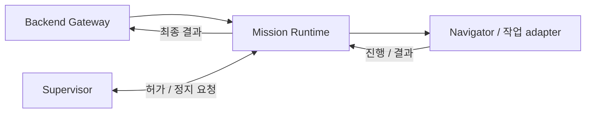
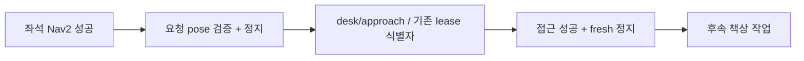

# cleany_mission_manager 노드 인터페이스

[Mission 실행](../../../../docs/RUNNING.md) · [미션 계약](../../cleany_interfaces/docs/mission.md)

응용 인터페이스와 adapter에서 생성하는 endpoint를 노드별로 정리합니다. 이름과 QoS 표기, ROS 자동 인터페이스는 [전체 색인](../../../../docs/ROS_INTERFACES.md)을 따릅니다. 이름 설정이 없는 항목은 ROS remap으로 변경합니다.

## mission_runtime

실행 파일: `mission_runtime`. 원본: [노드.py](../cleany_mission_manager/node.py), [nav2.py](../cleany_mission_manager/adapters/nav2.py), [manipulation.py](../cleany_mission_manager/adapters/manipulation.py), [supervision.py](../cleany_mission_manager/adapters/supervision.py).

| 종류 / 방향 | 기본 이름 | ROS 타입 | QoS, 주기와 이름 설정 |
|---|---|---|---|
| 토픽 발행 | `mission/status` | `cleany_interfaces/msg/MissionStatus` | R/T1; 상태 sequence 변경 시; `tick_hz` 기본 10 Hz |
| 토픽 발행 | `mission/result` | `cleany_interfaces/msg/MissionResult` | R/T1; 새 최종 결과 |
| 토픽 발행 | `mission/debug_snapshot` | `cleany_interfaces/msg/RuntimeDebugSnapshot` | R/T1; 기본 2 Hz |
| 토픽 발행 | `mission/runtime_events` | `cleany_interfaces/msg/RuntimeEvent` | R/T2048; 이벤트 발생 시 |
| 토픽 구독 | `robot/safety_fault` | `std_msgs/msg/String` | R10; `supervision_mode=disabled`만 |
| 토픽 구독 | `robot/safety_released` | `std_msgs/msg/String` | R10; `supervision_mode=disabled`만 |
| 액션 제공 | `mission/stop` | `cleany_interfaces/action/StopMission` | Action 기본값; `supervision_mode=required`, `stop_action` |
| 서비스 호출 | `system/check_permission` | `cleany_interfaces/srv/CheckPermission` | Service 기본값; required; 갱신 TTL/3 |
| 토픽 구독 | `system/heartbeat` | `cleany_interfaces/msg/SystemHeartbeat` | R1; required |
| 토픽 구독 | `system/state` | `cleany_interfaces/msg/SystemState` | R/T1; required |
| 토픽 구독 | `system/capabilities` | `cleany_interfaces/msg/SystemCapabilities` | R/T1; required |
| 서비스 제공 | `mission/offer` | `cleany_interfaces/srv/OfferMission` | Service 기본값 |
| 서비스 제공 | `mission/cancel` | `cleany_interfaces/srv/CancelMission` | Service 기본값 |
| 서비스 제공 | `mission/snapshot` | `cleany_interfaces/srv/GetRuntimeSnapshot` | Service 기본값 |
| 서비스 제공 | `mission/reset_error` | `std_srvs/srv/Trigger` | Service 기본값 |
| 액션 호출 | `navigate_to_pose` | `nav2_msgs/action/NavigateToPose` | Action 기본값; `navigation_backend=nav2` |
| 서비스 호출 | `navigate_to_pose/_action/cancel_goal` | `action_msgs/srv/CancelGoal` | Service 기본값; Nav2 adapter |
| 서비스 호출 | `<lifecycle_node>/get_state` | `lifecycle_msgs/srv/GetState` | Service 기본값; `required_navigation_lifecycle_nodes`; `supervision_mode=disabled`만 (감독 시 Supervisor가 확인) |
| 토픽 구독 | `odom` | `nav_msgs/msg/Odometry` | Sensor; `odom_topic`, Nav2 adapter |
| 토픽 구독 | `navigate_to_pose/_action/status` | `action_msgs/msg/GoalStatusArray` | Action status 기본 QoS; Nav2 adapter |
| 토픽 구독 | `/tf` | `tf2_msgs/msg/TFMessage` | TF 기본 QoS |
| 토픽 구독 | `/tf_static` | `tf2_msgs/msg/TFMessage` | TF 기본 QoS |
| 액션 호출 | `mock/manipulation/execute_skill` | `cleany_interfaces/action/ExecuteManipulationSkill` | Action 기본값; `manipulation_action` |
| 서비스 호출 | `mock/manipulation/execute_skill/_action/cancel_goal` | `action_msgs/srv/CancelGoal` | Service 기본값; `manipulation_action` + suffix |
| 서비스 호출 | `mock/manipulation/get_execution` | `cleany_interfaces/srv/GetManipulationExecution` | Service 기본값; `manipulation_query` |

| 실행 옵션 | 생성되는 경계 |
|---|---|
| navigation_backend=nav2 | Nav2 endpoint와 TF 구독 |
| manipulation_backend=action_mock | ROS 조작 endpoint; 기본 mock은 process 내부 |
| 기본 lifecycle 목록 | map_server / amcl / planner_server / controller_server / bt_navigator / collision_monitor |
| supervision_mode=required 기본 | 미션마다 supervision_capabilities 기본 [NAVIGATION]의 lease 하나 |
| supervision_mode=disabled | Mock / simulation 단독 실행; snapshot의 supervision에 기록 |

[Mission 계약](../../cleany_interfaces/docs/mission.md)을 따릅니다.

## 책상 정밀 접근을 사용하는 navigation port

| DeskApproach | 계약 |
|---|---|
| 활성 / 타입 | desk_approach_enabled=true, cleany_interfaces/action/DeskApproach, 기본 Action QoS |
| desk_distance_m | Base 원점에서 평면까지 거리 |
| 취소 | Lease 상실 / mission stop도 같은 navigation port에 연결 |
| Home | 호출하지 않음 |
| 재시작 | Journal desk_goal_uuid로 정확한 goal 취소; 수락만으로 정지 인정 안 함 |

## 버전이 있는 좌석 목표 파일

`targets_file`은 기존 schema 1 YAML과 control-plane에서 내보낸 schema 2 JSON을 읽습니다.
좌표는 `map` 프레임의 `[x_m, y_m, yaw_rad]`이며 좌석 ID를 접근 목표로 해석합니다.
Schema 2는 전체 payload에서 `target_digest`를 제외하고 키를 정렬한 compact JSON의
SHA-256을 확인합니다. `validation_status=field_verified`, 유효한 복귀점과 하나 이상의
좌석 목표가 필요합니다. 초안과 해시 불일치는 노드 초기화 중 거부합니다.

`mission/snapshot`의 JSON에 `target_map`을 추가합니다. 값은 실제 로드한 파일의
`map_id`, `source_sha256`, `layout_revision`, `target_digest`이며 schema 1에서는 null입니다.
이는 목표 파일의 버전 확인입니다. 실제 AMCL 위치 정확도, 장애물 회피, 팔 도달성이나
책상 정리 완료를 증명하지 않습니다. 배치 변경 후에는 Runtime을 재시작하여 새 파일을
로드하고 Backend의 버전 일치를 확인합니다.
