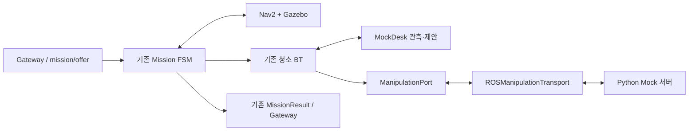

# Gazebo 주행과 Python Mock Manipulation 통합

PR #54 `98e9f6c`의 Mission Runtime에 PR #55 `86a6d85`의 **Python Mock 서버만 선별 연결**했다.
베이스는 Gazebo/Nav2가 주행하고 인식·계획·팔 조작은 Mock이다.

| 찾는 내용 | 기준 문서 |
|---|---|
| 공통 빌드·테스트·기존 VM 환경 | [Workspace](../../../README.md#missionmock-조작-검증) |
| Gazebo 실행·미션 요청·launch 인자 | [Bringup](../../cleany_bringup/README.md#빠른-시작) |
| 결과 판정·취소·주행 차단·시간표 | [Mission Manager](../README.md#단일-물체-manipulation-연결) |
| Action·message·service 필드 | [Interfaces](../../cleany_interfaces/README.md#단일-물체-manipulation-action) |
| 서버 단독 실행·fixture 기본값 | [Skill Executor](../../cleany_skill_executor/README.md#python-mock-manipulation-서버) |
| BT·조작 화면 해석·기록 재생 | [Dev Monitor](../../cleany_dev_monitor/README.md#실행-흐름과-상태-읽기) |

이 문서는 통합 구조·선별 포함 범위·공유 데이터와 **검증 이력**을 관리한다.
실행 명령과 패키지별 계약은 위 README를 기준으로 한다.

## 책임과 구현 범위

| 구성 | 책임 |
|---|---|
| Mission FSM | 수락·좌석 이동·작업 진입·취소·종료 정책·보고 |
| 청소 BT | 관측 → 제안 → 검증 → 한 물체 실행 → 재관측 → 완료 확인 |
| ManipulationPort | 전송 전 journal, 단일 실행 추적, 결과 검증·취소·조회·복구 |
| ROS transport | Action/service 변환, 동일 Goal UUID, 최신 Feedback 관측 |
| Mock 서버 | 세부 단계와 모의 성공·실패·CHECKPOINT 취소 결과 |
| Gazebo/Nav2 | 베이스 주행·도착, odom·TF·clock과 정지 확인 |

FSM 상태·전이, 청소 BT 노드·순서와 기존 port 계약을 유지한다. 서버의
`GRASPING`·`TRANSPORTING`은 Mission의 새 노드가 아니다. Mission allowlist는
`collect_trash`이며 로컬 `manipulation_backend=mock`도 유지한다.

선별한 코드는 `cleany_skill_executor/manipulation/`의 core·model·mock·port·단계·저장소,
`manipulation_node.py`, Mock 설정·launch·core/ROS 검사다. 실행 등록은
`manipulation_server`만 추가했다. PR #55의 native BT·MuJoCo 실행기·주변 인식/MoveIt
리팩터링은 포함하지 않았다. 기존 패키지 의존성은 보존하므로 의존 패키지를 빌드할 수는 있다.

## 인터페이스와 보고 호환

조작 Action·Record는 PR #55 정의로 정렬하고 `CancelManipulation`을 등록한다.
`GetManipulationExecution`과 Mission·관제 타입은 유지한다. 모든 consumer를
**하나의 install prefix**에서 빌드·source하며 PR별 overlay를 따로 겹치지 않는다.

기존 `ManipulationOutcome`, `RuntimeReport.actions`, Mission DB schema와 Gateway
payload는 유지한다. 세부 단계·취소 방식은 선택적 진단 metadata로 분리하고 과거
기록에는 기본값을 적용한다. 저장 위치와 결과 검증은
[Mission 보고·journal 계약](../README.md#보고journalfeedback-호환)을 따른다.

Feedback은 최신 실행의 관측값이다. Mission core에 ROS callback을 추가하지 않으며
완료·정지·주행 허가는 최종 결과와 기존 gate로 판정한다.

## 공유 fixture와 실행 순서

Runtime은 [Gazebo profile](../config/runtime_gazebo_manipulation_mock.yaml),
서버·Runtime 공통 입력은 [공유 fixture](../config/manipulation_server_fixture.yaml)를 사용한다.
backend·서버 시작 조합, preflight와 Nav2 세부 구성은
[Bringup 실행 인자](../../cleany_bringup/README.md#실행-인자)와
[주행 설정](../../cleany_bringup/README.md#주행-준비와-설정)에서 관리한다.

| 관측 ID | wire object 목록 | 역할 |
|---|---|---|
| `mock-snapshot-001` | `[1, 2]` | 작업 전 관측 |
| `mock-snapshot-002` | `[2]` | 첫 수거 후 재관측 |
| `mock-snapshot-003` | `[]` | 두 번째 수거 후 완료 제안 |
| `mock-snapshot-004` | `[]` | 추가 빈 관측으로 완료 확인 |

표시 문자열에서 wire ID를 추정하지 않는다. 검증된 SUCCESS만 논리적 물체를 제거한다.

1. 수락·Nav2 준비 검사를 통과한다.
2. 좌석 도착·베이스 정지를 확인하고 WORKING에 진입한다.
3. 기존 BT가 관측·제안을 검증하고 task/execution UUID와 Goal을 journal에 저장한다.
4. 같은 execution UUID를 ROS Goal UUID로 보내고 최종 결과를 검증·저장한다.
5. 성공 callback 뒤 재관측하며, 완료까지 다음 물체 또는 추가 빈 관측을 확인한다.
6. 기존 결과 보고와 종료 정책을 적용한다.

Gazebo가 유일한 simulator다. Mock 서버는 clock·TF·odom·카메라·joint_states를
발행하지 않으며 Mission·서버의 시간 제한은 steady clock을 사용한다.
출처는 `navigation=sim`, `perception/planning/execution=mock`이다.
Mock 성공은 논리적 수거 결과이며 물리 청소·실물 팔·팔 애니메이션의 증거가 아니다.

공유 fixture의 정상 단계 합계는 물체당 40초다. ROS 계약 검사는 같은 논리 입력의
시간을 줄이고 Gazebo 검사는 관찰 시간을 그대로 사용한다. 단계별 비율과 timeout은
[Mission 시간표](../README.md#mock-조작의-관찰-시간)에서만 관리한다.

## 실패·취소·재시작

판정 표와 복구 gate의 기준은 [Mission 요청·결과 판정](../README.md#요청과-결과-판정)이다.
통합 시 특히 다음 조건을 유지한다.

- ROS SUCCEEDED의 BLOCKED payload나 취소 ACK를 수거 성공·정지 증거로 사용하지 않는다.
- HELD/UNKNOWN·팔 미복귀·FATAL·정지 미확인 상태는 기존 이동·수락·오류 해제 조건을 유지한다.
- 전송 전 journal 실패 시 보내지 않고, 응답 유실·거절·지연 수락은 같은 ID로 조회·취소한다.
- 미완료 미션은 재시작 시 INTERRUPTED로 처리하며 자동 재개하지 않는다.
- 서버·Mission DB를 분리·보존하고, 초기 Mock 안전 설정이나 backend 전환으로 위험 상태를 덮지 않는다.
- 손상된 기록은 오류로 처리한다. DB 초기화로 계속 실행하는 자동 복구는 없다.

## 검증 순서

[공통 검증 명령](../../../README.md#missionmock-조작-검증)을 다음 순서로 실행한다.

| 순서 | 단계 | 확인 범위 |
|---|---|---|
| 1 | core | FSM·BT·조작 core, 보고·과거 journal 호환 |
| 2 | 실제 ROS + Mock 주행 | 공통 타입, 두 물체·네 관측, BLOCKED·불일치, HELD 취소, 동일 ID 복구, Feedback/debug 오류 격리, 설정 preflight |
| 3 | Gazebo/Nav2 + Mock 조작 | Gateway 없는 `mission/offer`, 단일 clock·물리 토픽 발행 주체, 도착·정지·최종 보고 |
| 4 | 별도 종료 정책·Bridge | home 복귀 시험, 로컬 WebSocket Gateway fixture의 offer·ACK·terminal payload |

운영 Backend·Dashboard 연결, 다른 지도·좌석과 실물 팔은 해당 외부 환경에서 별도 확인한다.

## 최신 검증 결과

**2026-10-20 / 현재 작업 브랜치 기준.** 아래 항목은 같은 실행 범위에서 수행했으며
검사 묶음 간 중복이 있어 수를 합산하지 않는다.

| 항목 | 결과 |
|---|---|
| Mission·Mock·Bridge ROS | 208 passed, Gazebo 1개는 별도 실행 |
| Monitor core·ROS | 41 passed |
| 웹 + 실제 Monitor·Gazebo 지도 | 27 passed, skip 없음 |
| Gazebo/Nav2 + Mock, `wait_for_next` | 1 passed, **139.97초**; 두 execution ID·각 17개 동작·추가 빈 관측 |
| 구조·보고·DB | 기존 FSM·BT·DTO·journal·Bridge session 핵심 파일 동일, Mission·서버·관측 DB 무결성 통과 |
| ROS 타입 | 조작 정의 3종은 `86a6d85`와 동일, 생성 타입 23종 import |
| 웹·Monitor 빌드 | TypeScript 미사용 검사·전체 웹 포맷·웹 빌드·Monitor 관련 4개 ROS 패키지 빌드 통과 |

실행 중 `CarryObject`를 조작 화면과 ExecuteOne 상세에서 확인했고 브라우저 page error는
없었다. 과거 metadata·서버 JSON 기본값 호환, 취소·응답 유실·재시작과 주행 차단 회귀를 포함한다.

### 남은 제한

| 항목 | 현재 상태 |
|---|---|
| 깨끗한 Gazebo 전체 재빌드 | 로컬 Nav2 export가 삭제된 `/tmp/cleany-nav2-validation-XMtC8l/root`를 참조해 실패. Gazebo 실행 검사는 **기존 설치** 사용 |
| 최신 PR #54 `65fdf06` 반영 | 파일별 3-way 사전 비교에서 코드 4곳·문서 삭제/수정 4곳 충돌. 병합·재검증 미수행 |
| 검증 범위 | Humble/Fortress·study-cafe `seat-12`. 이번 40초 fixture 재검증의 종료 정책은 `wait_for_next` |

따라서 실행 성공을 새 환경의 전체 재빌드 성공이나 최신 #54와의 병합 호환성으로
확대 해석하지 않는다. 이전 기본 로컬 Mock의 home 실패와 이후 Action Mock의 home
성공도 서로 다른 설정에서 수행한 기록이다.

### 검증 자료

경로는 저장소 옆 `cleany-data/runs/` 기준이다. 자동 생성 자료는 이 문서에 복제하지 않는다.

| 디렉터리 | 주요 자료 |
|---|---|
| `code-review-20261020/` | `verification.json`, `contracts.json`, `execution-evidence.json`, `upstream-compatibility.json`, DB·로그·화면 |
| `code-verification-20261015-NS9Nqz/` | 이전 ExecuteOne 통합 재검증·실제 집기 시점 재생 자료 |
| `manipulation-timing-20261015-XwwCUn/` | 단계 시간 조정 전후 DB·launch 로그·웹 화면 |

## 과거 검증 이력

초기 0.5초 fixture와 관찰 시간 조정 결과

| 시점·설정 | 결과 |
|---|---|
| 통합 전 로컬 Mock 주행 구성 | 과거 home 복귀 시험 실패. 현재 Action Mock 구성과 구분 |
| 2026-10-14, 단계 기본 0.5초 | Mission·Bridge 기존 51개 회귀, ROS 199 passed·1 skipped, Mock 의존 11개·simulation 16개 패키지 빌드 통과 |
| 같은 날, `wait_for_next` | 68.78초, 두 실행 UUID·네 관측·SUCCESS |
| 같은 날, `return_home` | 103.36초, 두 물체 수거 후 home 복귀·정지, `return_result=OK` |
| 2026-10-15, 물체당 정상 40초 | core 76 passed, ROS 208 passed·1 skipped, Gazebo `wait_for_next` 139.43초 |
| 같은 실행의 Mock 측정 시간 | 첫 물체 40.779초·두 번째 40.777초, 각 17개 동작 완료 |

당시 웹의 조작 단계 관측 검사 2개와 단일 clock·MuJoCo 미실행·Mock 물리 토픽 미발행을
확인했다. 기본 DiffDrive profile의 목표 근처 정지 문제는 기존 mecanum controller와
monitor에 맞춘 footprint로 구성했으며 Mission gate는 완화하지 않았다.

