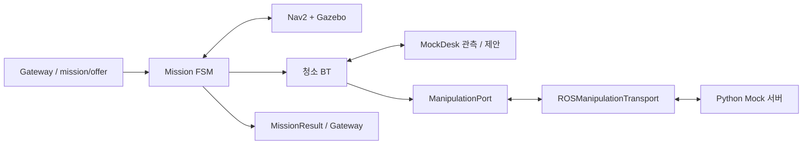

# Gazebo 주행과 Mock 조작 연결

베이스는 Gazebo/Nav2가 주행하고 인식, 계획과 팔 조작은 Mock이다. Python Mock 서버는 PR #55 `86a6d85`의 실행 core, model, mock adapter, port, 단계, SQLite 저장소와 ROS wrapper를 선별 포함했다. Native BT와 MuJoCo 실행기는 포함하지 않았다.

FSM은 수락, 좌석 이동, 취소, 종료 정책과 보고를 소유한다. 청소 BT는 `ObserveBefore → [PlanNext → ValidateProposal → ExecuteOne → Reobserve → VerifyCompletion]`을 실행한다. 접근, 집기와 운반은 Action 서버 내부 진행이며 Mission BT에 노드를 추가하지 않는다. 검증된 성공만 논리적 책상 목록을 갱신한다. Gazebo 팔 애니메이션이나 물리 수거는 실행하지 않는다.

| 안내 | 원본 |
|---|---|
| 실행과 미션 요청 | [RUNNING](../../../../docs/RUNNING.md#gazebo-주행과-mock-조작) |
| ID, 결과, 취소와 복구 | [Manipulation 계약](../../cleany_interfaces/docs/manipulation.md) |
| 화면과 ExecuteOne 상세 | [Monitor 데이터](../../cleany_dev_monitor/docs/data.md#청소-bt와-조작-관측) |
| 검증 명령과 실행 근거 | [TESTING](../../../../docs/TESTING.md), [EVIDENCE](../../../../docs/EVIDENCE.md) |

## Profile과 시작 조건

| 설정 | 주행 | 조작 |
|---|---|---|
| [runtime.yaml](../config/runtime.yaml) | Nav2 | 로컬 Mock |
| [runtime_manipulation_mock.yaml](../config/runtime_manipulation_mock.yaml) | Mock | 외부 Mock Action |
| [runtime_gazebo_manipulation_mock.yaml](../config/runtime_gazebo_manipulation_mock.yaml) | Gazebo/Nav2 | 외부 Mock Action |

| `manipulation_backend` | `start_manipulation_mock` | 처리 |
|---|---|---|
| `mock` | `false` | 기존 로컬 Mock |
| `action_mock` | `false` | 별도 서버 연결, 미준비 시 미션 수락 차단 |
| `action_mock` | `true` | `/mock` 서버 동시 시작 |
| `mock` | `true` | 설정 오류로 시작 거절 |

[통합 launch](../../cleany_bringup/launch/mission_sim.launch.py)는 backend, fixture의 snapshot wire ID와 목적지를 검사한다. 서버 동시 시작 시 scenario, 서버 설정과 DB 분리도 Gazebo 실행 전에 확인한다. `profile`은 Fortress만 지원한다.

`action_mock`은 기존 `lidar_depth_nav` 센서, `nav2_safety.yaml`의 collision monitor, `nav2_omni_motion.yaml`의 mecanum controller를 조합한다. Controller의 도착 오차는 3 cm이고 Mission의 기존 8 cm gate는 유지한다. Costmap footprint는 monitor envelope와 맞춘다. 지도 파일명과 targets의 `map_id`는 같아야 하며 초기 위치는 [AMCL 설정](../../cleany_gazebo_sim/config/nav2_amcl.yaml)의 지도 좌표를 사용한다.

## 공유 입력과 영속성

[공유 fixture](../config/manipulation_server_fixture.yaml)는 두 물체와 네 관측을 등록한다. 표시 ID `trash-1`과 wire ID `1`은 명시적으로 매핑하며 문자열에서 숫자를 추정하지 않는다.

| 관측 ID | wire ID 목록 | 역할 |
|---|---|---|
| `mock-snapshot-001` | `[1, 2]` | 작업 전 관측 |
| `mock-snapshot-002` | `[2]` | 첫 수거 후 재관측 |
| `mock-snapshot-003` | `[]` | 두 번째 수거 후 완료 제안 |
| `mock-snapshot-004` | `[]` | 추가 빈 관측으로 완료 확인 |

모든 consumer는 같은 install prefix의 생성 타입을 사용한다. Mission DB, 서버 DB와 Bridge DB는 분리하며 재시작 시험에서 유지한다. `manipulation_initial_mock_safe=true`는 새 journal에만 적용한다. 저장된 위험 상태나 진행 기록을 덮어쓰지 않으며 조작 실행 기록이 있으면 로컬 Mock 전환으로 gate를 우회할 수 없다.

Gazebo가 clock, TF와 odom을 소유한다. Mock 서버는 물리 상태 토픽을 발행하지 않으며 Mission과 서버는 steady clock으로 timeout과 취소를 처리한다. 출처는 `navigation=sim`, `perception/planning/execution=mock`이다.

## Mock 조작의 관찰 시간

공유 [server fixture](../config/manipulation_server_fixture.yaml)는 정상 수거를 물체 하나당
40초로 설정합니다. 팔 이동에 준비·검증보다 긴 시간을 배정해 진행을 관찰하기 위한
가정입니다. 실물 팔의 경로, 하중과 속도 설정을 측정해 산출한 예상 시간은 아닙니다.

| 단계 | 시간 |
|---|---:|
| 실행 준비 확인 `VALIDATING` | 1초 |
| 대상 확인·파지 계획 `PREPARING_TARGET` | 4초 |
| 물체 접근 `APPROACHING` | 7초 |
| 그리퍼 닫기·파지 확인 `GRASPING` | 3초 |
| 들어 올리기·보유 확인 `LIFTING` | 3초 |
| 수거함 운반 `TRANSPORTING` | 8초 |
| 놓기·이탈 확인 `PLACING` | 5초 |
| 팔 복귀 `RETURNING_ARM` | 7초 |
| 안착 확인 `VERIFYING_PLACEMENT` | 2초 |

두 물체는 통신·관측 시간을 더해 약 80초 이상 걸립니다. 단계 안의 세부 동작은
해당 시간을 나누어 쓰며 각각 최소 1초입니다. 청소 BT의 `ExecuteOne`을 실행하는 동안
`mission/debug_snapshot`의 `manipulation_feedback`과
`/mock/manipulation/execution_events`에서 세부 진행을 확인할 수 있습니다.
웹 관제보드의 실행 → BT에서도 조작 단계와 세부 동작이 표시됩니다.

`stage_durations_sec`는 모든 scenario의 기본 시간이고, scenario별 값이 우선합니다.
설정을 바꾸면 Mock 서버를 다시 실행해야 합니다. 이미 진행 중인 실행의 DB는 보존합니다.

| Runtime timeout | 기본 로컬 Mock | 외부 Action Mock profile |
|---|---:|---:|
| 단일 작업 | 30초 | 120초 |
| 취소 확인 | 5초 | 15초 |
| 청소 전체 | 180초 | 300초 |

ROS 계약 회귀 검사는 같은 논리 fixture의 시간을 줄이고 Gazebo 검사는 위 관찰 시간을 사용한다.
설정은 [Runtime profile](../config/runtime_manipulation_mock.yaml)과
[Gazebo profile](../config/runtime_gazebo_manipulation_mock.yaml)에서 관리한다.
