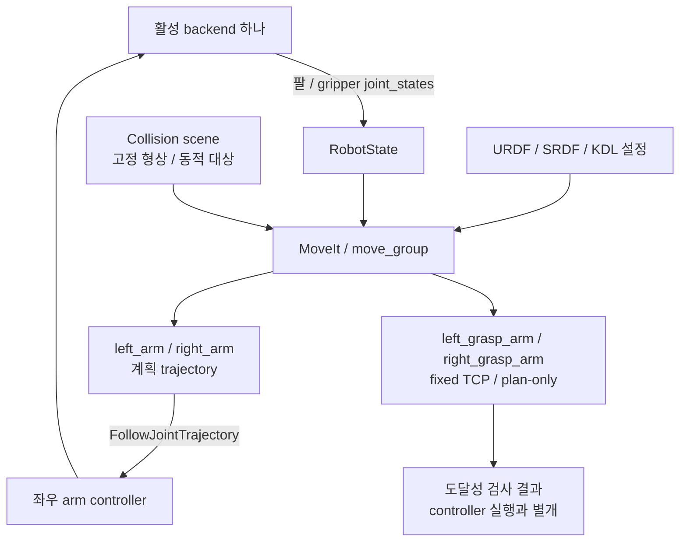

# MoveIt planning 계약

MoveIt은 팔별 5관절을 계획하며 gripper, base는 planning group에서 제외한다. Grasp group은 같은 팔 관절을 사용하고 fixed TCP joint까지 chain을 확장한다.

## Group과 controller

기본 MoveIt 및 Mock launch는 `collision_detector:=cleany/SolidFCL`을 사용한다.
최적화 메시의 닫힌 볼록 조각을 내부가 채워진 형상으로 읽고, RViz에도 같은
detector를 전달한다. `cleany/RequireCollisionDetector`가 요청한 detector의 로드를
확인하며, 실패하면 다른 검사기로 계속 계획하지 않고 프로세스를 종료한다.
원본 CAD의 표면 검사 대조에는 `collision_detector:=FCL`을 명시한다.



| Group | Chain | Controller |
|---|---|---|
| left_arm | base_link → left_gripper_frame | left_arm_controller |
| right_arm | base_link → right_gripper_frame | right_arm_controller |
| left_grasp_arm | base_link → left_grasp_tcp | plan-only |
| right_grasp_arm | base_link → right_grasp_tcp | plan-only |

| 항목 | 계약 |
|---|---|
| IK | KDL, position_only_ik=true; 목표 위치와 전체 arm seed 사용 |
| Home | left_home/right_home의 팔 5관절 모두 0 rad |
| Controller 타입 | control_msgs/action/FollowJointTrajectory |
| Action 이름 | /left_arm_controller/follow_joint_trajectory, /right_arm_controller/follow_joint_trajectory |
| Backend 상태 | 팔, gripper 전체 /joint_states 발행 필수 |

Position-only IK는 목표 orientation을 제약하지 않는다. SRDF는 직접 parent/child만 충돌 검사에서 제외하며, 비인접, 좌우 cross-arm 검사는 유지한다.

## 고정 collision scene

Hand-eye scene은 config/handeye_collision_objects.yaml의 cleany.moveit_collision_objects/v1 schema로 정의한다. Box는 전체 길이와 base_link 기준 primitive_pose를 사용하며 top-level CollisionObject.pose에 의존하지 않는다.

move_group 실행 후 scene을 한 번 적용한다.

```bash
ros2 launch cleany_moveit_config handeye_collision_scene.launch.py
```

Applier는 /apply_planning_scene이 handeye_table, handeye_target_stand, charuco_target을 수락한 뒤 종료한다. 일반 move_group launch는 이 scene을 자동 주입하지 않는다.

Pick-demo table은 config/pick_demo_collision_objects.yaml에 있으며 rgbd_pick_demo.xml.in과 크기, pose가 일치한다. Box/can target은 reachable-grasp action에서 동적으로 등록한다.

관련 안내: [실행](../../../../docs/RUNNING.md), [검증](../../../../docs/TESTING.md).

노드별 통신 목록: [인터페이스 표](interfaces.md).

## Terminal logging

`move_group.launch.py` accepts `backend_log_level` (standalone default `info`)
and `log_level` (default `info`). The sensor-driven MuJoCo workflow passes
`backend_log_level:=warn` to reduce backend initialization and planning detail.
Warnings and errors remain visible. The child logger `move_group.scene_mapping`
uses `log_level` independently: `log_level:=debug` enables throttled depth
callback and map timing diagnostics without enabling every MoveIt logger.
In quiet mode, capability banners printed directly to stdout go to the launch
log; this process sends ROS logs to stderr so warnings and errors remain on
screen even if the parent environment selects stdout. `backend_log_level:=info`
also restores those banners to the terminal.

## Humble controller plugin teardown

`keep_controller_plugin_loaded:=true` keeps the default controller plugin library
mapped through process teardown using a process-local `LD_PRELOAD`. Existing
preload entries are preserved. It applies only to
`moveit_simple_controller_manager/MoveItSimpleControllerManager`.

In this VM, Ctrl+C caused a SIGSEGV in `rclcpp::CallbackGroup` while the controller
manager node was being destroyed. MoveIt 2.5.9 declares the plugin loader after
that node, so the loader is destroyed first; the core dump is consistent with
a remaining weak-pointer control block referencing unloaded plugin code.
See the [upstream member declarations](https://github.com/moveit/moveit2/blob/2.5.9/moveit_ros/planning/trajectory_execution_manager/include/moveit/trajectory_execution_manager/trajectory_execution_manager.h).

Preloading prevented the observed crash. The workaround does not change
trajectory execution or controller selection. Set
`keep_controller_plugin_loaded:=false` when validating a patched MoveIt install.
The workaround may leave the upstream `class_loader` unload warning visible;
it prevents the observed crash without suppressing that warning.

The runtime regression exercises `/check_state_validity` in the default MuJoCo
logging mode (`backend_log_level:=warn`) and requires clean SIGINT termination
without SIGTERM escalation. It also checks that ROS warnings remain on screen.
