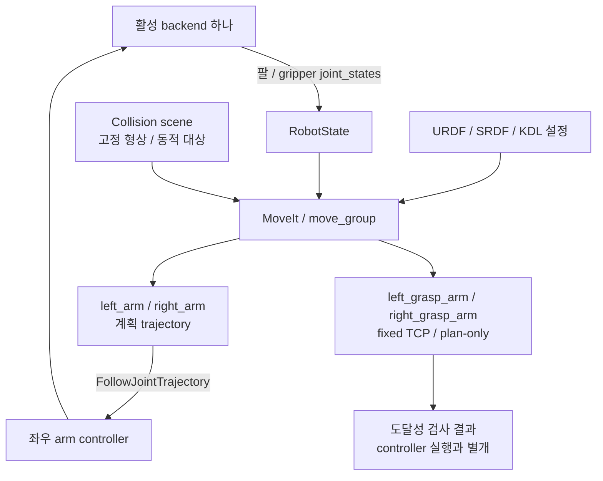

# MoveIt planning 계약

MoveIt은 팔별 5관절을 계획하며 gripper, base는 planning group에서 제외한다. Grasp group은 같은 팔 관절을 사용하고 fixed TCP joint까지 chain을 확장한다.

## FreeCAD 형상 검사

`freecad_inspection.launch.py`는 로컬 ROS domain에서 FreeCAD URDF를 그대로
읽어 MoveIt의 상태·충돌 검사와 OctoMap을 실행한다. 기본 모델은
`freecad_kinematic`이며, `cad_delta_*` 좌표 0은 CAD 파일의 저장 자세다.
검사 launch는 궤적 계획, IK와 실행 인터페이스를 비활성화한다.
검사용 포인트클라우드는 CAD `base_link`로 표현된 데이터를 사용한다.
[실행 방법](../../../../docs/RUNNING.md#freecad-moveit와-octomap-검사)을 따른다.

`collision_cache`를 지정하면 GLB 충돌 메시를 읽는다. 기본 인덱스 캐시는
삼각형 순서와 좌표를 보존하며, 표면 감면 캐시는 생성 시 명시한 양방향
표면 거리 상한 안에서 삼각형을 줄인다. 두 종류 모두 링크 변환과 시각 메시를
보존한다. 표면 감면은 입체 포함 보증이 아니므로 미확인 실물 계획의 충돌
여유로 사용할 수 없다. 캐시는 원본
URDF 및 형상 manifest의 해시가 일치하고 캐시 메시가 정상일 때만 사용한다.
cuRobo 검사도 이 캐시의 저장 자세를 읽을 수 있다.

`moveit_primitives` 캐시는 몸통을 채운 박스 5개의 합집합으로 표현한다.
두 CAD 상판에서 추출한 공통 직사각형 투입구와 그 아래 공간은 비워 둔다.
하단 경계는 기존 내부 횡대 `InstalledProfile20`의 윗면이며 실물 쓰레기통의
바닥이나 사용 가능 깊이를 확정한 값이 아니다. 바닥 부근의 기존 IMU 형상은
별도로 유지한다. 몸통 원본 삼각형이 투입구 내부를 가로지르면 생성을 거부한다.
몸통 측면의 라이다 높이 틈도 이 충돌 프로필에서는 채운다. 센서 프레임과
원본 시각 모델은 유지하지만 이 프로필을 라이다 광선 시뮬레이션의 가림 모델로
사용하지 않는다.

마운트는 각각 속이 찬 박스로, 바퀴는 기존 관절축과 동축인 원통으로
바꾼다. 서로 움직이는 링크는 합치지 않는다. 이 단순 입체는 선택한 원본
표면을 감싸며, 추가 여유는 부동소수점 바깥쪽 반올림뿐이다. 작은 구멍과 홈을
채우므로 근처 물체를 더 일찍 충돌로 판정하거나 자체 필터에서 제거할 수 있다.
단순 입체에는 표면 거리 상한을 적용하지 않는다.

팔 본체는 기존 `optimize_arm_collision_meshes.py`의 분할 외피 알고리즘을
사용한다. 새 CAD 좌표에서 부품과 포크를 분할하고 각 조각을 닫힌 볼록
다면체로 감싼다. 마스트는 높이 방향 8개 구간으로 나눠 내부를 채우면서
잘록한 허리와 넓은 밑부분을 유지한다. 설정은
`configs/robot/freecad_moveit_collision.json`의 `component_enclosures`가 관리한다.
직렬화한 float32 GLB가 원본 조각의 모든 삼각형을 포함하는지 검사한다.
외피 확장 상한은 팔 1mm, 마스트 0.25mm이며 **각 원본 조각의 볼록 외피**를
기준으로 한다. 오목한 CAD 표면과의 거리 상한은 아니며 작은 구멍은 채워진다.
분할 평면과 수치 여유 1µm는 메시 생성 설정이며 관절 보정값이 아니다.

생성한 외피에는 `cad_enclosure__` collision 이름을 붙인다. 검사 launch는
이 선언이 있으면 `cleany/CADInspectionFCL`을 선택하고 실제 로드를 확인한다.
닫힌 외피 내부에 완전히 들어간 장애물도 검출하며, 선언하지 않은 CAD 메시에는
기존 FCL 표면 검사를 유지한다. 형상 초기화나 detector 로드가 실패하면
검사 프로세스를 종료한다.

헤드 카메라 하우징과 집게 장착 어댑터의 볼록 외피 확장 상한은 0.25mm다.
양쪽 손목 카메라의 렌즈, 앞 유리와 마운트는 실측 치수를 담은 입력 표면
메시를 유지한다. 구동 로드, 외측 링크와 구동 혼은 1mm 상한의 외피로 단순화한다.
같은 링크에 고정된 팁의 쉘과 삽입부는 0.25mm 상한의 외피로 묶는다.
손목 본체, 서보, 집게 상하판, 캠과 캠 혼은 구멍과 결합부 틈이 있는
표면 메시로 생성한다. `RightTool`, `LeftTool`, `RightWrist`, `LeftWrist`에
속하는 표면 감면 대상은 원본 삼각형 표면과의 양방향 거리 상한 0.5mm를
사용한다. 후보가 더 작고 표면 검증을 통과할 때만 입력 캐시를 대체한다.
`preserve_collision_parts`의 접촉 패드(`Tip_Support`) 4개, 운반 링크
(`Distal_Rod`)와 내측 링크(`Internal_Rod`) 8개, 광학 부품 5개는 입력 캐시의
표면 메시를 유지한다. 운반 링크와 내측 링크는 축 구멍과 포크 틈을 유지해야
하므로 하나의 볼록 외피로 대체하지 않는다. 보호 부품을 단순 입체나 외피
대상으로 지정하면 생성을 거부한다. 접촉 패드 전체를 보존하며, 결합부의
양수 간격과 패드 사이 입구를 종속 관절을 해석한 CAD 비교 자세에서 검사한다.
자기 접촉은 감면 전 표면 모델과 대조한다. 메시 설정은 접촉 허용 쌍을
추가하지 않는다. 외부 장애물 검사와 제한된 CAD 자세의 통과는 기존 CAD
자기 접촉이나 모든 자세의 무충돌 계획을 보증하지 않는다.
원본과의 차이를 진단할 때는 원본 FreeCAD 솔리드의 표면 거리와 교집합
부피를 사용해 틈, 조립면 접촉, 체적 겹침을 구분한다.
헤드 팬의 고정 및 회전 브래킷, 팬 서보 외장과 구동 혼은 원본 틈이 있는
표면 메시를 유지한다. 팬 아래 지지 혼의 고정 링크 소유는
[CAD 링크 근거](../../cleany_description/docs/freecad-kinematics.md)에 따른다.
조립 접촉만 분리한 검사는 별도 scene의 정해진 CAD 자세에만 적용한다.

`component_enclosures.sets`는 함께 고정된 부품을 하나의 외피로 묶는다.
같은 관절 링크와 메시 좌표계를 갖는 원본만
허용한다. `combine_components`는 한 강체 안의 분리된 조각을 함께 감싸며,
틈을 남기기 위한 평면 분할과 동시에 지정할 수 없다. 생성 manifest는 묶음의
모든 원본 파일과 해시를 기록한다. 형상 허용치는 실물 보정이나 충돌 여유가
아니며 비충돌 XML, 관절축과 영점 설정은 변경하지 않는다.

cuRobo의 `--world-cache`는 같은 링크별 삼각형을 미리 합쳐 파일 수와 로딩 시
연결 작업을 줄인다. 이 cuRobo 변환은 MoveIt 및 OctoMap 캐시를 변경하지 않는다.
`moveit_primitives`를 입력하면 CAD 저장 자세의 FK를 적용한다. 박스, 원통과
`cad_enclosure__` 외피 조각은 각각 독립 GPU 충돌 객체로 유지해 겹치는 입체의 내부 면이 전체 합집합의
안팎 판정을 뒤집지 않도록 한다. 원통은 외접 64각 기둥으로 근사하며, 변환한
좌표는 GLB의 float32로 저장한다. 현재 바퀴의 반지름 확장은 약 0.077mm다.
world manifest는 관절 URDF 해시와 `required_mesh_query_distance_m`을 기록한다.
박스는 `cleany.freecad_collision_world/v2`의 `cuboids`에 위치, wxyz quaternion과
전체 변 길이를 저장하고 기본 cuboid 검사기로 읽는다. 몸통의 다섯 박스를
합치지 않으므로 투입구와 아래 공간은 유지된다. 박스 데이터의 해시도 검사한다.
`load_world_shapes()`는 GPU용 메시와 cuboid를 분리해 반환하고,
`load_world_cache()`는 기존 미리보기 호출을 위해 박스까지 삼각형으로 표시한다.
후자의 표시용 삼각형 수를 실제 GPU 메시 비용으로 집계하지 않는다.
구버전 mesh world는 그대로 읽으며, `--mesh-boxes`로 동일 형상의 전부 메시인
대조 캐시를 만들 수 있다.
검사 도구는 모든 객체의 내부를 덮도록 객체별 경계 상자 대각선에서
`WorldCollisionConfig.max_distance`를 계산한다. 기본 0.1m 탐색 범위는 큰
몸통의 깊은 내부를 놓칠 수 있으므로 이 캐시를 다른 검사기에 연결할 때도
같은 범위를 적용해야 한다. 이는 거리 검색 범위이며 물리적 padding이 아니다.

cuRobo 검사 도구는 같은 저장 자세의 충돌 메시를 CUDA mesh world로 읽는다.
CAD 삼각형에 대한 접촉 검사를 제공하며, 운영 cuRobo 로봇 모델과
궤적 solver를 갱신하려면 아래 자료가 필요하다.

| 적용 경로 | 필요한 확인 |
|---|---|
| 관절 상태와 MoveIt | 새 CAD 기준 자세에서 팔, 헤드와 집게 캠의 encoder 값 및 방향, 관절의 가동 범위와 속도 한계 |
| 집게와 계획 목표 | 실제 캠 각도와 개구 폭의 대응, 양쪽 TCP 위치·방향, 접촉이 허용되는 부품 쌍 |
| 쓰레기통 투입 | 실제 통의 내벽과 바닥 위치, 내부 장치와의 간섭, TCP 기준 투입 위치와 높이. CAD의 상판 투입구만으로 통 깊이나 투입 목표를 확정하지 않음 |
| MoveIt·cuRobo 충돌 모델 | 새 링크에 맞춘 SRDF와 자기 충돌 행렬, 가동 범위를 덮는 충돌 형상 및 구 모델, 두 검사기의 결과 대조 |
| 실물 OctoMap | 카메라 optical frame의 새 장착 TF와 관절 피드백의 시간 대응, 자세별 로봇 제거와 점유 확인 |
| cuRobo의 OctoMap 사용 | 기존 scene adapter가 거부하는 점유 데이터를 누락 없이 전달하는 변환과 장애물 검증 |
| 실제 궤적 실행 | 검증된 관절 이름·단위·제한을 controller에 매핑하고 정지·복귀 시험 |

## Group과 controller

기본 MoveIt 및 Mock launch는 `collision_detector:=cleany/SolidFCL`을 사용한다.
최적화 메시의 닫힌 볼록 조각을 내부가 채워진 형상으로 읽고, RViz에도 같은
detector를 전달한다. `cleany/RequireCollisionDetector`가 요청한 detector의 로드를
확인하며, 실패하면 다른 검사기로 계속 계획하지 않고 프로세스를 종료한다.
원본 CAD의 표면 검사 대조에는 `collision_detector:=FCL`을 명시한다.



| Group | Chain | Controller |
|---|---|---|
| left_arm | base_link → left_gripper_frame | left_arm_controller |
| right_arm | base_link → right_gripper_frame | right_arm_controller |
| left_grasp_arm | base_link → left_grasp_tcp | plan-only |
| right_grasp_arm | base_link → right_grasp_tcp | plan-only |

| 항목 | 계약 |
|---|---|
| IK | KDL, position_only_ik=true; 목표 위치와 전체 arm seed 사용 |
| Home | left_home/right_home의 팔 5관절 모두 0 rad |
| Controller 타입 | control_msgs/action/FollowJointTrajectory |
| Action 이름 | /left_arm_controller/follow_joint_trajectory, /right_arm_controller/follow_joint_trajectory |
| Backend 상태 | 팔, gripper 전체 /joint_states 발행 필수 |

Position-only IK는 목표 orientation을 제약하지 않는다. SRDF는 직접 parent/child만 충돌 검사에서 제외하며, 비인접, 좌우 cross-arm 검사는 유지한다.

## 고정 collision scene

Hand-eye scene은 config/handeye_collision_objects.yaml의 cleany.moveit_collision_objects/v1 schema로 정의한다. Box는 전체 길이와 base_link 기준 primitive_pose를 사용하며 top-level CollisionObject.pose에 의존하지 않는다.

move_group 실행 후 scene을 한 번 적용한다.

```bash
ros2 launch cleany_moveit_config handeye_collision_scene.launch.py
```

Applier는 /apply_planning_scene이 handeye_table, handeye_target_stand, charuco_target을 수락한 뒤 종료한다. 일반 move_group launch는 이 scene을 자동 주입하지 않는다.

Pick-demo table은 config/pick_demo_collision_objects.yaml에 있으며 rgbd_pick_demo.xml.in과 크기, pose가 일치한다. Box/can target은 reachable-grasp action에서 동적으로 등록한다.

관련 안내: [실행](../../../../docs/RUNNING.md), [검증](../../../../docs/TESTING.md).

노드별 통신 목록: [인터페이스 표](interfaces.md).

## Terminal logging

`move_group.launch.py` accepts `backend_log_level` (standalone default `info`)
and `log_level` (default `info`). The sensor-driven MuJoCo workflow passes
`backend_log_level:=warn` to reduce backend initialization and planning detail.
Warnings and errors remain visible. The child logger `move_group.scene_mapping`
uses `log_level` independently: `log_level:=debug` enables throttled depth
callback and map timing diagnostics without enabling every MoveIt logger.
In quiet mode, capability banners printed directly to stdout go to the launch
log; this process sends ROS logs to stderr so warnings and errors remain on
screen even if the parent environment selects stdout. `backend_log_level:=info`
also restores those banners to the terminal.

## Humble controller plugin teardown

`keep_controller_plugin_loaded:=true` keeps the default controller plugin library
mapped through process teardown using a process-local `LD_PRELOAD`. Existing
preload entries are preserved. It applies only to
`moveit_simple_controller_manager/MoveItSimpleControllerManager`.

In this VM, Ctrl+C caused a SIGSEGV in `rclcpp::CallbackGroup` while the controller
manager node was being destroyed. MoveIt 2.5.9 declares the plugin loader after
that node, so the loader is destroyed first; the core dump is consistent with
a remaining weak-pointer control block referencing unloaded plugin code.
See the [upstream member declarations](https://github.com/moveit/moveit2/blob/2.5.9/moveit_ros/planning/trajectory_execution_manager/include/moveit/trajectory_execution_manager/trajectory_execution_manager.h).

Preloading prevented the observed crash. The workaround does not change
trajectory execution or controller selection. Set
`keep_controller_plugin_loaded:=false` when validating a patched MoveIt install.
The workaround may leave the upstream `class_loader` unload warning visible;
it prevents the observed crash without suppressing that warning.

The runtime regression exercises `/check_state_validity` in the default MuJoCo
logging mode (`backend_log_level:=warn`) and requires clean SIGINT termination
without SIGTERM escalation. It also checks that ROS warnings remain on screen.
