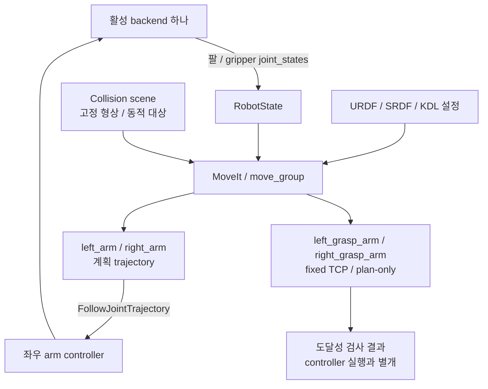
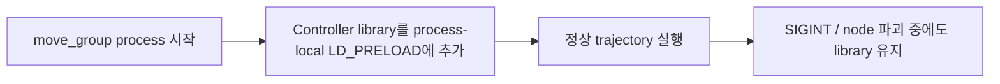

# MoveIt planning 계약

MoveIt은 팔별 5관절을 계획하며 gripper, base는 planning group에서 제외합니다. Grasp group은 같은 팔 관절을 사용하고 fixed TCP joint까지 chain을 확장합니다.

기본 형상은 최신 `cad_final`입니다. `move_group.launch.py model_profile:=jetson_20261009`는 이전 형상과 이전 joint limits를 함께 선택합니다. 최신 링크형 그리퍼는 0 rad 고정이며 Mock에서도 읽기 전용입니다. [모델 계약](../../cleany_description/docs/model.md)을 따릅니다.

## Group과 controller

| Collision detector | 계약 |
|---|---|
| 기본 MoveIt / Mock | cleany/SolidFCL; 닫힌 최적화 convex 조각 내부 포함 검사, RViz에도 전달 |
| 로딩 확인 | cleany/RequireCollisionDetector; 요청 detector 실패 시 프로세스 종료 |
| 원본 CAD 표면 대조 | collision_detector:=FCL 명시 |



| Group | Chain | Controller |
|---|---|---|
| left_arm | base_link → left_gripper_frame | left_arm_controller |
| right_arm | base_link → right_gripper_frame | right_arm_controller |
| left_grasp_arm | base_link → left_grasp_tcp | plan-only |
| right_grasp_arm | base_link → right_grasp_tcp | plan-only |

| 항목 | 계약 |
|---|---|
| IK | KDL, position_only_ik=true; 목표 위치와 전체 arm seed 사용 |
| Home | left_home/right_home의 팔 5관절 모두 0 rad |
| Controller 타입 | control_msgs/action/FollowJointTrajectory |
| Action 이름 | /left_arm_controller/follow_joint_trajectory, /right_arm_controller/follow_joint_trajectory |
| Backend 상태 | 팔, gripper 전체 /joint_states 발행 필수 |

Position-only IK는 목표 orientation을 제약하지 않습니다. SRDF는 직접 parent/child만 충돌 검사에서 제외하며, 비인접, 좌우 cross-arm 검사는 유지합니다.

## 고정 collision scene

Hand-eye scene은 config/handeye_collision_objects.yaml의 cleany.moveit_collision_objects/v1 schema로 정의합니다. Box는 전체 길이와 base_link 기준 primitive_pose를 사용하며 top-level CollisionObject.pose에 의존하지 않습니다.

move_group 실행 후 scene을 한 번 적용합니다.

```bash
ros2 launch cleany_moveit_config handeye_collision_scene.launch.py
```

Applier는 /apply_planning_scene이 handeye_table, handeye_target_stand, charuco_target을 수락한 뒤 종료합니다. 일반 move_group launch는 이 scene을 자동 주입하지 않습니다.

Pick-demo table은 config/pick_demo_collision_objects.yaml에 있으며 rgbd_pick_demo.xml.in과 크기, pose가 일치합니다. Box/can target은 reachable-grasp action에서 동적으로 등록합니다.

관련 안내: [실행](../../../../docs/implementation/running.md), [검증](../../../../docs/implementation/testing.md).

노드별 통신 목록: [인터페이스 표](interfaces.md).

## Terminal logging

| 옵션 / 출력 | 동작 |
|---|---|
| backend_log_level | Standalone info, 센서 MuJoCo warn; 경고 / 오류 유지 |
| log_level | 기본 info; child logger move_group.scene_mapping은 독립 적용 |
| log_level:=debug | 전체 MoveIt debug 없이 depth 콜백 / map timing 진단 |
| Quiet mode | stdout capability banner는 launch log, ROS 로그는 stderr로 화면 유지 |
| backend_log_level:=info | Banner도 터미널 복원 |

## Humble controller plugin teardown



| 항목 | 계약 |
|---|---|
| 활성 | keep_controller_plugin_loaded:=true |
| 대상 | moveit_simple_controller_manager/MoveItSimpleControllerManager만 |
| 기존 preload | 보존 |
| 목적 | MoveIt 2.5.9 teardown 중 plugin unload와 노드 수명 문제의 우회 |
| 영향 | Controller 선택과 trajectory 동작 유지; class_loader unload 경고를 숨기지 않음 |
| 패치된 MoveIt 검증 | keep_controller_plugin_loaded:=false |
| Runtime 회귀 | backend_log_level:=warn에서 /check_state_validity, SIGTERM escalation 없는 SIGINT 종료, ROS 경고 표시 |

수명 순서의 근거는 [MoveIt 2.5.9 멤버 선언](https://github.com/moveit/moveit2/blob/2.5.9/moveit_ros/planning/trajectory_execution_manager/include/moveit/trajectory_execution_manager/trajectory_execution_manager.h)입니다. 모든 MoveIt 버전의 종료 문제를 해결하는 일반 수정은 아닙니다.
