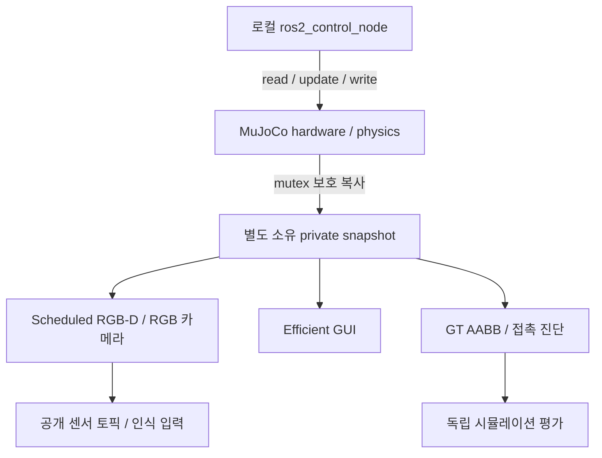
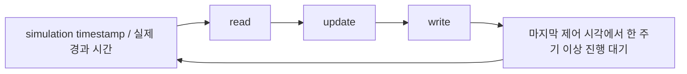

# MuJoCo 카메라와 독립 관측

이 패키지는 스터디카페의 카메라 렌더링, 제어 시각 전달, 독립 평가용 GT와 접촉 관측을 제공한다. Physics와 구동은 설치된 MuJoCo backend 및 ros2_control controller가 담당한다.



GT와 contact는 검출·분류·파지·계획 입력이 아니다. Observer는 qpos, ctrl, 힘이나 weld를 변경하지 않는다.

## 카메라 선택과 촬영 주기

`scheduled_cameras=true`는 vendor 반복 촬영을 끄고 private snapshot renderer만 공개 토픽을 발행하게 한다. Vendor 0 Hz 설정의 초기 1회 frame도 `/cleany/internal/disabled_vendor/*`로 격리한다.

| `/sorting_cameras` 선택 | Head | 선택 손목 | 비선택 손목 |
|---|---|---|---|
| `active_camera=head` | 10 Hz, `head_high_rate=false`이면 2 Hz | — | 0 Hz |
| `active_camera=left/right` | 2 Hz | 10 Hz | 0 Hz |
| 손목 선택 + `head_depth_boost=true` | 10 Hz | 10 Hz | 0 Hz |

Sorting은 새 장면 검출과 head 재선택에서 10 Hz, 검출 뒤 2 Hz로 전환한다. 접근·파지·lift 동안만 head depth boost를 켜고 성공/실패 시 해제한다.

| 설정 / scheduling | 계약 |
|---|---|
| 시작 rate | `head_rate_hz`, `head_idle_rate_hz`, `wrist_rate_hz`; 실행 중 rate 수정 거부 |
| 주기 기준 | Simulation timestamp 기준 최대 목표; 렌더링 비용에 따라 낮아질 수 있음 |
| Snapshot 복사 | 가벼운 simulation clock으로 촬영 기한을 확인한 뒤 필요한 경우만 `get_data` 복사 |
| 같은 pass | Head / wrist가 하나의 일관된 snapshot 공유 |
| Payload | 카메라별 Image / CameraInfo와 depth 변환 배열 재사용; depth는 640픽셀 행 단위 환산 |
| 지연 | 원래 주기를 유지하며 놓친 기한 건너뜀 |
| Clock reset | 카메라는 새 시각에서 촬영 재개; 아래 제어 backend는 재실행 필요 |

촬영 빈도를 줄여도 전체 CPU/GPU 부하가 같은 비율로 줄거나 최신 지도 수신이 보장되는 것은 아니다.

| 센서 | 공개 토픽 | 계약 |
|---|---|---|
| Head RGB-D | `/camera/color/{image_raw,camera_info}`, `/camera/aligned_depth_to_color/image_raw` | 640×480, optical frame, snapshot 촬영 timestamp |
| 손목 RGB | `/{left,right}_wrist_camera/{image_raw,camera_info}` | RGB 전용; 공개 depth / GT mask 없음 |

GLFW offscreen context와 유효한 DISPLAY가 필요하다. GLFW는 backend thread 시작 전에 동기 초기화한다.

## 제어 주기와 관절 피드백 시각



| 항목 | 계약 |
|---|---|
| 진입점 | `study_cafe_backend.launch.py`가 이 패키지의 `ros2_control_node` 실행 |
| 기본 | `controller_manager.update_rate=100 Hz`, `use_sim_time=true` |
| 한 주기 | read/update/write에 동일 시각과 경과 시간 전달 |
| 지연 후 | 마지막 제어 시각에서 한 주기 이상 진행해야 다음 실행 |
| 같은 시각 / 시계 정지 | 새 관절 상태나 feedback 수신 시각을 만들어내지 않음 |
| 시각 역행 | Backend 오류 종료; reset 뒤 새 launch 필요 |
| 검증 | `test_control_cycle`: read 지연, 중복 / 정지 / 역행 시각, 밀린 주기 |

Physics timestep이나 물체 상태는 조작하지 않는다. Feedback 만료와 [BT 정지 판정](../cleany_manipulation_bt/README.md#계약과-증거)은 유지한다.

## GUI 렌더링

| 실행 선택 | 동작 |
|---|---|
| `scheduled_cameras:=true headless:=false sim_viewer:=efficient` | 센서 worker의 snapshot / OpenGL context 공유; vendor fullscreen renderer 미실행 |
| `sim_viewer:=native` | 전체 MuJoCo 디버깅 UI; efficient viewer 문제 시 대안 |
| `headless` | GUI 없이도 현재 renderer는 DISPLAY 필요 |

`config/study_cafe_ros2_controllers.yaml`의 `sorting_cameras`가 초기값을 관리한다.

| 설정 | 기본값 / 동작 |
|---|---|
| `viewer_rate_hz` | 20.0, wall time 기준 최대 빈도 |
| `viewer_width` / `viewer_height` | 960 / 720 |
| `viewer_shadows` | false; 센서 촬영에는 기존 그림자를 복원해 RGB-D 픽셀 유지 |
| 창 그리기 | Physics mutex 미보유 |
| 최소화 / 창 닫기 | GUI 렌더링 생략, 센서와 physics 계속 실행 |

| 입력 | 동작 |
|---|---|
| 마우스 왼쪽 / 오른쪽 / 가운데·휠 | 회전 / 이동 / 확대 |
| Shift / Home | 수평 이동·회전 / 시점 초기화 |
| Space / Backspace | Backend pause / reset service |
| Escape / 창 닫기 | GUI 숨기기 |
| 실행 터미널 Ctrl+C | 전체 종료 |

Efficient viewer는 GLFW가 메인 스레드 전용으로 규정한 창 생성과 이벤트 처리를 센서 worker에서 수행한다. 현재 Ubuntu 22.04 VM `DISPLAY=:0`에서 확인했으며 창 정지가 센서 단절로 이어질 수 있다. 다른 환경에서 문제가 생기면 native viewer를 사용한다. `mjv_moveCamera`는 설치 헤더에 맞춰 5/6인자 API를 빌드 시 선택한다.

## 독립 Ground Truth 관측

| 항목 | 계약 |
|---|---|
| Hardware wrapper | `ObservedMujocoSystem`이 설치된 `MujocoSystemInterface` 상속 |
| 소스 | Physics mutex 아래 복사한 별도 snapshot의 동적 study-cafe collision geometry |
| 출력 | `/simulation/sorting_ground_truth`, `visualization_msgs/MarkerArray` |
| Marker | `text`: body명, `pose.position`: base_link AABB 중심, `scale`: full extents, 단위 quaternion |
| Mesh 경계 | 실제 변환 vertex 극값; sphere/capsule/cylinder/ellipsoid는 해석적 투영 반경 |
| 빈도 | Snapshot 복사 wall time 최대 10 Hz, 발행 simulation time 최대 10 Hz |
| 소비자 | 물체 이동과 수거함 안착을 검사하는 테스트 oracle |

Local AABB를 회전해 다시 감싸는 방식의 과대 경계를 피한다. Snapshot 잠금과 제어 주기 비용은 실측 대상이며 hard-real-time 보장은 없다.

Humble `mujoco_ros2_control` 0.0.3 C++ API를 사용한다. Vendor read-loop에서 arena/contact/force를 동시 조회하는 경로는 쓰지 않는다. GT/contact의 private copy 보호가 backend 전체의 동시 접근 문제를 해결했다는 뜻은 아니다. Publisher-only `sorting_observer`는 시작 때 parameter 파일을 읽으며 실행 중 변경이나 별도 spin thread는 없다.

## 선택형 접촉 진단

| 항목 | 값 / 해석 |
|---|---|
| 활성 | `sorting_contact_diagnostics:=true`, 기본 false |
| 출력 | `/simulation/contact_diagnostics`, `diagnostic_msgs/DiagnosticArray`; 구독자가 있을 때 최대 10 Hz |
| 데이터 | Snapshot contact와 `mj_contactForce`; physics 재계산 / 힘 적용 없음 |
| Header | Snapshot simulation time, `base_link` |
| 첫 status | 전체 / 발행 contact 수 |
| 개별 status | Body/geom 이름·ID, base-frame 위치(m), signed distance(m, 음수 penetration), contact-frame normal force(N), tangential 크기(N) |
| 상한 | `sorting_observer.maximum_contacts=256`, 허용 1–4096 |
| 생략 | 상한 초과 또는 geom ID 없는 flex contact는 summary WARN, 전체 수와 발행 수 구분 |

Normal force는 명령이나 파지 성공 판정이 아니다. 여러 접촉력을 물체 무게로 단순 합산하지 않으며 controller·검출·분류·계획은 이 진단을 구독하지 않는다.

## 검증

```bash
make test
```

저장소 루트에서 전체 workspace를 빌드하고 검사한다. 실제 OpenGL RGB-D 검사는 사용 가능한 display에 연결한 환경에서 실행한다. `DISPLAY`가 없으면 해당 검사만 skip되므로 결과에서 실행 여부를 확인한다.

| 검사 | 확인 범위 |
|---|---|
| 기하 / 접촉 | 회전 base-frame 변환, 힘 조회, 상한 / 잘못된 snapshot 거부 |
| 비간섭 | 읽기 전후 integration state와 applied force 불변 |
| Snapshot | 원본 arena 초기화 뒤에도 copy의 contact / force 유지 |
| Plugin | Wrapper library의 hardware plugin 로딩 |
| Renderer | GUI draw 뒤 headless와 RGB/depth 동일, 640×480 / optical frame / capture stamp / CameraInfo 일치 |

전체 분리 수거 성공은 별도 시나리오 검증 대상이다. 구현 기준: [설치 버전 plugin](https://github.com/ros-controls/mujoco_ros2_control/blob/0.0.3/mujoco_ros2_control/src/mujoco_system_interface.cpp), [MuJoCo contact API](https://mujoco.readthedocs.io/en/3.4.0/APIreference/APIfunctions.html#mj-contactforce).
