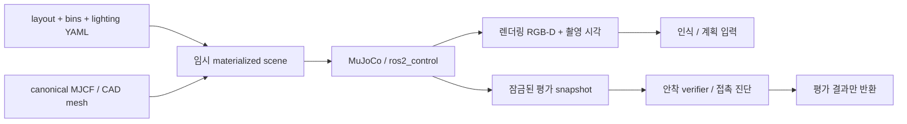
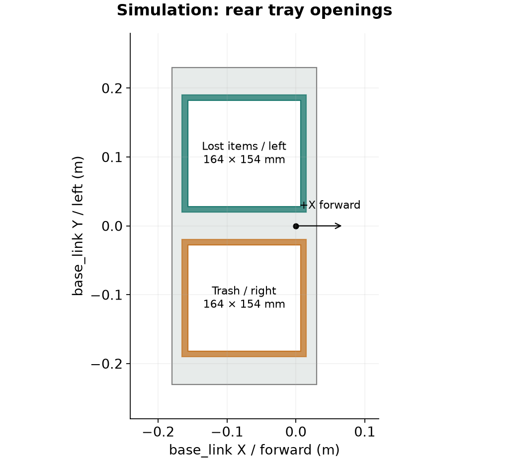
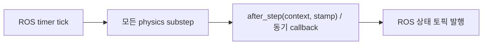
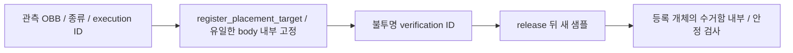

# MuJoCo 장면과 모델 설정

기존 MuJoCo 로봇은 `jetson_20261009` 모델입니다. 실물 공통 CAD와의 구분은 [모델 계약](../../cleany_description/docs/model.md)을 따릅니다.

스터디카페 관찰과 고정 베이스 수거 장면을 제공합니다. 로봇 형상은 `cleany_description`, 물리 제어와 촬영은 선택한 backend가 소유합니다.

## 상태와 책임

| 목적 | 장면 / 진입점 | 실행 범위 |
|---|---|---|
| 공간과 로봇 배치 보기 | `study_cafe.xml.in` / `ros2 launch cleany_mujoco_sim mujoco_study_cafe.launch.py` | custom bridge 관찰 장면 |
| 후면 수거함 보기 | `robot_top_bins_preview.launch.py` | GUI만 실행; 인식·수거 안 함 |
| 인식과 계획 | `ros2 launch cleany_skill_executor study_cafe_nearest_grasp_demo.launch.py` | RGB-D와 MoveIt plan-only |
| 연속 수거 | `study_cafe_grasp_execution.xml.in` / `ros2 launch cleany_skill_executor study_cafe_sorting.launch.py` | chassis-world weld, 팔·그리퍼 제어 |
| 단일 물체 Action | [BT 서버](../../cleany_manipulation_bt/README.md) | 별도 Action 경로 |

관찰 bridge와 ros2_control backend는 동시에 실행하지 않습니다. 기본 방·책상·파티션은 Gazebo의 `study_cafe_layout.yaml`과 일치하는지 검사합니다.



물체 정답 pose와 평가 AABB는 인식·파지·경로 입력으로 쓰지 않습니다. 물체 순간이동, gripper weld, 방출 시 충돌 비활성화는 사용하지 않습니다.

## 실행과 테스트

저장소 루트에서 `make build` 후 [공통 ROS 환경](../../../../docs/implementation/running.md#공통-준비)을 적용합니다. Vendor renderer는 headless에서도 GLFW 연결이 필요하므로 유효한 `DISPLAY`를 준비합니다.

```bash
# 아래 실행 중 하나를 선택
ros2 launch cleany_mujoco_sim mujoco_study_cafe.launch.py
# 수거함 배치만 확인
ros2 launch cleany_mujoco_sim robot_top_bins_preview.launch.py
# 자동 수거는 별도 실행
ros2 launch cleany_skill_executor study_cafe_sorting.launch.py
```

| 확인 | 명령 / 결과 |
|---|---|
| scene loader 검사 | `make test-mujoco` |
| 장면과 bridge 전체 단위 검사 | 빌드 overlay 적용 후 `python3 -m pytest ros2_ws/src/cleany_mujoco_sim/test` |
| 형상·settle·카메라 시야 | `test_study_cafe_scene.py`, `test_tabletop_shapes.py`, `python3 -m pytest ros2_ws/src/cleany_skill_executor/test` |
| 전체 조작 결과 | [수거 실행과 상태 읽기](../../cleany_skill_executor/docs/study-cafe-sorting-usage.md) |

단위 검사와 장면 컴파일은 물리 수거 성공률을 뜻하지 않습니다. 주행 controller 회귀는 회전된 스터디카페 배치 대신 원점의 장애물 없는 평면 fixture를 사용합니다.

## 시뮬레이션 기본 설정

| 설정 | 현재값 / 의미 |
|---|---|
| 방 | 12.26 × 10.94 m; 벽 4, 책상 48, 파티션 24, 모니터 48; 의자는 생성하지 않음 |
| 기준 자리 | 43번 의자 기준 책상 방향; `robot_center_rearward_offset_m=0.32` |
| 로봇 중심 | `(-3.13, -4.16, 0.38)` m |
| 물체 | 로봇 왼쪽 레고/마우스, 오른쪽 컵/휴지; 현재 yaw에서 desk X 음수는 로봇 왼쪽 |
| head 영상 | 640×480, vertical FOV 42°, 초기 tilt 1.00 rad에서 네 물체가 시야 안에 들어오는 배치 |
| 초기 joint 유지 | actuator 이름이 아닌 연결 joint 이름으로 keyframe 목표 설정 |
| 기둥 충돌 | `robot_top_bins.yaml`의 `simulation_ignore_mast_collision: true` 기본 |

기둥 옵션은 MuJoCo의 `top_base_link` 접촉과 MoveIt의 기둥–로봇 링크 충돌을 제외합니다. 외형, 팔·책상·함·물체 충돌은 유지합니다. `false`로 복원할 수 있으며 이 편의 설정의 경로가 실물 기둥을 피한다고 해석하지 않습니다.

## 로봇 후면 수거함 배치 미리보기

<figure class="contract-figure" data-visual-id="bins">

<figcaption>현재 robot_top_bins.yaml의 평면 배치입니다. 회색은 트레이, 색 테두리는 벽이며 내부 개구부는 각각 164×154 mm입니다. base_link 기준의 시뮬레이션 개념으로 실물 장착성과 수거 성공을 검증한 도면이 아닙니다. <a href="../../../../docs/assets/visuals/generated.json">입력과 출처</a></figcaption>
</figure>

`config/robot_top_bins.yaml`은 수거함과 내부 받침판의 알려진 형상을 공유합니다. 파일명은 top이지만 현재 배치는 후면입니다.

| base_link 기준 | 분실물함 `lost_items_left` | 쓰레기함 `trash_right` |
|---|---|---|
| 중심 X / Y | −0.075 / +0.105 m | −0.075 / −0.105 m |
| 바닥 / 상단 Z | 0.22 / 0.34 m | 0.22 / 0.34 m |
| 외형 / 벽 두께 | 180×170×120 mm / 8 mm | 동일 |
| 시각 테두리 | 청록 | 주황 |

`internal_tray`는 210×460×12 mm입니다. 함과 받침판은 chassis에 부착되고 동일한 충돌 형상을 MoveIt에 등록합니다. 함은 바닥과 네 벽으로 열린 구조이며 `rim_rgba`는 질량·충돌 없는 시각 테두리입니다. 탈착부 강도, 배선 여유, 실제 하중 및 이동 베이스 운용은 검증 범위가 아닙니다.

## 물체 형상과 접촉

| 물체 / body ID | 현재 크기 | 물리 모델 |
|---|---|---|
| 종이컵 / `study_cafe_cup` | 윗지름 61.2, 밑지름 39.6, 높이 68.4, 벽 0.504 mm | 열린 원뿔대 벽 32개 + 바닥, 8 g |
| 레고 / `study_cafe_lego` | 몸체 63.6×31.6×21.12, 돌기 포함 높이 25.08 mm | box + 돌기 8개, 2.3 g |
| 휴지 / `study_cafe_tissue` | 60×50×45 mm | 삼각형 표면과 convex hull, 1 g |
| 마우스 / `study_cafe_mouse` | 110×65×35 mm | CC0 mesh/texture와 convex hull, 120 g 가정 |

| 모델 가정 | 한계 |
|---|---|
| 모든 물체 | Free joint 강체; 컵 / 휴지 변형 없음 |
| 레고 | 밑면 튜브 / 로고 생략, 확대 진단 모델; 돌기 간격 / 지름 / 높이 16 / 9.6 / 3.6 mm |
| 실제 크기 레고 | 최소 후보 폭 50 mm보다 작아 제외될 수 있음 |
| 질량 / 물성 | 실측값 아님 |

형상은 `tabletop_shapes.py`, 위치·질량·색상은 `config/study_cafe_layout.yaml`에서 관리합니다. 마우스 위치는 책상 중심 기준 `[-0.14, -0.095]` m입니다.

| 접촉 설정 | 적용 / 한계 |
|---|---|
| 컵–jaw | 복합 형상 330 pair, friction `6 6 0.2 0.1 0.1` |
| 레고–jaw | 90 pair, friction `1.5 1.5 .001 .0001 .0001`; 파지/방출 중 전환하지 않음 |
| 얇은 컵 벽 강성 | `solref="0.002 1"`, `solimp="0.99 0.9999 0.0001"`; 종이 변형 모델 아님 |
| 휴지/마우스–jaw | 각 10 pair에 같은 강성, friction `3 3 .2 .1 .1` |
| 컵 바닥 clearance | `geometry.collision_bottom_clearance_m=0.00025`; 허용 0–0.000504 m |

| Cup clearance | 영향 |
|---|---|
| 양수 | 벽 아래 꼭짓점을 경사 방향으로 올려 바닥 원판이 하중 지지 |
| 0 | 원래 형상 |
| 유지 | 시각 mesh, 열린 내부, 상부 파지면, 질량, 마찰 |

마찰과 solver는 시뮬레이션 튜닝값입니다. 실제 재료 특성을 보장하지 않으며 마우스 충돌은 볼록 외피로 버튼의 오목한 부분을 분해하지 않습니다.

### 조명과 자산 출처

| `config/study_cafe_lighting.yaml` | 값 |
|---|---|
| 그림자 spotlight | 인접 책상 3열×2행, 중심 `(-4.33, -3.17, 3.30)` m, 수직 아래 |
| cutoff / exponent | 40° / 0; 책상 높이 반경 약 2.16 m |
| shadow map | 4096, 그림자 광원 1개 |
| camera headlight | ambient 0.12 / diffuse 0.08 |
| directional 보조광 | shadow 꺼짐; 전역 half extent 12 m |

조명은 materialized copy의 GUI와 RGB-D에 공통 적용합니다. 실측 조도나 간접광 모델이 아니며 그림자 광원은 렌더 비용을 추가합니다. Camera intrinsics, 물체 물리, confidence와 안전 기준은 바꾸지 않습니다.

| 자산 | 출처 / 관리 |
|---|---|
| 마우스 | [CreativeTrio Computer Mouse](https://poly.pizza/m/V2Ebx3pvo4), CC0 |
| Hash / license | config/study_cafe_assets.yaml의 원본 / 변환 SHA256 |
| 변환 | tools/convert_computer_mouse.py |
| 과거 Mug / Smartphone | Manifest에 출처 보존, 현재 장면에는 미로딩 |
| Robot CAD | cleany_description 소유; Gazebo plugin / sensor 복사 안 함 |

## 분리 수거 fixture

`study_cafe_backend.launch.py sorting_bins_config:=<path>`는 chassis 기준 함을 추가하고 `ObservedMujocoSystem` wrapper를 선택합니다. 빈 값은 함 없이 기존 장면을 씁니다. Wrapper는 잠금된 `get_data` 복사로 평가하며 vendor 배열을 동시에 직접 읽지 않습니다.

`placement_verifier`는 `/simulation/sorting_ground_truth`에서 release 이후의 새 AABB를 읽고 `/sorting/verify_placement`로 결과만 반환합니다. Oracle은 인식과 계획에 사용하지 않습니다. [두 컵 검증](#두-컵과-개체별-배치-확인)은 개체 등록까지 포함합니다.

## 카메라와 viewer

| 항목 | 설정 / 계약 |
|---|---|
| `scheduled_cameras` | backend 직접 실행 false, 통합 인식/수거 true |
| `sim_viewer:=efficient` | 960×720 snapshot GUI 최대 20 Hz; 센서 640×480과 그림자는 유지 |
| `sim_viewer:=native` | 전체 MuJoCo UI |
| 손목 optical pose | 최신 CAD의 좌우별 렌즈 앞면/CV축; nominal, 실물 hand-eye 별도 |
| 손목 영상 | 640×480, vertical FOV 93° |
| `sorting_contact_diagnostics` | 기본 false, 접촉 부위/힘 출력 전용 |

[Observer GUI와 촬영](../../cleany_mujoco_observer/README.md#gui-렌더링), [수거 카메라 전환](../../cleany_skill_executor/docs/study-cafe-sorting-configuration.md)을 따릅니다. 통합 launch의 초기 양팔 roll은 +1.58 rad이며 직접 backend의 초기값과 구분합니다.

## 되돌릴 수 있는 고정 책상 최적화

`sim_performance_profile`은 임시 materialized scene에만 적용합니다. 기본값
`baseline`은 기존 설정을 그대로 유지합니다. 소스 MJCF, mesh, layout은 수정하지 않습니다.

| 프로필 | 배경 충돌 | 그림자 맵 |
| --- | --- | --- |
| `baseline` | 기존 그대로 | 4096 |
| `tabletop_collision` | 먼 정적 가구만 비활성화 | 4096 |
| `tabletop_fast` | 먼 정적 가구만 비활성화 | 2048 |

| 최적화 대상 | 정책 |
|---|---|
| 제외 후보 | tabletop_performance.yaml 반경 2 m 밖에 형상 전체가 놓인 정적 책상 / 모니터 / 파티션 / 벽 |
| 경계 판정 | 보수적 경계구; 가까운 가구와 큰 벽은 남을 수 있음 |
| 유지 형상 | 바닥 / 로봇 / 수거함 / 물체 / 명시 contact pair |
| 유지 설정 | 질량 / 마찰 / 관절 / timestep / solver / 카메라 해상도·FOV / 추적 FPS / MoveIt / OctoMap |
| tabletop_fast | GUI와 센서 그림자 정밀도 저하 가능, 인식 회귀 필요 |

이 프로필은 chassis-world weld가 있는 `study_cafe_grasp_execution` 장면에만
허용합니다. 이동 베이스·내비게이션·실제 하드웨어에는 적용하지 않습니다.
시뮬레이션 시간 배속이나 로봇 이동 속도 상향 기능이 아닙니다.

`tabletop_fast`는 실험용이며 기본은 `baseline`입니다. 전체 수거 시간 단축이나 동일한 파지 성공률은 검증되지 않았습니다. 적용 전후 인식과 접촉 결과를 별도 비교합니다.

```bash
# 적용 (기존 GEMINI_API_KEY / DISPLAY 등 실행 환경 유지)
ros2 launch cleany_skill_executor study_cafe_sorting.launch.py sim_performance_profile:=tabletop_fast headless:=true use_rviz:=false use_image_view:=false
# 원복: 실행을 종료한 뒤 baseline으로 재시작 (파일 복원 불필요)
ros2 launch cleany_skill_executor study_cafe_sorting.launch.py sim_performance_profile:=baseline headless:=true use_rviz:=false use_image_view:=false
# 그림자 품질을 유지하며 배경 충돌만 줄이기
ros2 launch cleany_skill_executor study_cafe_sorting.launch.py sim_performance_profile:=tabletop_collision
# 별도 정지 장면 성능 비교: 다른 시뮬레이터를 종료한 뒤 실행
python3 ros2_ws/src/cleany_mujoco_sim/tools/benchmark_tabletop.py --output /tmp/tabletop_benchmark.json
```

벤치마크는 현재 launch 초기자세에서 세 프로필을 교차 순서로 반복합니다.
물리 step과 640×480 카메라별 RGB 렌더+readback을 따로 측정하며,
MuJoCo Python 버전도 기록합니다. ROS backend/vendor 버전, depth readback,
인식 모델, GUI, 실제 파지 접촉 부하를 포함한 전체 수거 시간과는 다릅니다.
일괄 속도 향상률로 해석하지 않습니다.

## 실행 성능 측정

| Runtime 측정 | 내용 |
|---|---|
| 지표 | Clock 진행률, RGB-D 수신 빈도, process tree CPU |
| 출력 | Warmup 뒤 JSON + launch log; 기본 /tmp/cleany-runtime.json과 .log |
| 종료 | 완료 / 실패 / 중단 시 도구가 시작한 process group과 추적 자식만 종료 |
| 준비 | psutil, probe에도 동일 Fast DDS 프로필 적용해 큰 메시지 SHM 손실 방지 |
| 해석 | CPU는 사용 코어 수 기준; 전체 수거 성공은 stage artifact로 별도 확인 |

```bash
DISPLAY=:0 python3 ros2_ws/src/cleany_mujoco_sim/tools/benchmark_runtime.py \
  --duration 35 --warmup 5 --output /tmp/runtime-headless.json -- \
  ros2 launch cleany_skill_executor study_cafe_nearest_grasp_demo.launch.py \
  headless:=true use_rviz:=false use_image_view:=false
DISPLAY=:0 python3 ros2_ws/src/cleany_mujoco_sim/tools/benchmark_runtime.py \
  --duration 35 --warmup 5 --output /tmp/runtime-gui.json -- \
  ros2 launch cleany_skill_executor study_cafe_nearest_grasp_demo.launch.py \
  headless:=false use_rviz:=false use_image_view:=false
```

`ros2_ws/src/cleany_mujoco_sim/tools/benchmark_runtime.py --output <file> -- ros2 launch ...`로 다른 launch도 측정합니다.

## ROS contract

| 역할 | 실행 / 계약 |
|---|---|
| 제어 주기 | cleany_mujoco_observer/ros2_control_node, 설치 MuJoCo hardware / physics |
| 상태 / 제어 | robot_state_publisher, joint-state broadcaster, 양팔 / gripper trajectory controller |
| Controller 설정 | config/study_cafe_ros2_controllers.yaml |
| 초기 joint | 임시 장면의 handeye_ros2_control_home keyframe; vendor 호환 내부 ID |
| 카메라 | Scheduled observer 또는 선택 vendor renderer; head RGB-D와 nominal wrist TF |
| 선택 adapter | wrist_camera.yaml의 왼손목 intrinsics와 topic만 사용, 이전 보정판 장면에 의존 안 함 |
| 시간 / 보정 | 원본 capture stamp 유지; 실물 카메라 보정값을 의미하지 않음 |

## 베이스 구동 모델

각 휠은 독립적인 `PG42-4266-1270NE` output-shaft DC motor 모델을 사용합니다.
actuator 제어 입력은 `rear_left_drive`, `rear_right_drive`, `front_left_drive`,
`front_right_drive`의 모터 단자 전압입니다. `base_link +X`가 전방이며, 양의 yaw는
`+Z` 기준 반시계 방향입니다.

- 정격 공급 전압: `12 V`
- 기어박스: `61:1`; 제조사 출력 토크에는 `72%` 효율이 반영되어 있습니다.
- 제조사 정격 출력: `103 rpm`에서 `2.94 N.m`
- 계산한 무부하 출력: `7000 / 61 rpm` (`12.017 rad/s`)
- 10% 마진을 적용한 시뮬레이션 운용 한계: `10.8 V`, `2.646 N.m`
- 디레이팅한 정격점: `92.7 rpm` (`9.708 rad/s`)
- 디레이팅한 무부하 평형점: `103.28 rpm` (`10.815 rad/s`)

MJCF actuator는 기어박스 출력축에서 직접 모델링하므로(`gear=1`) 감속비와 효율을
다시 적용하지 않습니다. 매 physics step마다 실제 joint 속도를 읽고, feed-forward와
anti-windup을 포함한 휠별 PID controller로 `-10.8~10.8 V` 전압을 계산합니다.
PID gain은 MuJoCo DC motor step response를 기준으로 한 시뮬레이션 값이며 실제
ESP32 controller에 그대로 사용하지 않습니다.

## 팔 서보 모델

양팔은 Feetech 12 V 시리얼 서보를 사용합니다.

- left/right shoulder pitch와 elbow pitch: `STS3250`
- shoulder rotation, wrist pitch/roll, jaw, head pan/tilt: `STS3215`

모델의 출력 한계에는 제조사 사양 대비 10% 운용 마진을 적용합니다. 위치 actuator와
joint force 한계에는 최대 정지 토크의 90%를 적용합니다. 전류, 발열 및 2초 과부하
차단 동작은 아직 모델링하지 않았습니다.

## 실행 인자

| 관찰 bridge | 기본 / 동작 |
|---|---|
| mujoco_study_cafe.launch.py | headless=false |
| viewer_rate_hz | 20.0, 허용 1–60 Hz |
| viewer_shadows | false |
| GUI 변경 | viewer_rate_hz:=60.0 viewer_shadows:=true |
| 주기 영향 | Viewer sync만 wall time 제한, physics / ROS 발행 유지 |
| mujoco_sim.launch.py | scene_path=scenes/study_cafe.xml.in; 주행 bridge parameter 유지 |

| backend 인자 | 기본 / 역할 |
|---|---|
| `scene_path` | `scenes/study_cafe_grasp_execution.xml.in` |
| `controller_config` | `config/study_cafe_ros2_controllers.yaml` |
| `camera_config` | `config/wrist_camera.yaml` |
| `headless`, `sim_viewer`, `sim_speed_factor`, `sim_xmodifiers` | viewer, 속도, XIM |
| `sorting_bins_config`, `scheduled_cameras`, `sorting_contact_diagnostics` | 수거함, 카메라 스케줄, 출력 진단 |
| `camera_name`, `camera_frame_name`, `color_image_topic`, `camera_info_topic`, `depth_image_topic` | renderer 연결 |
| `enable_camera_contract_adapter` | false; 통합 launch는 head topic 직접 연결 |
| `enable_gripper_controllers` | 기본 false; 최신 CAD의 링크형 그리퍼 구동은 거부 |
| `*_initial`, `head_tilt_initial` | 초기 자세; 탁상 preview의 head tilt는 최신 헤드 기준 0.8 rad |

수거 전체의 초기 자세와 센서 연결은 `cleany_skill_executor`의
`study_cafe_sorting.launch.py` 및 `study_cafe_nearest_grasp_demo.launch.py`를 따릅니다.

## Backend 터미널 로그

| 로그 옵션 | 출력 |
|---|---|
| backend_log_level:=warn 기본 | 관절 / 링크 / renderer 상세 억제, 경고·오류 유지 |
| backend_log_level:=info | 초기화 상세 복원 |
| log_level:=info | Spawner / camera adapter; debug 선택 가능 |
| 상위 launch | 센서 / 수거 / BT 모두 두 옵션 전달; 준비 완료는 기본 출력 |

## 시뮬레이션 확장 API



| API | 계약 |
|---|---|
| MujocoSimNode.simulation_context | MujocoSimulationContext의 model / 최신 data native handle; renderer 등 조회용 |
| add_step_observer(observer) | StepObserver 등록; tick마다 substep 완료 뒤 한 번 호출 |
| Callback | 짧게 유지, 예외 숨기지 않음 |
| 변경 경계 | Adapter는 물리 상태를 바꾸지 않는 read-only 계약 |

## 공통 RGB-D 파이프라인 연결

| RGB-D 연결 옵션 | 처리 |
|---|---|
| color_image_topic / camera_info_topic / depth_image_topic | 명시하면 선택 MJCF camera를 해당 ROS topic으로 직접 remap |
| 빈 값 | wrist_camera.yaml internal topic 사용 |
| Custom topic | enable_camera_contract_adapter:=false 필요 |
| 경계 | 영상 전달만 변경, geometry / 정답 pose 주입 없음; 실물 head TF 보정 정확도 보장 아님 |

레포 루트의 `ros2 launch cleany_skill_executor study_cafe_nearest_grasp_demo.launch.py`은 학습 perception과 sensor-only
MoveIt 지도를 포함하는 plan-only GUI 실행입니다. 장면만 띄우는
`ros2 launch cleany_mujoco_sim mujoco_study_cafe.launch.py`는 장면 관찰용입니다.

## 두 컵과 개체별 배치 확인

`config/study_cafe_two_cups.yaml`은 기존 물체와 별도의 자유 물체 `cup_b`를 둡니다.
`study_cafe_backend.launch.py`의 `study_cafe_layout_config`로 선택하며 기존 기본 배치는
유지합니다. materialize API도 같은 선택적 Path 인자를 받습니다. 기존 cup/lego/tissue/mouse를
유지하면서 고유 이름의 추가 procedural 물체를 허용합니다. asset·mesh를 재생성하지 않습니다.



| 개체 구분 | 계약 |
|---|---|
| 같은 종류 여러 body | Label/body 배열에서 허용, 등록 경로 필요 |
| Label-only | 종류당 body 하나일 때만 허용 |
| 다른 컵이 함 안에 있음 | 등록된 컵의 성공 근거로 사용 안 함 |
| 등록 응답 | Simulator body 정답 비공개 |

| verifier 설정 | 시뮬레이션 기본값 |
|---|---:|
| 관측 OBB와 body 대응 거리 | 5 cm |
| 후보 간 최소 차이 | 1 cm |
| 크기 오차 | 8 cm |
| 등록 TTL / 최대 수 | 600초 / 128건 |
| 관측 최대 나이 | 120초 |

`placement_verifier.yaml`과 `placement_verifier_two_cups.yaml`의 초기값이며 실물 기준이 아닙니다. 넓은 크기 허용은 위치 유일성 검사를 대체하지 않습니다. 재시작/시각 역행으로 등록을 복구하지 않고 잘못된 ID에 fallback하지 않습니다.

분실물은 mouse / computer mouse / wireless mouse / lego brick 등록과 lost_items_left 목적지를 지원합니다. 다른 개체나 잘못된 수거함은 성공 근거가 아닙니다. 실제 vertex 극값을 쓰는 [Observer AABB 계약](../../cleany_mujoco_observer/README.md#독립-ground-truth-관측)을 따릅니다.

## 범위

| 제공 | 별도 검증 / 미구현 |
|---|---|
| CAD MJCF, 휠 PID와 cmd_vel 제한/timeout, ROS 센서와 TF | 실제 encoder noise, 전류, 발열, 과부하 차단 |
| 양팔 FollowJointTrajectory, 12개 arm/gripper 상태 | Mission 운영 인터페이스 연동 |
| 카메라 스케줄과 평가용 observer | 하드웨어 controller 현실성, 실제 물리 수거 성공 |

모델 기준은 [Description](../../cleany_description/docs/model.md), 제품 전제는 [Robot Platform KB](../../../../docs/cleany-docs/20_TECHNICAL/04%20-%20Robot%20Platform%20XLeRobot.md)를 따릅니다.

`study_cafe_backend.launch.py`의 `model_profile`은 URDF와 MJCF에 같은 형상을 선택합니다.
지원 프로필은 `jetson_20261009`이며 기존 집기와 분리수거 데모도 같은 모델과
손목 optical TF를 사용합니다. 실물 공통 CAD의 관절 영점과 형상을 혼합하지 않습니다.
`config/model_profiles.json`이 각 MJCF와 장면의 그리퍼 접촉 형상을 함께 선택합니다.
