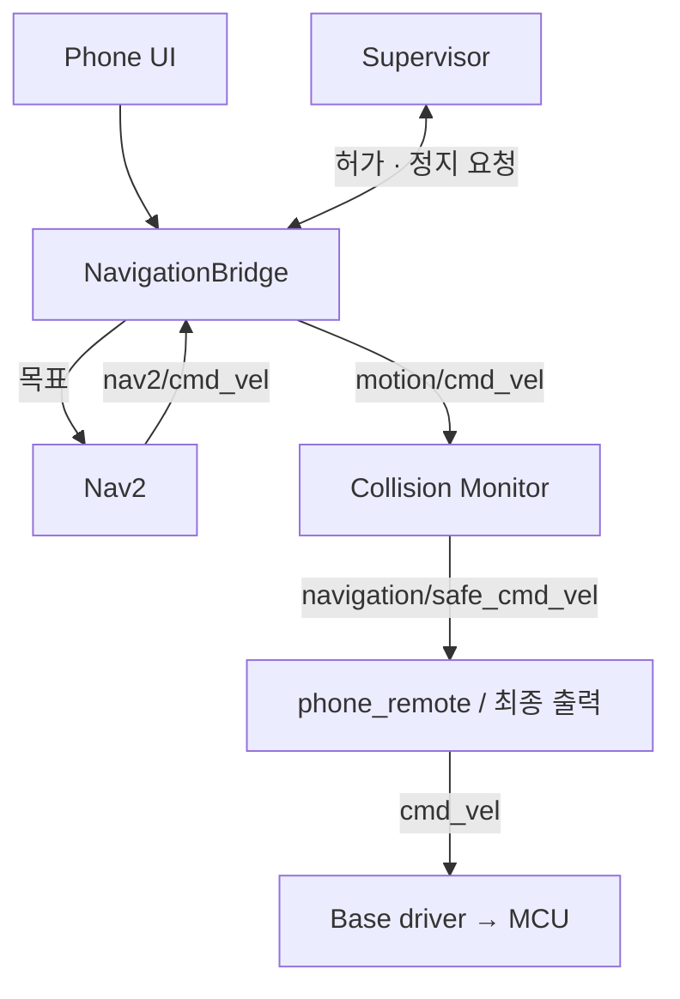

# Cleany Navigation

지도 생성과 저장, Nav2 주행, 위치 정합 및 장애물 감시를 구성합니다. 사용 순서는 작업 가이드, 노드와 설정의 세부 조건은 이 패키지의 참조 문서를 따릅니다.

| 하려는 일 | 시작할 곳 |
|---|---|
| 휴대폰에서 목적지 지정 | [화면으로 따라 하는 주행 가이드](../../../docs/how-to/phone-navigation.md) |
| 하드웨어로 지도 생성·저장 | [매핑 실행](../cleany_bringup/docs/hardware-mapping.md), [매핑 규약](docs/mapping.md) |
| 경로·속도·주행 방식 조정 | [계획과 제어](docs/planning.md) |
| 노드별 입력·출력 연결 | [인터페이스](docs/interfaces.md) |
| 감속·정지 조건 확인 | [안전 경로](docs/safety.md) |

## 휴대폰 주행의 연결

그림은 LiDAR 전용 phone 프로필의 논리적 역할을 표시합니다. NavigationBridge와 최종 출력 처리는 `phone_remote` 프로세스 안에 있습니다. 센서 드라이버와 물리 보호 회로 전체를 나타내는 그림은 아닙니다.

| 흐름 | 실제 연결 |
|---|---|
| 목표 | Phone UI → NavigationBridge → `navigate_to_pose` |
| 경로 미리보기 | NavigationBridge → `compute_path_to_pose`. 구동 허가·속도 발행 없음 |
| 자동 속도 | `/nav2/cmd_vel` → NavigationBridge → `/motion/cmd_vel` → Collision Monitor → `/navigation/safe_cmd_vel` → `phone_remote` → `/cmd_vel` |
| 구동 | Base driver → MCU. MCU 응답과 휠 피드백으로 정지 확인 |
| 허가 | Supervisor의 NAVIGATION lease. Fault·입력 만료 시 중단 |
| 위치 | `localization_guard`가 scan/map 정합과 제한 속도 제공 |

수동 조종은 자동 목표를 취소하고 정지를 확인한 뒤 기존 operator 경로로 전환합니다. 전체 시스템의 연결은 [연동 구조](../../../docs/INTEGRATION.md)를 참고하세요.

## 실행 프로필 고르기

| 프로필 | 선택 | 주행 방식 |
|---|---|---|
| Phone Omni | 실행 도구 기본값 `--motion-profile omni` | 순정 Smac Lattice + Omni MPPI, 횡이동 허용 |
| Phone longitudinal | `--motion-profile longitudinal` | 직진 우선 계획 + DiffDrive MPPI, 횡이동 차단 |
| 일반 navigation | AMCL/Nav2 launch | Phone과 별도 프로필. [Planning](docs/planning.md) 참조 |

`phone_navigation.launch.py`를 직접 실행할 때의 기본값은 `longitudinal`입니다. 상위 실행 도구와 기본값이 다르므로 프로필을 명시적으로 선택하세요.

## 설정을 어디서 바꾸나요?

| 조정 대상 | 파일 / 문서 |
|---|---|
| Omni 계획·속도·가속도 | [nav2_phone_omni.yaml](config/nav2_phone_omni.yaml), [주행 연속성](docs/planning.md#omni-주행-연속성) |
| 전후진 전용 프로필 | [nav2_phone_longitudinal.yaml](config/nav2_phone_longitudinal.yaml) |
| 감속·정지 영역 | [phone_lidar_safety.yaml](config/phone_lidar_safety.yaml), [Collision Monitor](docs/interfaces.md#phone_collision_monitor) |
| 위치 정합·복구 | [phone_localization.yaml](config/phone_localization.yaml), [정합 정책](docs/localization.md) |
| 슬립 관측·재시도 | [phone_slip_recovery.yaml](config/phone_slip_recovery.yaml), [슬립 노드](docs/interfaces.md#slip_monitor-traction_brake와-sliprecovery-bt) |
| Robot footprint | [phone_lidar_robot.yaml](config/phone_lidar_robot.yaml) |
| 선택적 D435 입력 | [phone_depth_local.yaml](config/phone_depth_local.yaml), [실행 안내](../../../docs/how-to/sensors.md#실물-depth-local-costmap-연결) |

LiDAR 프로필은 평면 장애물 감시입니다. 카메라·팔 높이의 3D 충돌이나 실측 제동거리를 보장하지 않습니다. 위치 복구는 정지 후 제한된 후보를 검사하며, 이전 목표를 자동 재개하지 않습니다.

## 변경 후 확인

저장소 루트에서 변경 범위에 맞춰 실행합니다. 빌드 환경과 전체 검사 선택은 [검증 가이드](../../../docs/TESTING.md)를 따릅니다.

| 변경 | 명령 |
|---|---|
| 매핑 수명주기·스캔 필터·하드웨어 프로필 | `make test-hardware-mapping-core` |
| Navigation C++·노드·프로필 | `make test-navigation` |
| Launch·설치 데이터·인터페이스 | `make build-hardware-mapping`, `make test-hardware-mapping` |

합성 입력 검사는 실물 주행 시험을 대신하지 않습니다. 실물에서는 위치, 센서, 정지 응답과 공간 조건을 별도로 확인합니다.
