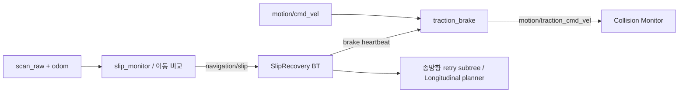
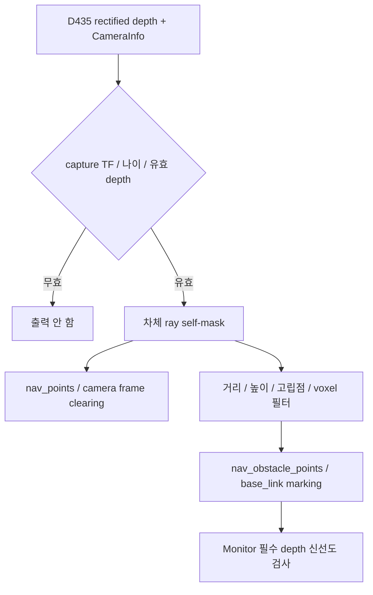
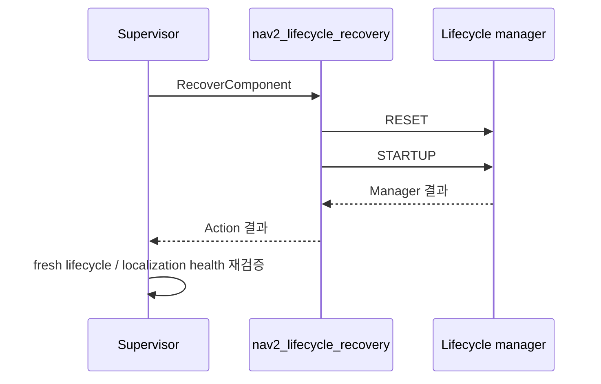
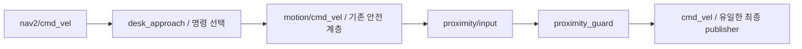

# cleany_navigation 노드 인터페이스

## localization_guard

실행 파일은 `localization_guard`이며 LiDAR 주행 launch에서 실행합니다.
지도와 scan의 정합을 관측하고, Supervisor가 요청한 정지 상태의 위치 복구를 수행합니다.

| 방향 | 이름 | 타입 | 계약 |
|---|---|---|---|
| 구독 | `map` | nav_msgs/OccupancyGrid | R/T1; 지도 변경 시 이전 정합 기록 무효화 |
| 구독 | `scan` | sensor_msgs/LaserScan | Sensor; scan 시각의 TF로 평가 |
| 구독 | `amcl_pose` | geometry_msgs/PoseWithCovarianceStamped | Sensor; 신선한 map 좌표와 유한 공분산 확인 |
| 구독 | `diagnostics` | diagnostic_msgs/DiagnosticArray | R10; base_driver의 disarmed와 피드백 나이 확인 |
| 구독·발행 | `initialpose` | geometry_msgs/PoseWithCovarianceStamped | R10; 수동 입력은 진행 중인 자동 검색을 중단 |
| 발행 | `system/component_health` | cleany_interfaces/ComponentHealth | R10, 5Hz; source=`localization_alignment`; 검증된 위치의 degraded는 제한된 주행을 위해 AVAILABLE 유지 |
| 발행 | `localization/status` | std_msgs/String | R1, 5Hz; state/reason/phase, score, 재정합 사유, 속도 제한 비율, 지도 ID와 관측 시각 |
| 발행 | `navigation/localization_speed_limit` | nav2_msgs/SpeedLimit | R10, 5Hz; percentage=true; 정상 100%, degraded 30%, 미확인·실패 0% |
| Action 서버 | `localization/recover` | cleany_interfaces/RecoverComponent | 동시에 한 요청; 정지·신선도·후보·AMCL 결과 검증 |
| 서비스 호출 | `request_nomotion_update` | std_srvs/Empty | 정지 중 위치 미확인 또는 복구 검증 시 실제 AMCL 관측 갱신 요청 |

TF는 읽기만 합니다. wheel 명령과 속도를 발행하지 않습니다. 토픽 이름은 ROS remap으로
바꿀 수 있습니다. 다른 `localization/recover` owner와 동시에 실행하지 않습니다.
상태와 복구 조건은 [위치 정합과 복구](localization.md)를 따릅니다.

## slip_monitor, traction_brake와 SlipRecovery BT

| 소유자 | 방향 | 기본 이름 | 타입 | 의미 |
|---|---|---|---|---|
| `slip_monitor` | 구독 | `scan_raw`, `odom` | LaserScan, Odometry | 센서 header 시각의 독립 이동 비교, sensor-data QoS |
| `slip_monitor` | 구독 | `nav2/cmd_vel`, `cmd_vel` | geometry_msgs/Twist | 분석용 요청/최종 명령, sensor-data QoS |
| `slip_monitor` | 구독 | `map` | nav_msgs/OccupancyGrid | transient-local depth 1, 지도 geometry/cells 식별 해시 |
| `slip_monitor` | 발행 | `navigation/slip` | std_msgs/String | 5Hz JSON, state, t0/t1, consecutive, reason, 이동 및 오차 |
| BT `SlipRecovery` | 구독 | `navigation/slip`, `odom` | String, Odometry | 새로운 신뢰 가능한 비교와 fresh 정지 증거 |
| BT `SlipRecovery` | 구독 | `motion/traction_cmd_vel` | geometry_msgs/Twist | fresh 0 출력 확인, 이후 0.5초 정지 유지 |
| BT `SlipRecovery` | 발행 | `navigation/traction_brake` | std_msgs/Bool | tick마다 brake heartbeat, true는 감속 정지 |
| BT `SlipRecovery` | 발행 | `navigation/traction_recovery` | std_msgs/String | JSON phase, reason, retry |
| `traction_brake` | 구독 | `motion/cmd_vel`, `navigation/traction_brake` | Twist, Bool | 기존 자동 조종 명령과 BT 상태 |
| `traction_brake` | 발행 | `motion/traction_cmd_vel` | geometry_msgs/Twist | 50Hz 충돌 감시 입력, stale heartbeat/명령은 0 |

| 상태 / 시각 | 의미 |
|---|---|
| state | unknown / clear / suspect / confirmed |
| clear | 해당 비교에 검출 증거 없음; 정합 품질 탈락은 unknown |
| t0 / t1 | Scan midpoint ROS 초; 같은 비교의 heartbeat는 연속 횟수 증가 안 함 |
| phase | warming_up / normal / braking / longitudinal_retry / failed / succeeded / idle |
| 감지 노드 | 명령과 TF 발행 안 함 |

| 복구 구성 | 계약 |
|---|---|
| BT child | 일반 Nav2 subtree + 종방향 retry subtree |
| 비교 수락 | Header age / 수신 freshness / retry 뒤 비교 시작 시각 확인 |
| 목표 수명 | Retry latch 유지, 취소 시 두 child halt |
| Retry Action / ID | `/traction_retry/compute_path_to_pose` / `Longitudinal` |
| Retry lifecycle | 별도 `traction_retry` namespace, global costmap과 manager |
| 입력 | `/map`, `/scan` |

[슬립 복구 실행 설정](../../../../docs/implementation/how-to/phone-navigation.md#omni-주행의-슬립-복구)을 따릅니다. Endpoint의 QoS 약어와 자동 ROS 인터페이스는 [전체 색인](../../../../docs/ROS_INTERFACES.md)을 참고합니다.

## cleany_collision_monitor

실행 파일: `cleany_collision_monitor`. 실행 노드명: `collision_monitor`. 원본: [cleany_collision_monitor.cpp](../src/cleany_collision_monitor.cpp).

Nav2 Collision Monitor의 lifecycle, 센서 좌표 변환, polygon 판정과 정지를 사용합니다. 별도의 안전 출력 publisher를 추가하지 않습니다.

| 제한 | 계산 / 적용 |
|---|---|
| Slowdown polygon | 병진 합성 속도와 회전의 절대 상한으로 축소 비율 계산 |
| 두 절대 상한 모두 0 | 기존 휠 제한만 사용 |
| 휠 상한 | 함께 검사; 작은 명령을 키우지 않음 |
| Localization percentage | nominal_translation_m_s / nominal_rotation_rad_s 기준 절대 상한으로 변환; 작은 입력에 중복 비율 적용 안 함 |
| 제한 하강 | localization_limit_ramp_per_s 적용 |
| 0% / 입력 timeout / 신선한 제한 없음 | Ramp 없이 0 출력 |

| 종류 / 방향 | 기본 이름 | ROS 타입 | QoS, 주기와 이름 설정 |
|---|---|---|---|
| 토픽 구독 | `motion/cmd_vel` | `geometry_msgs/msg/Twist` | R1; `cmd_vel_in_topic` |
| 토픽 구독 | `scan` | `sensor_msgs/msg/LaserScan` | Sensor; `scan.topic` |
| 토픽 발행 | `navigation/safe_cmd_vel` | `geometry_msgs/msg/Twist` | R1 lifecycle; `cmd_vel_out_topic` |
| 토픽 발행 | `safety/stop_zone` | `geometry_msgs/msg/PolygonStamped` | R1 lifecycle; `StopZone.polygon_pub_topic` |
| 토픽 발행 | `safety/slow_zone` | `geometry_msgs/msg/PolygonStamped` | R1 lifecycle; `SlowZone.polygon_pub_topic` |
| 서비스 제공 | `collision_monitor/change_state`, `collision_monitor/get_state` | lifecycle_msgs 서비스 | Nav2 lifecycle manager가 소유 |

| Geometry / 설정 | 값 / 동작 |
|---|---|
| lidar_safety.yaml | 바퀴 외곽 +16 cm 주황 영역, +5 cm 정지 영역 |
| absolute_limit_polygon | 기본 SlowZone |
| wheel_limit_rad_s | 기본 0.7 |
| Wheel radius / wheelbase / separation | 0.0635 / 0.35 / 0.59 m |
| SlowZone.slowdown_ratio | 고정비 대신 입력마다 계산한 상한 비율 사용 |
| 설정 반영 | 속도 / geometry 변경 뒤 lifecycle 재구성 |

## depth_clearance

실행 파일: `depth_clearance`. 원본: [depth_clearance_node.py](../cleany_navigation/depth_clearance_node.py).

| 종류 / 방향 | 기본 이름 | ROS 타입 | QoS, 주기와 이름 설정 |
|---|---|---|---|
| 토픽 구독 | `camera/head/depth/image_raw` | `sensor_msgs/msg/Image` | B1; `input_topic` |
| 토픽 구독 | `camera/head/depth/camera_info` | `sensor_msgs/msg/CameraInfo` | Sensor; `camera_info_topic` |
| 토픽 발행 | `camera/head/depth/points` | `sensor_msgs/msg/PointCloud2` | Sensor; 유효 depth 처리 시, `output_topic` |
| 토픽 발행 | `camera/head/depth/obstacle_points` | `sensor_msgs/msg/PointCloud2` | Sensor; `obstacle_topic` |
| 토픽 구독 | `/tf` | `tf2_msgs/msg/TFMessage` | TF 기본 QoS |
| 토픽 구독 | `/tf_static` | `tf2_msgs/msg/TFMessage` | TF 기본 QoS |

| 실물 overlay | 설정 / 계약 |
|---|---|
| 입력 | depth_local.yaml: `/camera/d435/depth/image_rect_raw`, `/camera/d435/depth/camera_info` |
| Clearing | `/perception/depth/nav_points`, 카메라 좌표; local VoxelLayer ray 원점 `sensor_frame=d435_depth_frame` |
| Marking | `/perception/depth/nav_obstacle_points`, base_link; spatial_filter_file 적용 |
| Self-mask | self_filter_boxes_file은 base-좌표계 고정 AABB JSON; self_filter_profile과 동시 지정 금지 |
| 가려진 ray | Marking과 clearing 모두 제외 |
| 수락 | max_image_age_s=0.5, min_valid_fraction=0.05; 촬영 시각 유지 |
| 무효 depth | positive_infinity_is_free=false; 빈 공간으로 변환 안 함 |
| 미재관측 장애물 | 카메라 방향 변경만으로 삭제 안 함 |

| Monitor 입력 | 처리 |
|---|---|
| QoS / 영역 | Marking SensorData 입력을 기존 2D polygon에 적용 |
| Required depth | required_depth_topic, required_depth_frame=base_link, required_depth_timeout_s=0.5 |
| 최초 입력 전 / 단절 / capture 만료 | 속도 입력 0; 오래된 source를 무시하는 Humble 기본 timeout과 별도 검사 |
| 유효 영상의 장애물 없는 빈 점군 | 정상 입력 |
| LiDAR 전용 | 기본 required_depth_topic 빈 값으로 유지 |

## depth_coverage

실행 파일: `depth_coverage`. 원본: [depth_coverage_node.py](../cleany_navigation/depth_coverage_node.py).

| 종류 / 방향 | 기본 이름 | ROS 타입 | QoS, 주기와 이름 설정 |
|---|---|---|---|
| 토픽 구독 | `camera/head/depth/image_raw` | `sensor_msgs/msg/Image` | Sensor; `input_topic` |
| 토픽 구독 | `camera/head/depth/camera_info` | `sensor_msgs/msg/CameraInfo` | Sensor; `camera_info_topic` |
| 토픽 구독 | `nav2/cmd_vel` | `geometry_msgs/msg/Twist` | R10 |
| 토픽 구독 | `odom` | `nav_msgs/msg/Odometry` | Sensor |
| 토픽 발행 | `head_pan/coverage` | `std_msgs/msg/String` | R10; `update_period_s` 기본 0.2초 |
| 토픽 구독 | `/tf` | `tf2_msgs/msg/TFMessage` | TF 기본 QoS |
| 토픽 구독 | `/tf_static` | `tf2_msgs/msg/TFMessage` | TF 기본 QoS |

## pan_motion_gate

실행 파일: `pan_motion_gate`. 원본: [pan_motion_gate_node.py](../cleany_navigation/pan_motion_gate_node.py).

| 종류 / 방향 | 기본 이름 | ROS 타입 | QoS, 주기와 이름 설정 |
|---|---|---|---|
| 토픽 구독 | `nav2/cmd_vel` | `geometry_msgs/msg/Twist` | R10; `command_topic` |
| 토픽 구독 | `joint_states` | `sensor_msgs/msg/JointState` | Sensor; `joint_states_topic` |
| 토픽 구독 | `odom` | `nav_msgs/msg/Odometry` | Sensor; `odom_topic` |
| 토픽 구독 | `camera/head/depth/points` | `sensor_msgs/msg/PointCloud2` | Sensor; `depth_topic` |
| 토픽 발행 | `pan_ready/cmd_vel` | `geometry_msgs/msg/Twist` | R10; `output_topic` |
| 토픽 발행 | `head_pan/command` | `std_msgs/msg/Float64` | R10; `pan_command_topic` |
| 토픽 발행 | `head_pan/state` | `std_msgs/msg/String` | R10; `state_topic` |

`observation_only=true`에서는 속도 출력 publisher와 odom/depth 구독을 생성하지 않습니다. Update 주기는 `update_period_s` 기본 0.05초입니다. TF listener는 없습니다.

## reactive_guard

실행 파일: `reactive_guard`. 원본: [reactive_guard_node.py](../cleany_navigation/reactive_guard_node.py).

| 종류 / 방향 | 기본 이름 | ROS 타입 | QoS, 주기와 이름 설정 |
|---|---|---|---|
| 토픽 구독 | `safety_2d/cmd_vel` | `geometry_msgs/msg/Twist` | R1; `command_topic` |
| 토픽 구독 | `nav2/cmd_vel` | `geometry_msgs/msg/Twist` | R1; `raw_command_topic` |
| 토픽 구독 | `odom` | `nav_msgs/msg/Odometry` | Sensor; `odom_topic` |
| 토픽 구독 | `scan` | `sensor_msgs/msg/LaserScan` | Sensor; `scan_topic` |
| 토픽 구독 | `camera/head/depth/points` | `sensor_msgs/msg/PointCloud2` | Sensor; `depth_topic` |
| 토픽 구독 | `joint_states` | `sensor_msgs/msg/JointState` | Sensor; `joint_states_topic`, `require_pan_feedback=true` |
| 토픽 발행 | `cmd_vel` | `geometry_msgs/msg/Twist` | R1; `output_topic` |
| 토픽 발행 | `reactive_guard/state` | `std_msgs/msg/String` | R10 |
| 토픽 구독 | `/tf` | `tf2_msgs/msg/TFMessage` | TF 기본 QoS |
| 토픽 구독 | `/tf_static` | `tf2_msgs/msg/TFMessage` | TF 기본 QoS |

선택 실행 경로입니다. Full voxel 경로의 최종 publisher와 중복 실행하지 않습니다. Update 주기는 `update_period_s` 기본 0.05초입니다.

## obstacle_memory

실행 파일: `obstacle_memory`. 원본: [obstacle_memory_node.py](../cleany_navigation/obstacle_memory_node.py).

| 종류 / 방향 | 기본 이름 | ROS 타입 | QoS, 주기와 이름 설정 |
|---|---|---|---|
| 토픽 구독 | `map` | `nav_msgs/msg/OccupancyGrid` | R/T1; `map_topic` |
| 토픽 구독 | `scan` | `sensor_msgs/msg/LaserScan` | Sensor; `scan_topic` |
| 토픽 구독 | `camera/head/depth/points` | `sensor_msgs/msg/PointCloud2` | Sensor; `depth_topic` |
| 토픽 발행 | `obstacle_memory/grid` | `nav_msgs/msg/OccupancyGrid` | R/T1; memory update 시 |
| 토픽 발행 | `obstacle_memory/lidar` | `nav_msgs/msg/OccupancyGrid` | R/T1; memory update 시 |
| 토픽 발행 | `obstacle_memory/depth` | `nav_msgs/msg/OccupancyGrid` | R/T1; memory update 시 |
| 토픽 발행 | `obstacle_memory/navigation_grid` | `nav_msgs/msg/OccupancyGrid` | R/T1; memory update 시 |
| 토픽 발행 | `obstacle_memory/voxels` | `sensor_msgs/msg/PointCloud2` | R/T1; `world_publish_period` |
| 토픽 발행 | `obstacle_memory/local_voxels` | `sensor_msgs/msg/PointCloud2` | R/T1; memory update 시 |
| 토픽 발행 | `obstacle_memory/voxel_status` | `std_msgs/msg/String` | R/T1 |
| 서비스 제공 | `obstacle_memory/save` | `std_srvs/srv/Trigger` | Service 기본값 |
| 서비스 제공 | `obstacle_memory/set_enabled` | `std_srvs/srv/SetBool` | Service 기본값 |
| 토픽 구독 | `/tf` | `tf2_msgs/msg/TFMessage` | TF 기본 QoS |
| 토픽 구독 | `/tf_static` | `tf2_msgs/msg/TFMessage` | TF 기본 QoS |

Update 주기는 `update_period` 기본 0.5초이며, 출력별 실제 발행은 변경 여부와 별도 주기 설정에 따라 달라집니다.

## voxel_guard

실행 파일: `voxel_guard`. 원본: [voxel_guard_node.py](../cleany_navigation/voxel_guard_node.py).

| 종류 / 방향 | 기본 이름 | ROS 타입 | QoS, 주기와 이름 설정 |
|---|---|---|---|
| 토픽 구독 | `safety_2d/cmd_vel` | `geometry_msgs/msg/Twist` | R10; `command_topic` |
| 토픽 구독 | `odom` | `nav_msgs/msg/Odometry` | Sensor; `odom_topic` |
| 토픽 구독 | `obstacle_memory/voxels` | `sensor_msgs/msg/PointCloud2` | R/T1; `voxel_topic` |
| 토픽 구독 | `obstacle_memory/voxel_status` | `std_msgs/msg/String` | R/T1; `status_topic` |
| 토픽 발행 | `cmd_vel` | `geometry_msgs/msg/Twist` | R10; `output_topic` |
| 토픽 발행 | `body_guard_3d/state` | `std_msgs/msg/String` | R/T1 |
| 토픽 발행 | `body_guard_3d/risk_voxels` | `sensor_msgs/msg/PointCloud2` | R/T1 |
| 토픽 구독 | `/tf` | `tf2_msgs/msg/TFMessage` | TF 기본 QoS |
| 토픽 구독 | `/tf_static` | `tf2_msgs/msg/TFMessage` | TF 기본 QoS |

충돌 검사와 속도 출력 주기는 `update_period_s` 기본 0.10초(10Hz)입니다. 기존 Collision Monitor와
ToF의 주기는 별도로 유지합니다. 이름 외에도 body 프로필과 안전 설정이 필요합니다.

## nav2_bt_trace

실행 파일: `nav2_bt_trace`. 원본: [bt_trace_node.py](../cleany_navigation/bt_trace_node.py).

| 종류 / 방향 | 기본 이름 | ROS 타입 | QoS, 주기와 이름 설정 |
|---|---|---|---|
| 토픽 구독 | `behavior_tree_log` | `nav2_msgs/msg/BehaviorTreeLog` | R10; `log_topic` |
| 토픽 구독 | `bt_navigator/transition_event` | `lifecycle_msgs/msg/TransitionEvent` | R10; `navigator` + suffix |
| 토픽 구독 | `navigate_to_pose/_action/status` | `action_msgs/msg/GoalStatusArray` | R/T1; `action` + suffix |
| 토픽 발행 | `navigation/bt_trace` | `std_msgs/msg/String` | R/T1; 입력 이벤트 처리 시, `output_topic` |

시작할 때 `manifest_file`과 `xml_file`을 검증합니다.

## 매핑 세션 상태

`mapping/status`의 `error_code`, `error_file`은 마지막 작업 실패의 단계 코드와
진단 JSON 경로입니다. 오류가 없으면 빈 문자열이며 새 작업 접수 시 초기화됩니다.
`output`은 시작 준비 단계부터 제공되고, `generation`은 성공한 시작 횟수만 나타냅니다.

## nav2_lifecycle_recovery

실행 파일: `nav2_lifecycle_recovery`. 원본: [lifecycle_recovery_node.py](../cleany_navigation/lifecycle_recovery_node.py).

| 종류 / 방향 | 기본 이름 | ROS 타입 | QoS, 주기와 이름 설정 |
|---|---|---|---|
| 액션 제공 | `navigation/recover` | `cleany_interfaces/action/RecoverComponent` | Action 기본값; `actions` |
| 액션 제공 | `localization/recover` | `cleany_interfaces/action/RecoverComponent` | Action 기본값; `actions` |
| 서비스 호출 | `lifecycle_manager_navigation/manage_nodes` | `nav2_msgs/srv/ManageLifecycleNodes` | Service 기본값; `lifecycle_managers`, `call_timeout_s` 10초 |
| 서비스 호출 | `lifecycle_manager_localization/manage_nodes` | `nav2_msgs/srv/ManageLifecycleNodes` | Service 기본값; `lifecycle_managers` |

| 경계 | 계약 |
|---|---|
| 동시성 | 모든 Action을 통틀어 goal 하나 |
| Cancel | 단계 사이에서 적용 |
| 성공 의미 | Manager 성공 응답; 실제 복구는 Supervisor의 fresh health 확인 |
| 제외 | lifecycle_manager_safety의 collision_monitor와 Nav2 BT recovery |
| 미검증 | 실제 stack RESET 뒤 AMCL 초기 pose와 지도 상태 |

## ToF를 활성화한 명령 경로

| 설정 / 경로 | 동작 |
|---|---|
| 활성 | `navigation.launch.py tof_enabled:=true` |
| depth_coverage | 선택 명령으로 remap; 원래 observer 설정 유지 |
| ToF | RGB-D coverage 요구나 observer 강제 활성 없음 |
| 기존 Nav2 / recovery | 같은 선택 명령 경로 사용 |

[ToF 계약](../../cleany_tof/docs/interfaces.md)을 따릅니다.

| 병행 지도 확장 | 계약 |
|---|---|
| 도구 | tools/validation/map_extension/extend.py |
| 서비스 | /map_extension 아래 start_trajectory, finish_trajectory, write_state, get_trajectory_states |
| 실물 입력 | /scan, /odom |
| 출력 | /map_extension/map, /map_extension/tracked_pose |
| TF | publish_to_tf=false로 기존 AMCL 소유 유지 |

### 슬립 관측의 분석 문맥

| context 필드 | 기록 기준 |
|---|---|
| 생성 | 새 관측 창마다 고정; heartbeat에서 갱신 안 함 |
| pose / 좌표계 | at=t1의 map→base_link TF, `[x,y,yaw]`; 비교 창 끝점이며 실제 슬립 시작 접촉점 아님 |
| TF 없음 | pose=null, historical_transform_unavailable; 최신 TF 대체 금지 |
| map_revision | 문맥 생성 시 지도의 좌표계 / geometry / cells SHA-256 |
| commands.requested / output | 기본 nav2/cmd_vel / cmd_vel의 velocity, received_at, age_s, topic, reason |
| 명령 시간 | Header 없는 Twist이므로 ros_receive_time; t1 이전 마지막 수신값 |
| 최대 나이 | command_context_max_age_s=0.3; 오래되거나 없으면 null, 미래 값 사용 금지 |
| 이력 | 출처별 4 s / 최대 512개 |
| 이름 설정 | requested_command_topic, output_command_topic, map_topic, map_frame |

이 문맥은 분석용이며 감지 판정이나 BT 입력이 아닙니다. Logger는 slip 5 Hz, traction_recovery 수신 이벤트를 기존 CDR bag과 용량·보존 정책으로 기록합니다.

## depth_obstacles_preview

실행 파일 `depth_obstacles_preview`는 촬영 시점 pan/tilt TF로 깊이 점을
`base_link`로 변환하는 미리보기 노드입니다. costmap, clearing, 주행 명령은 발행하지 않습니다.

| 방향 | 토픽 | 타입 | 의미 |
|---|---|---|---|
| 구독 | `/camera/d435/depth/image_rect_raw` | sensor_msgs/Image | rectified 깊이 |
| 구독 | `/camera/d435/depth/camera_info` | sensor_msgs/CameraInfo | 깊이 내부 파라미터 |
| 구독 | `/scan_raw` | sensor_msgs/LaserScan | CAD 높이의 LiDAR 표시 |
| 발행 | `/perception/depth/measured_points` | sensor_msgs/PointCloud2 | 원본 변환 점 |
| 발행 | `/perception/depth/obstacle_points` | sensor_msgs/PointCloud2 | 높이, 고정 차체, 고립점 필터 결과 |
| 발행 | `/perception/depth/ground_points` | sensor_msgs/PointCloud2 | 관측 바닥면 주변 진단용 점 |
| 발행 | `/perception/lidar/cad_points` | sensor_msgs/PointCloud2 | LiDAR 별도 표시 |
| 발행 | `/perception/depth/filter_status` | std_msgs/String | 유효성, 개수, `min_base_z` JSON |

| 미리보기 조건 | 처리 |
|---|---|
| QoS | 센서 / 점군 SensorData, 상태 Reliable depth 10 |
| 신선도 | 촬영 TF 없음 또는 0.5 s 유효 입력 없음 → 화면 비우기; 원본 stamp 유지 |
| filter_file의 min_base_z | 지정 시 base_link 고정 z 하한(m), 미지정 시 바닥 상대 min_height |
| max_height / floor | 상한은 관측 바닥 기준, floor는 진단 grid에도 사용 |
| body_boxes_file | 고정 CAD ray self-mask; 자세 미상의 가동 팔 제외 |
| Static TF | d435_ground_preview, lidar_cad_preview 발행; 기존 lidar_link 유지 |
