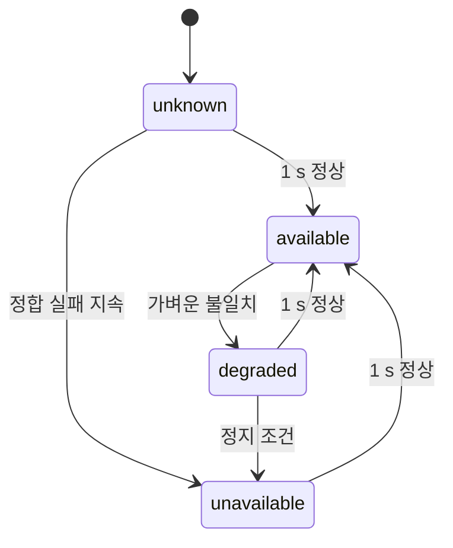
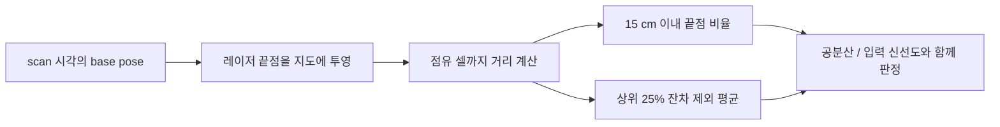
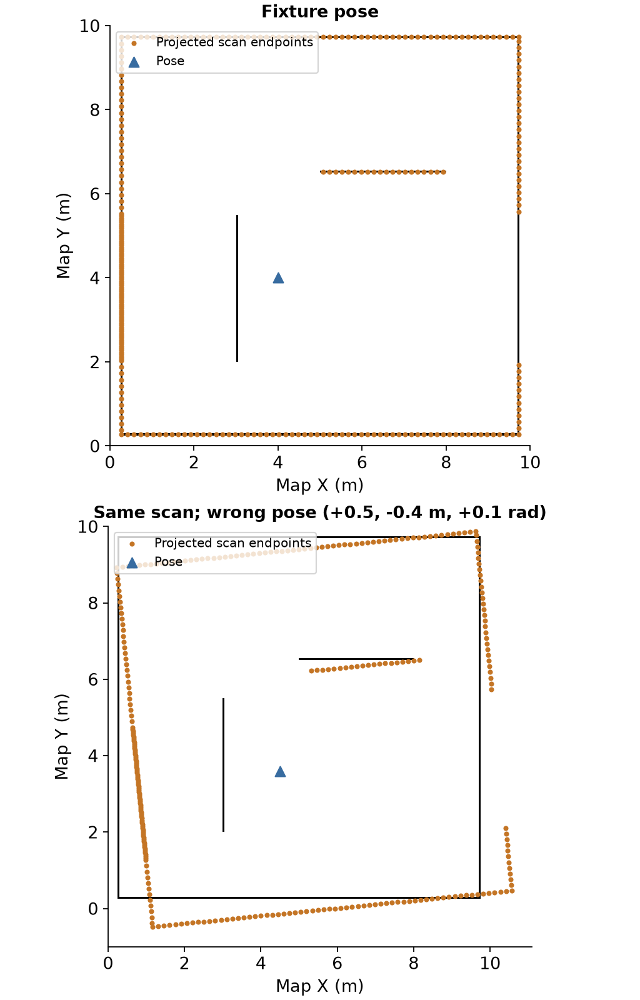
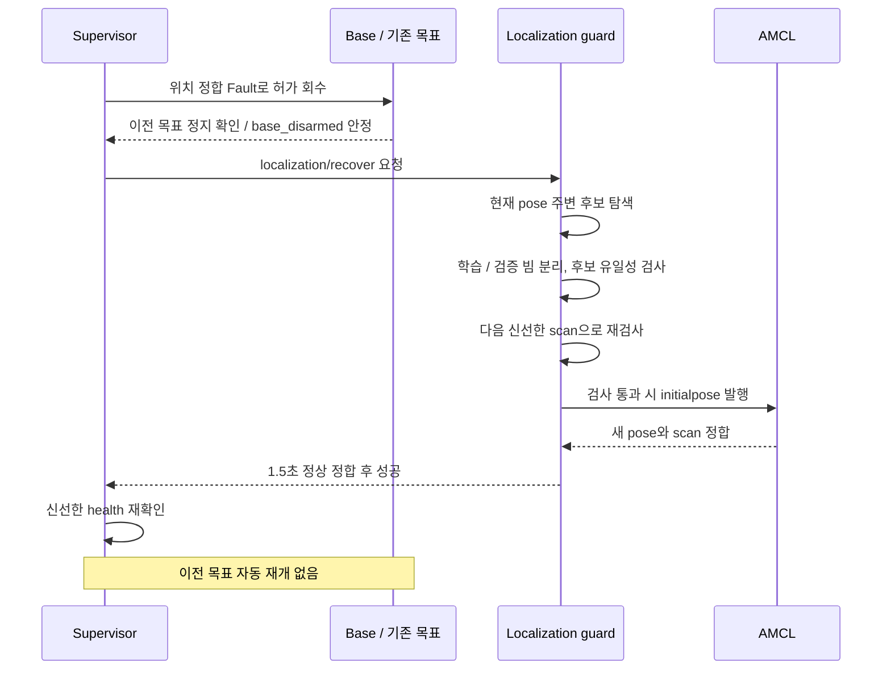

# 위치 정합과 정지 상태 복구

`localization_guard`는 LiDAR scan과 지도의 정합을 검사합니다. 검증된 위치가 가볍게 어긋나면 감속하고, 위치를 신뢰할 수 없으면 주행을 막습니다. 자동 복구는 **로봇을 정지시킨 상태에서 AMCL 초기 위치만 갱신**합니다.

## 상태별 주행 허가

어느 상태에서든 입력 무효, 공분산 미검증 또는 새 초기 위치는 `unknown`으로 전환합니다.

| 상태 | 의미 | 주행 처리 |
|---|---|---|
| `unknown` | 초기 위치 / 공분산 미검증 또는 센서 / TF 입력 무효 | 허용하지 않음 |
| `available` | 새 관측으로 1 s 연속 정상 확인 | 다른 안전 조건도 충족하면 허용 |
| `degraded` | 검증된 위치의 가벼운 불일치, AMCL 보정 대기 | 기존 목표와 허가 유지, 정상 속도의 30% 요청 |
| `unavailable` | 정합 실패 지속 | 정지와 허가 회수 |

정상으로 복귀해도 **이미 취소된 목표는 자동 재개하지 않습니다.** 반복 heartbeat는 정상 확인 시간을 늘리지 않습니다.

## Scan과 지도 비교

지도 밖과 미확인 영역의 끝점은 일치로 세지 않습니다. 평균에서 제외한 상위 25%도 일치율의 분모에는 남깁니다. 공분산이 작아도 이 지도 정합 검사를 생략하지 않습니다.

[phone_localization.yaml](../config/phone_localization.yaml)의 값은 시연용 초기 기준입니다. 지도 품질과 실제 바닥에서 추가 검증이 필요합니다.

| 정상 판정 항목 | 조건 |
|---|---|
| 유효 끝점 | 최소 60개 |
| 일치율 | 15 cm 이내 끝점이 30% 이상 |
| 절사 평균 잔차 | 18 cm 이하 |
| 정상 지속 | 새 관측으로 1 s 연속 |
| 공분산 | 비유한 값, 설정 상한 초과, 허용 범위 밖 음수는 정상 근거로 사용하지 않음 |
| 공분산 수치 오차 | −1e−9 이내 음수는 0으로 해석 |

<figure class="contract-figure" data-visual-id="alignment">

<figcaption>기존 단위 테스트의 같은 지도와 scan을 정상 pose(위), 잘못된 pose(아래)로 투영했습니다. 검정은 점유 셀, 주황은 scan 끝점입니다. 실제 bag이나 복구 성능 측정이 아닌 합성 fixture 예시입니다. <a href="../../../../docs/assets/visuals/generated.json">입력과 출처</a></figcaption>
</figure>

## 감속 유지와 정지 시점

| degraded에서 관측된 조건 | 처리 |
|---|---|
| 최고 기록보다 평균 오차 2 cm 감소 **또는** 일치율 5%p 증가 | 개선 시각 갱신 |
| 정상 기준을 만족하는 새 관측 | 개선 시각 갱신; 1 s 연속 확인 전까지 감속 유지 |
| 4 s 동안 개선 없음 | `unavailable`, 정지 |
| 불일치 총 8 s 도달 | `unavailable`, 정지; 짧은 정상 관측으로 한도 초기화 안 함 |
| 일치율 < 10% **동시에** 평균 오차 > 35 cm, 0.8 s 지속 | 먼저 정지 |
| 잘못된 공분산, 큰 불확실성 또는 입력 단절 | 위 대기 시간을 주지 않고 주행 차단 |

| 속도 제한 전달 | 동작 |
|---|---|
| 요청 비율 | 정상 상한의 30%: 현재 병진 0.15 m/s, 회전 0.21 rad/s |
| 다른 상한과 관계 | 더 낮은 장애물 / 도착 상한 우선 |
| 소비자 | MPPI와 Collision Monitor가 `navigation/localization_speed_limit` 공유 |
| Monitor 제한 하강 | 초당 30%p |
| 정상 복귀 | MPPI의 기존 가속도 제한으로 회복 |
| 제한 메시지 0.6 s 단절 또는 0% 수신 | Monitor 즉시 0 출력 |

## 정지 상태의 자동 복구

아래는 후보 검사를 통과한 경우의 순서입니다. 거부와 중단 조건은 아래 표를 따릅니다.

| 복구 검사 | 통과 조건 |
|---|---|
| 탐색 범위 | 현재 pose 주변 반경 0.8 m, yaw ±0.7 rad |
| 일치율 | 50% 이상 |
| 정합 개선 | 기존 절사 평균보다 4 cm 이상 개선 |
| 공분산만 높은 경우 | 기존 정합이 정상이면 개선량 대신 엄격한 일치율과 후보 유일성 검사 |
| 모호한 후보 거부 | 30 cm 또는 0.2 rad 이상 다른 후보와 점수 차이 < 2.5 cm |
| 적용 후 검증 | AMCL의 새 pose에서 1.5 s 정상 정합 |
| 재시도 | 총 2회; 실패하면 새 자동 주행 계속 차단 |

큰 공분산은 이동 허가를 막지만 유효한 scan과 TF를 이용한 복구 탐색까지 막지는 않습니다. 정지 중 미확인 상태 또는 복구 검증 중에는 0.5 s 간격으로 AMCL no-motion update를 요청합니다.

| 중단 또는 실패 상황 | 후속 처리 |
|---|---|
| 수동 initialpose, 지도 교체, base 움직임, 입력 중단, 취소 | 진행 중인 후보 적용 중단 |
| 큰 위치 오차 또는 반복 구조로 후보 모호 | 수동 초기 위치 설정 필요 |
| 회차별 판정 확인 | `localization_evidence_directory`의 지도, scan, seed와 판정 근거 확인 |

복구는 휠을 움직이거나 지도를 수정하지 않습니다. 저장 결과는 물리 E-stop 또는 전신 보호의 증거가 아닙니다. 통신 규격은 [인터페이스](interfaces.md), 주행 설정은 [계획과 제어](planning.md)를 따릅니다.
