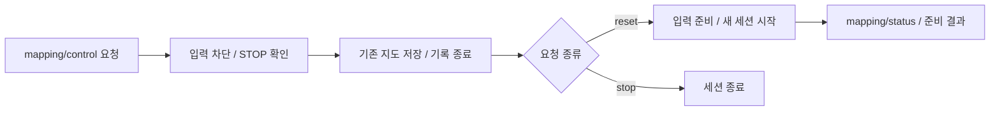

# 실물 매핑 세션

[실행 가이드](../../../../docs/implementation/how-to/mapping.md) · [하드웨어 프로필](../../cleany_bringup/docs/hardware-mapping.md)

`mapping_scan_filter`는 `scan_raw` 원본을 보존하고 base 전방 180도 중 0.30m 초과 값을
`scan`으로 발행합니다. 후방과 가까운 finite 값은 NaN이며 clearing ray로 바꾸지 않습니다.
센서 yaw를 이용해 전방을 센서 좌표로 변환합니다.

`mapping_session`은 지도 세션과 Cartographer, Logger 자식 프로세스를 소유합니다.
센서와 구동, 조종 프로세스는 외부에서 제공하며 지도 초기화로 재시작하지 않습니다. 해당 프로세스의 실행 수명은 [하드웨어 구성](../../cleany_bringup/docs/hardware-mapping.md)이 관리합니다.

기록 디렉터리에 `recording-settings.json`이 있으면 Logger가 복원한 기록 정책을
지도 초기화 후에도 유지합니다. 저장된 정책이 없는 첫 실행에서만 매핑용 기본 토픽과
주기를 설정합니다. 따라서 초기화가 사용자의 기록 제외나 Hz 설정을 덮어쓰지 않습니다.

| ROS endpoint | 타입 | 계약 |
|---|---|---|
| `mapping/control` | `MappingControl` 서비스 | reset 또는 stop 접수. request_id와 operation 조합으로 수명 내 중복 제거 |
| `mapping/status` | `MappingStatus` | Reliable transient local depth 1. phase, generation, output과 이전 output |
| `teleop/status` | `TeleopStatus` 구독 | 정지 확인은 fresh connected, paused, disabled, stop_confirmed 모두 필요 |
| `teleop/pause` | `SetBool` client | 초기화와 종료 전 입력 차단. 준비 완료 뒤 차단만 해제 |
| `wheel_odometry/reset` | `Trigger` client | 이전 SLAM 종료와 STOP 확인 후 오도메트리 원점 재설정 |
| `write_state` | Cartographer `WriteState` client | 최종 pbstream 파일과 code=0 응답 모두 확인 |
| `/cleany_logger/*` | `RecordingControl` client | 자신이 시작한 session ID만 정지 |

상태는 idle, queued, stopping, waiting_usb, starting, running, failed입니다.
waiting_usb는 장치 파일만 검사하지 않고 실제 scan과 fresh MCU 연결을 기다립니다.
새 세션은 scan 시각의 `map -> sensor` TF, fresh odom과 새 map을 확인해야 running이 됩니다.

초기화 순서는 입력 차단과 STOP 확인, 이전 지도/pbstream 저장, Logger flush, 이전 SLAM 종료,
odom reset, 새 Logger와 SLAM 시작입니다. 저장 실패와 남은 자식은 다음 시작을 차단합니다.
ESP32 연결 자체가 사라지면 STOP 미확인을 상태에 남기고 재연결을 기다립니다.

`map.yaml`은 실제 origin yaw와 immutable PGM을 참조합니다. 현재 지도 사본 `map.pgm`,
`latest.pbstream`, 선택 설정과 출처를 담은 `session.json`, Logger session을 가리키는
`recording.json`, 종료 결과를 세션별로 보존합니다. 기존 세션 디렉터리를 덮어쓰지 않습니다.
Map YAML과 이미지는 임시 파일과 원자적 교체로 갱신합니다.

이 매핑 세션의 Cartographer는 `map → odom`을 소유합니다. 외부 입력은
`odom → base_link`와 센서 장착 TF를 제공해야 하며, 각 변환의 발행자는 하나여야 합니다.
같은 `map → odom`을 발행하는 AMCL이나 다른 SLAM은 동시에 실행하지 않습니다.
일반 Cartographer launch는 유지하고 실물 경로는 `cartographer_hardware_2d.lua`를 선택합니다.

## 실패 진단

매핑 관리자는 시작 전에 `MappingStatus.output`을 설정하므로 준비 중 실패해도
Cartographer와 Logger 로그의 세션 디렉터리를 찾을 수 있습니다. `generation`은 정상 시작이
완료됐을 때만 증가합니다.

| 실패 정보 | 보존 / 갱신 |
|---|---|
| error_code | 단계별 `MAPPING_<PHASE>_FAILED` |
| error_file | `output_root/errors/<operation_id>.json` |
| JSON 내용 | UTC / 요청·작업 ID / 세션 경로 / 당시 상태 / 예외 타입 / 전체 traceback |
| 시작과 정리 모두 실패 | 두 예외 함께 보존 |
| 진단 저장 실패 | Stderr traceback, runtime/mapping.log 확인 |
| 새 요청 | 현재 오류 필드 초기화, 이전 파일 유지 |
| 실행 자식 종료 | Cartographer / Logger 구분, 종료 코드와 로그 경로 |

하드웨어 프로필의 `recording_limit_mib`는 최초 세션 정책과 Logger 시작 한도를, `recording_total_limit_mib`는 보존된 전체 기록의 총량 한도를 설정합니다. 저장된 `recording-settings.json`이 있으면 세션 한도는 저장된 정책을 우선합니다. 총량 한도는 세션 한도 이상이어야 하며, 프로필 변경은 런타임을 다음에 시작할 때 적용합니다.

LiDAR 주행 구성은 `lidar_self_mask_cad.yaml`의 고정 기둥 직사각형을 base_link 좌표로 제외합니다. CAD -Y를 base +X, CAD +X를 base +Y로 변환하고 기둥 외곽에 15mm 여유를 둡니다. 360도 매핑 원본 `/scan_raw`는 변경하지 않으며, 일반 매핑 실행에는 이 마스크를 자동 적용하지 않습니다.
