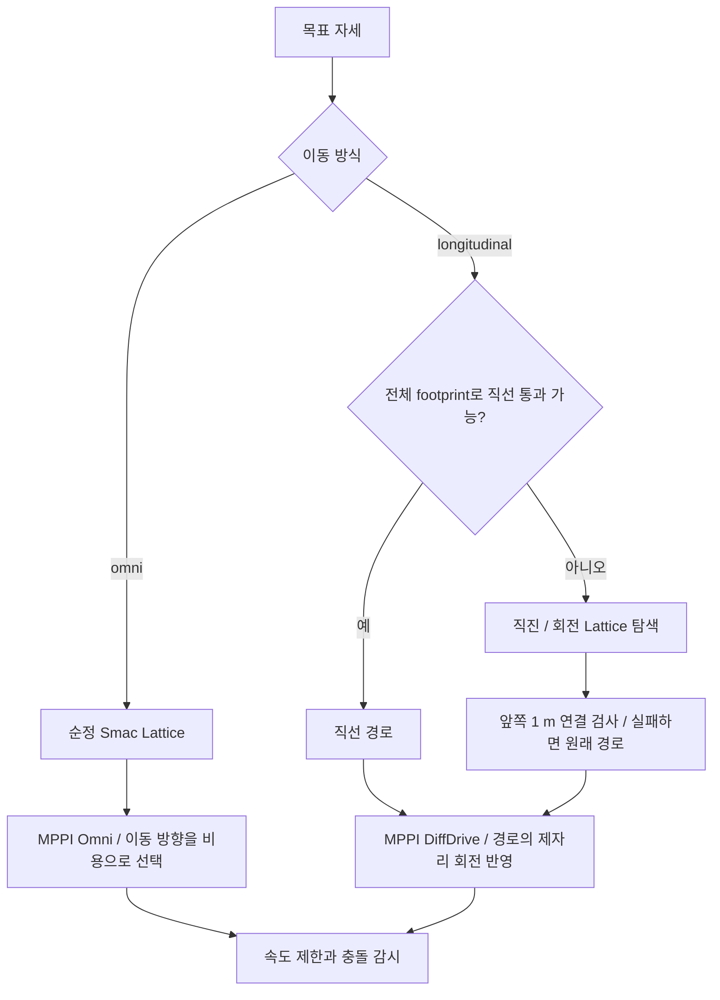
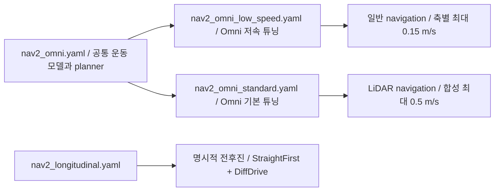
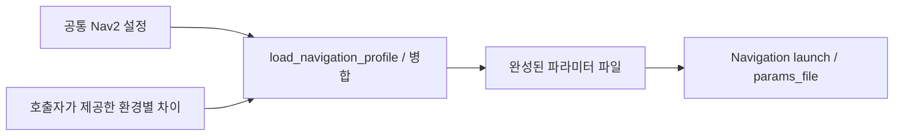
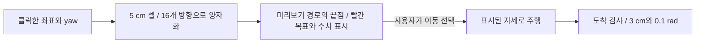
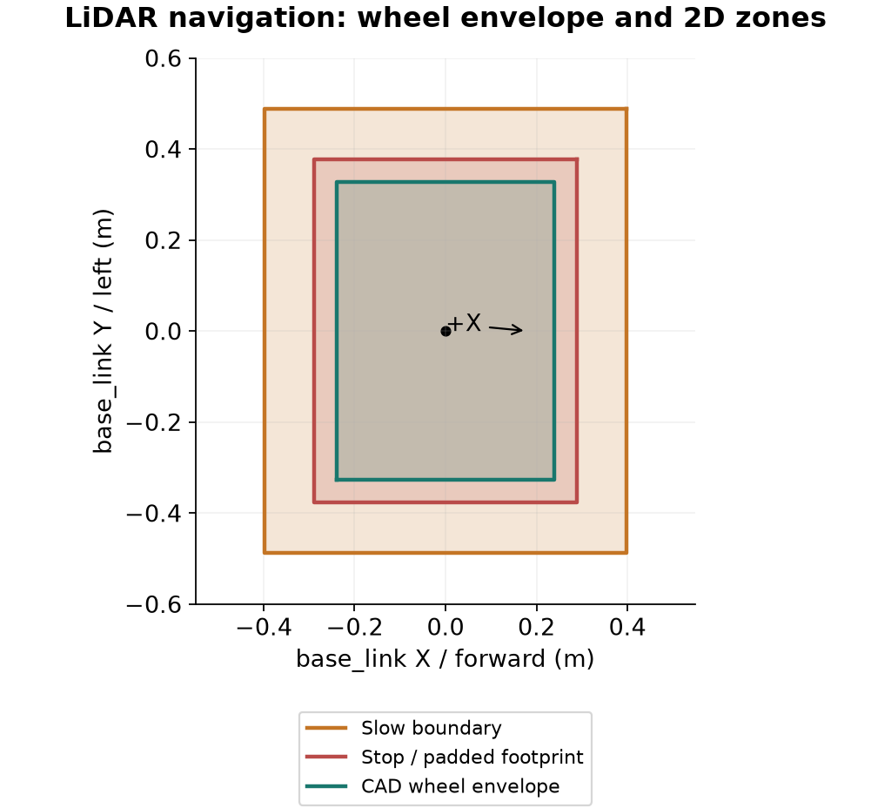
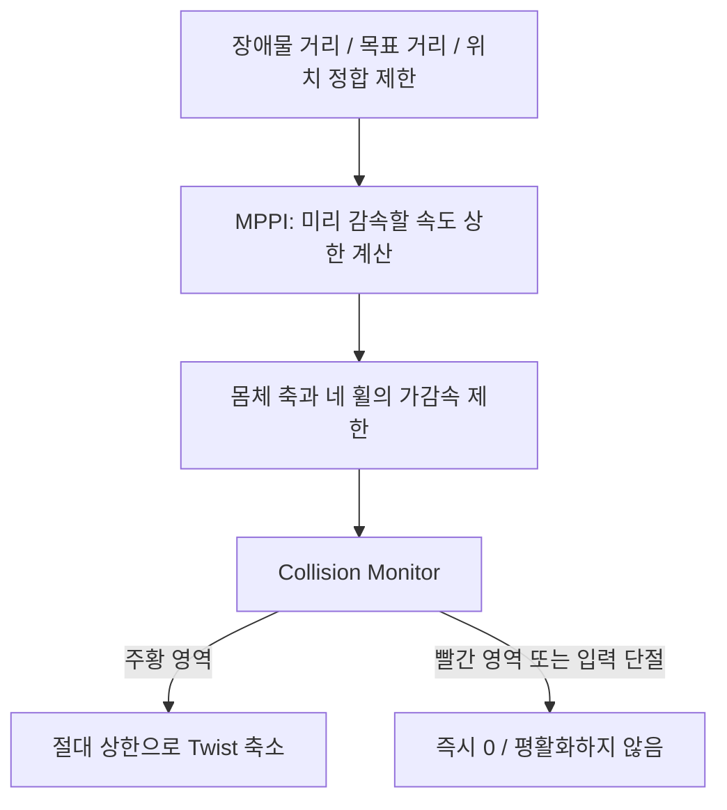
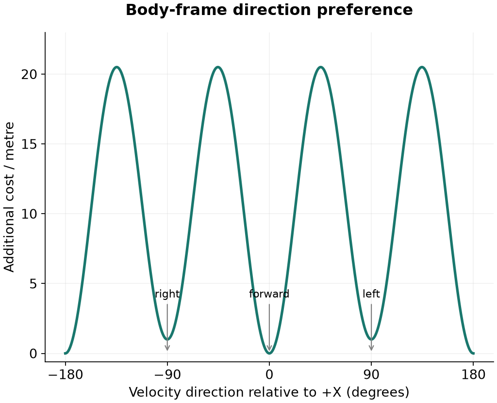
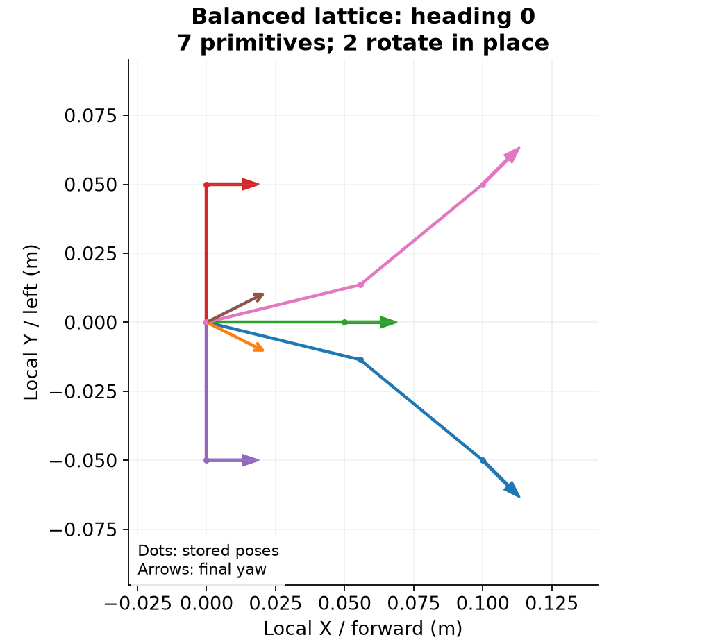

# 경로 계획과 주행 제어

전역 planner는 지나갈 경로를 찾고, MPPI는 그 경로를 따라갈 속도를 선택합니다. 실제 출력은 [안전 경로](safety.md)의 제한을 추가로 받습니다. 실행 방법은 [주행 가이드](../../../../docs/implementation/how-to/phone-navigation.md)를 따릅니다.

## 프로필 선택

| 실행 | 전역 planner / primitive | 제어 모델 | 이동 방식 |
|---|---|---|---|
| Omni 저속 튜닝 / 일반 AMCL | Smac Lattice / `omni-r10cm.json` | MPPI Omni | 전후, 횡이동, 회전 |
| 전후진 전용 / 명시적 `longitudinal` | StraightFirst → 필요 시 Lattice / 직진과 제자리 회전 | MPPI DiffDrive | 횡이동 없이 직진과 회전 |
| Omni 기본 튜닝 / `omni` | Smac Lattice / `omni-r10cm-balanced.json` | MPPI Omni | 방향별 비용으로 전후, 횡이동, 회전 선택 |
| 명시적 `axis_motion:=true` | 축 전용 기존 프로필 | DWB | 축 전용 이동 |

`lidar_navigation.launch.py`에는 `robot_params_file`과 기존 안전 센서 입력이 필요합니다. `lidar_navigation.launch.py`, `hardware_mapping.launch.py`, `run-navigation`은 모두 `omni`를 기본으로 사용합니다. `motion_profile:=longitudinal`을 명시하면 StraightFirst와 DiffDrive를 선택합니다. 수동 조종의 횡이동 허용도 같은 선택을 따릅니다. 일반 `navigation.launch.py`는 Omni 저속 튜닝을 사용합니다.



### 공통 설정과 운용 튜닝



공통 파일과 운용별 차이를 합쳐 적용합니다. `standard`와 `low_speed`는 주행 튜닝 이름이며 센서 종류를 뜻하지 않습니다. 두 튜닝은 속도 외에도 탐색 시간과 비용 설정이 다릅니다. `nav2_omni_standard.yaml`과 `nav2_omni_low_speed.yaml`은 단독 설정 파일이 아닙니다. `lidar_robot.yaml`, `lidar_safety.yaml`은 센서와 로봇의 조건을, `motion_profile`은 이동 방식을 선택합니다. `phone_remote`는 웹 조종기의 이름입니다.

### 외부 설정의 전달 계약



`load_navigation_profile(base, overlay)`는 같은 plugin의 값을 병합하고, plugin 종류가 달라지면 해당 설정 묶음을 교체합니다. 이전 plugin의 전용 값이 새 plugin에 남지 않게 하기 위한 규칙입니다. 환경별 차이만 담긴 파일은 호출자가 공통 설정과 합친 뒤 `params_file`로 전달합니다. Navigation launch는 전달받은 파일을 읽고 선택한 이동 방식과 안전 설정을 적용합니다.

센서와 구동 연결, 환경별 설정 선택은 호출 패키지가 소유합니다. 실행 순서는 [전역 실행 가이드](../../../../docs/implementation/running.md), 이 패키지가 요구하는 입력은 [안전 계약](safety.md#입력과-tf)을 따릅니다.

`navigation.launch.py`가 안전 센서를 포함한 공통 진입점이며 `amcl_nav2_safety.launch.py`는 같은 인자를 전달하는 호환 이름입니다. 축 이동 구성은 `AxisGenerator`와 `PathHeadingCritic`을 사용합니다. StraightFirst planner의 연속 footprint 검사는 별도 `footprint_sweep` 라이브러리를 사용합니다.

## 기본 튜닝과 전후진 전용 설정

### 클릭한 목표와 실제 도착 판정



`tolerance=0`은 다른 목표 셀로 대체하지 않는다는 뜻입니다. 연속 좌표의 정확한 보존을 뜻하지 않습니다. Controller는 반환된 경로 끝점, 조종기는 표시된 목표를 기준으로 위 허용오차를 검사합니다.

### Omni 전역 계획

Omni 기본 튜닝에는 직선 우선 연결, 고정 방향 XY 탐색, 별도 몸체 방향 탐색이나 거리 기준 방향 선택이 없습니다.

| 설정 | 값 | 역할 |
|---|---|---|
| `rotation_penalty` | 5.0 | 제자리 회전 비용 |
| `reverse_penalty` | 1.2 | 후진 확장 비용 |
| `non_straight_penalty` / `change_penalty` | 1.2 / 0.05 | 곡선 / 회전 방향 전환 비용 |
| `cost_penalty` | 2.0 | 장애물 비용장 반영 |
| `max_planning_time` | 2.0 s | 검색 시간 예산 |
| `tolerance` | 0.0 m | 다른 목표 셀로 대체하지 않음 |
| `smooth_path` / analytic expansion 길이 | false / 0 m | Primitive 경로 유지 |

### Omni 지역 제어

[nav2_omni.yaml](../config/nav2_omni.yaml)과 [nav2_omni_standard.yaml](../config/nav2_omni_standard.yaml)을 합쳐 Omni 기본 튜닝을 구성합니다. MPPI는 20 Hz로 동작하며 **60 × 0.05 s 예측 구간에 1,000개 후보**를 평가합니다.

| 샘플 설정 | 값 |
|---|---|
| 운동 모델 | `Omni` |
| X / Y 속도 표준편차 | 각각 0.1 m/s |
| 회전 속도 표준편차 | 0.2 rad/s |
| Temperature | 0.1 |

| 비용 항목 | 가중치 | 적용 기준 |
|---|---|---|
| PathAlign | 5 | `use_path_orientations=false`: 경로 위치만 평가 |
| Goal / PathFollow | 40 / 30 | 전환 거리 0.5 m |
| GoalAngle | 12 | 목표 0.15 m 안에서 최종 방향 평가 |
| Twirling | 1 | 불필요한 회전 억제 |
| Cost | 설정 파일 참조 | 목표 0.3 m 안에서는 일반 반발 비용 생략, footprint 충돌 검사는 유지 |
| PathAngle | 비활성 | 경로 방향 강제 없음 |

몸체 방향은 [방향별 이동 비용](#횡이동과-대각이동의-고정-비용), 장애물과 회전 비용을 함께 평가해 결정합니다. 특정 거리에서 회전→전진→회전을 강제하지 않습니다.

### Longitudinal의 경로 연결과 회전

| 상황 | 처리 | 실패 또는 해제 조건 |
|---|---|---|
| 직선 연결 가능 | StraightFirstPlanner가 전체 footprint로 검사 | 불가능하면 Lattice 탐색 |
| Lattice 경로 앞쪽 1 m | 먼 연결 가능 경로점까지 직진과 필요한 제자리 회전으로 연결 | 연속 footprint sweep 또는 최신 costmap 검사 실패 시 원래 경로 |
| 선두 경로점 0.075 m 이내, 같은 XY에서 yaw 변화 | 회전 구간 마지막 yaw를 방향 목표로 선택 | 일반 이동 구간은 기존 경로 방위각 평가 |
| 경로 방향 오차 > 0.1 rad | 후보와 출력의 목표 XY 속도 0 | 가속도 제한 사용 시 먼저 감속, 미사용 시 즉시 XY=0 |
| 목표 위치 3 cm 이내 | 최종 GoalAngle 비용 우선 | 최종 회전 XY 제한은 2.5 cm에서 시작, 3 cm 밖에서 해제 |

`prefix_shortcut_distance=1.0`은 남은 경로와 최종 자세를 보존합니다. 다른 프로필의 기본값 0은 이 연결 처리를 끕니다. 추가 검색 padding은 0이며 footprint의 기존 5 cm 여유를 검사합니다.

경로 회전은 `PathAngleCritic.respect_in_place_rotations=true`와 `path_rotate_enabled`로 제어합니다. 측정 초기 속도와 감속 이동도 충돌 예측에 포함합니다. Omni는 이 강제 회전 단계를 사용하지 않습니다.

## Omni 주행 연속성

### 공간과 속도 상한

| 영역 또는 조건 | 병진 합성 속도 상한 | 회전 상한 |
|---|---|---|
| 정상 | 0.5 m/s | 0.7 rad/s |
| 주황 영역: 바퀴 외곽 사방 0.16 m | 0.16 m/s | 0.3 rad/s |
| 목표점 0.2 m 이내 | 목표 상한 0.06 m/s | 목표 상한 0.15 rad/s |
| 위치 정합 degraded | 0.15 m/s | 0.21 rad/s |
| 빨간 영역, 정지 조건 | 0 | 0 |

병진은 `hypot(vx, vy)`입니다. 더 낮은 제한이 우선하고 작은 요청을 키우지 않습니다. Collision Monitor는 경계를 넘는 혼합 Twist 전체를 같은 비율로 줄여 곡률을 유지합니다. 휠 최종 상한 10 rad/s 때문에 병진과 회전을 섞으면 더 느려질 수 있습니다. Longitudinal 속도는 별도 프로필 값을 따릅니다.

| 공간 기준 | 크기 / 여유 | 적용 한계 |
|---|---|---|
| CAD 바퀴 포함 하부 외곽 | 0.477 × 0.6548 m | 하부 2D 외곽 |
| Costmap footprint | 위 외곽 + `footprint_padding=0.05 m` | 카메라와 팔 높이의 3D 검사 아님 |
| Collision Monitor 정지 사각형 | 0.577 × 0.7548 m | 실측 제동 거리 보증 아님 |

<figure class="contract-figure" data-visual-id="footprint">

<figcaption>LiDAR 설정의 바퀴 외곽(녹색), 정지 경계와 padded footprint(빨강), 감속 경계(주황)를 같은 축척으로 그렸습니다. base_link의 X는 전방, Y는 왼쪽입니다. 높이별 3D 보호나 실측 제동 거리를 나타내지 않습니다. <a href="../../../../docs/assets/visuals/generated.json">입력과 출처</a></figcaption>
</figure>

### 가감속과 장애물 접근



| 설정 | Omni 기본 튜닝 값 | 의미 |
|---|---|---|
| `acceleration_limits` | true | 샘플, 가중 평균, 필터 후 출력, 충돌 회피 대체 후보에 동일 적용 |
| `ax_max` / `ay_max` / `az_max` | 0.20 / 0.15 m/s² / 0.40 rad/s² | 몸체 축별 대칭 가감속; `ax_min`, `ay_min` 미사용 |
| `wheel_acceleration_max` | 3 rad/s² | 네 휠 명령의 가감속 제한 |
| `control_variation_weight` | 1 | 연속 명령 변화 비용 |
| `path_velocity_weight` | 0 | 직선 구간 횡오차에 대한 별도 벌점 비활성 |
| `path_rotate_enabled` | false | 경로 회전의 XY 강제 제한 비활성 |
| `goal_rotate_enter_radius` / `goal_rotate_exit_radius` | 0 / 0 | 도착 회전 단계와 연결된 거리 속도 제한 비활성 |

Twist는 전체를 같은 비율로 보간합니다. 첫 호출이나 0.2 s를 넘는 호출 공백에서는 측정 odom 속도, 연속 호출에서는 직전 출력을 시작점으로 씁니다. 측정 초기 속도는 충돌 예측에 유지합니다. 일반 MPPI 프로필의 가속도 제한 기본값은 false입니다.

| 사전 감속 계산 | 기준 |
|---|---|
| 장애물 거리 | 치명적 또는 미관측 costmap 셀과 padded footprint 외접 사각형 사이 거리에서 셀 반대각 차감 |
| 주황 영역까지 여유 | `proximity_clearance=0.11 m`: 바퀴+5 cm에서 바퀴+16 cm까지 |
| 감속도와 반응 시간 | 축 / 휠 중 보수적인 감속도, `speed_limit_reaction_time=0.3 s` |
| 계산 예 | 0.5→0.16 m/s 감속은 주황 경계 약 0.98 m 전부터 시작 |
| 목표 접근 | 같은 제동 곡선 적용 |

이 거리는 계산값이며 실측 정지 거리 보장이 아닙니다. 낮아진 상한으로의 감속은 가감속 제약을 따르되, 실제 영역의 절대 상한과 갑자기 나타난 장애물의 정지는 Monitor가 적용합니다.

## 횡이동과 대각이동의 고정 비용

`DirectionalMotionCritic`은 body 좌표계 이동 각도 θ에 대해 아래 비용을 이동 거리로 적분합니다. 각 예측점의 거리는 속력 × `model_dt`입니다.

```text
이동 1 m당 비용 = 1 × sin²(θ) + 20 × sin²(2θ)
```

| 방향 / 동작 | 비용 (cost/m) | 해석 |
|---|---|---|
| 전진 / 후진 | 0 | 방향 비용 없음 |
| 좌 / 우 횡이동 | 1 | 낮은 추가 비용 |
| 45° 대각이동 | 20.5 | 높은 추가 비용 |
| 약 45.36° | 약 20.5031 | 연속 함수의 실제 최대 |
| 정지 / 제자리 회전 | 추가 비용 없음 | 회전 비용은 다른 critic이 평가 |

전후와 좌우 부호에 대칭입니다. **선호 비용이므로 횡이동 후보를 제거하거나 회전 후 전진을 강제하지 않습니다.** 충돌, 도착, 경로 추종 비용과 함께 평가하며 DiffDrive 복구 controller와 goal checker의 XY 도착 허용오차 안에서는 생략합니다.

| 조정 항목 | 조건 |
|---|---|
| `lateral_weight` / `diagonal_weight` | 기본 튜닝 1.0 / 20.0 cost/m; 일반 plugin 기본값은 둘 다 0 |
| 값 반영 | configure 시 읽음; 변경 후 controller 재구성 필요 |
| 호환성 | 이전 harmonic-overlap 계산과 같은 수치로 호환되지 않음 |
| 검증 범위 | 초기 시험값; 실제 바닥 개선은 실물 비교 필요 |

슬립 측정으로 가중치를 자동 변경하지 않습니다. 위치별 위험 지도와 장기 학습은 미구현입니다. SlipRecovery의 감속 정지, 정지 확인, 한 번의 종방향 재시도는 별도 동작입니다.

<figure class="contract-figure" data-visual-id="direction-cost">

<figcaption>현재 critic 식과 기본 튜닝 가중치로 계산한 1 m당 방향 비용입니다. 전후 0, 횡이동 1, 45°에서 20.5이며 다른 비용과 함께 평가합니다. 실측 슬립이나 주행 성능 그래프가 아닙니다. <a href="../../../../docs/assets/visuals/generated.json">입력과 출처</a></figcaption>
</figure>

## 위치 정합과 복구

위치가 불확실하면 감속하거나 주행 허가를 회수합니다. [위치 정합 문서](localization.md)에서 상태 전이, 정지 조건과 정지 상태의 자동 복구 순서를 확인합니다.

| 슬립 복구 설정 | 유지하는 기능 | 실행하지 않는 기능 |
|---|---|---|
| Omni `slip_recovery:=false` | slip_monitor와 로그, 기본 Nav2 동작, 위치 정합 복구 | SlipRecovery BT, 종방향 재시도 planner, traction_brake |
| 슬립 BT 활성 | 충돌 감시 입력 `motion/traction_cmd_vel` | — |
| 슬립 BT 비활성 | 충돌 감시 입력 `motion/cmd_vel` | — |

## Lattice 파일

| 파일 | 구성 | 용도 |
|---|---|---|
| `omni-r10cm.json` | 5 cm 격자, 반경 설정 10 cm, heading 16개, primitive 144개 | 일반 navigation 기본 |
| `omni-r10cm-balanced.json` | 원본 좌표 / 방향 유지; 오른쪽 횡이동 16개의 길이 메타데이터만 교정 | Omni 기본 튜닝 |

파일은 [config/lattice](../config/lattice)에 있습니다. Launch 기본 경로보다 명시적인 `GridBased.lattice_filepath`가 우선합니다. 원본은 공식 Nav2 1.1.20 Generator로 만들었으며 반경 설정은 실물 최소 회전 반경 측정값이 아닙니다.

<figure class="contract-figure" data-visual-id="lattice">

<figcaption>기본 튜닝의 balanced JSON에서 시작 heading 0인 7개 primitive만 표시했습니다. 점은 저장된 pose, 화살표는 마지막 yaw이며 원점의 두 화살표는 제자리 회전입니다. 선은 pose 사이 연결이고 실제 주행 결과가 아닙니다. <a href="../../../../docs/assets/visuals/generated.json">입력과 출처</a></figcaption>
</figure>

## MPPI 샘플 초기화

| 시점 / 범위 | 계약 |
|---|---|
| 초기화와 reset 반환 전 | 완전한 잡음 묶음 생성 |
| `regenerate_noises=true` | 이후 묶음을 작업 스레드에서 준비 |
| reset 잠금 | 설정, 운동 모델과 잡음 배열을 함께 교체 |
| DiffDrive로 전환 | 횡방향 잡음 0으로 초기화 |
| Controller별 상태 | 독립 난수 엔진 소유 |

후보가 모두 같아지는 초기 경쟁 상태를 방지하지만 비동기 스케줄의 결정성은 보장하지 않습니다. 충돌 검사, 비용 가중치와 출력 제한은 별도 계약입니다.

커스텀 controller는 `cleany_navigation::MPPIController`, critic은 `cleany_navigation::mppi::critics`로 등록합니다. 소스는 `mppi/src`와 `include/cleany_navigation/mppi`, 원본 설명과 라이선스는 [upstream README](../mppi/README.upstream.md)와 [LICENSE](../mppi/LICENSE.md)에 있습니다.
