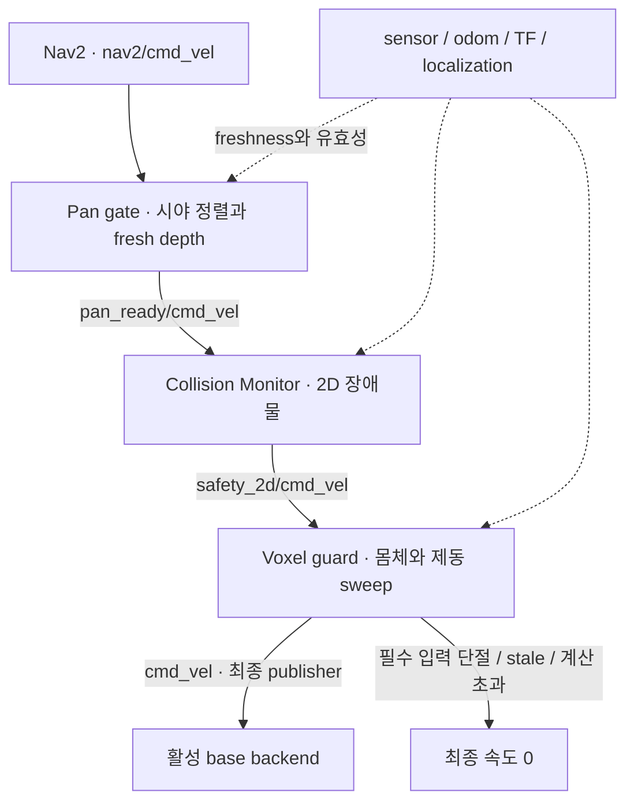

# Navigation 안전 계약

- 대상: 기본 full runtime. 모든 단계 기본 활성화
- 명령: Twist x/y/yaw. 최종 `cmd_vel` publisher는 voxel guard 하나

## 입력과 TF

| 입력 | 계약 |
|---|---|
| `scan` | LaserScan, LiDAR frame, ROS stamp |
| `odom` | child=base_link, 측정 x/y/yaw 속도 |
| `joint_states` | head_pan_joint position/velocity, 유효 stamp |
| depth image | rectified 32FC1(m)/16UC1(mm); 0/NaN/-Inf는 관측 없음 |
| CameraInfo | image와 동일 크기·optical frame, 유효 K/monocular P, D=0 |
| Backend TF | odom→base_link, base→LiDAR/head/optical |
| AMCL TF | map→odom |

## Depth와 pan

- Depth 변환: capture stamp의 TF 사용. TF/calibration 없으면 cloud 미발행
- 자기 필터: park 팔·고정 몸체·기둥을 통과하는 ray와 레일 뒤 경계 픽셀 제거
- 보수적 교차 판정: 평행 ray·표면 접촉·센서가 몸체 내부인 경우 포함
- 회전 head: 정적 자기 필터 대상 밖. 가려진 ray를 free-space로 처리 금지
- 기본 margin: 1 mm. 실물 보정 오차에 맞춘 별도 검증 필요
- Pan 출력: `head_pan/command` Float64. TF 소유 없음; actuator adapter·실측 feedback 필요
- 위치 범위: pan_min/max_position_rad, 기본 [-π, π]. 실물 보정 한계 아님
- 목표: 같은 방위각의 범위 내 위치 중 현재 pan에 가장 가까운 값; clipping 금지
- 범위 내 목표 없음: `PAN_TARGET_OUT_OF_RANGE`, 속도 차단
- 자유 이동: 방향 정렬 + 정렬 이후 fresh depth
- 축 제한: 정지·settle 추가 확인
- 후진: 뒤쪽 π rad 정렬·정지 후 fresh depth. 실물 뒤쪽 시야 검증 필요
- 후진 제외: `pan_motion_gate.allow_reverse: false`

## 차단과 한계

- 기본 이동: 전진·후진·제자리 회전. 횡이동 차단
- Progress: XY 0.15 m 또는 yaw 0.25 rad; 20초간 둘 다 없으면 실패
- Voxel guard: 몸체 OBB + 예측 제동 sweep. 요청 속도 0이어도 측정 관성 검사
- 최종 0 조건: 필수 입력 단절, stale/future stamp, TF 누락, localization jump, voxel freeze, 계산 초과
- Pan/voxel: steady timer 사용. `/clock` 중단 중에도 정지 출력 유지
- 몸체 가정: 설정된 park posture. 실시간 팔 FK 감시·자세 유지 미구현
- 관측 voxel만 검사. Unknown 공간의 안전 보장 없음
- 물리 E-stop·driver watchdog·실측 제동: 로봇 통합에서 별도 검증

## Memory·설정·진단

- Global/local costmap: `obstacle_memory/grid`를 max 병합
- 진단: `obstacle_memory/{grid,voxels,voxel_status}`, `body_guard_3d/state`, `head_pan/state`
- Memory service: `obstacle_memory/save`, `obstacle_memory/set_enabled`
- `output_directory`: 기본 빈 값; 지정 시 로그·snapshot 기록
- Full runtime alias: `amcl_nav2_safety.launch.py`
- 기본 Nav2 실험: `amcl_nav2.launch.py map:=...`
- 선택 비활성화: pan_enabled/memory_enabled/voxel_enabled. Voxel에는 memory 필수
- 설정: 패키지 `config/`
- 안내: [실행](../../../../docs/RUNNING.md), [테스트](../../../../docs/TESTING.md), [과거 근거](../../../../docs/EVIDENCE.md)
