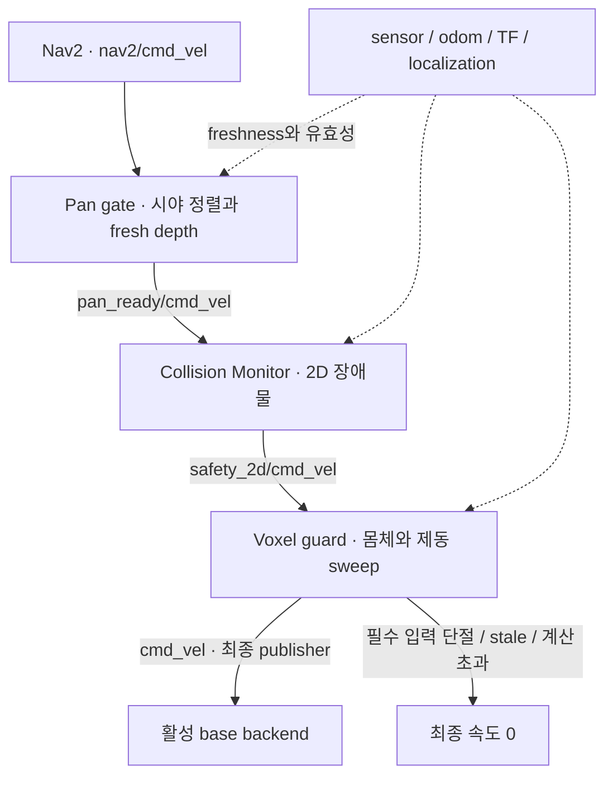

# Navigation 안전 계약

기본 full runtime은 Nav2 속도를 pan gate·Collision Monitor·voxel guard 순서로 검사한다. 모든 단계가 기본 활성화이며, 최종 cmd_vel publisher는 voxel guard 하나다. 속도는 Twist x/y/yaw를 사용한다.

## 입력과 TF

| 입력 | 계약 |
|---|---|
| scan | LaserScan, LiDAR frame, ROS stamp |
| odom | child=base_link, 측정 x/y/yaw 속도 |
| joint_states | head_pan_joint position/velocity, 유효 stamp |
| Depth image | Rectified 32FC1(m)/16UC1(mm); 0/NaN/-Inf는 관측 없음 |
| CameraInfo | Image와 동일 크기·optical frame, 유효 K/monocular P, D=0 |
| Backend TF | odom→base_link, base→LiDAR/head/optical |
| AMCL TF | map→odom |

## Depth 처리

Depth는 capture stamp의 TF로 변환한다. TF/calibration이 없으면 cloud를 발행하지 않는다. 자기 필터는 park 팔·고정 몸체·기둥을 통과하는 ray와 레일 뒤 경계 픽셀을 제거한다. 평행 ray·표면 접촉·센서가 몸체 내부인 경우도 보수적으로 판정한다.

회전 head는 정적 자기 필터 대상이 아니며 가려진 ray를 free-space로 처리하지 않는다. 기본 margin은 1 mm이며, 실물 보정 오차에 맞춘 별도 검증이 필요하다.

## Pan과 이동

Pan gate는 head_pan/command Float64를 발행하고 TF를 소유하지 않는다. Backend의 actuator adapter와 실측 feedback이 필요하다. 같은 방위각의 범위 내 위치 중 현재 pan에 가장 가까운 값을 선택하며 목표를 clipping하지 않는다.

| 설정 / 모드 | 동작 |
|---|---|
| pan_min/max_position_rad | 기본 [-π, π]; 실물 보정 한계 아님 |
| 자유 이동 | 방향 정렬 + 정렬 이후 fresh depth 확인 |
| 축 제한 | 정지·settle 추가 확인 |
| 후진 | 뒤쪽 π rad 정렬·정지 후 fresh depth; 실물 뒤쪽 시야 검증 필요 |
| allow_reverse=false | 후진 제외 |
| 기본 이동 | 전진·후진·제자리 회전; 횡이동 차단 |
| Progress checker | XY 0.15 m 또는 yaw 0.25 rad; 20초간 둘 다 없으면 실패 |

## 차단과 적용 한계

Voxel guard는 몸체 OBB와 예측 제동 sweep를 검사한다. 요청 속도가 0이어도 측정된 관성 이동은 검사한다. Pan/voxel은 steady timer를 사용해 `/clock` 중단 중에도 정지 출력을 유지한다.

| 조건 | 처리 |
|---|---|
| Pan 범위 안에 목표 방위각 없음 | PAN_TARGET_OUT_OF_RANGE, 속도 차단 |
| 필수 입력 단절·stale/future stamp·TF 누락 | 최종 속도 0 |
| Localization jump·voxel freeze·계산 초과 | 최종 속도 0 |

몸체 검사는 설정된 park posture를 가정한다. 실시간 팔 FK 감시·자세 유지는 미구현이며, 관측하지 않은 공간의 안전을 보장하지 않는다. 물리 E-stop·driver watchdog·실측 제동은 로봇 통합에서 별도 검증한다.

## Memory와 진단

Global/local costmap은 obstacle_memory/grid를 max 병합한다. Voxel을 사용하려면 memory가 필요하다. Pan/memory/voxel을 비활성화하면 그에 맞춰 속도 경로가 바뀐다.

| 항목 | 위치 / 동작 |
|---|---|
| 진단 토픽 | obstacle_memory/{grid,voxels,voxel_status}, body_guard_3d/state, head_pan/state |
| Memory service | obstacle_memory/save, obstacle_memory/set_enabled |
| output_directory | 기본 빈 값; 지정 시 로그·snapshot 기록 |
| Full runtime alias | amcl_nav2_safety.launch.py |
| 기본 Nav2 실험 | amcl_nav2.launch.py map:=... |
| 설정 | 패키지 config/의 pan_enabled/memory_enabled/voxel_enabled 등 |

관련 안내: [실행](../../../../docs/RUNNING.md), [테스트](../../../../docs/TESTING.md), [과거 근거](../../../../docs/EVIDENCE.md).
