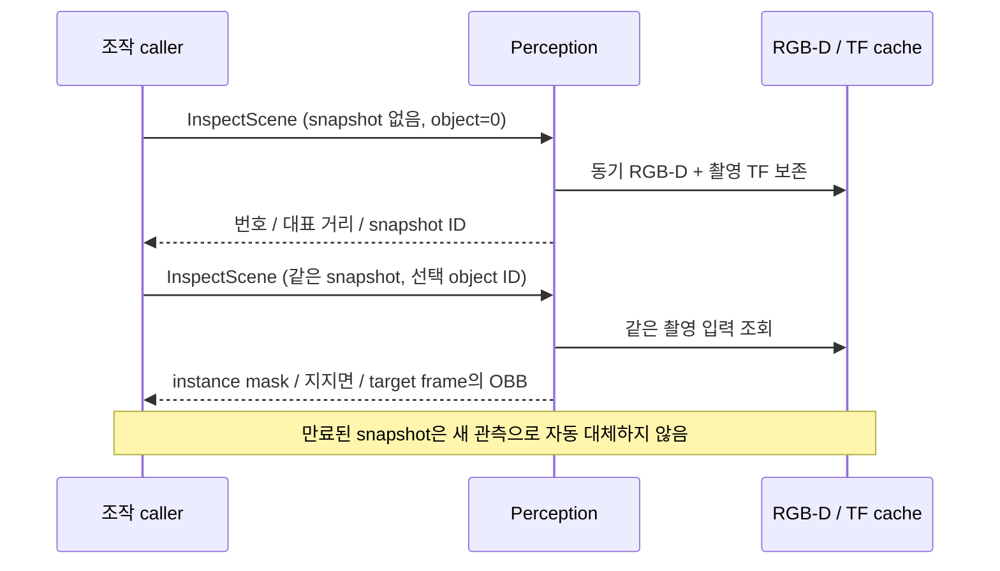
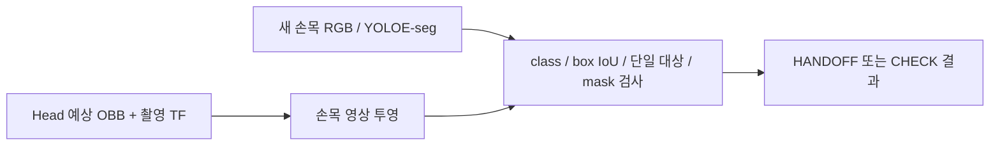
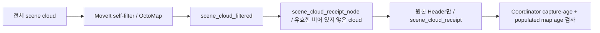
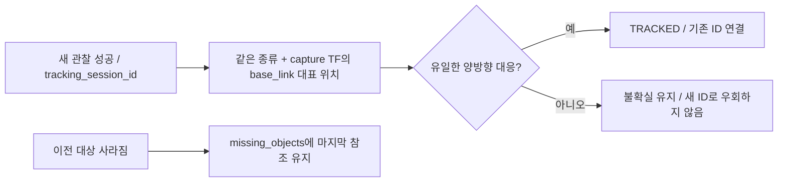
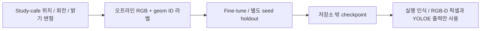

# 인식 실행과 데이터 흐름

Head RGB-D는 물체를 선택하고 3D 형상을 복원합니다. 손목 RGB는 선택된 대상의 일관성을 검사하며 새 3D 위치를 만들지 않습니다.



| 목적 | 절차 |
|---|---|
| 처음 실행 | 아래 모델 준비 → 실행 → ROS API |
| 손목 검증 | [HANDOFF / CHECK](#입력과-손목-관측) |
| 장애물 지도 입력 | [전체 Depth](#전체-depth-환경-포인트클라우드), [receipt](#필터링-점군-수신-확인) |
| 새 체크포인트 학습 | [오프라인 학습](#스터디카페-mujoco-전용-yoloe-seg-학습) |

## Decision 분류

YOLOE가 장면의 instance mask를 찾은 뒤 Decision 분류기가 같은 검출의 의미를
평가한다. 선택한 종류, 분류, 위험 판단과 검토 사유는 객체별로 연결하고, 승인
대상 재확인에서는 원래 분류를 유지한다. 종류 후보와 질문의 기본값은
[decision_prompt.yaml](../config/decision_prompt.yaml)에 있다.

| 설정 | 역할 |
|---|---|
| `gemini_model` | 분류 backend 선택 |
| `decision_prompt_file` | Decision 질문과 선택지 파일 |
| `decision_object_types` | 물체 종류 선택지 배열 |
| `yoloe_scene_duplicate_mask_iou` | 장면의 중복 mask 제거 기준 |

실행기에서 `GEMINI_MODEL`을 지정하면 YOLOE 프로파일의 모델 이름보다 우선한다.
배포 환경에서 해당 API와 모델을 사용할 수 있어야 한다. API 키는 실행 환경의
`GEMINI_API_KEY`로 전달한다.

## 모델 준비

의존성 설치는 [개발환경](../../../../docs/implementation/development-setup.md)를 따릅니다. YOLOE checkpoint와
`mobileclip2_b.ts` text encoder는 `CLEANY_MODEL_DIR` 또는 `~/models` 아래에 준비합니다.
모델은 저장소에 포함하거나 실행 중 자동 다운로드하지 않습니다.
Gemini 분류를 사용하는 `yoloe_gemini`는 `GEMINI_API_KEY` 환경변수가 필요합니다.
스터디카페 head/손목 전용 체크포인트는 아래 체크포인트 표와 학습 절를 따릅니다.

## 실행

Jetson에서는 perception을 `172.30.0.11` 전용 GPU service로 실행합니다. AnyGrasp의 고정
MAC, license와 checkpoint는 perception container에 mount하지 않습니다. 자세한 절차는
[`containers/vision`](../../../../containers/vision/README.md)을 따릅니다. 아래 명령은 native
개발환경용입니다.

```bash
source /opt/ros/humble/setup.bash
source "$(make -s print-install-base)/setup.bash"
export GEMINI_API_KEY="<your-api-key>"
ros2 launch cleany_perception inspect_scene.launch.py
```

| 입력 | 형식 |
|---|---|
| `camera/color/image_raw` + `camera/color/camera_info` | RGB8 또는 BGR8 |
| `camera/depth/image_raw` + `camera/depth/camera_info` | 32FC1은 m, 16UC1은 scale parameter 적용 |
| 네 메시지의 시간 | exact 측정 시각 |
| RGB / Depth 보정 | 동일 해상도와 intrinsics; 촬영 시각 TF 필수 |

`target_frame ← depth optical frame` TF는 Gemini 요청 전에 확보해 RGB-D/detections와 함께 cache에 저장합니다. 기본 cache는 2개 snapshot, TTL 120초입니다.


## ROS API

Action:

```text
perception/inspect_scene  cleany_interfaces/action/InspectScene
```

빈 query는 `default_query` parameter를 사용합니다. 1차 요청은 `snapshot_id=''`,
`selected_object_id=0`이며, 동시에 하나의 goal만 실행합니다. detection이 없으면 빈 2D
detection 배열로 성공합니다. 2차 요청은 1차 결과의 두 값을 함께 전달합니다.

```bash
ros2 action list
ros2 action info /perception/inspect_scene
ros2 action send_goal \
  /perception/inspect_scene \
  cleany_interfaces/action/InspectScene \
  "{query: 'Detect objects on the table.', snapshot_id: '', selected_object_id: 0}" \
  --feedback
```

2차 요청 예시:

```bash
ros2 action send_goal \
  /perception/inspect_scene \
  cleany_interfaces/action/InspectScene \
  "{query: '', snapshot_id: 'rgbd-...', selected_object_id: 2}" \
  --feedback
```

성공 시 같은 snapshot을 다음 topic에도 발행합니다.

- `perception/detections_2d`: 번호가 부여된 `DetectedObject2DArray`
- `perception/objects`: 후속 선택 단계에서 사용할 `DetectedObject3DArray` topic

| 색상 fixture | 경계 |
|---|---|
| 선택 | detector_type=simulation_color, segmenter_type=simulation_color |
| 계산 | 렌더링 RGB의 빨강 / 파랑 픽셀로 bbox와 mask 생성 |
| 3D | 운영 경로와 같은 depth / CameraInfo / 촬영 TF; pose나 합성 점 주입 없음 |
| 용도 | 시뮬레이션 통합 검증 전용, 실제 배포 인식 대체물 아님 |

```bash
ros2 topic echo /perception/detections_2d --once
ros2 topic echo /perception/debug_image_latched --once --field encoding \
  --qos-reliability reliable --qos-durability transient_local
```

### System Supervisor readiness

`perception_inspector`는 `health_topic`(기본 `system/component_health`, 빈 값이면 끔)에
`health_period_seconds`(0.2초)마다 `source=perception` ComponentHealth를 발행합니다.

| 상태 | 조건 |
|---|---|
| UNKNOWN | 지연 로딩 모델이 아직 로드되지 않음(`preload_models:=true`일 때만 readiness 보고), 또는 RGB-D 동기 snapshot 미수신 |
| UNAVAILABLE | 최신 동기 RGB-D snapshot이 `health_maximum_rgbd_age_seconds`(1.0초)보다 오래됨 |
| AVAILABLE | 모델 준비 + fresh 동기 RGB-D |

camera 좌표계 수신만으로 준비를 선언하지 않습니다. Gemini 등 원격 classifier 접근 가능성은
여기서 확인하지 않으며 요청별 `ERROR_DETECTOR_API`로 보고됩니다.

## 거리 순서와 실패 처리

| 결과 | 처리 |
|---|---|
| 유효 depth | bbox 중앙 유효 depth 중앙값 → 촬영 TF → target 원점까지 거리 |
| 정렬 | 거리 오름차순, confidence 내림차순, detector 원본 순서 |
| depth 부족 | `distance_valid=false`로 뒤에 배치; 자동 조작에서 제외 |
| snapshot 만료 / 누락 | 선택 복원 불가; TTL이나 촬영 시각을 갱신하지 않음 |
| 1차 검출 없음 | 빈 detection 배열로 성공; 물리 작업 완료 의미는 아님 |

`nearest_object_central_bbox_fraction`과 `nearest_object_minimum_depth_pixels`가 배경 혼입과 depth hole을 제한합니다. Snapshot ID는 opaque key입니다.

## 기존 snapshot 조회

`/perception/get_scene_snapshot` (`cleany_interfaces/srv/GetSceneSnapshot`)은
`snapshot_id`의 캐시된 2D 관측을 읽습니다. `found`, `detections`, `message`를 반환하고,
TTL과 촬영 시각을 갱신하거나 새 모델 추론을 시작하지 않습니다. 누락/만료는 `found=false`입니다.
동일 cache를 `InspectScene` 선택 물체 복원에서도 사용합니다.

## 입력과 손목 관측

<figure class="visual-slot" data-visual-id="perception-snapshot">
<p><strong>시각자료 자리 · 비워 둠</strong></p>
<figcaption><strong>필요한 자료:</strong> 같은 capture stamp와 snapshot의 RGB, segmentation, OBB와 유효 depth 점군 비교.<br><strong>빈 이유:</strong> 기존 이미지를 동일 관측의 mask·depth·모델 설정과 연결할 근거가 부족합니다.</figcaption>
</figure>

`depth_scene_node`의 Depth/CameraInfo 구독은 best-effort KEEP_LAST(1)입니다.
부하가 높을 때 과거 입력을 순차 처리하지 않고 최신 수신 프레임을 사용합니다.
촬영 측정 시각와 `maximum_depth_age_sec` 검사는 유지하며 오래된 Depth를
현재 시각으로 재표기하지 않습니다.

`enable_wrist_observation=true`는 `/perception/observe_wrist_target`를 추가합니다. `yoloe_gemini` + `yoloe_seg` 모드에서는 손목 RGB를 YOLOE-seg로 검증합니다.

| 단계 / 카메라 | 모델 parameter |
|---|---|
| 왼손목 HANDOFF | `wrist_yoloe_model_path` |
| 오른손목 HANDOFF | `wrist_right_yoloe_model_path` |
| 왼손목 CHECK | `wrist_check_yoloe_model_path` |
| 왼손목 마우스 CHECK | `wrist_mouse_check_yoloe_model_path` |
| 오른손목 CHECK | `wrist_right_check_yoloe_model_path` |

빈 경로는 앞 단계 모델을 공유합니다. 모델을 분리하면 메모리도 추가로 사용합니다. 별도 오른손목 CHECK 모델의 클래스 기준은 `wrist_right_check_yoloe_class_confidence_thresholds`이며 빈 목록은 head 기준입니다. Study-cafe 프로필의 오른손목 컵 CHECK 기준은 0.08입니다.



각 시점의 새 영상을 독립 검출합니다. 연속 추적은 하지 않으며 같은 위치·mask의 중복 예측만 하나로 취급합니다. 클래스는 Gemini 상세 label에 포함된 YOLOE 클래스를 사용합니다.

추가 검사도 클래스, 투영 box와 mask 조건을 모두 통과해야 합니다. 정상 검출이면 추가 추론하지 않습니다.

| 손목 관측 보존 | 정책 |
|---|---|
| 실패 영상 | wrist_failure_image_directory 지정 시 예상 대상 미검출 좌표계만 PNG; 기본 빈 값은 저장 안 함 |
| 이력 | HANDOFF 뒤 RGB / mask 이력 미보존 |
| 측정 범위 | RGB-only, 새 3D 위치나 독립 객체 ID 미산출 |
| 모델 메모리 | 별도 checkpoint마다 추가 사용 |

손목 RGB와 CameraInfo는 exact 측정 시각로 짝지어 처리합니다. 촬영 시점 TF,
보정값, source/reference ID와 mask 검증 실패는 성공으로 처리하지 않습니다.
`wrist_*` 매개변수로 freshness/TTL, confidence, 투영 시야와 mask 면적 한계를 설정합니다.
HANDOFF와 CHECK는 `after_stamp_ns`보다 새로운 촬영 영상을 요구합니다.

| `ObserveWristTarget` 상태 | 의미 / 후속 처리 |
|---|---|
| `OK` | 클래스, 투영 box, mask 및 참조 검사 통과 |
| `NOT_DETECTED`, `success=false` | 정상 새 프레임에 대응 후보 없음. CHECK도 촬영 시각과 reference/source ID 반환 |
| `ERROR` | 센서/TF/모델 오류, 모호한 후보, 잘못된 mask/confidence. 미검출로 숨기지 않음 |

이미 사용한 CHECK 프레임은 재사용할 수 없습니다. 새 프레임 재시도와 그리퍼 feedback을 통한 진행 여부는 Skill Executor가 결정합니다.


## 전체 depth 환경 포인트클라우드

`depth_scene_node`는 검출 bbox나 SAM mask와 무관하게 전체 depth를
`/perception/scene_cloud` (`PointCloud2`, XYZ, 원본 optical frame/stamp)로
투영합니다. 환경 물체 pose, 크기, MuJoCo mesh/정답 상태는 읽지 않습니다.
설정은 `config/depth_scene.yaml`입니다.

| 항목 | 기본값 / 거부 조건 |
|---|---|
| 거리 / 샘플링 / 주기 | 0.1–2.0 m / stride 2 / 2 Hz |
| Depth 시각 | 1초 초과 또는 미래 시각이면 발행하지 않음 |
| 32FC1 / 16UC1 | m / `depth_16u_scale_m` 기본 0.001 |
| 무효 depth | 0, NaN, Inf를 표면이나 빈 공간으로 채우지 않음 |

cloud 구독자가 없으면 depth 투영 자체를 건너뛰며, 구독자가 생기면 다음 새 depth부터 발행합니다.
현재 정렬 실행에서는 MoveIt의 OctoMap 최신성 검증 때문에 장면 cloud를 계속 갱신합니다.
작업 단계별 생성 중단은 최신성 계약과 함께 재설계해야 하므로 적용하지 않았습니다.

| Depth 입력 | 요구 조건 |
|---|---|
| 영상 / 보정 | 정류 depth와 대응 CameraInfo; RGB 정렬 depth면 RGB optical 좌표계 / intrinsics |
| 거부 | 잔여 왜곡, 좌표계 / 해상도 불일치 |
| 형식 | 32FC1 m, 16UC1은 depth_16u_scale_m 기본 0.001; endian / row padding 처리 |
| CameraInfo 재사용 | 같은 보정 / 해상도 유지 전제 |

```bash
ros2 run cleany_perception depth_scene_node --ros-args \
  --params-file ros2_ws/src/cleany_perception/config/depth_scene.yaml \
  -p depth_image_topic:=/camera/depth/image_rect_raw \
  -p depth_info_topic:=/camera/depth/camera_info
```

이 출력은 RViz 표시와 MoveIt occupancy updater 입력용입니다. 로봇 자체
표면 제거는 MoveIt의 URDF/TF 기반 self-filter가 담당합니다. 검출되지 않은
물체도 depth가 관측되면 포함되지만, 가려진 표면은 복원하지 않습니다.

## 필터링 점군 수신 확인



| 계약 | 값 / 처리 |
|---|---|
| 입력 | /perception/scene_cloud_filtered, 기본 BEST_EFFORT depth 1 |
| 출력 | /perception/scene_cloud_receipt, std_msgs/Header, RELIABLE depth 1 |
| 시각 | 원본 capture stamp; 현재 시각 교체 / timer 재발행 없음 |
| 손실 / 중단 | Receipt도 중단 |
| 이름 설정 | filtered_cloud_topic / receipt_topic |
| 역할 | Coordinator에서 큰 점군 복사 분리; 좌표 / 지도 / mapper 입력은 유지 |
| 한계 | Receipt만으로 지도 갱신 / 안전 보장 안 함; 기존 capture-age와 populated-map 수신-age 필요 |

센서 전용 파이프라인 launch가 함께 시작합니다.

## 고정 베이스 책상 물체 추적



| 항목 | 기준 |
|---|---|
| 반환 | position_valid / track_id / tracking_state; RGB header와 representative_frame 구분 |
| 불확실 | 모호한 위치, 큰 이동, 깊이 실패; 최초 불확실 대상은 빈 track ID 가능 |
| 빈 장면 | 이전 불확실 대상을 없던 것으로 만들지 않음 |
| 위치 / 후보 차이 | inspect_scene.yaml: 3 cm / 1 cm |
| 세션 | 최대 32, TTL 600 s; 재생성 / 만료마다 epoch 변경 |
| Alias | 컵 별칭→cup, computer/wireless mouse→mouse, lego brick 유지; 종류만 연결하며 분류 결정 안 함 |
| 베이스 이동 | 호출자가 새 세션 시작 |
| TF 실패 / 취소 | 추적 갱신 안 함 |
| Cache 조회 / 선택 복원 | 저장 ID / epoch / TTL 유지 |
| 빈 session | UNTRACKED |

수치와 alias는 조정 가능한 시뮬레이션 초기값이며 실물 기준이 아닙니다.

## YOLOE-seg 공통 실행 프로필

| 프로필 / 옵션 | 동작 |
|---|---|
| config/yoloe_seg.yaml | 로컬 YOLOE instance mask로 선택 객체 분할 |
| config/yoloe_seg_gemini.yaml | 같은 mask + Gemini label/category/reason; learned_rgbd.launch.py 기본 |
| `model_profile:=<yaml>` | 명시적 프로필 선택 |
| enable_wrist_observation:=true | 손목 HANDOFF / CHECK 활성 |
| preload_models=true | 로컬 파일 / 장치 검사, Action 공개 전 모델 준비 |
| 로딩 실패 | 다른 detector나 색상 fixture로 자동 대체 안 함 |

```bash
ros2 launch cleany_perception learned_rgbd.launch.py \
  model_directory:=/models device:=cuda:0 use_sim_time:=true
```

카메라와 로봇 driver는 별도로 실행합니다. 기본 입력은 `/camera/color/image_raw`,
`/camera/color/camera_info`, `/camera/aligned_depth_to_color/image_raw`이며
RGB-D와 CameraInfo의 크기·좌표계·intrinsics·exact 측정 시각 계약이 필요합니다.
`auto`는 CUDA/CPU를 선택하고 명시한 CUDA를 사용할 수 없으면 실패합니다.

## 모델 로딩 로그

기본 `INFO` 출력은 모델 로딩 시작과 준비 완료·사용 장치를 알립니다.
개별 detector 로딩과 모델·text encoder 경로는 `DEBUG`에서 확인합니다.
MuJoCo 수거·BT launch에서는 `log_level:=debug`, 단독 노드 실행에서는
`--ros-args --log-level perception_inspector:=debug`로 상세 로그를 켭니다.

깊이 점군과 receipt 노드는 ROS context 종료에 따른 executor 중단과 점군 변환
중단을 정상 종료로 처리합니다. ROS가 실행 중일 때의 `RuntimeError`는 다시
발생시켜 실제 변환 실패가 숨겨지지 않게 합니다.

## 검증

```bash
source /opt/ros/humble/setup.bash
cd ros2_ws
colcon build --symlink-install --packages-up-to cleany_perception
source install/setup.bash
python3 -m pytest -q src/cleany_perception/test
python3 -m flake8 src/cleany_perception
colcon test --packages-select cleany_perception
colcon test-result --verbose
```

## 스터디카페 MuJoCo 전용 YOLOE-seg 학습



`tools/study_cafe_yoloe_dataset.py`는 현재 장면 전용 학습 데이터를 만듭니다. MuJoCo segmentation geom ID는 오프라인 라벨에만 쓰며 실행 인식은 geom ID나 정답 pose를 읽지 않습니다. 생성 데이터와 모델은 외부 모델 디렉터리에 둡니다.

| 생성 단계 | 옵션 / 산출물 |
|---|---|
| head 영상 | 물체 위치·회전·밝기 변형 → RGB와 geom ID 기반 offline mask |
| 손목 영상 | `--camera left_wrist_rgb` 또는 `right_wrist_rgb`, `--joint-positions-json` |
| 일부만 보이는 장면 | `--allow-partial-objects`; 보이는 물체만 라벨링 |
| 파지 후 장면 | `--attached-object lego --attachment-site left_grasp_tcp`, `--attachment-jitter-m` |
| 데이터 결합 | `combine_study_cafe_yoloe_datasets.py --source head=... --source left_wrist=... --source right_wrist=...`; 클래스 순서 확인 후 symlink |
| 평가 | 학습과 다른 seed의 holdout, head/양손목 각각 평가; 생성 자세 밖 성능 별도 |

```bash
source /opt/ros/humble/setup.bash
source "$(make -s print-install-base)/setup.bash"
export MUJOCO_GL=egl
export OMP_NUM_THREADS=4 MKL_NUM_THREADS=4 OPENBLAS_NUM_THREADS=4
python3 ros2_ws/src/cleany_perception/tools/study_cafe_yoloe_dataset.py \
  --output ~/models/yoloe/study_cafe_sim_v1_dataset \
  --train-count 64 --val-count 16
python3 ros2_ws/src/cleany_perception/tools/finetune_study_cafe_yoloe.py \
  --dataset ~/models/yoloe/study_cafe_sim_v1_dataset/dataset.yaml \
  --checkpoint ~/models/yoloe/yoloe-26s-seg.pt \
  --text-encoder-directory ~/models/yoloe \
  --project ~/models/yoloe/study_cafe_sim_v1_training \
  --epochs 8 --batch 4 --device cpu
python3 ros2_ws/src/cleany_perception/tools/evaluate_study_cafe_yoloe.py \
  --dataset ~/models/yoloe/study_cafe_sim_v1_dataset/dataset.yaml \
  --checkpoint ~/models/yoloe/study_cafe_sim_v1_training/fit/weights/best.pt \
  --text-encoder-directory ~/models/yoloe \
  --confidence 0.08 --class-thresholds 0.25 0.25 0.25 0.08
cp ~/models/yoloe/study_cafe_sim_v1_training/fit/weights/best.pt \
  ~/models/yoloe/study_cafe_sim_yoloe26s_seg.pt
```

| 기준 | 값 / 해석 |
|---|---|
| YOLOE 추론 최소 confidence | 0.08 |
| 클래스 순서 / 문턱값 | 컵, 마우스, 휴지, 레고 / 0.25, 0.25, 0.25, 0.08 |
| 문턱값 적용 위치 | 모델 출력 뒤, Gemini 분류 전 |
| mask 평가 | IoU 0.5, holdout의 일치 수와 미일치 검출 수를 함께 보고 |
| 성능 범위 | 같은 시뮬레이터의 새로운 배치; 실제 카메라/물리 파지 성공률 아님 |

모델의 클래스 순서를 바꾸면 `yoloe_class_confidence_thresholds` 순서도 맞춥니다. 학습 점수나 한 장의 검출 성공을 런타임 성공으로 해석하지 않습니다.


## Gemini 분류 메타데이터

Gemini structured response에 `sorting_category`(trash/lost_item/review),
`sorting_reason`을 추가해 `DetectedObject2D`까지 보존합니다. 기존 bbox만 있는
응답은 파싱 가능하지만 category는 빈 값이며 sorting 실행에서 검토 대상으로
처리합니다. 위험하거나 용도가 불확실한 물체는 review를 요청합니다. 소유권 판단은
확정 사실이 아니며 현재 정책은 감독하의 시뮬레이션 검증용입니다.

- [Technical Overview](../../../../docs/cleany-docs/20_TECHNICAL/00%20-%20Technical%20Overview.md)
- [Safety and Risk](../../../../docs/cleany-docs/20_TECHNICAL/08%20-%20Safety%20and%20Risk.md)

## 모델 재사용과 입력 처리

TensorRT 엔진은 프로파일의 클래스 순서와 해시를 검사한 뒤 로드합니다.
같은 모델 경로의 어댑터는 모델 풀을 공유하고 추론 호출을 직렬화합니다.
Gemini 요청은 JPEG를 사용하며 종류명 별칭을 정규화합니다. 분류 사유는 기존
수거 소비자와의 호환성을 위해 계속 요청하고 전달합니다.

Gemini 응답을 기다리는 동안 깊이 기하를 계산하고, 동일 snapshot의 선택 복원에서
지지면과 크기 계산을 재사용합니다. 캐시는 snapshot TTL과 함께 정리됩니다.
`rgbd_qos_reliability`는 `best_effort` 또는 `reliable`이며 각 입력 콜백은
별도 그룹을 사용합니다. 모델, 스레드 및 QoS 설정은 실행 환경에서 검증해야 합니다.

새 서비스와 검출 필드는 [인식 인터페이스](interfaces.md)를 따릅니다.

### 비식별화 모델 준비

YOLOE 프롬프트와 체크포인트 해시는 [privacy lock](../../../../configs/models/yoloe-26s-seg-privacy.lock.json)에 있다. 기존 [TensorRT 내보내기 도구](../../../../tools/yoloe_trt.py)에 이 lock과 `config/yoloe_privacy.yaml`을 지정한다. 작업용 real53 엔진과 별도로 생성한 결과를 `privacy.engine`으로 배치한다.

보조 모델의 출처와 검증할 SHA-256은 [보조 모델 lock](../../../../configs/models/camera-privacy-aux.lock.json)에 있다. YuNet은 ONNX를 그대로 사용한다. 글자 검출 ONNX는 같은 Jetson의 `trtexec`에 lock의 인수와 `--onnx=text.onnx --saveEngine=text.plan`을 전달해 변환한다. 노트북 CPU 검증에는 `--text text.onnx`를 사용한다.

연속 영상은 시작 시점, 역행 타임스탬프 또는 0.48초 이상의 입력 단절 뒤 첫 프레임을 추적 초기화에만 사용한다. 사진은 각 검출기를 독립 실행한다. 재생 도구는 구간 앞에 입력이 있으면 한 장을 먼저 읽고, 전송을 보류한 프레임 수를 JSON에 기록한다.

기본 모드에서 Gemini를 쓰는 인식 프로세스는 첫 이미지 요청에서 비식별 모델을 로드한다. 기본 번들은 `/var/opt/cleany/models/camera-privacy/active`이며 엔진과 함께 클래스 구성을 담은 `profile.yaml`이 필요하다. 프리뷰와 같은 GPU 잠금을 사용한다.

시연에서 원본 맥락을 보내려면 `cleany-perception.service`의 systemd 사용자 drop-in에 다음 설정을 두고 해당 서비스만 재시작한다. 비식별 전송으로 복귀하려면 값을 `redacted`로 바꾸고 재시작한다.

```ini
[Service]
Environment=CLEANY_GEMINI_IMAGE_MODE=original
```
