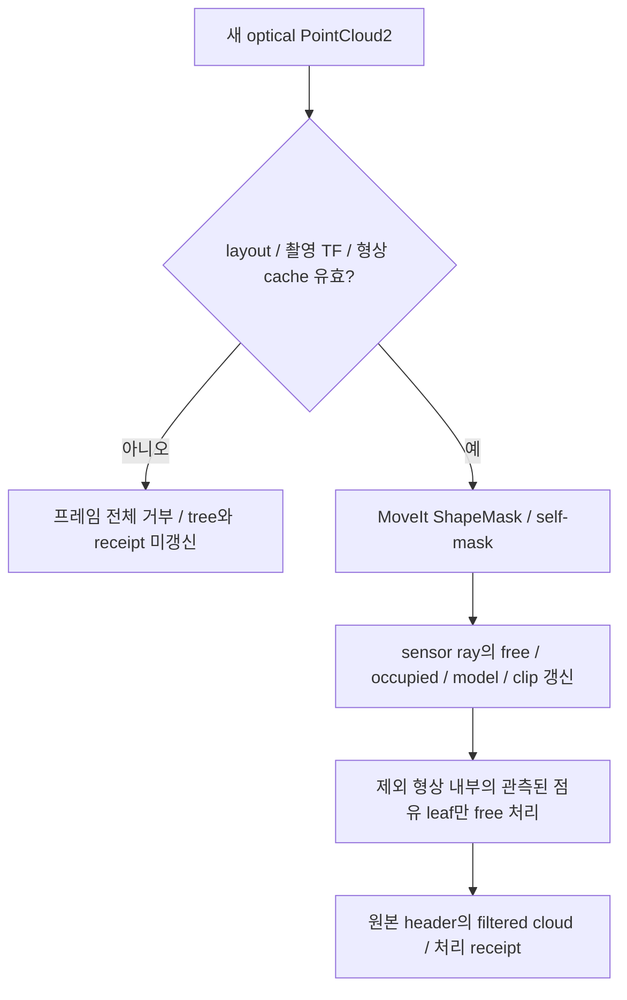
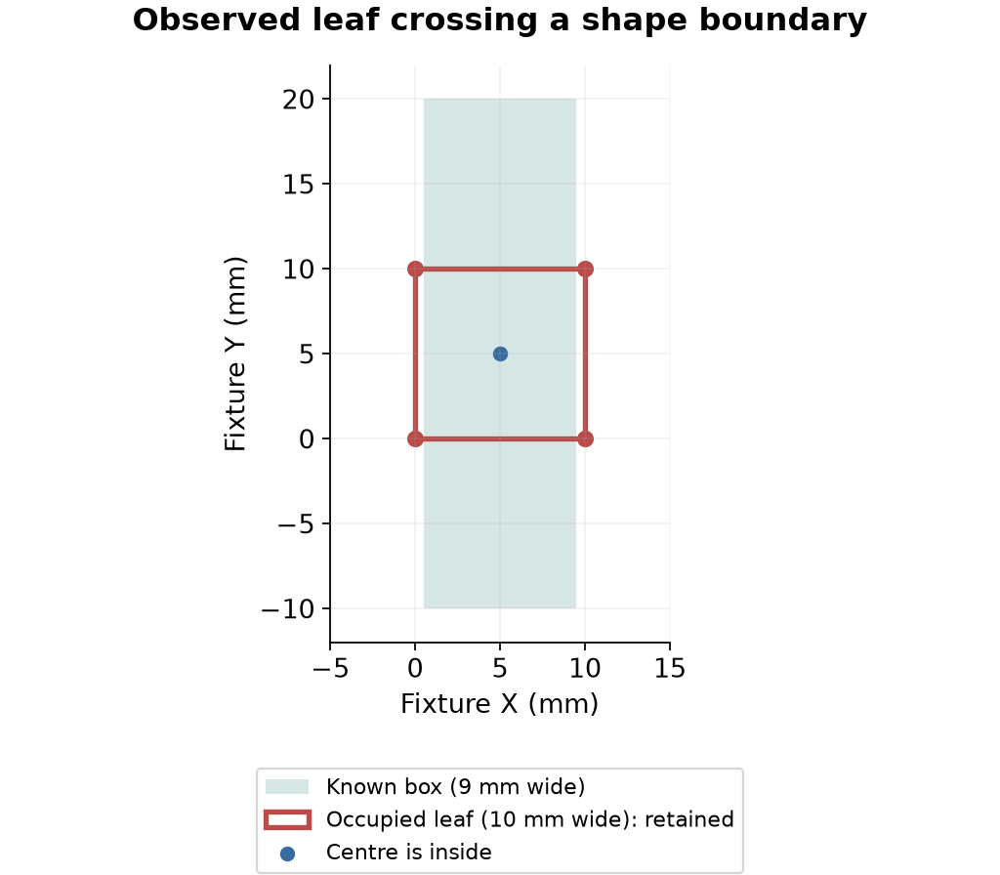
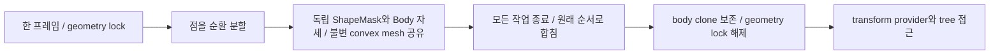

# 센서 기반 MoveIt OctoMap 갱신

MuJoCo sorting은 `cleany_scene_mapping/KnownGeometryOctomapUpdater`를 기본으로 사용합니다. 실물과 다른 모드는 기존 updater를 유지하며 `depth_octomap_plugin`으로 명시 선택합니다. 실물 충돌 안전을 검증한 기능은 아닙니다.



## 제거하는 셀과 남기는 셀

형상의 출처는 URDF, 관측 target mesh/OBB, 명시 등록한 수거함입니다. MuJoCo GT나 물체 정답 위치는 읽지 않으며 Planning Scene의 충돌 형상도 삭제하지 않습니다.

| 셀 | 처리 |
|---|---|
| 하나의 convex body 안에 8개 모서리가 모두 포함된 관측 점유 leaf | 점유 갱신 **후** free 처리 |
| 일부만 겹친 셀 | 유지 |
| 여러 형상 사이의 틈 / 바깥 장애물 | 유지 |
| 아직 관측하지 않은 셀 | 비우지 않음 |
| 형상 / TF cache 하나라도 무효 또는 조회 중 세대 변경 | self-mask부터 발행까지 프레임 전체 거부 |

| 형상 검사 | 적용 방식 |
|---|---|
| 점군 self-mask | Upstream ShapeMask 판정 유지 |
| 내부 mesh 정리 | Convex face를 법선 방향 `padding_offset`만큼 확장하고 확장 local bounding box로 제한 |
| `padding_scale` | Hull vertex 평균 중심으로 적용 |
| Primitive | 기존 내부 판정 유지 |
| TF | 점군 촬영 시점의 cache |

가려진 내부 잔상 정리가 목적입니다. 로봇·OBB·TF가 잘못되면 실제 장애물을 잘못 제외할 수 있으며 인식 오류를 보완하는 안전 보장은 아닙니다.

<figure class="contract-figure" data-visual-id="octomap-cells">

<figcaption>기존 C++ 검사 fixture의 z=5 mm 단면입니다. 10 mm 점유 셀(빨강)의 중심은 9 mm 폭의 알려진 형상(녹색) 안에 있지만 모서리는 밖에 있어 셀을 유지합니다. 실제 구현은 3D의 8개 모서리를 모두 검사합니다. <a href="../../../docs/assets/visuals/generated.json">입력과 출처</a></figcaption>
</figure>

## 설정

| 설정 | 기본 / 범위 | 동작 |
|---|---|---|
| `depth_cloud.known_geometry_clear_max_leaves` | 200,000 | Free 셀도 포함한 메시지당 추가 검사 예산; 초과 시 나머지는 유지하고 경고 |
| `depth_cloud.mask_workers` | 4 / 1–4 | 1은 분할 없이 원래 ShapeMask 호출 |
| 빌드 유형 | 미지정 시 `RelWithDebInfo` | CPU 경로이므로 무최적화 Debug 시간과 구분 |
| `padding_scale` / `padding_offset` | 표준 updater와 공유 | 관측 형상 여유 |

추가 leaf 검사 예산은 정상 프레임 raycast를 제한하지 않습니다. 작업자 수 증가는 전체 CPU 작업량이나 메모리 감소를 보장하지 않습니다.

### 작업자와 프레임 직렬화



| 수명 / 오류 | 계약 |
|---|---|
| 기본 4 workers | 호출 스레드 1 + 상주 스레드 3; 프레임 사이 condition variable 대기 |
| 버퍼 | 최대 프레임 크기의 분할 / 판정 용량 재사용; 원본 복사는 유지 |
| Mesh | 원본 hull 한 번 계산, `Body::cloneAt`으로 불변 계산 결과 공유 |
| 형상 변경 | 모든 worker 종료까지 직렬화; 형상 등록 중 worker 수 변경 거부 |
| Worker / 호출 예외 | 나머지 작업 완료를 기다린 뒤 전달; 부분 판정 반환 안 함, 다음 프레임 복구 가능 |
| 재설정 / 종료 | 스레드 종료와 버퍼 해제 |
| Lock 순서 | Callback mutex로 프레임 직렬화; transform provider / tree 접근 중 geometry mutex 미보유 |

점군 밀도, mesh, padding과 내부/외부 판정은 작업자 수와 무관해야 합니다. 버퍼 재사용이 RSS 감소를 뜻하지는 않습니다.

## 프레임 처리 계약

| 항목 | 수락 / 처리 조건 |
|---|---|
| Layout | Little-endian FLOAT32 XYZ, offset 0/4/8, packed row, 완전한 data buffer |
| 카메라 원점 | Shape mask는 optical 좌표계 0; raycast에서만 촬영 시각 map-좌표계 위치로 변환 |
| TF 대기 | 누락 프레임 거부 후 다음 새 프레임 사용; 대기 queue / 재발행 / 측정 시각 수정 없음 |
| Filtered cloud | 원본 header 유지, BEST_EFFORT SensorDataQoS |
| History | 입력 / 출력 `KEEP_LAST(1)`; 처리 중 밀린 입력은 가장 최근 촬영본 선택 |
| 실행 중 프레임 | 중간 취소나 측정 시각 재작성 없음 |
| 최신성 판정 | Coordinator의 기존 capture / receipt 허용 기준 유지 |

Plugin은 `OccupancyMapUpdater`로 프레임 콜백 전체를 소유합니다. 거부된 프레임은 tree, filtered cloud와 처리 완료 receipt를 갱신하지 않습니다.

## 빌드와 검증

```bash
scene_build_root="${XDG_CACHE_HOME:-$HOME/.cache}/cleany/builds/$(basename "$PWD")"
make test CLEANY_BUILD_ROOT="$scene_build_root"
# 저장된 fixture를 사용한 비구동 비교
source /opt/ros/humble/setup.bash
source "$scene_build_root/install/setup.bash"
"$scene_build_root/build/cleany_scene_mapping/profile_mask" /absolute/path/to/mask_fixture
```

저장소 루트에서 실행합니다. `make test`는 전체 workspace를 빌드하고 검사하며, `profile_mask`는 저장된 fixture 디렉터리를 인자로 받는 build 산출물입니다.

| 검사 | 입력 / 확인 범위 |
|---|---|
| Robot-only 프로필 | `robot.urdf`, `raw.cdr` PointCloud2, `fk.cdr` GetPositionFK response; cloud-좌표계 collision link pose |
| 작업자 동등성 | Serial / 2 / 4 worker의 점별 결과 완전 일치, 부품별 내부 판정 / clone 시간 |
| Core gtest | 내부 / 외부 / 경계 / 분리 형상 / 회전 / 가변 leaf / 예산 / TF 누락 |
| Mesh padding | Box primitive와 scale / 회전 / local offset / capture-time clone 비교 |
| Frame integration | World / attached 형상 누락과 세대 변경 거부, 정상 지도 통합과 주변 장애물 보존 |
| 점군 / 실행 | 원점, layout, range clipping, stop/start, 동시 콜백, 지연 뒤 최신 프레임 선택 |
| Worker 수명 | 재사용 / 재설정, 프레임 크기와 XYZ/XYZRGB 변경, 예외 뒤 전체 종료와 복구 |

Profile에는 world/attached body가 포함되지 않습니다. 이 수치는 실제 이동 지연, Jetson 성능 또는 파지·운반 성공을 대신하지 않습니다. 의존성 설치는 [개발환경](../../../docs/implementation/development-setup.md)을 따릅니다.

## 로그 수준

| 로그 | 의미 |
|---|---|
| 기본 출력 | 준비 완료, 실패, TF cache 누락, 검사 예산 초과 |
| `move_group.scene_mapping` DEBUG | 정상 프레임 입장 / 종료, `Consistent depth frame`, 정리 수 / 검사 수 / 소요 시간 |
| 활성화 | 상위 MuJoCo 또는 standalone MoveIt의 `log_level:=debug` |
| 시간 구간 | Transform/cache, mask/snapshot, raycast, tree 갱신, receipt 발행의 wall time |
| 신선도 | 입력 / 출력 ROS capture age; wall time과 구분 |
| 추가 콜백 진단 | Steady clock 기준 초당 최대 1회, capture stamp / 노드 ROS 시각 / 마지막 갱신 / 종료 stage |

종료 stage 예시는 `ros_clock_rate_limit`, `transform_cache`, `map_transform`, `shape_mask`, `tree_update`, `integrated`입니다. Lock 대기도 구간 시간에 포함됩니다. Throttled 로그는 전체 trace가 아니므로 입력 토픽 관측과 함께 읽어야 upstream 단절과 executor 지연을 구분할 수 있습니다.

구현 기준: [MoveIt 2.5.9 updater](https://github.com/moveit/moveit2/blob/2.5.9/moveit_ros/perception/pointcloud_octomap_updater/src/pointcloud_octomap_updater.cpp), [transform cache provider](https://github.com/moveit/moveit2/blob/2.5.9/moveit_ros/planning/planning_scene_monitor/src/planning_scene_monitor.cpp).
