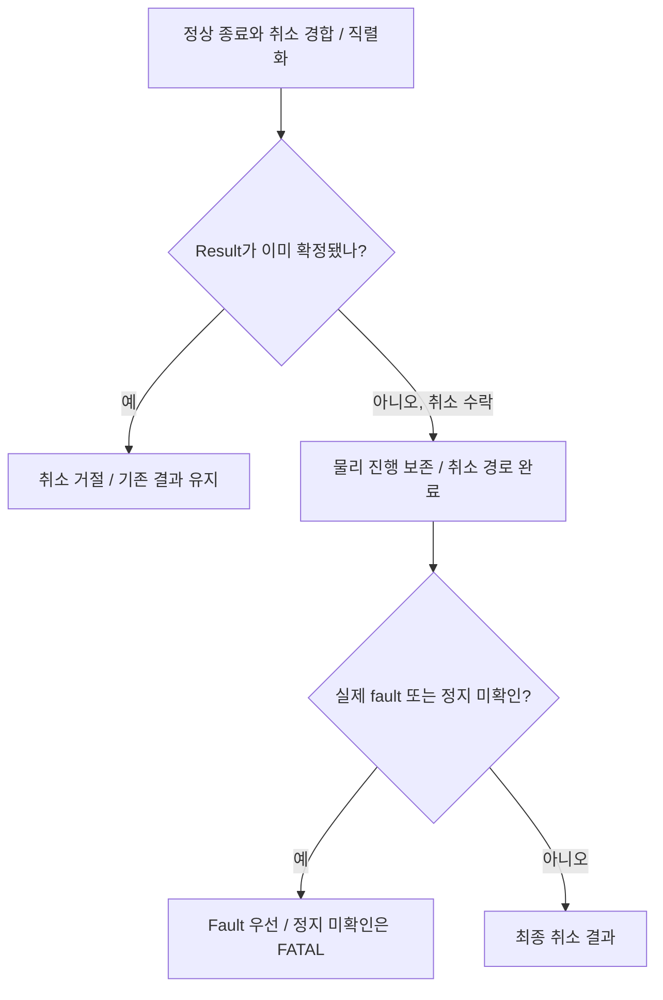

# 02. Manipulation Action 인터페이스 명세

> **Mock·MuJoCo 공통 Action 계약.** 실제 필드는 [ExecuteManipulationSkill.action](../../cleany_interfaces/action/ExecuteManipulationSkill.action)을 따른다.
> 실물 backend와 Mission Manager의 외부 승인·연동 계약은 후속 구현 대상이다.

| 서버 | namespace / `execution_profile` | 실행·설정 안내 |
|---|---|---|
| Python 모의 서버 | `/mock` / `mock` | [Mock 사용법](manipulation_mock_usage.md) |
| native BT MuJoCo 서버 | `/sim` / `mujoco` | [BT 서버 README](../../cleany_manipulation_bt/README.md) |

이 문서는 공통 필드와 결과 의미를 관리한다. backend별 물리 확인 방식은 각 실행 안내를 따른다.

## 1. Goal 하나가 하는 일

**지원 행동은 `collect_trash`와 `collect_lost_item`이다.** 호출자가 승인한 물체
하나를 지정 수거함에 옮기고 결과를 확인한다. 접근, 집기와 운반은 서버 내부 단계다.
다음 물체를 제안하려면 이번 행동 결과와 새 Scene이 필요하다.

| 범위 | 처리 |
|---|---|
| 승인된 쓰레기 후보 하나 수거 | `collect_trash` |
| 승인된 분실물 하나의 전용 탑재 보관함 보관 | `collect_lost_item`. 사용자 요청으로 구현하며 KB의 MVP 범위 불일치는 별도 기록 |
| 책상 전체 반복 | Mission Manager와 Planner의 책임 |
| 인식만 수행 | 독립 Perception interface 사용 |

모델 분류–skill–목적지는 각각 검사한다. 두 분류의 수거 동작은 공통 BT를 사용하고
책상 반복과 재관찰은 호출자가 담당한다. staging과 handoff는 이 계약에 추가하지 않는다.

## 2. Goal: 무엇을 실행할지

| 필드 | 타입 | 쉽게 설명하면 | 예시 |
|---|---|---|---|
| `mission_id` | `string` | 어떤 미션인가 | `mission-001` |
| `task_id` | `string` | 어떤 승인된 행동인가 | `task-003` |
| `execution_id` | `string` | 이번 실행 시도의 고유 번호 | UUID |
| `skill_name` | `string` | 승인된 행동 이름 | `collect_trash` 또는 `collect_lost_item` |
| `snapshot_id` | `string` | 대상이 확인된 관찰 | `snapshot-010` |
| `object_id` | `uint32` | 그 관찰 안의 물체 번호 | `3` |
| `destination_id` | `string` | 설정에 등록된 수거 목적지 | Mock: `mock_trash_bin`, MuJoCo: `trash_right` |

`object_id`는 snapshot마다 다시 붙을 수 있다. `(snapshot_id, object_id)`로 조회하며
다음 관찰의 3번이 같은 물체라고 가정하지 않는다. 목적지 ID는 해당 서버의 설정과 일치해야 한다.
`work_area_id`는 이번 Goal에 넣지 않는다. 좌석과 접근 위치는 미션 및 Navigator 계약,
물리 workspace는 서버 설정과 backend가 검사한다.

### 식별자와 승인

- 미션 식별자는 기존 값을 전달하고 task는 승인된 proposal에 연결한다.
- task ID의 재관찰 간 유지 및 발급 규칙은 Planner adapter에서 정해야 한다.
- 호출 adapter가 `execution_id`를 생성하고 실제 움직임 전에 기록한다.
- 새 실행 ID로 재시도할 때도 이전 시도의 물체 상태를 먼저 확인한다.
- Goal 필드만으로 권한이나 의미 분류를 증명하지 않는다. Mission Manager가 상태,
  allowlist와 인자를 승인하고, 허용 client의 ROS 접근 경계는 구현 시 정의한다.

## 3. Goal 수락과 중복 요청

| 상황 | 처리 |
|---|---|
| ID 누락, `object_id=0`, 지원하지 않는 skill | Goal 거절 |
| 다른 Goal 실행 중 | Goal 거절. 활성 행동 선점 금지 |
| fault 또는 정지 확인이 필요한 상태 | Goal 거절 |
| 같은 실행 ID가 실행, 종료 또는 중단 기록에 있음 | 중복 Goal 거절. 다시 움직이지 않음 |
| 같은 실행 ID에 다른 인자 | 충돌로 거절 |
| 구조상 유효한 새 Goal | 수락 후 준비 및 물리 검증 |
| snapshot 조회 실패, 대상 이동 또는 verifier 준비 실패 | 수락 후 `BLOCKED`, 움직임 시작하지 않음 |

ROS Goal 거절에는 일반 Result payload가 없다. 호출 adapter는 거절을 수거 실패나
취소 완료로 만들지 않고 준비 상태와 실행 기록을 확인한다. 기록 조회는 `manipulation/get_execution`이다.

완료 Result를 새 Goal에 자동 재생하는 계약은 사용하지 않는다. 응답을 잃으면 실행 ID로
기록을 조회한다. 이번 구현은 SQLite와 `GetManipulationExecution.srv`를 사용하며 기록을 자동 만료하지 않는다.
조회할 수 없다면 새 ID로 무조건 재실행하지 않는다. 프로세스 재시작 후 이전 활성
실행은 중단으로 기록하고 자동 재개하지 않는다.

### 작업 중 프로그램이나 장치가 다시 켜진 경우

예를 들어 물체를 집던 중 프로그램이 종료되고 다시 켜졌다면, 기존 기록만으로
물체가 그리퍼에 있는지 또는 팔이 멈췄는지 확정할 수 없다.

1. 이전 활성 실행을 중단으로 표시하고 마지막 물리 진행 기록을 보존한다.
2. 중단 사실과 확인 가능한 상태를 Mission Manager의 복구 처리에 전달한다.
3. Mission Manager와 외부 상태 adapter는 **미션 중단과 사람 확인 필요**를 Backend에 알린다.
4. 실제 팔, 그리퍼와 물체 상태 및 안전 조건을 확인하기 전 새 물리 Goal을 허용하지 않는다.
5. 이전 Goal을 자동 재개하지 않는다. 후속 미션이나 행동은 별도 검증과 승인 절차를 따른다.

| 재시작 보고 | 계약 |
|---|---|
| Result / 정지 | 재시작 자체를 CANCELED 또는 stop_confirmed 근거로 쓰지 않음 |
| 기존 Goal에 응답 불가 | 실행 기록 조회와 복구 이벤트로 중단 전달 |
| 구현 이벤트 | manipulation/execution_events, ManipulationExecutionRecord, Reliable / Transient Local depth 100 |
| 외부 전달 | SQLite 기록 제공; Backend 전달은 후속 Mission adapter |

[Mission 연결](../../cleany_mission_manager/docs/manipulation_mock_integration.md)과 [KB 재시작 규칙](../../../../docs/cleany-docs/20_TECHNICAL/02%20-%20Robot%20Operations%20and%20Mission%20Dispatch.md)을 따른다.

## 4. Feedback: 지금 어디까지 했는지

| 필드 | 타입 | 의미 |
|---|---|---|
| `execution_id` | `string` | 이번 실행 시도 |
| `stage` | `string` | 아래 단계 |
| `substage` | `string` | 현재 세부 동작. 예: `GraspObject`, `ConfirmGrasp` |
| `selected_arm` | `string` | 선택 전 빈 값, 선택 후 등록된 팔 ID |
| `message` | `string` | 사람이 읽는 설명 |

| 단계 | 화면에서 읽을 뜻 |
|---|---|
| `VALIDATING` | 입력과 준비 상태 확인 |
| `PREPARING_TARGET` | 선택 물체의 좌표, grasp와 경로 준비 |
| `APPROACHING` | 빈 팔을 물체 쪽으로 이동 |
| `GRASPING` | 그리퍼를 닫아 집기 |
| `LIFTING` | 들어 올리고 잡은 상태 확인 |
| `TRANSPORTING` | 물체를 든 채 수거함으로 이동 |
| `PLACING` | 목적지에서 그리퍼를 열어 놓기 |
| `RETURNING_ARM` | 팔을 backend의 복귀 목표 자세로 이동 |
| `VERIFYING_PLACEMENT` | 수거함 내부 위치 확인 |
| `RELEASING_IN_PLACE` | 취소 후 현재 위치에서 그리퍼 열기 |
| `RECOVERING_ARM` | 취소 후 팔 복귀 |
| `STOPPING` | 취소 또는 실패 후 동작 종료와 정지 확인 |
| `FINALIZING` | 실제 진행과 종료 결과 기록 |

Feedback은 진행 안내다. `PLACING`을 받았다고 물체가 수거된 것은 아니다.
첫 이미지 전달, 책상 재관찰과 베이스 복귀는 이 Action의 단계가 아니다.

두 구현의 Feedback은 `substage`도 제공한다. 예를 들어 `GRASPING/GraspObject`는
그리퍼 닫기, `GRASPING/ConfirmGrasp`는 파지 확인이다. Result의 `failed_substage`는
실패 세부 동작을 식별하고, 조회 기록의 `completed_substages`는 완료한 세부 동작만
보존한다. 큰 단계의 취소 및 timeout 계약은 유지한다.

## 5. Result: 이번 행동이 어떻게 끝났는지

### 구현 필드

| 필드 | 타입 | 확인하려는 것 |
|---|---|---|
| `execution_id` | `string` | 어떤 시도 결과인가 |
| `execution_profile` | `string` | `mock` 또는 `mujoco`. 실행 환경과 근거 구분 |
| `status` | `string` | 성공, 차단, 실패, 취소 또는 치명 오류 |
| `cancel_mode` | `string` | 취소 요청이 없으면 빈 값. `IMMEDIATE`, `CHECKPOINT`, `RETURN_ARM` |
| `error_code` | `string` | 원인. 정상 성공은 `NONE` |
| `failed_stage` | `string` | 문제가 난 단계. 성공은 빈 값 |
| `failed_substage` | `string` | 실패한 세부 동작. 없으면 빈 값 |
| `last_completed_stage` | `string` | 근거를 확인하고 끝낸 마지막 단계. 없으면 빈 값 |
| `object_state` | `string` | 물체를 건드리지 않았는지, 들고 있는지 등 |
| `placement_state` | `string` | 수거함 내부 위치를 확인했는지 |
| `selected_arm` | `string` | 사용한 팔. 선택 전 종료면 빈 값 |
| `stop_confirmed` | `bool` | 종료 시 팔과 그리퍼의 정지를 확인했는가 |
| `arm_recovered` | `bool` | backend의 목표 자세로 팔을 복귀했는가 |
| `retryable` | `bool` | 같은 행동을 다시 검토할 여지가 있는가 |
| `message` | `string` | 사람이 읽는 설명 |

MuJoCo의 복귀 목표는 실행 시작 때 저장한 팔 자세다. `arm_recovered=true`만으로
모바일 베이스의 주행 자세나 이동 허가를 보장하지 않는다. 상위 연동에서 별도 readiness를 확인해야 한다.

`retryable=true`는 재실행 명령이나 책상 전체 재시작 허가가 아니다. Mission Manager가
재관찰, 승인과 retry budget을 확인한다. false인 Goal을 그대로 자동 반복하지 않는다.

### 상태와 ROS 종료

| `status` | 뜻 | ROS 종료 |
|---|---|---|
| `SUCCESS` | 수거, 놓은 결과 확인과 팔 복귀 완료 | `SUCCEEDED` |
| `BLOCKED` | 움직임 전에 필요한 조건을 통과하지 못함 | `SUCCEEDED`, payload 확인 필요 |
| `FAILED` | 실행을 시작했으나 요구한 결과를 얻지 못함 | `ABORTED` |
| `CANCELED` | 선택한 취소 정책을 마치고 정지를 확인 | `CANCELED` |
| `FATAL` | e-stop, hardware fault 또는 정지 확인 불가 | `ABORTED` |



전송 연결 유실과 client timeout은 Result 수신의 근거가 아니다. 취소 수락도 정지 완료와 구분한다.

### 취소 방식과 서비스

| 취소 계약 | 의미 |
|---|---|
| 서비스 | manipulation/cancel, 활성 execution_id + mode → accepted/message |
| accepted=true | 요청 수락, 정지 완료 아님 |
| IMMEDIATE | 현재 완료를 기다리지 않고 중단 요청 |
| CHECKPOINT | 현재 동작과 필요한 확인까지 완료; 일반 Action cancel 기본 |
| RETURN_ARM | 중단 / 정지 확인 → 현재 위치 열기 → 팔 복귀 |
| RETURN_ARM 한계 | MuJoCo 열림 완료 기반; 별도 이탈 / 안착 확인은 초기 정책에 없음 |
| 선점 | Mode를 진행 / Result에 보존; IMMEDIATE로 선점 가능 |
| 실패 | 놓기 / 복귀 FAILED, 정지 미확인 FATAL/STOP_UNCONFIRMED |

### 물체 상태와 놓은 결과

| `object_state` | 뜻 |
|---|---|
| `NOT_TOUCHED` | 잡거나 움직이지 않았다는 근거가 있음 |
| `HELD` | 마지막 확인에서 그리퍼로 들고 있음 |
| `LEFT_GRIPPER` | 그리퍼에서 떠난 것을 확인. 목적지 내부인지는 별도 |
| `UNKNOWN` | 접촉, 낙하 또는 센서 유실로 상태를 확정할 수 없음 |

| `placement_state` | 뜻 |
|---|---|
| `NOT_CHECKED` | 수거함 내부 확인을 아직 수행하지 않음 |
| `CONFIRMED` | 놓은 뒤 검증 근거로 수거함 내부 위치를 확인 |
| `NOT_CONFIRMED` | 확인 기능의 성공 조건을 만족하지 못함 |
| `UNKNOWN` | 확인 timeout 또는 센서 문제로 판단 불가 |

| 놓기 근거 | 판정 |
|---|---|
| 열기 명령만 성공 | LEFT_GRIPPER로 확정하지 않음, 추가 근거 없으면 UNKNOWN |
| 함 내부 검증 성공 | LEFT_GRIPPER / CONFIRMED로 갱신 가능 |
| VerifyPlacement false | 명시적인 함 밖 판정 아님 |
| Mock 확인 실패 시나리오 | NOT_CONFIRMED |
| MuJoCo false | 확인 대기; 기한 초과 시 UNKNOWN / VERIFICATION_TIMEOUT |

[MuJoCo 센서 / 정지 계약](../../cleany_manipulation_bt/docs/execution_contract.md#정상-수거의-놓기정지-확인)을 따른다.

### 예시로 읽기

| 상황 | 상태 | 물체 / 놓은 결과 | 중요한 점 |
|---|---|---|---|
| 수거와 확인, 팔 복귀 완료 | `SUCCESS` | `LEFT_GRIPPER / CONFIRMED` | 정지와 복귀도 확인 |
| 시작 전에 snapshot이 없음 | `BLOCKED` | `NOT_TOUCHED / NOT_CHECKED` | 새 관찰 필요 |
| 운반 중 물체 상태를 잃음 | `FAILED` | `UNKNOWN / NOT_CHECKED` | 정지와 재관찰 필요 |
| Mock의 확인 실패 시나리오 | `FAILED` | 확인된 상태 / `NOT_CONFIRMED` | 밖에 있다고 단정하지 않음 |
| MuJoCo에서 안착 확인 기한 초과 | `FAILED` | 마지막 확인 상태 / `UNKNOWN` | false 응답만으로 즉시 실패하지 않음 |
| 놓기는 확인됐지만 팔 복귀 실패 | `FAILED` | `LEFT_GRIPPER / CONFIRMED` | 실제 수거 증거 보존 |
| 취소 후 물체를 든 채 정지 | `CANCELED` | `HELD / NOT_CHECKED` | 베이스 자동 복귀 금지 |
| 취소 후 정지 확인 불가 | `FATAL` | 마지막 확인 상태 / 기존 확인 상태 | 신규 Goal 차단 |

| 성공 Result 필드 | 필수값 |
|---|---|
| error_code / failed_stage | NONE / 빈 문자열 |
| last_completed_stage | VERIFYING_PLACEMENT; FINALIZING은 보관 단계 |
| object_state / placement_state | LEFT_GRIPPER / CONFIRMED |
| 팔 ID | 존재 |
| stop_confirmed / arm_recovered | true / true |
| retryable | false |

| 종료 / 재시도 | 규칙 |
|---|---|
| 실패 / 취소 | 확인된 물체와 놓기 상태 보존 |
| CANCELED | error_code=CANCELED, retryable=false; 취소 관찰 단계를 failed_stage로 기록 |
| 정지 실패 | 단계와 별도로 STOP_UNCONFIRMED 원인 보존 |
| 실행 후 실패 / 치명 오류 | 기본 retryable=false |
| 준비 중 일시 오류 | 정지 / 미접촉 근거가 있을 때만 true 후보 |
| 미확인 물리 상태 | false 또는 UNKNOWN; 성공값 추정 금지 |

## 6. ROS 정의

값 목록은 위 표를 따르며 Python core는 문자열 Enum을 사용한다.
아래 필드는 [실제 Action 정의](../../cleany_interfaces/action/ExecuteManipulationSkill.action)와 같다.

```text
# Goal
string mission_id
string task_id
string execution_id
string skill_name
string snapshot_id
uint32 object_id
string destination_id
---
# Result
string execution_id
string execution_profile
string status
string error_code
string failed_stage
string last_completed_stage
string object_state
string placement_state
string selected_arm
bool stop_confirmed
bool arm_recovered
bool retryable
string message
string failed_substage
string cancel_mode
---
# Feedback
string execution_id
string stage
string substage
string selected_arm
string message
```

## 7. 오류와 후속 결정

구현 오류 목록: `NONE`, `INVALID_ARGUMENT`, `TARGET_UNAVAILABLE`, `STALE_TARGET`,
`DESTINATION_UNAVAILABLE`, `BACKEND_NOT_READY`, `VERIFICATION_UNAVAILABLE`,
`GRASP_FAILED`, `GRASP_LOST`, `MOTION_FAILED`, `PLACEMENT_NOT_CONFIRMED`,
`VERIFICATION_TIMEOUT`, `TIMEOUT`, `CANCELED`, `E_STOP`, `HARDWARE_ERROR`,
`STOP_UNCONFIRMED`, `INTERNAL_ERROR`.

| 실행 기록 / 후속 결정 | 계약 |
|---|---|
| ID | Client 발급, 테스트 client UUID4 |
| 저장 실패 | 경고만 남기고 실제 status/error_code 유지; 저장 실패만으로 동작 / 신규 Goal 차단 안 함 |
| Fault 병행 | Hardware / E-stop / 정지 미확인 FATAL과 물리 상태 차단 유지 |
| 조회 | 메모리 최신값, 디스크 저장 보장 아님 |
| Record | Goal / 진행 / Result, record_state, has_result, human_confirmation_required, revision, Unix ns |
| has_result=false | 가짜 status/error_code 생성 안 함 |
| 미결정 | 제품 snapshot 보존, 실물 정지 / verifier, 허용 client |

Adapter 대응은 [서버 명세](03_manipulation_server_behavior_spec.md)와 [Mission 연결](../../cleany_mission_manager/docs/manipulation_mock_integration.md)을 따른다.
