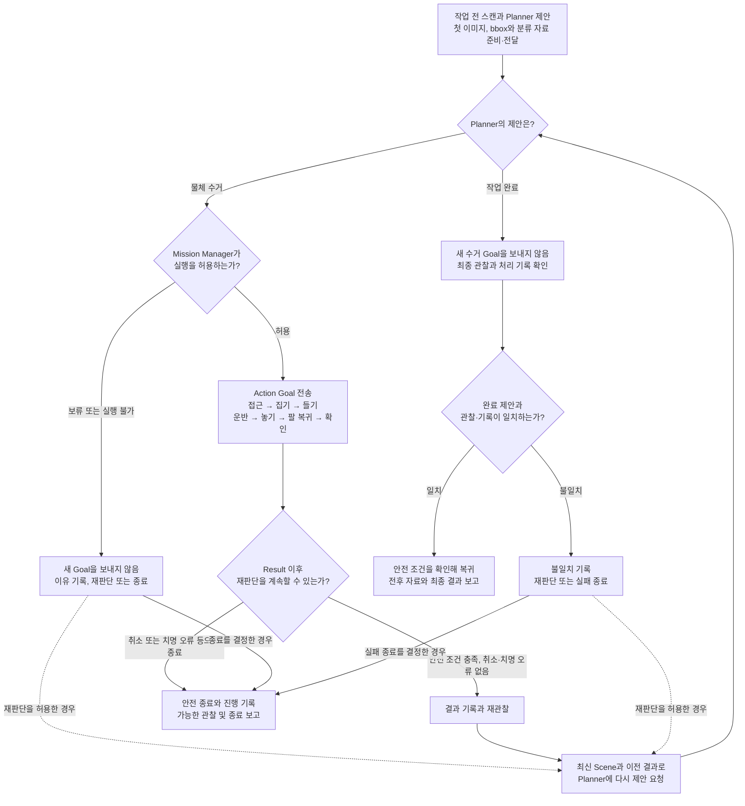
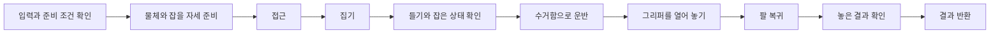

# 매니퓰레이션 Action 설계 안내

한 Goal은 승인된 물체 하나의 조작을 요청합니다. Gazebo 미션은 Mock 조작 서버와 연동할 수 있습니다. 고정 베이스 MuJoCo에서는 BT Action 서버가 인식·MoveIt·그리퍼를 연결합니다. Jetson에서 실물 수거를 실행하는 조건은 [실물 수거 가이드](physical-collection.md)를 따릅니다.

| 바로 확인할 내용 | 문서 |
|---|---|
| 모델 없이 실행·취소·조회 | [Mock 사용법](manipulation-mock-usage.md) |
| MuJoCo·인식·MoveIt 연동 실행 | [BT 서버 README](../../cleany_manipulation_bt/README.md) |
| Goal·Feedback·Result 필드 | [공통 Action 명세](execute-manipulation-skill-action-spec.md) |
| Mission Manager와 연결할 책임 | [Gazebo 미션과 Mock 조작 연동](../../cleany_mission_manager/docs/manipulation-mock-integration.md) |

## 행동의 실행 단위

**Mission Manager가 행동 하나를 승인하고, Manipulation Action 서버가 그 행동의
팔과 그리퍼 동작을 수행한 뒤 결과를 돌려줍니다.**

예를 들어 `collect_trash(물체 3번)`을 한 번 요청하면 서버가 접근, 집기, 들기,
수거함으로 운반, 그리퍼를 열어 놓기, 팔 복귀와 놓은 결과 확인을 처리합니다.
이 세부 동작마다 Mission Manager를 다시 호출하지 않습니다.
다음 물체는 결과 재관찰 후 Planner가 제안하고 Mission Manager가 승인합니다.

| 질문 | 답 |
|---|---|
| 여러 물체도 처리하는가? | 행동 하나 실행, 재관찰과 다음 제안을 반복해 여러 물체를 처리합니다. |
| Goal 하나가 책상 전체를 정리하는가? | 이번 명세의 Goal은 승인된 high-level 행동 하나입니다. |
| 인식만 별도로 사용할 수 있는가? | Perception의 `InspectScene`은 독립 Action으로 계속 사용할 수 있습니다. |
| 모든 팔 동작을 Mission Manager가 지시하는가? | 접근, 들기, 운반 등의 동작은 Skill Executor 내부에서 처리합니다. |
| 서버 개발에 Mission Manager 완성이 필요한가? | 같은 검증 조건을 갖춘 테스트 클라이언트와 mock port로 개발할 수 있습니다. |

## 구성 요소별 책임

| 담당 | 역할 | 예시 |
|---|---|---|
| Mission Manager | 행동 승인, 실행 요청, 결과 기록과 재관찰, 전체 미션 보고 | 이 단계에서 수거를 허용할지 검사 |
| Planner | 최신 장면과 이전 결과로 다음 행동 또는 완료 제안 | 물체 3번을 먼저 수거하자 |
| Perception | 물체, 이미지 영역과 3D 정보 제공 | 물체 3번의 bbox와 위치 |
| Manipulation Action 서버 | 행동 하나의 실행 순서, Feedback와 Result 관리 | 접근부터 놓은 결과 확인까지 |
| Motion 또는 VLA backend | 동작 생성, 물리 제약 검사, 실행과 정지 | MoveIt, controller와 실험 후 선택할 VLA adapter |
| 관측 전달 기능 | 같은 장면의 원본 이미지와 정보를 묶어 전달 | overlay를 위한 자료 |
| Backend와 Dashboard | 관측 저장, overlay와 최종 결과 표시 | 전후 사진과 미처리 대상 |

Perception 모델과 Planner adapter, Skill 내부 VLA와 MoveIt 조합은 KB의 실험 후보입니다.
현재 시뮬레이션 구현이 제품의 최종 모델이나 분실물 처리 정책을 결정하지 않습니다.

### Action 서버 구현과 목표 MVP의 관계

| 단계 | 확인할 내용 |
|---|---|
| Rule-based 통합 검증 | 규칙 기반 Planner와 실행 계층을 연결해 Goal, 물리 실행 결과, 재관찰과 보고를 검증 |
| 목표 MVP | 위 흐름에 AI의 다음 행동 제안과 **VLA 기반 Manipulation Skill의 물리 실행 및 결과 관찰**을 포함 |

Action 서버는 기존 MoveIt 및 controller port나 mock으로 먼저 개발할 수 있습니다.
이 검증만으로 목표 MVP를 완료했다고 보고하지 않습니다. 목표 MVP에는 VLA 기반 실행과
관찰 결과로 다음 행동 또는 완료를 판단하는 검증이 추가로 필요합니다.
VLA 모델, adapter와 MoveIt의 조합은 실험 후 선택하며 이 명세에서 확정하지 않습니다.
단계별 통과 조건은 [KB Success Criteria](../../../../docs/cleany-docs/10_PLANNING/05%20-%20Success%20Criteria.md)를 따릅니다.

### ROS 서버를 세부 동작마다 만드는가

제안하는 Manipulation Action endpoint는 하나입니다. 접근, 집기, 들기와 운반은 내부 함수
또는 BT 노드로 연결합니다. 기존 Perception의 `InspectScene`, 파지 선택의
`SelectReachableGrasp`는 별도 Action이고, `PlanGrasp`와 `VerifyPlacement`는 기존 Service입니다.
Service는 잡을 자세나 확인 결과를 요청하는 호출이며 Mission Manager의 새 상태가 아닙니다.
Task Planner의 다음 행동 제안과 `PlanGrasp`의 grasp 계산도 서로 다른 책임입니다.

## 책상에 도착한 뒤의 전체 흐름

**Action 서버는 켜진 채로 대기합니다. 실행할 물체 수거가 승인된 경우에만 새 Goal을 받습니다.**

| 상황 | Mission Manager가 하는 일 |
|---|---|
| Planner가 물체 3번 수거를 제안하고 검증을 통과 | 물체 3번의 Action Goal 전송 |
| Planner가 작업 완료를 제안 | 새 수거 Goal 없이 최종 관찰과 기록 확인 |
| 제안이 허용 기능 또는 인자 검증을 통과하지 못함 | Goal 없이 이유 기록. 재판단하거나 차단 결과로 종료 |
| 미션 취소 또는 치명 오류 | 안전 종료 경로로 이동. 새 수거 Goal 전송 금지 |

이 표는 Mission Manager가 Goal을 보내기 전의 판단입니다. Goal을 보낸 뒤 서버가
거절하거나 수락 후 `BLOCKED`를 반환하는 경우는 [Action 수락 명세](execute-manipulation-skill-action-spec.md)의 별도 처리입니다.
첫 관측의 원본 이미지 전달과 수신 확인 계약은 Mission 연동 단계에서 추가 결정해야 합니다.
위 그림의 재판단은 안전 조건과 종료 정책을 확인한 경우에만 수행합니다.
치명 오류와 취소는 종료 및 안전 경로로 연결하고 새 Goal을 자동으로 보내지 않습니다.
취소 뒤 안전하게 관찰할 수 있어도 다음 행동 실행을 재개하지 않습니다.

**빈 장면이나 실행할 제안이 없다는 사실만으로 성공을 결정하지 않습니다.**
Planner의 완료 제안, 최종 관찰, 처리 기록과 남은 대상을 함께 확인합니다.

## 승인된 행동 하나의 내부 동작

선택 물체의 3D 조회나 집기 전 위치 확인은 행동의 준비 과정에 포함할 수 있습니다.
서버는 다른 물체를 선택하거나 전체 장면에서 새 high-level 행동을 계획하지 않습니다.
집기 전 장면이 달라졌다면 이전 Goal을 차단하고 Mission Manager가 재관찰합니다.

## 실행과 결과 확인

- Goal과 결과 필드, 취소 후의 상태는 [Action 인터페이스](execute-manipulation-skill-action-spec.md)에서 확인합니다.
- 준비 조건, 단계별 실패, 실행 기록의 조회는 [서버 동작](manipulation-server-behavior-spec.md)을 따릅니다.
- MuJoCo 실행기의 트리와 관찰 방법은 [BT 서버](../../cleany_manipulation_bt/README.md), 설계용 XML의 노드와 포트는 [BT 설계](manipulation-behavior-tree-design.md)에 있습니다.
