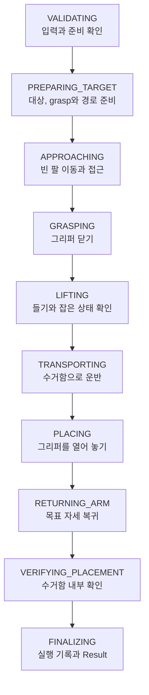
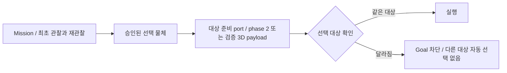

# Manipulation 서버 동작 명세

> **모의 구현과 BT backend 계약.** 대상은 승인된 `collect_trash` 또는 `collect_lost_item` 물체 하나입니다.
> 서버는 책상 전체의 물체 선택, Planner 호출과 완료 판정을 맡지 않습니다.
> Python 모의 서버의 실행·설정·검증은 [사용법](manipulation-mock-usage.md)를 따릅니다.
> MuJoCo의 실제 실행·정지 근거는 [BT 실행 계약](../../cleany_manipulation_bt/docs/execution-contract.md)을 따릅니다.

| 확인할 내용 | 위치 |
|---|---|
| 시작 조건과 실행 단계 | [시작 전 확인](#시작-전에-확인할-것), [실행 단계](#실행-단계) |
| 인식과 놓기 검증 | [InspectScene](#inspectscene은-무엇인가), [놓은 결과 확인](#놓은-결과-확인) |
| 실패·취소·기록 | [실패와 재시도](#실패와-재시도), [취소](#취소는-어떻게-처리하는가), [실행 기록](#기록-fault와-profile) |
| Mock의 구현 범위 | [모의 서버의 구현 경계](#모의-서버의-구현-경계) |

## 시작과 종료 경계

| 시작 | 종료 |
|---|---|
| 승인된 Goal과 관찰 참조를 받음 | 행동 Result와 실제 물체 및 팔 상태를 반환 |
| 선택된 물체와 목적지를 물리적으로 검사 | Mission Manager가 기록, 재관찰과 다음 판단 |

새 Goal을 실행하기 전에 이전 실행의 기록과 정지 상태를 확인합니다.
같은 서버와 관련 팔 및 그리퍼 자원을 쓰는 Goal은 한 번에 하나만 실행합니다.
e-stop과 hardware fault의 실제 정지는 ROS Result와 Planner 응답을 기다리지 않습니다.

## 시작 전에 확인할 것

아래는 상위 연동까지 포함한 준비 조건입니다. 이 브랜치의 MuJoCo 서버는 고정 베이스를 사용하며,
모바일 베이스의 도착·정지·주행 자세를 조회하는 readiness adapter는 아직 없습니다.

| 확인 | 통과 조건 | 실패 처리 후보 |
|---|---|---|
| 지원 행동 | 승인 경로를 거친 `collect_trash`, `collect_lost_item` | 구조상 오류는 Goal 거절, 분류–skill–목적지 불일치는 이동 전 차단 |
| backend | mock, 검증 가능한 simulation 또는 준비된 real adapter | `BLOCKED/BACKEND_NOT_READY` |
| 베이스 상태 | 접근 위치 도착, 베이스 정지와 위치 조건 유효 | `BLOCKED/BACKEND_NOT_READY` |
| 팔과 그리퍼 | 새 feedback으로 상태와 정지를 확인, 이전 held 또는 fault 없음 | 준비 불가 또는 기존 fault는 실행 차단 |
| snapshot | 지정 관찰 존재, 기간과 대상 유효 | `BLOCKED/TARGET_UNAVAILABLE` 또는 `STALE_TARGET` |
| 목적지 | 등록된 수거 목적지, 해당 물체의 크기와 경로 유효 | `BLOCKED/DESTINATION_UNAVAILABLE` |
| 확인 기능 | 놓은 결과를 검증할 port 준비 | `BLOCKED/VERIFICATION_UNAVAILABLE` |
| 실행 기록 | ID·인자 충돌과 기존 실행 상태 확인, 시작 기록을 메모리에 반영 | 충돌·미완료 실행은 차단. SQLite 쓰기 실패만으로는 차단하지 않음 |

실물 연동의 베이스 정지 기준, snapshot age와 확인 수단은 아직 정해야 합니다.
준비 전 움직임이 없고 초기 feedback이 부족하면 `BLOCKED`로 끝낼 수 있지만
`stop_confirmed=true`라고 주장하지 않습니다. 이미 움직인 뒤 정지가 불명확하면 `FATAL`입니다.
검증이 준비되지 않은 실물 프로필은 사용 가능으로 표시하지 않습니다.

## 실행 단계

| 단계 | 수행과 통과 조건 | 남길 기록 |
|---|---|---|
| 입력 검증 | 위 시작 조건 확인 | Goal, 프로필, 초기 상태 |
| 대상 준비 | 선택 물체 3D 정보, grasp와 경로 유효 | snapshot, 팔, 계획 참조 |
| 접근 | 승인된 경로와 최신 제어 feedback으로 완료 확인 | 시작 명령과 접근 결과 |
| 집기 | 그리퍼 접촉 및 제어 결과 확인 | 물체 상태와 근거 시각 |
| 들기 | 들어 올린 뒤 잡은 상태 유지 확인 | `HELD` 또는 불명확 상태 |
| 운반 | 충돌, workspace와 잡은 상태 감시 | 목적지 접근과 이탈 여부 |
| 놓기 | 목적지 유효성 재확인 후 그리퍼 열기 | 명령 성공과 물체 상태를 구분 |
| 팔 복귀 | backend의 복귀 목표 자세 도달 확인 | `arm_recovered`, 정지 근거 |
| 놓은 결과 확인 | 놓은 뒤의 검증이 성공 조건 만족 | 확인 상태와 관찰 시각 |
| 종료 | 모든 실제 진행 보존 후 Result 반환 | 마지막 완료 단계, 원인과 정지 상태 |

각 motion 노드는 명령 전과 근거가 생긴 직후 진행을 기록합니다. 마지막 단계에서만
기록하면 집거나 놓은 뒤 실패한 사실을 잃습니다. `last_completed_stage`는 성공 근거가
있는 단계만 갱신합니다. 그리퍼 명령 완료만으로 물체 수거를 완료 처리하지 않습니다.

모의 구현은 기존 `stage` 안에 `substage`를 추가해 세부 진행을 기록합니다.
예를 들어 `GRASPING`은 그리퍼 닫기와 파지 확인을 구분하며, 확인 전에는
`HELD`로 갱신하지 않습니다. `completed_substages`는 완료된 세부 단계만 보존하고,
실패한 세부 단계는 `failed_substage`로 반환합니다. 재시작 시 이 진행도 유지합니다.
세부 단계가 늘어나도 기존 단계 timeout과 원자 구간 취소 경계는 유지합니다.

## InspectScene은 무엇인가

**기존 Perception Action의 이름입니다. 선택 물체를 잡기 위해 필요한 정보도 제공합니다.**

| 요청 종류 | 기존 입력 | 기존 출력 |
|---|---|---|
| 전체 장면 관찰, phase 1 | 빈 `snapshot_id`, `selected_object_id=0` | 2D 검출 목록과 새 snapshot |
| 선택 대상 준비, phase 2 | 기존 snapshot과 물체 번호 | 해당 대상의 3D, mask 기반 cloud와 주변 cloud |

Phase 2는 캐시된 관찰의 선택 물체 복원입니다. 새 사진으로 책상 전체를 다시 분류하지 않습니다.

기존 [InspectScene.action](../../cleany_interfaces/action/InspectScene.action) 오류를 다음처럼 연결합니다.

| 기존 Perception 오류 | 행동 오류 후보 |
|---|---|
| `ERROR_SNAPSHOT_NOT_FOUND`, `ERROR_INVALID_SELECTION` | `TARGET_UNAVAILABLE` |
| RGB-D, mask, depth, plane, TF 오류 | 대상 준비 불가 또는 `STALE_TARGET`, 원래 코드도 보존 |
| detector API, response, internal 오류 | `TARGET_UNAVAILABLE` 또는 `INTERNAL_ERROR`, 원인 보존 |
| Perception 취소 | 상위 취소이면 `CANCELED`; 예상 밖 하위 취소면 실패 원인으로 기록 |

하위 취소만 받았다고 팔 정지가 확인된 것은 아닙니다. Action Result가 요구하는 물리
상태와 상위 취소 요청을 확인합니다. snapshot 오류 이름은 기존 `ERROR_SNAPSHOT_NOT_FOUND`를 따릅니다.

## 놓은 결과 확인

기존 [VerifyPlacement.srv](../../cleany_interfaces/srv/VerifyPlacement.srv)는
`success`와 `message`만 반환합니다. 상세한 센서 판정 enum은 없습니다.

| 받은 정보 | Mock의 기록·시나리오 | MuJoCo adapter |
|---|---|---|
| 유효한 안착 확인 | `CONFIRMED` | 방출 뒤와 팔 복귀 뒤 각각 확인. 나머지 조건 충족 시 `SUCCESS` |
| 확인 불충족 / `success=false` | `NOT_CONFIRMED`, `FAILED/PLACEMENT_NOT_CONFIRMED` | 확인 기한 안에서 대기 |
| 확인 timeout 또는 응답 불가 | `UNKNOWN`, `VERIFICATION_TIMEOUT` | `UNKNOWN`, `VERIFICATION_TIMEOUT` 또는 통신 원인 보존 |
| 시작 시 확인 port 준비 안 됨 | `NOT_CHECKED`, 이동 전 차단 | `BLOCKED/VERIFICATION_UNAVAILABLE`, 집지 않음 |

false를 “수거함 밖에 있는 것을 봤다”로 확대하지 않습니다. 현재 srv로는 그런 근거를
보장하지 않습니다. action 내부 adapter는 응답 false와 호출 timeout은 구분할 수 있습니다.
명시적 위치 판정이 필요하면 srv 확장을 별도 검토합니다.

MuJoCo는 방출 직후 `ConfirmRelease`와 팔 복귀 후 `VerifyPlacedObject`에서 독립 검증을 요청합니다.
팔 복귀가 실패했어도 backend가 독립적인 최신
검증 근거를 제공하면 그 물리 사실을 실패 Result에 보존할 수 있습니다. 그 경우에도 행동
상태는 `FAILED`입니다. 증거를 얻지 못하면 확인 성공을 추정하지 않습니다.

기존 자동 sorting 데모의 기본 GUI 관찰 모드는 확인을 끄고 `complete_unverified`를 기록합니다.
MuJoCo BT Action은 독립 확인을 요구합니다. 확인 생략 모드를 지원하려면
별도 프로필과 보고 계약을 검토하고, `CONFIRMED`를 허위로 반환하지 않습니다.

## 실패와 재시도

| 상황 | 제안하는 결과 | 다음 판단 |
|---|---|---|
| 움직임 전 대상 또는 목적지 불가 | `BLOCKED` | Mission Manager가 관찰과 새 제안 검토 |
| 움직임 전 계획을 만들지 못함 | `BLOCKED`, `GRASP_FAILED` 또는 `MOTION_FAILED` | 실패 원인과 대상 근거 전달 |
| 접근, 집기, 운반 또는 팔 복귀 실패 | `FAILED` | 동작 종료, 정지와 물체 상태 확인 |
| 물체 상태 유실 | `FAILED/GRASP_LOST`, `object_state=UNKNOWN` | 자동 놓기 금지, 정지 후 재관찰 |
| 수거함 내부 확인 실패 | `FAILED` | 놓기 진행과 확인 실패를 함께 기록 |
| 실제 e-stop 또는 hardware fault | `FATAL` | 하위 안전 경로, 신규 Goal 차단 |
| 실행 후 정지 확인 불가 | `FATAL/STOP_UNCONFIRMED` | 신규 Goal 차단, 즉시 fault 알림 |

접촉 이후 행동 전체를 내부에서 다시 시작하지 않습니다. 준비 단계 조회와 motion 계획은
새 움직임이 없고 입력이 유효할 때만 설정된 횟수 안에서 retry할 수 있습니다.
그 설정과 실행 후 재시도 budget은 별개입니다. `max_object_attempts`, `max_scan_cycles` 같은
책상 반복 설정은 이 서버가 소유하지 않습니다.
관측에서 대상이 사라진 사실만으로 수거 성공을 만들지 않습니다.

## 취소는 어떻게 처리하는가

**취소 요청을 받으면 다음 정상 단계 시작을 막고, 선택한 취소 모드로 종료합니다.**
새로운 대상이나 수거 행동을 시작하지 않습니다. 기본 Action cancel은 `CHECKPOINT`이고,
`manipulation/cancel` 서비스는 `execution_id/mode`를 받습니다.

| mode | 서버 처리 | 종료 때 주의점 |
|---|---|---|
| `IMMEDIATE` | 현재 노드와 원자 구간 완료 대기 없이 중단 요청, 실제 정지 확인 | 팔 복귀나 그리퍼 열기 없음 |
| `CHECKPOINT` | 현재 동작과 완료 확인까지만 수행한 뒤 정지 | 잡기·들기·놓기는 현재 원자 구간까지, 다음 단계 금지 |
| `RETURN_ARM` | 현재 동작 중단, 정지 확인, 물체를 잡고 있으면 현재 위치에서 놓고 팔 복귀 | 수거함 배치 성공으로 기록하지 않음 |

`RETURN_ARM`의 현재 위치 놓기는 그리퍼 열기 완료에 근거한 초기 구현 정책입니다.
놓기 위치 선택과 별도 이탈 관찰은 후속 검토 대상으로 둡니다. 빈 팔은 놓기 동작 없이
복귀하고, 팔 선택 전이면 정지 후 종료합니다. 놓기와 복귀 중에도 `IMMEDIATE`로 선점합니다.
놓기·복귀 실패는 다시 정지 후 실패로 반환하며, 실제 정지 미확인은 기존 FATAL 경로입니다.

집기, 들기 원자 구간의 범위와 제한 시간은 backend별로 정의해야 합니다. 제한 없이
취소를 지연하거나, 선택한 취소 정책 밖의 운반과 놓기를 새로 시작하지 않습니다.
e-stop과 hardware fault는 이 checkpoint 대기를 우회하는 독립 정지 경로입니다.

### 정지 확인에 필요한 근거

1. 해당 MoveIt 및 controller goal에 중단을 전달하고 종료 응답을 확인합니다.
2. 명령 뒤의 **새 feedback**으로 팔과 그리퍼 속도를 확인합니다.
3. 설정한 속도 기준과 유지 시간을 만족해야 정지를 확인합니다.
4. 확인 제한 시간 안에 증거를 얻지 못하면 정지 미확인으로 종료하고 실행을 차단합니다.

같은 feedback을 여러 번 읽은 것을 연속 새 표본으로 세지 않습니다. 제한 시간은
프로세스의 단조 시계, sensor freshness는 해당 stamp 및 clock 계약으로 따로 관리합니다.
MuJoCo BT 서버의 Action 종료·새 관절 표본 검사는 [BT README](../../cleany_manipulation_bt/README.md#계약과-증거)를
따릅니다. 실물 backend의 정지 기준과 해당 계약의 검증은 후속 구현 대상입니다.

## 기록, fault와 profile

| 항목 | 구현 요구 후보 |
|---|---|
| 시작 기록 | 실행 ID, 인자 hash, snapshot과 대상, 프로필을 움직임 전에 보관 |
| 물리 진행 | 집기, 들기, 그리퍼 열기와 확인 근거를 발생 직후 보관 |
| 종료 | 취소와 예외도 마지막 진행과 원인을 반드시 기록 |
| 재시작 | 활성 기록은 중단, 자동 재개 금지. Mission Manager에 중단과 마지막 진행 전달, 외부에 사람 확인 필요 보고 |
| fault 알림 | 안전 경로와 Mission Manager에 즉시 전달. 정확한 진단 topic 또는 port는 구현 시 선택 |
| fault 해제 | 운영자 권한과 로봇 안전 조건 검사. 물리 e-stop 및 hardware fault를 원격 reset으로 해제하지 않음 |
| mock 프로필 | 순수 core와 동작 port 검증 |
| simulation 프로필 | 독립 확인과 stop 근거를 제공하는 simulation adapter |
| real 프로필 | 실제 feedback, 물리 verifier와 안전 경로가 준비되기 전 비활성 |

| 기록 단계 | 계약 |
|---|---|
| 수락 / 단계 시작 | 동작 전에 메모리 반영 후 SQLite 저장 시도 |
| 저장 | 최신 기록과 단계 이력을 같은 transaction, execution_id UNIQUE, DB별 file lock |
| 저장 실패 | 실제 동작 중단 안 함 |
| 같은 프로세스 조회 / 중복 | 메모리 기록 사용 |
| 외부 연결 | Action 명세의 조회 service와 복구 이벤트 |

### 재시작 시 서버와 Mission Manager가 처리할 일

**재시작은 작업 도중 프로그램이나 장치가 종료된 뒤 다시 켜지는 상황입니다.**
새 미션 시작과 구분하여 이전 활성 기록을 먼저 확인합니다.

| 담당 | 처리할 일 |
|---|---|
| Action 서버의 복구 처리 | 이전 실행 ID와 미션 ID, 마지막 진행 및 확인 근거를 보존하고 중단 사실 전달 |
| 로봇 상태 및 안전 기능 | 현재 팔, 그리퍼, 들고 있는 물체와 정지 여부 확인. 확인 전 새 물리 실행 차단 |
| Mission Manager | 이전 미션을 자동 재개하지 않고 중단과 사람 확인 필요를 보고 자료에 반영 |
| 외부 상태 adapter | Backend에 중단과 사람 확인 필요 전달. 연결이 없으면 보고를 보관하고 재연결 시 전달 |

기록에 집기 명령이 있다는 것만으로 현재 물체를 들고 있다고 확정하지 않습니다.
재시작했다는 이유만으로 정상 취소 또는 안전 정지 완료를 보고하지 않습니다.
오류 reset이 허용되어도 이전 미션이 자동 재개되지는 않습니다.
중단 보고 및 사람 확인 필요는 [KB 운영 규칙](../../../../docs/cleany-docs/20_TECHNICAL/02%20-%20Robot%20Operations%20and%20Mission%20Dispatch.md)의 요구이며,
조회 Service와 복구 이벤트는 모의 서버에 구현했습니다. Backend 재전송 저장소와
Mission Manager adapter는 후속 구현 대상입니다.

### 설정 목록 후보

| 설정 | 용도 |
|---|---|
| `observation_max_age_sec`, `target_check_timeout_sec` | 관찰 기간과 선택 대상 확인 |
| `preparation_timeout_sec`, `preparation_max_retries` | 움직임 전 준비와 제한된 retry |
| `motion_timeout_sec`, `placement_check_timeout_sec` | motion과 놓은 결과 확인 |
| `stop_timeout_sec`, `stationary_velocity_limit`, `stationary_duration_sec` | 새 feedback 기반 정지 판정 |
| `execution_record_retention_sec` | 중복 방지 기록 보관 |
| backend별 베이스, 팔과 그리퍼 readiness 기준 | 시작 및 복귀 허용 조건 |

| 설정 | 모의 값 / 범위 |
|---|---|
| 단계 / 정지 확인 | 0.5 s / 0.1 s |
| 준비·확인 / 동작 / 정지 기한 | 5 s / 10 s / 1 s |
| 자동 재시도 | 0회 |
| 기존 정지 설정 | arm_stationary_velocity_rad_s=0.02, arm_stationary_samples=5 |

실물 기본값은 미정입니다. MuJoCo는 횟수와 지속 시간 / 관절별 freshness를 함께 검사하며 [BT 설정](../../cleany_manipulation_bt/docs/execution-contract.md#정상-수거의-놓기정지-확인)을 따릅니다.

## 기존 코드에서 재사용할 부분

| 코드 | 재사용하는 부분 | 현재 적용·후속 작업 |
|---|---|---|
| [sorting.py](../cleany_skill_executor/core/sorting.py) | pick, transport, release, retreat와 verify 순서 | MuJoCo BT core가 동작별 진행과 typed Result를 관리 |
| [sorting_coordinator.py](../cleany_skill_executor/sorting_coordinator.py) | 준비, grasp, motion과 stop port | MuJoCo BT backend에서 개별 동작 재사용. 전체 반복은 별도 데모 |
| [nearest_pregrasp_coordinator.py](../cleany_skill_executor/nearest_pregrasp_coordinator.py) | grasp 선택과 arm 동작 | ROS wrapper와 core port 분리 필요 |
| Mission Manager core | 미션 요청과 기존 결과 envelope | 승인된 high-level 행동, 재관찰과 취소 adapter 필요 |

현재 `sorting_required_categories`는 simulation demo에
남습니다. 제품 `collect_trash`에는 분실물과 handoff를 자동 포함하지 않습니다.
팔 동작을 재사용할 때 시뮬레이션 좌석 순회와 물체 선택까지 서버로 가져오지 않습니다.

관련 문서: [Action 명세](execute-manipulation-skill-action-spec.md),
[Mission 연동 후속 작업](../../cleany_mission_manager/docs/manipulation-mock-integration.md), [설계 안내](manipulation-action-design.md).

## 모의 서버의 구현 경계

정상 단계는 3절의 순서로 진행합니다. core는 비동기 port를 poll하며 ROS timer는
20Hz steady clock을 사용합니다. `CHECKPOINT`는 현재 단계를 완료하고,
`IMMEDIATE/RETURN_ARM`은 현재 동작을 중단한 뒤 정지 확인으로 처리합니다. fault는 checkpoint 대기를
우회하고 `FATAL`로 신규 실행을 차단합니다. 취소와 Result 확정은 하나의 lock으로 직렬화합니다.

| 재시작 / 저장 경계 | 처리 |
|---|---|
| 활성 기록 | INTERRUPTED / 사람 확인 필요, 마지막 물리 근거 보존 |
| Result / 재개 | 가짜 Result 생성과 이전 Goal 자동 재개 없음 |
| 신규 Goal 차단 | Fault / 중단 / HELD / UNKNOWN; reset 없음 |
| 기록 쓰기 실패 | 경고, 실제 결과 유지; 쓰기 실패만으로 차단 안 함 |
| FINISHED | 메모리 실행 종료, 디스크 저장 보장 아님 |
| 기동 | DB 초기화 / 이력 읽기 필수 |
| 재시작 복구 / 중복 | 디스크 기록만 사용; 미저장 메모리 유실 |

Mock adapter는 실제 제어기 feedback, VLA, 실물 verifier 또는 베이스 readiness를
검증하지 않습니다. 해당 backend와 권한·복구·원격 전달 계약은 별도로 구현해야 합니다.
