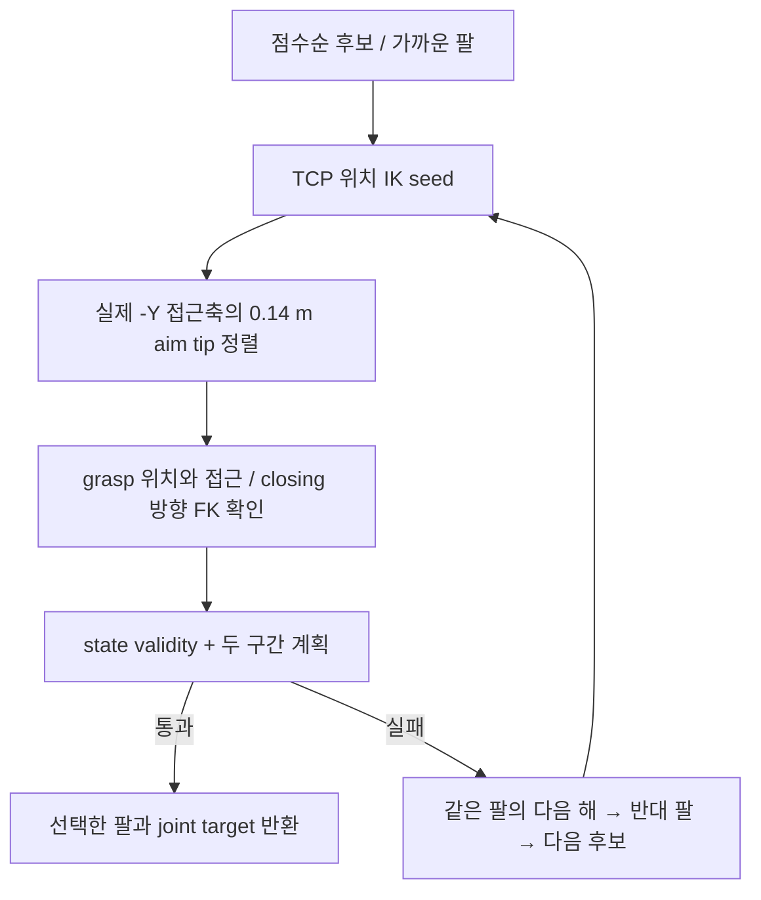
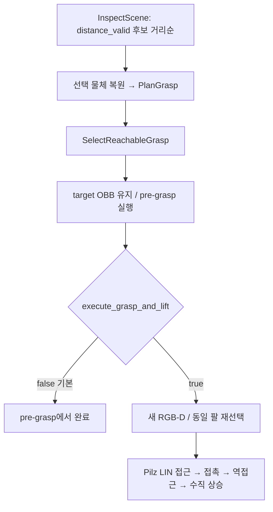

# 조작 경로와 파지 후보 선택

이 패키지는 파지 후보를 MoveIt으로 검증하고, 선택한 실행 경로에 따라 Mock 결과 또는 MuJoCo 조작을 수행한다. 외부 실물 로봇의 통합 수거 실행은 지원하지 않는다.

| 필요한 동작 | 진입점 | 명령이 도달하는 곳 |
|---|---|---|
| 단일 물체 Action 연결 | [Mock 사용법](manipulation_mock_usage.md) | 모의 진행과 결과만 생성 |
| 단일 물체 물리 시뮬레이션 | [MuJoCo BT](../../cleany_manipulation_bt/README.md) | MuJoCo 팔과 그리퍼 controller |
| 후보 도달성 검사 | 아래 Reachable grasp Action | IK와 계획만 수행 |
| 가까운 물체 pre-grasp | 아래 coordinator | 기본 pre-grasp, 선택적으로 집기와 lift |
| 연속 분류 수거 | [실행과 진단](study_cafe_sorting_usage.md) | 고정 베이스 MuJoCo sorting |

수거의 수치 설정은 [설정](study_cafe_sorting_configuration.md), 충돌·접촉·운반 조건은 [실행 계약](study_cafe_sorting_contract.md)에서 관리한다.

## 단일 물체 Action 실행

Mock과 native MuJoCo BT는 `ExecuteManipulationSkill` 계약을 공유한다. 진행·취소·결과 필드는 [공통 Action 계약](../../cleany_interfaces/docs/observation-contracts.md#단일-물체-manipulation-action)을 따른다. Mission의 `action_mock`은 `/mock/manipulation`을 호출하며, 아래 nearest-pregrasp 및 연속 sorting과 별도 경로다.

## Python Mock Manipulation 서버

`manipulation_server`는 진행과 결과를 모의 생성한다. Backend는 `mock`만 허용하며 clock, TF, odom, 카메라와 joint_states를 발행하지 않는다. Steady clock으로 timeout과 취소를 처리한다. [Endpoint 표](interfaces.md#manipulation_server)와 [실행 절차](../../../../docs/how-to/mission.md#주행도-mock으로-action-연결-확인)를 따른다.

| 설정 | 용도 | 정상 시간 |
|---|---|---|
| [기본 fixture](../config/manipulation_mock.yaml) | 빠른 서버 계약 검사 | 단계당 기본 0.5초 |
| [Mission 공유 fixture](../../cleany_mission_manager/config/manipulation_server_fixture.yaml) | 두 물체와 네 관측 | 물체당 합계 40초 |

시간 우선순위는 scenario의 `stage_durations_sec`, 전역 `stage_durations_sec`, `stage_duration_sec` 순서다. 정지 단계 기본값은 `stop_duration_sec`다. [공유 시간표와 timeout](../../cleany_mission_manager/docs/manipulation_mock_integration.md#mock-조작의-관찰-시간)을 따른다.

Execution ID는 중복 수락하지 않는다. 재시작 시 ACTIVE를 INTERRUPTED로 보존하고 자동 재개하지 않는다. 과거 JSON의 추가 필드는 기본값으로 읽으며 손상된 DB는 시작 오류다. 서버 DB와 Mission DB는 분리해 유지한다. [결과, 취소와 보고 계약](../../cleany_interfaces/docs/manipulation.md)을 함께 확인한다.

조회는 메모리에 유지 중인 최신 상태를 포함한다. 실행 중 서버 DB 쓰기가 실패하면 경고를 남기고 모의 동작 결과는 보존한다. Mission의 전송 전 journal 저장과 결과 저장은 별도 계약이며, 조회 응답만으로 서버 DB 쓰기 성공을 판단하지 않는다.

## Reachable grasp action

`grasp/select_reachable` (`SelectReachableGrasp`)는 trajectory나 gripper 명령을 보내지 않는다.



| 검사 | 조건 |
|---|---|
| 입력 동일성 | snapshot, object, frame, target OBB 일치; frame은 `planning_frame` |
| 현재 상태 | 양팔과 gripper 12개 joint 완전, 나이 0.5초 이내 |
| pre-grasp | 접근 벡터 반대 방향 0.14 m |
| 탐색 | 팔당 joint limit 전체에 분산한 8개 seed; 위치 seed 실패 시 현재 상태에서도 시도 |
| 해 순위 | joint-limit 정규화 이동량, wrist roll 가중치 2; 자세 오차는 동률 비교 |
| 방향 허용 | 접근축 최대 15°, jaw 대칭을 고려한 closing 축 최대 30° |
| 계획 | current→pre-grasp와 pre-grasp→grasp 모두 검사 |
| 종료 | 임시 target OBB와 ACM 복원 후 결과 확정; 복원 실패는 planning-scene 오류 |

한 번에 goal 하나만 처리한다. 각 IK, validity, planning 단계 전후에 timeout과 cancel을 확인한다. Skill Executor는 결과를 반환하며 Mission Manager FSM을 직접 변경하지 않는다.

## 설정 및 검증

`config/grasp_selection.yaml`이 planning frame, timeout, attempts/scaling과 후보 수를 관리한다.

```bash
# 각각 별도 터미널에서 같은 overlay 적용
ros2 launch cleany_moveit_config mock_planning.launch.py
ros2 launch cleany_skill_executor grasp_selection.launch.py
# 저장소 루트의 단위 검사
pytest -q ros2_ws/src/cleany_skill_executor/test
```

일반 simulation 실행은 planning attempts 3, velocity/acceleration scaling 0.08, replan 2회와 delay 0.25초를 사용한다. Controller 실패는 joint tracking error를 남기고 현재 상태에서 같은 joint goal로 한 번만 안전 재계획한다. 연속 sorting의 값은 [별도 설정](study_cafe_sorting_configuration.md#sorting-속도와-실행-설정)을 따른다.


## 가까운 객체 자동 pre-grasp

`nearest_pregrasp_coordinator`는 다음 순서로 한 번의 작업을 수행한다.



양쪽 gripper는 object evaluation 전에 open한다. 따라서 MoveIt 후보 검증과 실제 실행이
동일한 gripper joint state 및 collision geometry를 사용한다.

가장 가까운 객체가 segmentation, grasp 생성 또는 양팔 도달성 검사에서 실패하면 다음
가까운 객체로 fallback한다. depth가 불충분해 `distance_valid=false`인 detection은
자동 조작에서 제외한다. infrastructure, MoveIt 또는 controller 실패는 다른 객체로
넘기지 않고 전체 작업을 실패시킨다.

RGB-D camera, `perception/inspect_scene`, `grasp/plan`,
`grasp/select_reachable`, MoveGroup과 arm/gripper controller를 먼저 실행한 뒤 coordinator를
시작한다.

```bash
ros2 launch cleany_skill_executor nearest_pregrasp.launch.py
```

query, timeout, 속도/가속도 scaling과 gripper open 위치는
`config/nearest_pregrasp.yaml`에서 설정한다. pre-grasp joint target은 운영 selector가
aim-tip IK와 FK 방향 검증까지 통과한 결과를 사용한다. 성공한 target OBB는 완료 자세에서
Planning Scene에 유지하며, 실패하거나 coordinator가 종료될 때 기존 ACM과 함께 복원한다.
