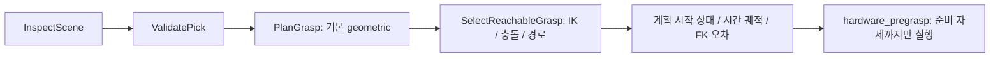

# 실물 파지 계획과 준비 자세 실행

`physical_grasp_selection_server`는 파지 후보의 IK와 충돌을 검사하고 준비 자세와
파지 자세 사이의 경로를 반환한다. 기본 backend는 MoveIt이다.
`curobo_ik_moveit`은 cuRobo로 IK 후보를 구하고 전체 장면의 상태 검사와 경로 계획은
MoveIt에서 수행한다. GPU 충돌 구는 후보 계산용 근사이며 최종 충돌 판정을 대신하지 않는다.
하이브리드 IK는 실패한 후보에 설정된 재시도 횟수와 시드 수를 적용한다.

기존 `grasp_selection_server`와 실물 선택기는 같은 Action 기본 이름을 사용하므로
같은 namespace에서 함께 실행하지 않는다. `ValidatePick`과 선택기는 모터를 움직이지
않는다. `hardware_pregrasp`는 사용자가 별도로 시작한 실물 controller에 명령을 보내며,
수거, 들어올리기와 복귀를 실행하지 않는다.

## 계획과 실행 조건

| 경계 | 조건 |
|---|---|
| 후보 | 같은 snapshot, object, frame과 OBB. `required_arm`은 빈 값, `left`, `right` |
| 현재 상태 | 완전하고 최신인 관절 상태. 오래된 상태나 잘못된 후보는 거절 |
| 파지 준비 거리 | 실물 지원 프로필은 8cm부터 검사하고 IK 실패 시 6cm, 4cm 순으로 시도 |
| 시간 궤적 | 시작 관절 상태와 함께 반환. 실행기는 현재 상태, 관절 범위, 속도와 가속도, 충돌을 다시 검사 |
| 기준 물체 | PIN한 snapshot/object를 재관찰. 오래되거나 이동한 표면을 다른 물체로 대신하지 않음 |
| 실물 준비 자세 | 이동 전후 기준 물체를 관찰하고 이동량을 검사. 파지 명령은 보내지 않음 |
| 통신 복구 | 취소와 최신 피드백을 확인한 뒤 남은 경로를 다시 연결, 검사 |
| 로컬 FK | 활성화 시 MoveIt FK와 먼저 대조. 모델, 관절, 그리퍼 변경 시 다시 확인하며 충돌 결과는 캐시하지 않음 |

`pregrasp_motion.yaml`은 실물 후보 선택 설정, `geometric_pregrasp.yaml`은 기하학적
후보 생성 설정이다. `hybrid_motion.yaml`은 GPU IK 설정을 추가한다. 기하학적 후보 생성이
기본이며 AnyGrasp는 선택 사항이다. 설정의 허용오차는 물리 로봇의 안전 인증 기준이 아니다.

## 예열과 장면 처리

`/grasp/warmup_status`는 GPU 준비 상태를 보고한다. VLM 대기 중 예열은 인식 launch의
`vlm_ik_warmup_enabled`와 선택기의 `curobo_ik_vlm_warmup_enabled`를 모두 켰을 때
사용한다. 실제 GPU 요청은 예열보다 우선하며 진행 중인 CUDA 호출은 중단하지 않는다.

센서 장면은 관측 시각과 OctoMap을 확인한다. 자기 형상 필터의 메시 준비와 raycast
중복 연산을 줄이되 캐시 검증 실패는 원래 계산으로 돌아간다. MoveIt 배치 검사는 한
읽기 잠금 안에서 전체 로봇 상태를 검사한다. 배치 서비스가 없으면 단일 상태 검사로
대체한다. 충돌 플러그인은 `cleany_moveit_collision`이 계속 관리한다.

실행 절차는 [RUNNING](../../../../docs/RUNNING.md#실물-파지-계획과-준비-자세),
검증 명령은 [TESTING](../../../../docs/TESTING.md#실물-계획과-실행-기반-검증),
ROS 계약은 [인터페이스](interfaces.md#physical_grasp_selection_server)를 따른다.
