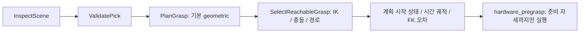

# 실물 파지 계획과 준비 자세 실행

`physical_grasp_selection_server`는 파지 후보의 IK와 충돌을 검사하고 준비 자세와
파지 자세 사이의 경로를 반환한다. 기본 backend는 MoveIt이다.
`curobo_ik_moveit`은 cuRobo로 IK 후보를 구하고 전체 장면의 상태 검사와 경로 계획은
MoveIt에서 수행한다. GPU 충돌 구는 후보 계산용 근사이며 최종 충돌 판정을 대신하지 않는다.
하이브리드 IK는 실패한 후보에 설정된 재시도 횟수와 시드 수를 적용한다.

기존 `grasp_selection_server`와 실물 선택기는 같은 Action 기본 이름을 사용하므로
같은 namespace에서 함께 실행하지 않는다. `ValidatePick`과 선택기는 모터를 움직이지
않는다. `hardware_pregrasp`는 사용자가 별도로 시작한 실물 controller에 명령을 보내며,
수거, 들어올리기와 복귀를 실행하지 않는다.

## 계획과 실행 조건

| 경계 | 조건 |
|---|---|
| 후보 | 같은 snapshot, object, frame과 OBB. `required_arm`은 빈 값, `left`, `right` |
| 현재 상태 | 완전하고 최신인 관절 상태. 오래된 상태나 잘못된 후보는 거절 |
| 파지점 충돌 | 실물 프로필은 손가락을 연 상태로 파지 자세와 팔 경로를 검사한다. 파지점에서 손가락만 닫는 구간의 충돌 검사는 생략한다 (`require_gripper_closure_clearance=false`). |
| 파지 준비 거리 | 실물 지원 프로필은 8cm부터 검사하고 IK 실패 시 6cm, 4cm 순으로 시도 |
| 시간 궤적 | 시작 관절 상태와 함께 반환. 실행기는 현재 상태, 관절 범위, 속도와 가속도, 충돌을 다시 검사 |
| 기준 물체 | PIN한 snapshot/object를 재관찰. 오래되거나 이동한 표면을 다른 물체로 대신하지 않음 |
| 실물 준비 자세 | 이동 전후 기준 물체를 관찰하고 이동량을 검사. 파지 명령은 보내지 않음 |
| 통신 복구 | 취소와 최신 피드백을 확인한 뒤 남은 경로를 다시 연결, 검사 |
| 로컬 FK | 활성화 시 MoveIt FK와 먼저 대조. 모델, 관절, 그리퍼 변경 시 다시 확인하며 충돌 결과는 캐시하지 않음 |

`pregrasp_motion.yaml`은 실물 후보 선택 설정, `geometric_pregrasp.yaml`은 기하학적
후보 생성 설정이다. `hybrid_motion.yaml`은 GPU IK 설정을 추가한다. 기하학적 후보 생성이
기본이며 AnyGrasp는 선택 사항이다. 설정의 허용오차는 물리 로봇의 안전 인증 기준이 아니다.

`pregrasp_hardware_support.launch.py`에 `collection_config_file`을 지정하면
선택기는 그 파일의 승인된 그리퍼 열림 각도, 닫힘 각도와 폭 기준을 실행기와
함께 사용한다. 이 값은 패키지의 기본 선택 설정을 덮어쓴다. 현재 선택기는
양팔에 하나의 폭 변환을 사용하므로, 두 팔의 이 세 값이 다르면 시작을 거부한다.
파일을 생략했을 때의 각도 기본값은 최대 개방 기준 160° 보정을 따른다.
100mm 폭은 명목값이며, 모터 끝점 확인이 개구 폭 곡선 측정을 대신하지 않는다.
현재 보정과 복원용 스냅샷은 [캘리브레이션 안내](../../../../docs/CALIBRATION.md)에 있다.

닫힘 검사가 꺼져 있으면 MoveIt이 검증한 최종 궤적에서 시작과 끝 자세를 확인한다.
계획의 끝 관절각이 요청 자세와 다르면 요청 자세를 별도로 검사한다.

MoveIt의 양팔 파지 그룹은 기본, 파지 접근, 복귀 플래너에 같은 충돌 검사 간격 비율(`longest_valid_segment_fraction=0.001`)을 적용한다.

## 예열과 장면 처리

`/grasp/warmup_status`는 GPU 준비 상태를 보고한다. VLM 대기 중 예열은 인식 launch의
`vlm_ik_warmup_enabled`와 선택기의 `curobo_ik_vlm_warmup_enabled`를 모두 켰을 때
사용한다. 실제 GPU 요청은 예열보다 우선하며 진행 중인 CUDA 호출은 중단하지 않는다.

센서 장면은 관측 시각과 OctoMap을 확인한다. 자기 형상 필터의 메시 준비와 raycast
중복 연산을 줄이되 캐시 검증 실패는 원래 계산으로 돌아간다. MoveIt 배치 검사는 한
읽기 잠금 안에서 전체 로봇 상태를 검사한다. 배치 서비스가 없으면 단일 상태 검사로
대체한다. 충돌 플러그인은 `cleany_moveit_collision`이 계속 관리한다.

`hybrid_motion.yaml`은 선택 단계의 `state_validity_batch_size=64`와
`selection_overlap_sensor_wait=true`를 사용한다. 센서 장면 갱신 동안 독립적인 후보
준비를 진행하고 첫 장면 의존 검사 전에 같은 관측 시각과 원래 제한 시간으로 대기한다.
선택 성공 직전에도 장면 유효성을 확인한다. 서비스 응답은 완료 알림으로 대기를 깨운다.

GPU IK 결과가 32개 이상이면 손목 변형과 자세 오차를 GPU에서 묶어 계산한다.
URDF에서 손목 축과 TCP 오프셋의 동축 관계가 확인된 경우 기준 FK에 손목 회전을
합성하고, 관계가 맞지 않으면 전체 FK를 계산한다. 채택 후보는 현재 모델의 FK와 실제
그리퍼 열림 상태로 MoveIt 검사를 통과해야 하며, 같은 요청의 확정 결과만 중복 검사 없이
전달한다. 관절 순서와 공통 메시지 정보는 묶음 안에서만 공유한다.
GPU 평가 후 전체 오차 통계는 숫자 배열에서 집계하고, 선택에는 유효한 자세 전부와
가장 우선순위가 높은 탈락 자세만 객체로 만든다. 평가 개수와 탈락 근거는 보존한다.

기하학적 후보의 yaw는 0°, ±20°, ±40°이며 180° 반전 후보는 생성하지 않는다.
최근의 접근 방향 제한, 물체 형상과 충돌 조건은 그대로 적용한다.

실행 절차는 [RUNNING](../../../../docs/RUNNING.md#실물-파지-계획과-준비-자세),
검증 명령은 [TESTING](../../../../docs/TESTING.md#실물-계획과-실행-기반-검증),
ROS 계약은 [인터페이스](interfaces.md#physical_grasp_selection_server)를 따른다.

공통 TCP, 그리퍼, GPU와 운영 충돌 정책은 [공통 파지 설정](shared-grasp-policy.md)을 따른다.

## Jetson 후보 제한 전 배치 IK

파지 자세를 먼저 찾을 때 GPU는 여러 후보의 자세를 묶어서 계산한다. 나중에 검사할
후보의 첫 자세가 MoveIt 최종 검사를 통과하지 못하면, 해당 후보만 같은 기본 seed 수로
다시 계산해 다른 관절해도 검사한다. 개구폭과 충돌 장면은 해당 후보의 값을 사용한다.

Jetson의 `batch_grasp_ik_before_limit` 설정은 후보 전체에서 팔별 파지 IK를 배치로 계산한다.
TCP 위치, 접근 방향, 닫힘 방향과 관절 범위가 맞는 후보를 팔별 32개 한도 안에서 우선한다.
남는 자리는 기존 기하 순위로 채우며, 실행에 사용할 자세와 경로는 MoveIt에서 검사한다.
