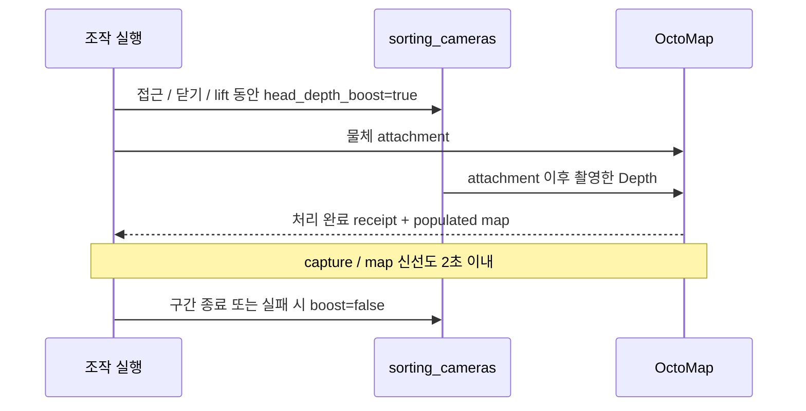
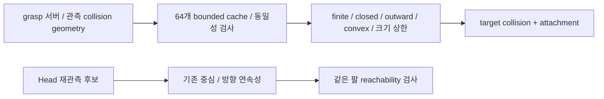
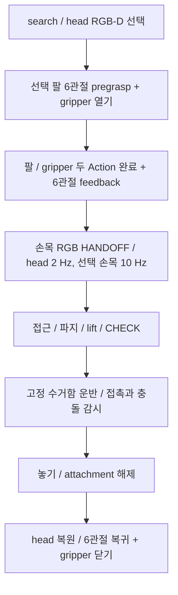

# 스터디카페 수거 설정

[실행](study-cafe-sorting-usage.md) / [충돌·접촉·운반 계약](study-cafe-sorting-contract.md)

아래 값은 고정 베이스 시뮬레이션용입니다. Launch 인자는 다음 실행부터 적용되며 이미 실행 중인 GUI의 파라미터를 바꾸지 않습니다.

## 작업자 관찰 모드와 파지 깊이

| `sorting_verify_placement` | 동작 | 종료 결과 |
|---|---|---|
| `false` 기본 | 놓기와 복귀 후 다음 탐색; verifier 준비/호출을 기다리지 않음 | `complete_unverified`, `placement_verified=false`, `mission_complete_unverified` |
| `true` | 독립 verifier로 안착 확인 | 확인을 통과해야 `mission_complete` |

두 모드 모두 접촉 이탈 감시, 정지, 충돌 검사와 빈 작업영역 재확인을 유지합니다. 관찰 모드의 안착은 작업자가 GUI에서 확인합니다.

| 접근 보정 | MuJoCo sorting 값 | 적용 |
|---|---:|---|
| `grasp_approach_offset_m` | 0.018 m | 공통; 일반 경로는 0.016 m |
| `mouse_grasp_extra_depth_m` | +0.014 m | `mouse`, `computer mouse`, `wireless mouse`; 합계 32 mm |
| `lego_grasp_extra_depth_m` | +0.004 m | 설정 라벨 정확 일치; 합계 22 mm |
| `tissue_grasp_extra_depth_m` | +0.004 m | `crumpled tissue`, `tissue`, `crumpled paper`; 합계 22 mm |

`red building block`은 레고 추가량에 매칭되지 않습니다. 실물/비sorting 추가량 기본은 0입니다. 일반 ROS 설정의 `deeper_grasp_labels`와 `deeper_grasp_offsets_m`은 같은 길이이며 selector/executor가 동일한 값을 사용해야 합니다. Pregrasp 위치는 유지합니다. 공통 깊이는 `0.016`, 휴지 추가량은 `0.0`으로 비교할 수 있습니다. 실측 보정값이 아니므로 다른 물체 크기에 재사용하기 전에 검증합니다.

## 선택형 시뮬레이션 최적화와 원복

| 옵션 | 사용 목적 / 기본값 |
|---|---|
| `sim_performance_profile` | `baseline`; 배경 충돌/그림자 절감은 [MuJoCo 프로필](../../cleany_mujoco_sim/docs/scenes.md#되돌릴-수-있는-고정-책상-최적화) |
| `topdown_only` | 기본 false. true는 지지면 법선 아래 방향만 탐색하고 반대쪽 접근 필터를 끔; 사선 fallback 없음 |
| `shutdown_on_sorting_exit` | false로 실행하면 완료/실패 뒤 GUI 유지 |
| 초기 손목 roll | 양팔 +1.58 rad, keyframe과 actuator 목표에 적용; 실물 보정과 별개 |
| `gripper_open_position_rad` | 1.2 rad; 열린 jaw 경로도 충돌 검사 |
| `joint_limit_margin_rad` | sorting 0.005 rad, 일반 0; endpoint 선택 여유이며 feedback clipping 아님 |

Top-down도 평면 추정과 IK 오차 허용이 있으므로 완벽한 수직 제어를 뜻하지 않습니다. IK와 충돌 허용 기준은 동일합니다.

## 파지 후 Depth 최신성

| `attachment_scene_timeout_sec` 적용 경로 | wall time 상한 |
|---|---:|
| 일반 sensor-scene | 5초 |
| 시뮬레이터를 시작하지 않는 sorting 구성 | 10초 |
| MuJoCo 시뮬레이터를 시작하는 sorting | 30초 |

이는 준비 응답의 최대 대기 시간입니다. 신선도 2초를 늘리지 않으며 준비되면 즉시 진행합니다. 외부 실물 수거 실행은 아직 지원하지 않습니다. Boost 거부 시 이동하지 않으며 카메라 노드도 함께 빌드해야 합니다.

| 지도 설정 | 범위 / 절충 |
|---|---|
| `KnownGeometryOctomapUpdater` | MuJoCo sorting 기본. 등록한 물체 형상 내부에 완전히 포함된 셀만 제거; 부분 겹침과 주변 장애물 유지 |
| `depth_octomap_plugin` | 명시 override; 실물과 비sorting은 기존 updater |
| `scene_cloud_pixel_stride` | MuJoCo 4: 640×480 최대 19,200점. 일반 2: 76,800점. 인식 해상도는 유지하지만 작은 장애물 점 밀도 감소 |

지도 갱신은 원본 cloud 수신만으로 인정하지 않습니다. 처리 receipt와 populated map 조건은 [계약](study-cafe-sorting-contract.md#접촉-재시도와-운반-감시)을 따릅니다. 어깨 기준점은 현재 CAD URDF shoulder origin이며 `test_learned_runtime_launch.py`가 grasp parameter와 일치하는지 검사합니다.

## 닫기 직후 접촉 확인

| 조건 | 기본값 |
|---|---|
| 새 joint-state의 안정 샘플 | 연속 3개 이상 |
| ROS 시간 안정 구간 | `gripper_contact_stable_duration_sec`: 0.10초 이상 |
| 실제 시간 대기 | `gripper_contact_feedback_timeout_sec`: 최대 5초 |

속도가 튀면 안정 구간을 초기화합니다. 이 확인 중 추가 닫기 명령을 보내지 않으며 controller 실패나 새 feedback 누락은 실패입니다. CHECK 전후의 0.3초 확인과 닫기 재시도는 [별도 계약](study-cafe-sorting-contract.md#자동-sorting의-손목-미검출-보완)입니다.

## Sorting 속도와 실행 설정

다음 값은 simulation sorting launch의 기본값입니다. 일반 demo와 실물 로봇의
하드웨어 한계와 구분하며, 각 이름은 launch argument 및 ROS parameter입니다.

| 설정 | 기본값 |
| --- | ---: |
| `velocity_scaling` / `acceleration_scaling` | 0.30 / 0.50 |
| `sorting_payload_velocity_scaling` / `sorting_payload_acceleration_scaling` | 0.24 / 0.20 |
| `cartesian_translation_speed_m_s` | 0.30 |
| `approach_velocity_scaling` / `retreat_velocity_scaling` | 1.0 / 0.8 |
| `cartesian_translation_acceleration_m_s2` | 0.80 |
| `cartesian_joint_acceleration_rad_s2` | 4.0 |
| `cartesian_rotation_speed_rad_s` | 1.50 |
| `lin_acceleration_scaling` | 0.8 |
| `corridor_time_margin` | 1.05 |
| `gripper_motion_sec` (별도 닫기/놓기 명령) | 2.0 |

접근 가속도 배율 `sorting_approach_acceleration_scaling=1.0`은 유지합니다.
pregrasp와 그리퍼 열기는 기존 6관절 동시 계획을 유지하며, 별도 2초 대기를
추가하지 않습니다. 운반은 기본 이동 배율과 payload 배율의 최솟값을 적용합니다.
위 Cartesian 속도는 retiming 상한이지 실제 일정 속도를 보장하는 값이 아닙니다.
충돌/FK/관절 위치·속도 한계, 추적·접촉 감시, timeout 취소는 유지합니다.
시뮬레이션 속도는 실제 경과 시간과 다를 수 있으며, 이 설정은 실물 성능 검증값이 아닙니다.

## 관측 형상과 재선택

| 설정 / 검사 | 계약 |
|---|---|
| use_observed_collision_geometry | Sorting true, 일반 false는 기존 OBB |
| 입력 | /grasp/collision_geometry의 snapshot/object ID, capture header, OBB pose 정확 일치 |
| Mesh 유효성 | Finite / closed / outward / convex, vertex / triangle 상한 |
| 활성 상태에서 geometry 없음 | Timeout 뒤 실패; OBB로 조용히 대체 안 함 |
| 유지 검사 | Support patch, 전체 robot open/closure |
| 운반 / 재관측 / 놓기 반경 | OBB 반대각선과 mesh 최대 local vertex 거리 중 큰 값 |
| 한계 | Trimmed OBB 밖 관측점 포함, 숨은 실제 형상 보장 아님; cache는 identity 검사 |
| 시간 | Sensor-scene / wrist freshness 별도 적용 |
| 기록 | 수신 collision_geometry CDR도 artifact에 포함 |
| 재선택 | 중심 / 방향 연속성 통과 후보만 같은 팔 selector에 전달; 호환 후보 없으면 이동 전 실패 |
| Head 갱신 | sorting_head_reference_refresh_age_sec 기본 0, 양수로 진단 가능, 최대 30 s |

Head 갱신을 켜도 새 관측과 재계획은 기존 simulation-clock 신선도 상한을 만족해야 합니다.

## 서비스와 실행 대기 상한

응답 timeout은 고정 대기나 충돌 허용치가 아닙니다. 준비되면 즉시 진행하고 만료되면 해당 작업을 실패시킵니다.

| 설정 | 일반 | CPU sorting |
|---|---:|---:|
| `planning_scene_timeout_sec` | selector 1초 / executor 2초 | 5초 |
| `state_validity_timeout_sec` | 1초 | 5초 |
| `fk_timeout_sec` | [selector config](../config/grasp_selection.yaml) | 5초 |
| `ik_response_margin_sec`, `planning_response_margin_sec` | 1초 | 5초 |
| IK / aim IK / MoveGroup 계산 예산 | 0.15 / 1 / 4초 | 동일 |

응답 여유는 계산 예산 뒤에 더하며 aim IK에도 적용합니다. 충돌 검사나 실패 결과를 생략하지 않습니다.

Cartesian wall deadline은 `max(minimum_sec, trajectory_duration × factor + margin_sec)`입니다.

| `cartesian_execution_wall_timeout_` 접미사 | 값 |
|---|---:|
| `minimum_sec` | 60초 |
| `margin_sec` | 10초 |
| `factor` | 일반 2 / CPU sorting 10 |

동작 감속값이 아니며 접촉·추적 감시와 timeout 시 취소·종료 확인은 유지합니다.

## 동시 관절 이동과 카메라 인계

| 동시 이동 | 계약 |
|---|---|
| 시작 | 양손 초기 열기 없음; 선택 팔만 *_pregrasp_open 사용 |
| 검사 | 열린 jaw 포함 전체 경로; target 접촉 허용은 grasp 접근부터 |
| Controller | MoveIt이 팔 / gripper 궤적 분배; 두 완료와 선택 6관절 feedback 전에는 HANDOFF 금지 |
| 반대 팔 / IK | 반대 gripper 미이동; grasp / retreat IK는 기존 5관절 |
| 복귀 | *_return_close, 저장된 원래 팔 자세 + sorting_return_gripper_position_rad=-0.30 |
| 복귀 조건 | 의도한 release와 attachment 해제 뒤 빈 팔만, jaw 충돌과 두 controller 완료 확인 |
| 시간 | gripper_open_position_rad는 최종 열림; gripper_motion_sec는 별도 파지 / 놓기만, 동시 이동 시간은 MoveIt 경로가 결정 |

| 손목 인계 / 운반 | 경계 |
|---|---|
| HANDOFF | 기존 head 3D와 경로 보존, RGB로 일관성 검사; 실패 시 중단 |
| 이 분기의 제외 동작 | Head 재검출 / 3D 재계산 / head 시야 복구 이동 |
| Lift 근거 | 손목 mask, 닫힘 명령 대비 관절 접촉 추정, kinematic clearance |
| 측정 한계 | 독립 힘 센서 / depth 상승량 아님; 옛 3D를 새 측정값으로 표시 안 함 |
| 수거함 | robot_top_bins.yaml 초기 base_link 위치, 전후 접촉 / 충돌 검사; [입구 검사는 경로별 구분](study-cafe-sorting-contract.md) |
| 카메라 TF | Nominal CAD; 실물은 측정한 양팔 hand-eye 필요 |
| 설정 파일 | sorting_wrist_cameras_config, 기본 cleany_mujoco_sim/config/sorting_wrist_cameras.yaml |
| 실행 범위 | 외부 로봇 수거 / visual servo 미지원; 경로는 head 3D와 joint feedback에 의존 |
| Head-only 비교 | sorting_use_wrist_camera:=false |
