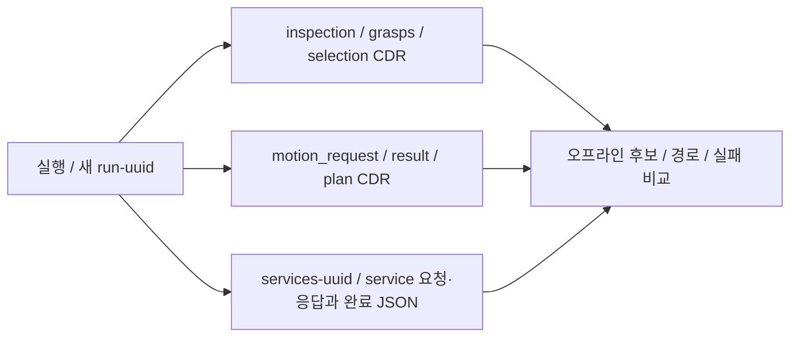

# 스터디카페 실행과 진단

[파지 후보와 다른 조작 경로](manipulation.md) / [설정](study-cafe-sorting-configuration.md) / [실행 계약](study-cafe-sorting-contract.md)

## 센서 전용 study-cafe 검증

| 목적 | 저장소 루트 명령 | 실제 실행 범위 |
|---|---|---|
| 인식과 후보 계획 | `ros2 launch cleany_skill_executor study_cafe_nearest_grasp_demo.launch.py` | RGB-D, YOLOE/Gemini, AnyGrasp, MoveIt plan-only |
| 연속 수거 | `ros2 launch cleany_skill_executor study_cafe_sorting.launch.py` | MuJoCo 팔 이동과 물체 접촉, 운반과 놓기 |
| 단일 물체 Action | [BT 실행](../../cleany_manipulation_bt/README.md) | 별도 BT Action 경로 |

1. `make build` 후 [공통 환경](../../../../docs/implementation/running.md#공통-준비)을 적용하고 `GEMINI_API_KEY`, 로컬 YOLOE/AnyGrasp 모델을 준비합니다. [인식 모델 설정](../../cleany_perception/docs/runtime.md#모델-준비)을 따릅니다.
2. 같은 domain의 다른 simulator/controller를 종료합니다. Vendor 카메라 renderer는 headless에서도 유효한 `DISPLAY`가 필요합니다.
3. 위 표에서 하나를 선택합니다. Target 위치는 카메라에서 얻으며 시뮬레이터 정답을 planner 입력으로 사용하지 않습니다.

## 시뮬레이션 분리 수거 (통합 검증 진행 중)

처음에는 GUI를 유지해 결과를 확인할 수 있습니다.

```bash
ros2 launch cleany_skill_executor study_cafe_sorting.launch.py headless:=false use_rviz:=true use_image_view:=true shutdown_on_sorting_exit:=false
```

기본 실행은 headless이며 RViz/image_view를 시작하지 않습니다. 완료/실패 뒤 기본적으로 launch도 종료합니다. `shutdown_on_sorting_exit:=false`는 GUI 유지 옵션이며 수거를 자동 재시도하지 않습니다.

| 화면 / 출력 | 확인할 내용 | 성공으로 오해하지 않을 것 |
|---|---|---|
| MuJoCo GUI | 물체가 실제로 들어갔는지, 팔 복귀 | 기본 관찰 모드는 자동 안착 검증을 하지 않음 |
| `/sorting/status` | 단계, label, category, destination, 완료 항목; 실패 시 `error` | 수락/계획 로그는 최종 결과가 아님 |
| `mission_complete_unverified` | 관찰 모드 종료 | `placement_verified=false` |
| `mission_complete` | verifier 사용 시 안착 확인 후 종료 | 시뮬레이션 결과이며 실물 수거 성공 아님 |
| `First ranked grasp/pregrasp` | 첫 IK 후보 오차 | 최종 선택은 Action result의 joint state |

별도 터미널에서 같은 domain과 overlay로 관찰합니다.

```bash
ros2 topic echo /sorting/status --qos-durability transient_local
```

빈 작업영역은 연속 두 번 확인합니다. `sorting_require_category_coverage=true`일 때만 설정된 모든 category 완료도 요구합니다. `review` 및 위험/저신뢰 물체는 미해결로 남기며 집지 않습니다. 분류 대상은 종이컵, 마우스, 휴지, 레고이고 위치/크기는 [장면 설정](../../cleany_mujoco_sim/docs/scenes.md)을 따릅니다.

## 실행 옵션 고르기

| 옵션 | 효과 |
|---|---|
| `sim_viewer:=efficient` 기본 | 센서 snapshot을 공유하는 최대 20 Hz GUI |
| `sim_viewer:=native` | 전체 MuJoCo UI |
| `scheduled_cameras:=true` | 통합 launch 기본; 손목 전환 수거에 필수 |
| `sorting_verify_placement:=true` | release 이후 새 AABB로 안착을 검사하는 시뮬레이션 verifier 사용 |
| `sorting_use_wrist_camera:=false` | head-only 비교 시험 |
| `sorting_contact_diagnostics:=true` | 접촉 부위/힘 출력만 추가. Coordinator는 이 GT 토픽을 읽지 않음 |
| `topdown_only:=true` | [수직 후보 비교](study-cafe-sorting-configuration.md#선택형-시뮬레이션-최적화와-원복) |

`fastdds_profiles_file`은 child 시작 전에 `FASTRTPS_DEFAULT_PROFILES_FILE`로 전달됩니다. 기존 환경변수를 우선하며 기본은 UDP와 participant별 16 MiB SHM인 `fastdds_rgbd.xml`입니다. 빈 값은 middleware 기본 설정을 사용합니다. 별도 recorder/camera도 같은 DDS 환경을 사용합니다. 다른 RMW, QoS 및 freshness 기준은 바꾸지 않습니다.

## 실패 위치 찾기

| 멈춘 구간 | 먼저 확인할 것 |
|---|---|
| RGB-D 준비 | DISPLAY, 모델 경로, exact stamp와 TF, DDS 환경 |
| 후보 선택 | 거리 유효성, 시야 cone, IK와 충돌 결과; 정답 pose 주입 금지 |
| HANDOFF | 선택 팔 좌표계과 source/reference ID, 새 손목 RGB |
| 닫기 / lift | 새 gripper feedback, 접촉 유지, attachment 이후 Depth receipt |
| CHECK 미검출 | [미검출 보완 조건](study-cafe-sorting-contract.md#자동-sorting의-손목-미검출-보완); ERROR는 별도 실패 |
| 운반 / 놓기 | 부착 형상, 고정 물체 중심과 wrist feedback; 실패 시 열지 않음 |

재관측 이동, seeded corridor와 손목 제한은 [실행 계약](study-cafe-sorting-contract.md)에 모읍니다. 속도·깊이·대기 시간은 [설정](study-cafe-sorting-configuration.md)에서 변경합니다.

## 저장 결과 읽기



| Artifact 설정 / 파일 | 의미 |
|---|---|
| sorting_artifact_directory | 기본 빈 값은 저장 안 함; 지정하면 새 run-uuid |
| inspection / grasps / selection | InspectScene.Result / PlanGrasp.Response / SelectReachableGrasp.Result |
| motion_request / motion_result | MoveGroup.Goal / Result; 접근 / 후퇴 / lift의 계획 실패·실행 전 거부도 기록 |
| Seeded 요청 | cleany_seeded_cartesian / monotone_cubic은 기록용 pipeline/planner ID; MoveGroup 서버에 보내지 않음 |
| 결과 trajectory / planning_time | 실제 IK / 검증 계산, 실패 포함 |
| motion_plan | FK 검증 통과 RobotTrajectory, corridor retiming 반영 |
| Services trace | 별도 services-uuid에 MoveIt 요청 / 응답 CDR, 완료 시각 / 취소 JSON |
| 사용 경계 | 출력 전용, 제어 입력 재사용이나 응답 / 계획 수정 없음 |
| 성능 해석 | File I/O 포함 시간; 저장 OFF 성능이나 물리 파지 성공으로 해석 안 함 |

`/sorting/verify_placement`는 독립 결과 검증 port입니다. 정답 AABB는 인식·분류·파지·경로 계산에 쓰지 않으며 실물에는 별도 센서 기반 verifier가 필요합니다.
