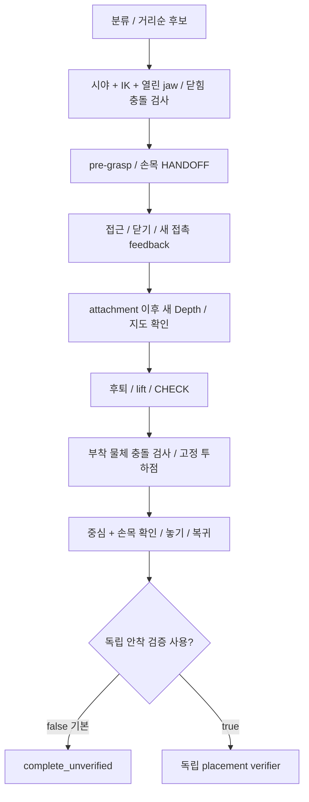
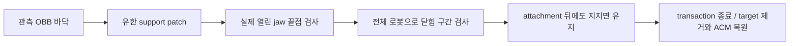
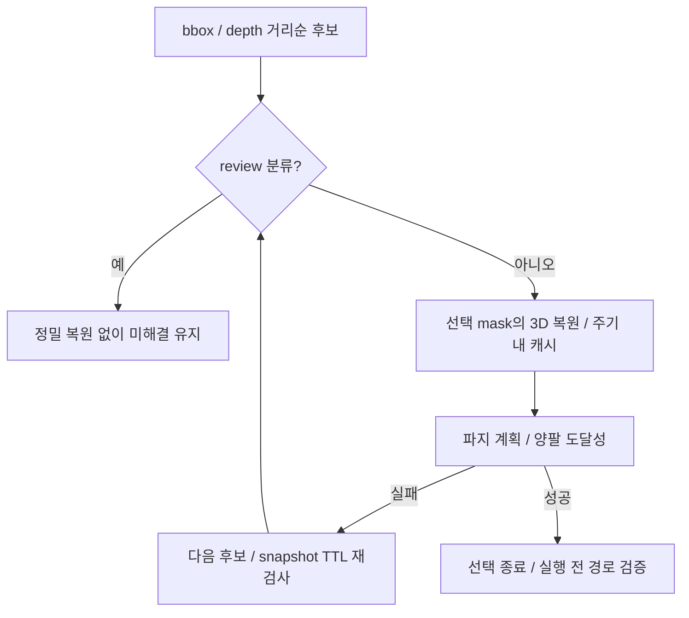
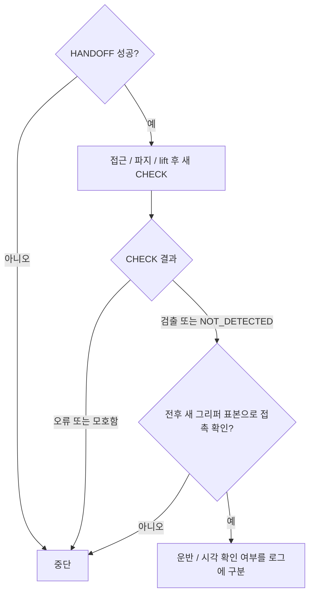
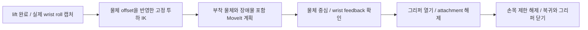
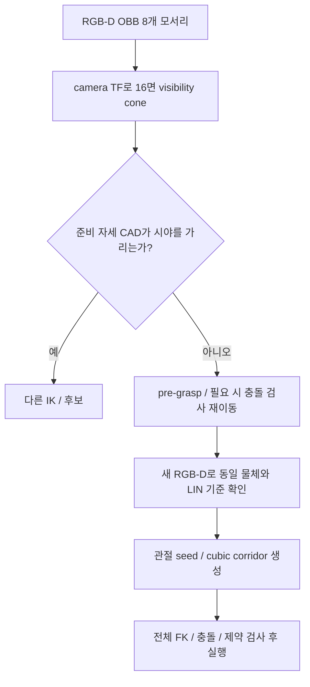
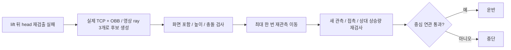

# 스터디카페 분류·운반 실행 계약

[실행](study_cafe_sorting_usage.md) / [설정](study_cafe_sorting_configuration.md)

센서로 선택한 물체를 집어 로봇 내부 후면 수거함의 고정 위치에 놓는다. 아래는 MuJoCo 실행 계약이며 전체 물리 정리 성공이나 실로봇 안전을 보증하지 않는다.

| 경로 | 놓기 직전 확인 | 결과의 한계 |
|---|---|---|
| 자동 sorting | 물체 중심, wrist feedback, MoveIt 충돌 | `TODO(bin-opening-fit)`: 입구 적합성 미구현 |
| MuJoCo BT Action | 위 조건 + bounding sphere 입구 검사 | 아래 margin / 높이 적용; 실물 검증 아님 |

## 분류·운반 실행 계약

| 항목 | 규칙 |
|---|---|
| 배치 | `robot_top_bins.yaml`의 내부 후면 받침판과 수거함; 책상 양끝 분류 영역과 구분선 없음 |
| 분류 | Gemini category/reason을 `table_sorting_policy.yaml` destination에 연결; label allowlist로 대체하지 않음 |
| 대상 | RGB-D 거리순 시도, 위험 label 거부, 수거 구역 물체 다시 집지 않음 |
| 완료 | 미처리 / 미확인 물체가 없어야 함; 관측 수보다 완료 수가 적으면 중단 |
| 빈 영역 | 두 번 재확인; search/action 최대 12회 도달 시 실패 |
| 수량 검사의 한계 | 객체 identity 추적과 독립 안착 검증을 대체하지 않음 |
| MuJoCo oracle | 물체 전체 AABB가 수거함 안에 있고 정지했는지 검사 |
| 종료 | `sorting_exit_on_finish=true`; GUI 유지 시 `shutdown_on_sorting_exit:=false` |

### 지지면과 jaw 충돌

| 검사 | 설정 / 거부 조건 |
|---|---|
| Support patch | `support_patch_margin_m=0.02`; OBB XY 사방 2 cm 확장, 바닥 아래 두께 1 cm; node 기본 0 |
| 관측 전제 | OBB Z축이 지지면 법선; 수평에서 20° 초과 또는 잘못된 pose 거부 |
| 범위 | target mask padding 1.5 cm를 포함하는 로컬 가정; 책상 정답을 읽지 않음 |
| 접촉 허용 | 물체/support만 허용, robot/support 거부 |
| 열린 끝점 | `require_open_grasp_clearance=true`; target 접촉 허용을 잠시 해제하고 선택 gripper만 연 전체 로봇 검사 |
| 닫힘 sweep | `require_gripper_closure_clearance=true`; `gripper_sweep_step_rad=0.05` 이하 간격, target 외 충돌 거부 |
| 복원 | 성공 / 실패 / 예외 모두 ACM 복원; attachment 뒤에도 patch 유지 |
| 충돌 진단 | 거부된 seeded cubic의 최대 8개 contact: body pair, 위치/frame, penetration depth |

이 검사는 기하학적 표본 검사다. 접촉 동역학과 파지 유지를 보장하지 않으며 보수적인 OBB 때문에 유효한 후보도 거부할 수 있다. Grasping의 간이 지지면 검사 위임은 이 patch와 open/closure 검사를 함께 사용할 때만 허용한다.

### 선택 물체의 복원과 IK

선택하지 않은 물체도 전체 depth OctoMap의 충돌 검사에는 남는다. 만료된 snapshot의 시각을 갱신하지 않으며, 미해결 물체와 이전 관측 물체의 누락을 계속 검사한다.

| 항목 | Sorting 값 / 계약 |
|---|---|
| 고정 jaw 여유 | `fixed_jaw_clearance_m=0.003 m`; selector/coordinator의 `grasp_fixed_jaw_clearance_m`도 동일; 비-sorting 기본 0 |
| 벌림 여유 | `grasp_opening_margin_m=0.008 m`; 고정 jaw 여유는 그 절반 이하 |
| 5 mm 진단 | 고정 여유 0.005 m, 벌림 여유 0.010 m; 생성기와 두 TCP 보정 경로에 동일 전달 |
| 수치 보정 | `pose_refinement_iterations=30`; runtime `/robot_description` URDF 로컬 FK와 MoveIt FK를 후보 탐색 전 대조; 일반 adapter 0은 기존 탐색 |
| Seed 예산 | pregrasp는 `pregrasp_aim_attempts`, grasp는 `grasp_pose_seed_attempts`; grasp 0이면 pregrasp 예산 재사용 |
| 종료 | 설정 예산 내 첫 유효 해; 예산 증가는 실패 후보 시간을 늘릴 수 있으나 허용값은 유지 |
| 위치 검사 | grasp 1.5 mm (`grasp_position_tolerance_m=0.0015`), pregrasp 20 mm |
| 위치 잔차 가중치 | `pose_refinement_position_weight=10`; 각도, 관절 한계, 충돌 기준 유지 |
| Head reference 갱신 | `sorting_head_reference_refresh_age_sec=0.0`이면 시간 경과만으로 재인식하지 않음; `(0,30] s`는 만료 / 연관 / 동일 팔 재계획 활성 |

수치 보정은 후보 계산이며 로봇 명령을 보내지 않는다. Head reference 자동 갱신을 꺼도 손목 관측 유효성 검사와 원본 timestamp는 유지한다.

### TCP 보정과 닫기

| 항목 | 계산 / 제한 |
|---|---|
| `grasp_use_aperture_centering=true` | 검출 폭에서 opening margin 8 mm 제외 → 물체 폭/2 − `fixed_jaw_inner_x` 8 mm로 TCP 옆방향 보정 |
| 계획과 실행 | 같은 보정 함수 사용 |
| 시뮬레이션 jaw | aperture 기울기 0.065 m/rad, command opening reduction 18 mm |
| 추가 닫기 | `gripper_contact_retry_steps`: node 0, sorting 5, 허용 0–5회 |
| 회당 명령 | `gripper_contact_retry_step_rad=0.10`, `gripper_contact_retry_motion_sec=1.2` |
| 구동 한계 | 닫힘 하한과 기존 토크 제한 유지; 최초 열린 위치 기준으로 접촉 판정 |
| 확인 실패 | 허용 횟수 안에서 확인되지 않으면 lift 전에 실패 |

### 자동 sorting의 손목 미검출 보완

| 조건 | 기준 |
|---|---|
| CHECK 횟수 | `sorting_wrist_check_attempts=1`, 허용 1–5; 기본은 미검출이어도 추가 요청 없이 모터 검사로 판단 |
| 영상 신선도 | 첫 요청은 lift 완료 뒤, 재요청은 직전 실제 촬영 시각 뒤의 프레임 |
| 응답 동일성 | 미검출 응답도 source/reference ID, 선택 팔 frame, 촬영 시각 확인 |
| 보완 제외 | HANDOFF 실패, 센서 / 통신 / TF / 추론 / 참조 오류, 모호한 검출 |
| 접촉 표본 | 각 CHECK 전후 요청 이후의 서로 다른 표본 최소 3개 |
| 지속 시간 | `sorting_wrist_contact_confirmation_sec=0.3 s` ROS 시간 |
| 나이 / 간격 | `sorting_gripper_feedback_max_age_sec=0.5 s` 이하 |
| 대기 상한 | `gripper_contact_feedback_timeout_sec=5 s` wall time |
| 거부 | 오래된 값, 중복 stamp, 단절, 빈손 완전 닫힘, 접촉 상실 |
| 미래 stamp | `/clock`이 따라올 때까지 세지 않음; 지속되는 미래 값 / 시계 정지는 상한에서 실패 |

모든 영상이 미검출이어도 접촉 조건을 만족하면 운반한다. 이는 그리퍼 위치·속도에 근거한 진행이며 물체 식별이나 전류·토크 확인이 아니다. Lift 높이도 FK와 파지 offset의 추정값이다.

### 접촉 재시도와 운반 감시

| 단계 | 유지하는 검사 |
|---|---|
| 최초 접촉 | 관절 잔차와 정지 속도; 완전히 닫혀 잔차가 없으면 성공 아님 |
| 연속 sorting | `gripper_force_full_close=true`로 기존 닫힘 하한을 목표로 유지; 실제 접촉은 그 전에 멈출 수 있음 |
| 비동기 운반 | 추가 조임은 허용; 최소 잔차, 열리는 속도 상한, feedback 신선도, 손목 추적, 접촉 상실 debounce 유지 |
| 감시 기준 명령 | 추가 닫기를 포함한 실제 마지막 명령 |
| Attachment 대기 | [경로별 timeout](study_cafe_sorting_configuration.md#파지-후-depth-최신성); 새 데이터가 준비되면 즉시 진행 |
| 지도 신선도 | 2 s, attachment 뒤 새 capture 필요; tree 쓰기 뒤 processed-cloud receipt로 활동 확인 |
| 지도 거부 | 빈 지도, 원본 cloud 수신만 있음, 중복 receipt; populated-map과 capture/receipt 신선도 모두 요구 |

힘 센서 판정이 아니므로 잔차가 사라지기 전의 미끄러짐을 모두 검출하지 못한다. 물리 파지 성공과 실물 보정값은 별도 검증 대상이다.

### 열린 jaw와 수직 lift 진단

열린 jaw 검사는 [지지면과 jaw 충돌](#지지면과-jaw-충돌)을 따른다. 아래 진단은 기본 역방향 retreat를 바꾸어 시험할 때 사용한다.

| 설정 / 검사 | 조건 |
|---|---|
| `direct_vertical_lift` | 기본 false; true는 현재 TCP에서 바로 수직 lift 계획 |
| `direct_vertical_lift_extra_m` | 기본 0, 허용 0–0.05 m; 진단 TCP 상승에만 추가 |
| 높이 | 기존 물체 중심 최소 상승 높이 유지; 부족하면 예측 / 요구 높이 오류 기록 |
| 경로 | 끝점 position IK/FK + seeded 위치 corridor; 끝점 자세 한도 5°와 전체 FK / 충돌 / 자세 검사 |
| 해석 | 정확한 자세 고정 LIN이 아님; 접촉과 손목 감시 유지 |

## 수거함 운반

고정 투하점과 운반 설정 원본은 [nearest_pregrasp.yaml](../config/nearest_pregrasp.yaml)이다.

### 분류된 수거함으로 직접 이동 / 손목 유지 (기본 모드)

| 항목 | 값 / 동작 |
|---|---|
| 왼쪽 분실물 중심 | `sorting_fixed_release_lost_items_left_m=[-0.075,0.105,0.50]`, base_link m |
| 오른쪽 쓰레기 중심 | `sorting_fixed_release_trash_right_m=[-0.075,-0.105,0.50]`, base_link m |
| 기본 경유점 | 파지 전 공통 경유점 IK, 공동 손목 endpoint, 경유점 이동 생략 |
| 투하 IK | Roll 고정, 어깨 yaw/pitch + 팔꿈치 + 손목 pitch 4관절 계산 |
| 투하 허용오차 | 중심 1 cm, IK 축별 0.5 mm, `sorting_fixed_release_wrist_tolerance_deg=0.5°`; 자동 확대 없음 |
| 도달 실패 | 물체를 놓지 않고 중단; 넓은 탐색이나 손목 완화로 우회하지 않음 |
| 최종 자세 캐시 | 동일 팔 / roll / offset / 투하점만 재사용; hit도 현재 부착 물체 충돌과 FK 재검사 |
| 빈손 복귀 상한 | `sorting_return_velocity_scaling=0.12`, `sorting_return_acceleration_scaling=0.15`; 더 낮은 전역값 우선 |

현재 `robot_top_bins.yaml`의 `simulation_ignore_mast_collision=true`는 MuJoCo 기둥 접촉과 MoveIt 기둥–로봇 충돌을 제외한다. 외형과 self-filter 형상은 남지만 이 구성의 성공은 실제 기둥 회피 검증이 아니다.

복귀 상한은 MJCF STS3215 모델(2.648 Nm, 감쇠 합 3.342 Nm·s/rad)의 추종 제약에 맞춘 값이다. 무부하 정상 속도 약 0.78 rad/s 이하에 대해 복귀 yaw 상한은 약 0.509 rad/s다. 토크와 0.12 rad 추종 허용치는 유지하며 실제 모터 인증값으로 쓰지 않는다.

### 파지 후 후퇴/들어 올리기의 손목 제약

| 단계 | 제약 / 재시도 |
|---|---|
| 기준각 | 안정된 파지 접촉 시점의 실제 roll; 구간마다 재설정하지 않음 |
| 후퇴 / lift | 새 endpoint IK와 전체 Cartesian 경로; 빈 팔 pregrasp 목표 재사용 안 함 |
| Roll 범위 | `sorting_carry_wrist_tolerances_deg=[2,5,10,20,30]°`; 계획 실패 시 다음 범위, 확대 범위는 놓기까지 유지 |
| 방향 변화 | `sorting_carry_cartesian_rotation_limit_deg=30°`; 구간 시작 방향 기준, pitch는 물리 한계 내 자유 |
| MoveIt / 직접 궤적 | 같은 joint path constraint; local IK와 모든 waypoint에서 확인 |
| 재시도 금지 | 서비스 / URDF 오류, controller 실패, 접촉 상실 뒤 완화 재실행 금지 |
| 일반 운반 | IK 뒤 경로 계획 실패 시 중단 |
| 해제 | 열기와 attachment 해제 후 복귀 |

FK corridor의 자세·속도·가속도·충돌 검사는 유지한다. Roll 유지가 세계좌표 방향 고정, 물체 수평 유지 또는 전역 최적해를 뜻하지 않는다.

| BT Action의 추가 입구 검사 | 기준 |
|---|---|
| 입구 내 포함 | 벽 두께와 `sorting_release_edge_margin_m=0.005 m`를 제외한 내부에 bounding sphere 포함 |
| 테두리 위 물체 하단 | `sorting_release_clearance_m=0.06 m`부터 `sorting_release_maximum_clearance_m=0.21 m`까지 |
| 실행 / 놓기 전 | 범위 밖이면 이동 중단; 놓기 직전 실제 중심 / 손목 / 입구 재검사 |
| 자동 sorting | 위 sphere 검사는 미적용; 중심 / 손목 / MoveIt 검사만 수행 |

## 준비 자세와 접근 경로

| 검사 | Sorting 설정 / 제한 |
|---|---|
| 시야 | `require_pregrasp_visibility=true`, 일반 false; 관측 OBB 기반, padding 3 mm |
| TF / 결과 | 동적 camera TF 0.5 s 이내; 누락된 validity 결과를 통과로 간주하지 않음 |
| 재선택 후 이동 | LIN 방향 기준을 넘으면 새 pregrasp로 이동; target 접촉 불허 |
| 재관측 | 동일 OBB 모서리 집합 5 mm 이내, LIN 방향 10°; 누락 / stale / 중복 일치 거부 |
| 접근 모드 | `use_joint_corridor_grasp=true`, `use_seeded_cartesian_grasp=true`; 선택 grasp 관절값 보존 |
| 경로 기하 | TCP 반경 1 mm 원통, 역접근 목표는 실제 접근 시작 관절값 |
| IK / 곡선 | 기본 10 mm 간격 collision-aware IK → 단조 cubic; 전체 feedback / attachment 유지 |
| 방향 검사 | 시작 / 끝 0.01 rad 이내, 중간은 끝 자세 SLERP의 5° 이내; 원통 이탈 / 역행 거부 |
| 실행 전 표본 | 실제 JTC cubic을 기본 1 mm 및 관절별 0.005 rad 이하 간격 검사; 2,000점 초과 중단 |
| JTC 전달 | position + velocity, acceleration 필드는 비움 |
| 관절 한계 | `cartesian_joint_limits_file` 기본 MoveIt `joint_limits.yaml`; 미정 가속도는 `cartesian_joint_acceleration_rad_s2=1.0` rad/s²에 실행 scaling |
| Cartesian retiming | 0.10 m/s, 0.50 rad/s, 0.20 m/s²에 scaling; `corridor_time_margin=2.0` |

Retiming은 위치를 바꾸지 않고 시간을 균일하게 늘리며 속도·가속도를 함께 낮춘다. 표본 검사는 연속 시간 충돌이나 하드웨어 안전 인증을 대신하지 않는다. Seeded 모드를 끄고 joint corridor만 켜면 OMPL+FK 검사를 쓰며, 일반 데모는 opt-in이고 수직 lift는 endpoint 검사 후 Pilz LIN이다.

`align_grasp_wrist_roll=true`는 URDF의 roll 축과 TCP offset이 local −Y라는 가정 아래 후보의 closing 방향을 맞춘다. 관절 범위 안 동치각만 검사하며 비대칭 jaw의 180° 반전은 허용하지 않는다. 후보만 회전시킨 뒤 전체 충돌과 FK 허용값을 다시 검사한다. 일반 selector 기본은 false이며 모델-parity 검사가 이 기구학 가정을 확인한다.

## Head 재관측 fallback

| 설정 / 조건 | 기준 |
|---|---|
| 활성 | `sorting_reobserve_after_lift=true`; 기본 관측 경로에서 대상이 없을 때도 적용 |
| 화면 포함 | 관측 OBB bounding sphere 전체; `sorting_reobserve_margin_px=24`, `sorting_reobserve_geometry_padding_m=0.01 m` |
| 이동 | `sorting_reobserve_max_translation_m=0.20 m` |
| 낮추기 | `sorting_reobserve_max_lowering_m=0.10 m`, 높이 최대 3단계; 필수 상대 상승량 + `sorting_reobserve_height_clearance_m=0.02 m` 아래 금지 |
| 실행 | attached geometry 유지, collision-aware IK와 MoveIt 계획; 전후 contact 확인 |
| 결과 | 재검출 / 복원 / 높이 실패는 중단; 중심 연관 `sorting_held_association_tolerance_m=0.03 m` 이내 |
| 파지 중 joint-goal | `sorting_payload_velocity_scaling=0.24`, `sorting_payload_acceleration_scaling=0.20`; 더 낮은 기존 상한 우선 |
| Node 단독 기본 | 위 scaling 둘 다 0.01; 열린 그리퍼 복귀는 원래 값, Cartesian retiming은 별도 |

MuJoCo GT나 자동 물체 부착을 사용하지 않는 센서 기반 동작이다. 재관측과 지속 파지 성공은 별도 실행 검증이 필요하다.
