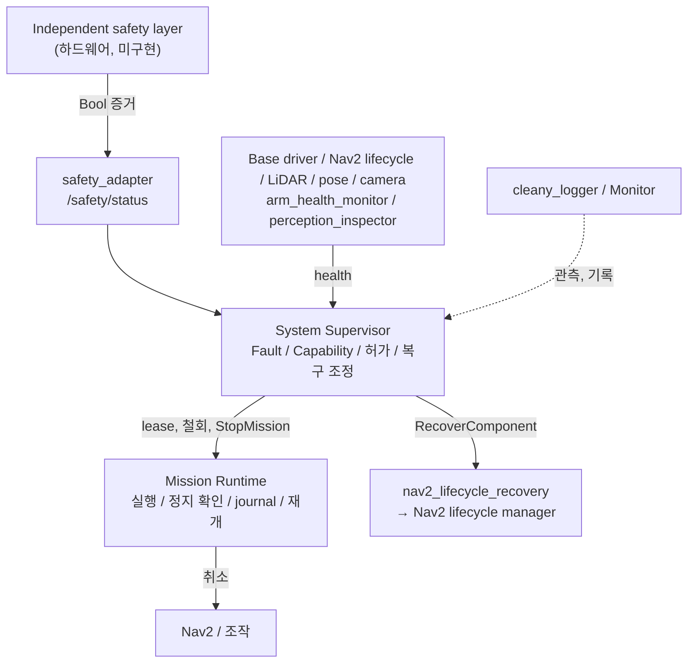

# System Supervisor 계약

System Supervisor는 시스템 가용성, Fault, Capability, 운영 상태, Mission 실행 허가와 복구 조정을 소유한다. 실제 안전 정지 장치가 아니며 Mission 실행, 정지 확인, 재개, journal과 Nav2 BT Recovery를 대신하지 않는다. 책임 원칙은 KB의 [System Supervisor](<../../../../docs/cleany-docs/20_TECHNICAL/14 - System Supervisor.md>)를 따른다. Endpoint 표는 [인터페이스](interfaces.md), 설정 원본은 [system_supervisor.yaml](../config/system_supervisor.yaml)이다.

## 책임 경계

| 판단 | 소유자 |
|---|---|
| 시스템 Fault, Capability, 운영 상태, 실행 허가 | Supervisor |
| 미션 수락, 실행, 취소, 자기 동작의 정지 완료, 재개, journal | Mission Runtime |
| 현재 팔 상태로 주행해도 되는지(`safe_to_drive`) | Mission Runtime (조작 결과 기반) |
| 실제 정지와 하드웨어 보호 | 독립 안전 계층 |
| 정지 증거와 E-stop 해제 증거 보고 | `cleany_safety_adapter` |
| 실제 복구 | 각 컴포넌트 owner (현재는 Nav2 lifecycle manager만) |
| 영구 기록 | `cleany_logger`; Supervisor는 구조화 이벤트만 발행 |

Runtime의 실행 오류(정지 기한 초과, adapter 예외, INTERRUPTED)는 Runtime ERROR와 `mission/reset_error`가 처리한다. 시스템 Fault는 Supervisor와 `system/request_fault_reset`가 처리한다. 허가 상실로 끝난 미션은 정지가 확인되면 Runtime ERROR로 가지 않는다.

## 운영 상태

| 상태 | 조건 |
|---|---|
| INITIALIZING | boot grace 중 필수 기능 또는 안전 증거가 아직 검증되지 않음 |
| OPERATIONAL | 모든 Capability와 필수 안전 증거가 fresh, stable이고 운영 잠금 Fault 없음 |
| DEGRADED | 필수 기능과 안전은 검증됐지만 일부 비필수 Capability 제한 |
| FAULT_LOCKED | 운영 잠금 Fault, 필수 기능 불가, 또는 grace 이후 필수 정보 미확인 |

Severity만으로 상태를 정하지 않는다. 필수 Capability는 `BASE_MOTION`이다. 초기와 stale 상태는 UNKNOWN이다. Capability 차단은 Fault debounce 없이 즉시 적용하고, 정상 복귀에는 `clear_s` 동안 연속 정상 보고가 필요하다.

### 부팅 유예와 hysteresis

| 상황 | 처리 |
|---|---|
| 한 번도 AVAILABLE을 보고하지 않은 source의 UNKNOWN | `startup_grace_s`(source별 override, base 15초) 동안 Fault 아님. Capability는 UNKNOWN이라 허가 거부 |
| 명시적 이상 보고 | grace와 무관하게 `raise_s` 뒤 Fault |
| 확인된 뒤 상실 | grace와 무관하게 `raise_s` 뒤 Fault |
| Base 첫 MCU 피드백 전 | `feedback_received=False`를 UNKNOWN으로 처리 |
| Base 짧은 피드백 공백 | `raise_s` 0.3초 미만이면 BASE_MOTION만 즉시 차단, latch 없음 |
| STOP 요청, `cmd_vel timeout` | base driver `fault`가 비어 있으므로 장애 아님 |

Grace 값과 hysteresis는 미측정 초기값이다.

## Capability와 Fault

| Capability | 직접 증거 | 의존성 |
|---|---|---|
| BASE_MOTION | base diagnostics | 없음 |
| NAVIGATION | 유효 scan, covariance 제한 내 pose와 localization lifecycle, Nav2 lifecycle(`planner_server`, `controller_server`, `bt_navigator`, `collision_monitor`) | BASE_MOTION |
| MANIPULATION | `arm_health_monitor` | 없음 |
| VISUAL_PERCEPTION | 유효 image, `perception_inspector` readiness | 없음 |
| MOBILE_MANIPULATION | 없음 | NAVIGATION, MANIPULATION, VISUAL_PERCEPTION |

KB 초기 분류는 BASE_MOTION에 "이동을 허용할 팔 상태"를 포함한다. 현재 구현은 이 판단을 Runtime의 `safe_to_drive`에 두고 Capability에서는 팔 가용성만 다룬다. 이 배치는 KB 검토가 필요하다.

| Fault | 기본 처리 |
|---|---|
| BASE_UNAVAILABLE | base fault, 지속 피드백 상실, grace 후 미연결. CRITICAL, latched, 전체 잠금 |
| LIDAR_UNAVAILABLE, CAMERA_UNAVAILABLE | 입력 중단 또는 무효. 해당 Capability 제한, 복구 unsupported |
| LOCALIZATION_UNAVAILABLE, NAVIGATION_UNAVAILABLE | pose 또는 lifecycle 이상. NAVIGATION 제한, lifecycle 복구 가능 |
| PERCEPTION_UNAVAILABLE, ARM_UNAVAILABLE | owner 보고 불가 또는 미확인. 해당 Capability 제한, 복구 unsupported |
| SAFETY_UNVERIFIED, ESTOP | 보호 계층 또는 E-stop 해제 증거 없음. CRITICAL, latched, 전체 잠금 |
| UNTRUSTED_PUBLISHER | 안전 또는 health topic에 allowlist 밖 publisher. CRITICAL, latched, 전체 잠금 |
| MISSION_STOP_FAILED:<lease_id> | 정지 실패 또는 기한 초과. 확인된 stop 결과 전까지 잠금 |
| SUPERVISOR_STATE_UNVERIFIED | 영속 상태 파일 읽기 또는 쓰기 실패. operator 확인 전까지 잠금 |

Latched Fault reset에는 원인 source의 fresh, stable 정상 보고와 `operator_id`가 모두 필요하다. E-stop reset은 하드웨어를 해제하지 않는다.

## 허가와 정지

Mission Runtime과의 순서와 사유 코드는 [Mission 계약](../../cleany_interfaces/docs/mission.md#system-supervisor-감독)을 따른다.

| 항목 | 계약 |
|---|---|
| Lease | 미션당 하나, `supervision_capabilities` 집합. TTL 1.5초, epoch와 version 일치, 갱신은 같은 집합만 |
| 철회 | Capability 상실, 운영 잠금, TTL 만료. 철회 즉시 `mission/stop` 요청 |
| 정지 확인 | Runtime이 자기 동작의 정지와 terminal 결과를 확인해야 stopped=true. Action 수락은 증거 아님 |
| 정지 기한 | `stop_timeout_s` 6초. Runtime 응답 기한(`cancel_timeout` 5초 + 0.5초)보다 길어야 정상 정지가 잠금으로 확대되지 않음 |
| 정지 서버 미발견 | 기한 안에서 재시도. 기한 초과 시 MISSION_STOP_FAILED |
| 늦은 확인 | 기한 뒤라도 stopped 결과가 오면 해당 Fault 해제 |
| Supervisor 종료 | 갱신이 끊겨 Runtime이 heartbeat timeout(1초)과 TTL로 스스로 정지 |

## 재시작과 영속 상태

`persistence.state_file`(기본 `~/.ros/cleany/system_supervisor_state.json`)에 활성 latched Fault와 정지 미확인 lease를 원자적으로 기록한다.

| 재시작 시 | 처리 |
|---|---|
| Latched Fault | restored로 다시 활성. 현재 health가 정상이어도 operator reset 전 잠금 |
| 정지 미확인 lease | granted=false로 복원하고 `mission/stop`으로 재확인. 확인 전에는 같은 mission의 새 허가와 복구 dispatch 차단 |
| 파일 손상, format 불일치 | SUPERVISOR_STATE_UNVERIFIED |
| 빈 `state_file` | 영속화 해제. 테스트 전용 |

## 정리와 이벤트

`retention_s`(300초)가 지난 정지 확인 lease, terminal recovery job, 해제 Fault를 정리한다. Job은 해당 Fault episode가 끝난 뒤에만 정리하므로 재시도 예산은 사라지지 않는다.

`system/events`는 상태 차이에서 이벤트를 만들기 때문에 어떤 전이도 기록을 건너뛰지 않는다. 영구 저장은 `cleany_logger`의 기록 대상에 추가해 처리하며, Supervisor는 파일을 쓰지 않는다. Node log에는 debug level로만 남긴다.

| kind | 의미 |
|---|---|
| STATE_CHANGED | 운영 상태 전이 |
| FAULT_RAISED, FAULT_CLEARED, FAULT_RESTORED | Fault 발생, 해제, 재시작 후 복원 |
| FAULT_RESET_ACCEPTED, FAULT_RESET_REJECTED | reset 요청. `source`는 operator_id |
| LEASE_GRANTED, LEASE_REVOKED, LEASE_RELEASED, LEASE_RESTORED | 허가 수명 |
| MISSION_STOP_ACCEPTED, MISSION_STOPPED | 정지 요청 수락과 정지 확인 |
| RECOVERY_REQUESTED, RECOVERY_<state>, RECOVERY_UNSUPPORTED | 복구 시도와 결과 |
| STATE_RESTORE_FAILED, STATE_PERSIST_FAILED | 영속 상태 오류 |

## 운영자 절차

1. `ros2 run cleany_system_supervisor supervisor_operator`로 활성 Fault를, `system/events`로 이력을 확인한다.
2. 물리 원인을 해소한다. CLI와 서비스는 하드웨어를 해제하지 않는다.
3. `supervisor_operator <FAULT_CODE> --operator <name>`으로 reset을 요청한다. 거부 사유는 응답과 이벤트에 남는다.
4. `MISSION_STOP_FAILED:<lease>` reset은 정지 Action을 다시 조회할 뿐이며 새 stopped 결과가 와야 해제된다.
5. Runtime ERROR가 남아 있으면 `mission/reset_error`로 따로 해제한다.

## 발신자 신뢰

Humble rclpy는 메시지별 발신자를 알려 주지 않는다. Supervisor는 graph를 조회해 `trusted_publishers` topic에 allowlist 밖 node가 publish하면 잠근다. 잘못된 실행과 이름 충돌은 잡지만 같은 node 이름의 위조는 막지 못한다. `ComponentHealth.source`가 node와 묶이지 않으므로 allowlist 안 node의 source 사칭도 막지 못한다. 실제 접근 통제는 SROS2 enforce 모드에서 `safety/status`, `system/component_health` publish와 `system/request_fault_reset`, `mission/stop` 호출을 각 enclave에만 허용하는 방식으로 해야 하며, 이 저장소에서는 검증하지 않았다.

## 복구 정책

| source | owner | 상태 |
|---|---|---|
| navigation | `navigation/recover` → `lifecycle_manager_navigation` | 구현, 자동 off |
| localization | `localization/recover` → `lifecycle_manager_localization` | 구현, 자동 off |
| lidar, camera, perception, arm, base | 없음 | `UNSUPPORTED`, 예산 소모 없음 |

자동 복구는 실제 Nav2 stack에서 lifecycle reset이 검증되지 않아 꺼져 있다. 기본 max_attempts 2, attempt 15초, total 40초, verify 5초, cancel 2초다. 복구는 겹쳐 실행하지 않고, 같은 Fault episode의 중복 요청은 같은 job을 반환한다. 시작에는 safety adapter의 whole-robot `stopped`와 미확인 Mission 정지가 없을 것이 필요하다. Owner 성공 뒤에도 fresh health와 안정화 시간이 지나야 성공이다.

## 검증 범위

소프트웨어 검증 결과와 지연시간은 [EVIDENCE](../../../../docs/EVIDENCE.md#system-supervisor와-mission-runtime-통합)에 있다. 다음은 하드웨어나 실제 stack이 필요해 검증하지 않았다.

- E-stop 회로와 독립 보호 계층 상태를 내보내는 하드웨어. 현재 신호가 없어 기본 실행은 잠긴다.
- ESP32 통신 차단 시 MCU watchdog의 모터 정지 시간과 실제 감속 거리.
- 실제 Nav2 stack의 lifecycle RESET/STARTUP 복구, Jetson 다중 프로세스 지연, base grace 15초의 적정성.
- 실물 arm controller 가용성 보고와 SROS2 enforce 모드.
- Mission이나 하위 제어기 crash 뒤의 물리 안전. Lease는 이 Runtime만 제한하며 임의의 `cmd_vel` publisher나 sorting coordinator 같은 별도 실행기를 막지 않는다.
