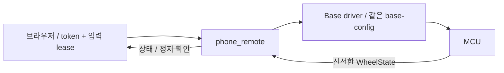
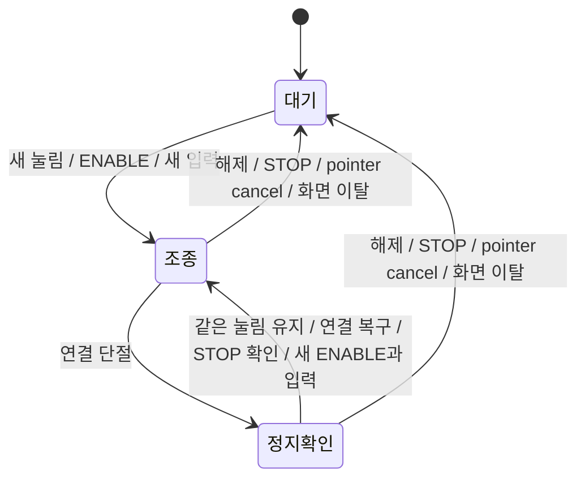
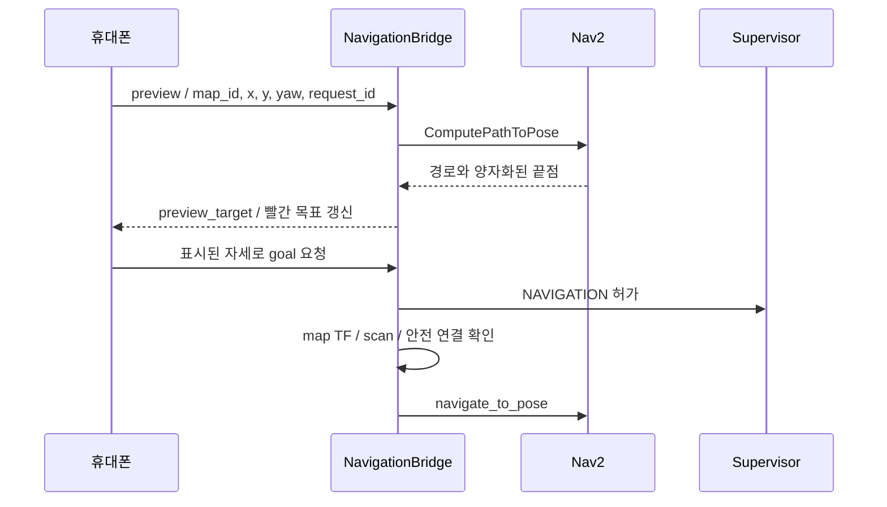
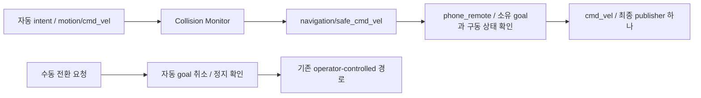

# 휴대폰 조종과 자동 주행 인터페이스

`phone_remote`는 브라우저 입력을 base driver에 전달합니다. MCU 휠 명령은 발행하지 않으며 단일 브라우저가 입력 lease를 소유합니다.

## 수동 조종과 ROS 연결

| 종류 | 기본 이름 | 타입 / 계약 |
|---|---|---|
| 발행 | `cmd_vel` | Twist, 50 Hz 상한; driver 축별 / 휠 상한 적용 |
| 구독 | `base/wheel_state` | WheelState, SensorData QoS; 신선한 MCU 응답으로 상태 판정 |
| 호출 | `base/set_enabled` | SetBaseEnabled; 순서 있는 허가 요청, 응답만으로 구동 완료 판정 금지 |
| 제공 | `teleop/pause` | SetBool; true는 입력 차단 + STOP, false는 차단 해제만 |
| 발행 | `teleop/status` | TeleopStatus, Reliable depth 10; ready / pause / 연결 / 정지 / boot |
| 구독 | `mapping/status` | MappingStatus, Reliable / Transient Local depth 1 |
| 호출 | `mapping/control` | MappingControl; 인증된 초기화 전달 |

| 수동 입력 조건 | 동작 |
|---|---|
| 갱신 / 만료 | 70 ms / 250 ms |
| Publisher 단일성 | `base/wheel_command`와 `cmd_vel` 각각 하나여야 허용 |
| 설정 | `--base-config`는 실행 driver와 동일 |
| 속도 해석 | UI 최대 휠 속도는 의도 상한, 실제 전송 목표는 MCU `target_rad_s` |

서버 재시작은 이전 lease를 복원하지 않고 눌림 없이 ENABLE하지 않습니다. `commission_wheels`는 protocol-v2 독립 시험 CLI이므로 base driver와 동시에 실행하지 않습니다.

### 전후진과 회전만 허용하기

| 항목 | 방법 / 의미 |
|---|---|
| 설정 파일 | `--token-file`과 같은 디렉터리의 `teleop-motion.json` |
| 활성 | `{"forward_only": true}` 저장 후 조종 서버 재시작 |
| 복원 | false 또는 파일 없음 + 재시작 |
| 허용 | 전후 스틱, 회전 스틱과 a/d 키 |
| 차단 | UI 횡이동 숨김, 서버도 횡이동 / 대각 명령 거부 |
| 상태 | `GET /api/status`의 `forward_only` |

키 이름은 forward_only지만 회전은 허용합니다. STOP·입력 만료·허가 검사는 유지하며 driver나 다른 controller는 변경하지 않습니다.

## Jetson 게임패드 입력

`gamepad_input`은 리시버의 XInput 보고서를 `/joy` (`sensor_msgs/Joy`, frame ID `leadjoy_xeno_plus`)에 발행합니다. 커널의 `MSC_TIMESTAMP` 표시가 있는 프레임을 사용합니다. 입력 시각은 evdev 이벤트 기준이며 장치 분리 또는 큐 손실 때는 빈 배열을 발행합니다. 축 0~5는 조종에 쓰는 LX, LY, LT, RX, RY, RT이고 축 6~9는 같은 보고서의 원본 LX, LY, RX, RY입니다. 버튼 순서는 A, B, X, Y, LB, RB, Back, Start, Guide, LS, RS입니다.

입력 노드는 모든 USB 보고서에서 LS와 RS의 각 축을 검사합니다. 움직이던 축이 중립대(±0.05)에 진입하거나 부호가 바뀌면 그 축의 출력을 0으로 두고 바로 발행합니다. 스틱 전체가 중립으로 돌아오면 두 축의 반동을 함께 거릅니다. 반동 중 방향이 바뀔 때마다 안정 시간을 다시 셉니다. 새 방향이 60 ms간 이어지면 그 방향을 반영하고, 중립이 60 ms간 이어지면 다음 조작부터 바로 반영합니다. 보통 보고서는 20 ms 간격으로 발행하며 버튼 전환도 즉시 발행합니다. 주행과 헤드 노드는 최초 시작 때 원본 축에서 중립을 한 번 확인합니다. 입력이 끊겼다가 돌아오면 복구 뒤 새로 수신한 보고서로 조종합니다.

`gamepad_teleop`은 중립을 확인한 뒤 왼쪽 스틱으로 병진 이동을, 오른쪽 스틱의 수평 축으로 회전을 요청합니다. 이동 의도가 사라지면 조종권을 즉시 해제합니다. LT(축 2)와 RT(축 5)는 왼쪽 스틱의 병진 속도를 선택합니다. 기준은 0~1 범위에서 0.5 이상이며 동시에 누르면 LT가 우선합니다. 기본 저속과 고속은 각각 0.1 m/s, 0.5 m/s입니다. 어댑터는 베이스 프로필의 휠 반지름과 축별 제한으로 이를 휠 속도로 환산합니다. 어댑터는 150 ms 이내의 실제 입력을 사용하며 이동 중에는 70 ms 간격으로 갱신을 요청합니다. 입력 처리는 중계 응답을 기다리지 않습니다. 조종권 확인 후 두 갱신까지 응답을 병행해서 기다리고, 만료된 갱신은 버린 뒤 최신 실제 입력을 보냅니다. 스틱 해제와 단절은 대기 중인 갱신을 건너뛰어 정지 요청을 보냅니다. 실제 입력 단절, 250 ms 동안의 조종권 갱신 실패 또는 주행 거부 시 정지합니다. 스틱을 기울인 채로 유지하면 새 보고서로 다시 조종권을 요청하고, 허가를 받은 뒤 현재 입력을 전달합니다. 휴대폰 서버에서 자동 주행 중이면 게임패드의 이동 요청을 거부하고 현재 목표를 유지합니다. Backend는 같은 사용자의 Unix 소켓에서 요청을 받아 수동 조종 허가를 확인하고 기존 서버에 전달합니다. `gamepad_press/update`는 같은 호스트의 단조 시각 만료를 확인합니다. `release`는 순번을 기록하고 해당 소유자의 조종만 해제합니다. 명령을 받을 수 없으면 기존 250 ms 입력 만료가 적용됩니다. [설치와 조종 방법](../../../../docs/implementation/how-to/gamepad.md)

`gamepad_head`는 같은 `/joy`의 RY(인덱스 4)를 헤드 틸트 속도로 변환합니다. 팬은 조향하지 않습니다. RS 중립에서는 현재 각도를 유지합니다. 150 ms가 지난 입력은 만료됩니다. 새 RS 보고서가 도착하면 현재 스틱 위치로 조향을 재개합니다. 서보 ID 13과 14의 레지스터 범위를 `head_preview_joints.json`의 실측 범위와 대조합니다. 편향을 받은 축만 현재 위치에서 토크를 켭니다. 틸트 최고속도는 30°/s로 제한하며, 수직 축의 최대 편향에서 목표각과 서보에는 341 tick/s(약 29.97°/s)를 적용합니다. 실측 팬과 틸트 각도(rad)를 `/head/joint_states` (`sensor_msgs/JointState`)로 발행합니다. 종료 시 해당 축의 토크를 해제하고 기존 RAM 설정을 복원합니다.

헤드는 best effort, depth 1로 최신 RS 보고서를 구독합니다. 운전 중 서보의 실측 위치가 범위를 벗어나거나 상태 레지스터가 0이 아니거나 온도가 50 °C 이상이면 조향 중지 사유와 측정값을 기록하고 소유한 토크를 해제합니다. 두 축에서 1초간 정상 판독이 이어진 뒤 새 RS 중립 입력을 받아야 다시 조향할 수 있습니다.

## HTTP와 인증

| HTTP | 계약 |
|---|---|
| `GET /`, `/assets/` | 설치 shadcn UI; asset 디렉터리 밖 파일 제공 안 함 |
| `GET /api/status` | X-Control-Token 필수; 목표 / 측정 속도 / PWM / 진단 / 최근 정지 사유 |
| `POST /api/control` | Token + 동일 Origin + ui_version=2 + client + 증가 sequence |
| `GET /api/mapping/status` | Token 필수 |
| `POST /api/reset` | Token + 동일 Origin + request_id; 202는 접수, running이 완료 |

Token은 `#token=...`에서 읽고 저장하지 않습니다. STOP도 인증합니다. Stale 요청 409는 통신 단절과 구분하고, 초기화 응답 지연은 같은 request_id로 재시도합니다.

| UI 갱신 | 동작 |
|---|---|
| `/` 요청 | 현재 index.html을 매번 읽어 새 해시 asset 반영 |
| 파일 교체 중 entrypoint 없음 | 503 |
| UI / asset 캐시 | no-store |
| HTTP LAN | Secure-context 전용 API에 의존하지 않는 요청 ID로 목적지 선택 / 이동 지원 |

## 진단 상태와 이벤트 기록

| 상태 필드 | 해석 |
|---|---|
| Mapping `status_age_ms`, `connected` | 마지막 ROS heartbeat 기준; HTTP 연결 유지와 구분 |
| `--mapping-status-timeout` | 기본 1 s 초과 시 phase=unavailable; 마지막 경로 / ID와 last_phase 보존 |
| `permission` | 요청 단계, client, request_sequence, 응답 boot_id / command_sequence |
| `last_permission_error` | 마지막 RPC 거절 / 예외의 code, reason, exception_type, traceback; 다음 요청 뒤에도 보존 |
| MCU 대기 / boot 불일치 | `mcu_ack_pending` / `mcu_boot_mismatch` |
| `event_log` | 경로, 저장 / 누락 수, 마지막 저장 오류 |
| `event_sink_error` | 이벤트 전달 자체의 예외 |

| JSONL 기록 | 계약 |
|---|---|
| 행 식별 | UTC, 단조 시각 at, run_id, 증가 event_id, PID와 요청 문맥 |
| 쓰기 | 별도 스레드; 큐 포화 / 저장 실패가 조종 루프를 막지 않음 |
| 직접 실행 기본 | `~/.local/state/cleany/teleop/events.jsonl` (`--event-log`) |
| 통합 launch | state_root의 `teleop-events.jsonl` |
| 회전 | 기본 2 MB, 백업 3개; `--event-log-max-bytes`, `--event-log-backups` |
| 한계 | 강제 종료 / 디스크 장애 / 큐 포화 시 누락 가능; 장기 보관 보장 아님 |

## 지도 클릭 주행 (명시적 선택)

`phone_remote --navigation`은 일반 수동 조종과 별도 선택입니다. 수락한 자동 목표는 화면 잠금·앱 전환 중에도 Supervisor와 센서 감시 아래 계속 실행됩니다. 수동 조종은 기존 입력 만료와 화면 이탈 정지를 유지합니다.

| HTTP | 입력 / 결과 |
|---|---|
| GET `/api/navigation/map`, `/status` | Token으로 보호된 지도 / 상태 |
| POST `/api/navigation/{initial-pose,goal,cancel,heartbeat}` | 기존 Origin / token 검사 |
| Goal | map_id, x/y(m), yaw(rad), request_id |
| Initial pose | 정지 상태에서만 설정; preview 양자화 변환 미적용 |
| Preview | ComputePathToPose만 호출; lease 취득 / ENABLE / 속도 발행 없음 |
| Preview 상태 | preview_request_id, phase, path, error, target(x/y/yaw) |
| Preview 무효화 | 목적지 / 지도 변경, 취소, 이동 시작; 늦은 응답은 generation으로 제외 |

도착 판정은 표시된 목표의 3 cm / 0.1 rad를 유지합니다. 초기 위치 설정과 수동 조종이 가능하더라도 자동 목표에는 새 위치 정합과 새 Supervisor 허가가 필요합니다.

### 자동 속도와 정지 경로

| 프로필 / 제한 | 값 |
|---|---|
| 하드웨어 Omni | `forward_only=false`, Omni MPPI; body +Y 좌측 이동 허용 |
| Longitudinal | 횡이동 차단 유지 |
| 자동 MPPI 상한 | 병진 합성 0.5 m/s, 회전 0.7 rad/s |
| 주황 영역 | 병진 0.16 m/s, 회전 0.3 rad/s |
| 최종 휠 상한 | `phone_navigation.yaml`의 `navigation.max_wheel_rad_s=10` |
| 혼합 명령 | 네 휠 최대 절댓값으로 같은 비율 축소; 작은 요청을 키우지 않음 |

실물 자동 주행은 별도 통합 검증 대상입니다. Plugin 로딩이나 mock 통과가 실물 구동 증거는 아닙니다.

### 실물 미션 주행

검증된 목표 파일과 점유 격자 revision을 지정하면 기존 주행 서버가 `navigation/drive_mission_target` Action을 제공한다. 좌석 ID 또는 `home`을 로컬 목표 파일에서 해석한다. 요청 digest, 현재 map revision, 원 미션의 `MOBILE_MANIPULATION` lease ID, epoch와 version이 일치해야 출발할 수 있다. 이 Action은 기존 Nav2 및 MCU 명령 소유자를 사용한다. 완료에는 Nav2 종료, MCU 정지 응답과 네 바퀴의 최근 정지 피드백이 필요하다. 미션 소유 중과 허가 회수 후 정지 확인 전에는 수동 이동을 차단하며 STOP은 받는다. 발행 시각이 오래된 Supervisor 상태로는 수동 이동을 열지 않는다.

### ROS 연결과 재기동 후 정지

| 방향 | Endpoint / 계약 |
|---|---|
| 구독 | `/map` OccupancyGrid transient-local, `/plan` Path reliable/volatile, `/scan` LaserScan, `/odom` Odometry, `/nav2/cmd_vel` Twist |
| 발행 / Action | `/initialpose`, `navigate_to_pose`, 기존 NAVIGATION lease |
| 정지 Action | `navigation/stop` StopMission; 소유 session의 epoch/lease 검증, MCU STOP 확인 뒤 성공 |
| 공통 제어 | 일반 조종과 자동 주행이 같은 DriverControl 사용 |
| 허가 전 연결 | Fresh map TF/scan, 안전 입력 subscriber, 단일 최종 publisher |

| 재기동 idle bridge | 처리 |
|---|---|
| 현재 epoch의 이전 lease 정지 요청 | 목표나 새 허가 없이 STOP 수락 |
| stopped 근거 | 신선한 MCU ACK, 휠 속도 < 0.05 rad/s, 출력 정지, 진행 중 goal 전송 / 취소 완료 |
| 다른 epoch / 새 목표와 무관한 lease | 거부 |
| STOP 응답 boot_id=0 | 실제 feedback 뒤 새 STOP; 0을 ACK로 인정하거나 ENABLE로 복구하지 않음 |

### 주행 상태 표시

| 상태 | 출처 / 처리 |
|---|---|
| `slip`, `traction_recovery` | navigation/slip, navigation/traction_recovery의 String JSON; 표시용이며 권한 추가 없음 |
| `localization` | localization/status String; 정합 미확인으로 허가 거부 시 이유 표시 |
| `tf_error` | 마지막 TF 조회 오류; 정상 새 TF에서 해제. 예상 밖 처리 오류는 위치를 즉시 무효화하고 5 s 간격 제한 오류 로그 출력 |
| `last_input_failure` | 센서 지연 취소의 입력별 수신 나이; event log의 navigation_input_failure와 함께 정지 뒤에도 보존 |
| 파란 전역 경로 | `/plan`의 유한한 map-좌표계 점; 빈 경로 / 지도 변경 / 새 목표 / 취소 시 제거 |
| 경로 상태 | global_path_topic, global_path_points, global_path_age_s; 없으면 “경로 생성 대기” |

Subscription 변경은 기존 서버 프로세스에 자동 반영되지 않으므로 코드 반영 뒤 서버를 재실행합니다.
